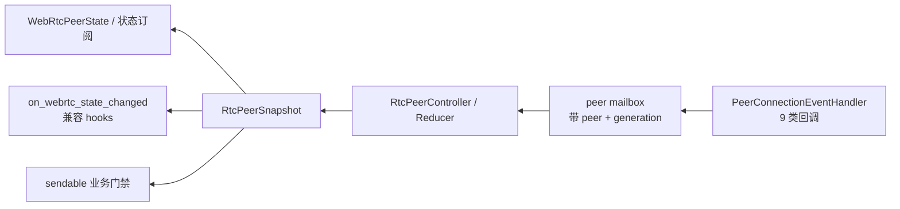
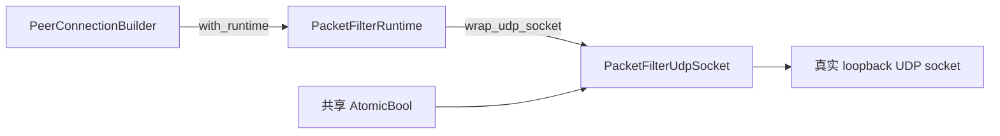
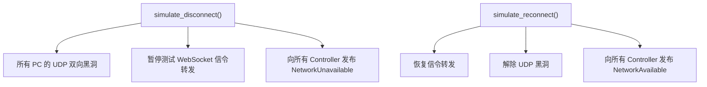
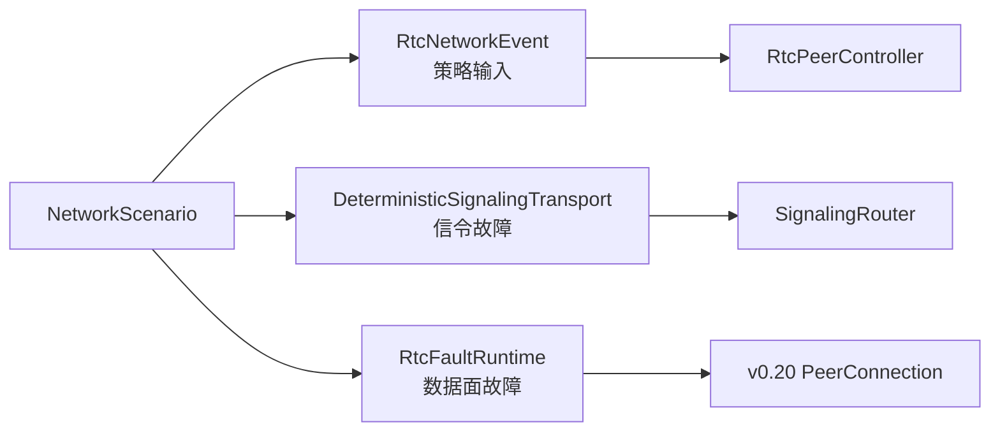

# Actr 基于 webrtc-rs v0.20 的分层测试与网络验证方案

状态：Implemented（Rust T3 阶段；T4/T5/T6 仍由系统/设备门禁推进）

日期：2026-08-11

基线分支：`worktree-webrtc-v020-arch`

基线提交：`69df070622d3`
实际依赖：`webrtc = 0.20.1`、`rtc = 0.20.1`、`rtc-rtp = 0.20.1`

> 本文中的“v0.20”指 webrtc-rs v0.20 API 线。当前升级分支使用的是
> v0.20.1，而不是精确的 v0.20.0。测试设计以当前实际依赖为准，同时
> 适用于 v0.20.0 → v0.20.1 之间未改变的公开 API。

关联文档：

- [架构 RFC](../rfcs/0504-webrtc-v020-rtc-controller-architecture.md)
- [T1/T2/T3 测试契约](webrtc-v020-test-contract.md)
- [恢复测试与发布门禁](webrtc-v020-recovery-test-plan.md)
- [Runtime 时钟能力跟踪](webrtc-v020-clock-patch-tracking.md)
- [移动端双端 WebRTC 连接、生命周期与网络恢复测试方案](webrtc-v020-mobile-integration-test-design.zh.md)

---

## 1. 结论

升级分支已经具备比较完整的 WebRTC 单元测试、真实 PeerConnection
互通测试和 Actr 集成测试，但“网络测试”目前主要验证的是：

1. 在真实 loopback UDP socket 上对所有 PeerConnection 统一做双向黑洞；
2. 同时暂停测试 WebSocket 信令转发；
3. 同时向所有 `RtcPeerController` 发布网络不可用/恢复事件；
4. 验证 ICE Restart、Hard Recovery、业务请求和状态通知最终收敛。

这能验证“全网断开 → 恢复”的端到端流程，但还不能等价于真实网络实验室。
它不覆盖单连接隔离、单向丢包、按比例丢包、时延/抖动/乱序、MTU、带宽、
NAT 重绑定、真实地址切换等场景。当前 `with_vnet()` 也是兼容旧测试命名的
门面，并非 v0.20 PeerConnection 真正运行在 `webrtc-util::vnet` 中。

目标方案采用七层验证：

- T0：协议编码与纯函数；
- T1：Controller/Reducer 确定性恢复策略；
- T2：v0.20 高层 API 与真实 loopback PeerConnection；
- T2.5：可选的 `rtc` Sans-I/O 协议实验室；
- T3：完整 Actr 生产链路集成；
- T4：Linux netns/`tc netem`/NAT/Actrix TURN 系统网络；
- T5/T6：移动端 E2E 与多连接规模/长稳测试。

本分支已经把全局丢包开关扩展为“每个远端 peer、每个方向、每个
`pc_generation` 独立”的 `DirectedRtcFaultRegistry`。一个 Actr 管理多个
PeerConnection 时，可以只破坏 A→B，而不影响 A→C/A→D。

---

## 2. 测试目标与原则

### 2.1 目标

测试必须能够回答以下问题：

1. v0.20 新 API 是否按 Actr 约定被正确调用和消费？
2. 每个 `RtcPeerController` 是否只管理一个远端 peer，并隔离不同连接？
3. 网络故障发生时，公开状态和业务发送资格是否先于业务错误正确变化？
4. Soft Recovery、Hard Recovery、关闭和重建是否按 generation 规则收敛？
5. 故障恢复后，RPC、流、分片大消息和媒体是否仍能正确传输？
6. 旧版本集成测试表达的业务语义是否得到等价保留？
7. 连接关闭后，任务、socket、DataChannel buffer 和 pending request 是否释放？

### 2.2 原则

- 生产只有一条 WebRTC 路径。测试不得引入第二套 PeerConnection 实现或
  第二套状态机。
- 老测试优先保留原场景、输入、断言和业务语义，只替换 v0.20 不再支持的
  fixture/注入方式。
- 恢复策略放在 T1 确定性测试；真实协议机制放在 T2/T3；真实网络行为放在
  T4/T5。不要在昂贵层重复穷举纯状态组合。
- 业务是否可发送只认公开 `WebRtcPeerState.sendable`，不能把 ICE Connected、
  PeerConnection Connected 或某个 DataChannel Open 单独当作业务就绪。
- 任何网络用例都必须覆盖“注入前、故障中、恢复后、关闭后”四个阶段。
- 不依赖固定 `sleep` 判断状态；使用 snapshot/watch、明确的条件等待和总超时。
- 每个故障用例记录随机种子、peer、generation、故障方向和故障配置，以便重放。

### 2.3 不在本方案中重复验证的内容

- webrtc-rs 自身所有 ICE/DTLS/SCTP/RTP 算法的内部正确性；
- 每一个浏览器或每一家 TURN 服务商的兼容性；
- stock v0.20 高层 PeerConnection driver 的全虚拟时间重放。

这些由上游测试、可选互操作门禁或单独的系统实验负责。Actr 只锁定自己的
适配契约、控制策略、业务语义和生产链路。

---

## 3. 当前生产链路与测试观察点

### 3.1 一条生产链路

下面这张图只描述“业务消息如何走到一个远端 PeerConnection”。一个 Actr
连接多个远端时，图中从 `RtcPeerController` 开始的部分会按 peer 重复。


v0.20 的事件从 PeerConnection 反向进入同一个 Controller，再由 Controller
生成唯一可信的状态：



### 3.2 v0.20 API 的现有采用与对应测试

| v0.20 能力 | Actr 用法 | 当前验证位置 |
| --- | --- | --- |
| `PeerConnectionBuilder::with_handler` | build 前注入每 generation 一个统一 Handler | `validation_tests`、`event_handler.rs`、Controller 测试 |
| `PeerConnectionEventHandler` | 映射连接、ICE、信令、candidate、DataChannel、Track、renegotiation 共 9 类回调 | `validation_tests`、`notification_tests` |
| `PeerConnectionBuilder::with_runtime` | 注入生产 Runtime 或测试 Runtime wrapper | `factory_tests`、`fault_tests`、集成 harness |
| `Runtime::wrap_udp_socket` | 包装 v0.20 自己创建的 UDP socket，实现黑洞和指标 | `test_runtime.rs`、`fault.rs` |
| `PeerConnection::restart_ice` | Soft Recovery | reducer/controller、ICE restart 集成测试 |
| `PeerConnection::set_configuration` | TURN 凭据轮换 | `turn_credential_rotation.rs` |
| `PeerConnection::get_stats` | 解析 direct/relayed path，不阻塞 sendable | `stats_tests`、`interop_tests` |
| `PeerConnection::close` | generation 所有者显式关闭 | session/controller/close race 测试 |
| `DataChannel::poll` | 每个 DataChannel 唯一消费泵 | lane/data/media 相关测试 |
| `writable`、`try_send`、`outstanding_bytes` | 背压和有界发送 | `validation_tests`、`send_tests`、大消息测试 |
| `TrackRemote::poll`、sender/track API | 远端媒体、发送和重协商 | `media_tests`、`media_loopback.rs` |

---

## 4. 已有 WebRTC 测试盘点

以下数量是基线提交上的 `#[test]`/`#[tokio::test]` 静态标注数，用于衡量
用例结构，不等同于 nextest 最终执行条目，也不表示每个共享 transport 测试
只覆盖 WebRTC。

### 4.1 v0.20 模块内测试

`core/hyper/src/wire/webrtc/v020` 下共 236 个测试标注，且没有 `#[ignore]`：

| 领域 | 数量 | 主要内容 |
| --- | ---: | --- |
| Controller/Reducer/状态机 | 110 | role/glare、ICE generation/ufrag、stale event、关闭竞态、软/硬恢复、重协商、恢复预算 |
| Manager/恢复/通知/状态 | 42 | 多 peer 管理、状态订阅、Hook 投影、恢复监督、公开状态 |
| v0.20 API/真实 PC/fault/stats | 31 | offer/answer、真实 DataChannel、Handler、Runtime 注入、UDP 黑洞、统计信息 |
| 数据/媒体/资源 | 39 | 四条 lane、分片/重组、背压、Track、资源预算、发送门禁 |
| 信令 adapter | 14 | router、WebSocket transport、队列/重连 |
| **合计** | **236** | |

其中直接使用真实 v0.20 PeerConnection 的重点测试包括：

- `validation_tests`：真实 offer/answer/双向关闭、DataChannel 背压、9 类 Handler
  事件、factory codec/interceptor 配置；
- `interop_tests`：offerer/answerer、glare、多 peer 隔离、关闭重连、四条 lane、
  stats、媒体 sample；
- `wiring_tests`：完整生产 wiring 下的 RPC、DataChunk、多分片；
- `fault_tests`：Runtime 注入到真实 PC、UDP 黑洞/恢复、TCP 失败、task kill、
  信令 drop/delay/duplicate/partition。

### 4.2 共享单元测试

| 位置 | 数量 | 说明 |
| --- | ---: | --- |
| `wire/webrtc/signaling_tests.rs` | 64 | WebRTC 信令协议、序列化和兼容约束 |
| `network_event_tests.rs` + `recovery_supervisor_tests.rs` | 73 | 网络事件去抖、生命周期事件、恢复广播 |
| transport 共享模块 | 127 | dest/host/lane/peer/route/wire builder/wire pool；部分同时覆盖 WebSocket |

### 4.3 已有集成测试

| 领域 | 测试文件 | 静态测试数 | 现有覆盖 |
| --- | --- | ---: | --- |
| ICE/连接/陈旧连接 | `ice_restart*`、`outproc_*reconnect*`、`stale_*`、`webrtc_initial_connection_timeout` | 50 | 初连、断连、ICE restart、连接重建、stale callback/transport |
| 网络与移动恢复 | `network_event_*`、`recovery_vnet_supervisor`、`mobile_*`、`webrtc_large_mobile_recovery` | 67 | 去抖、offline/online、前后台、移动场景、大消息在途恢复 |
| 数据/媒体/TURN/trace | `webrtc_large_data_transfer`、`media_loopback`、`turn_credential_rotation`、`trace_propagation` | 21 | 1 MiB、媒体、relay-only TURN、凭据轮换、trace |
| 重试/资源/业务契约 | `retry_*`、`recovery_invariant_resources`、`recovery_invariants`、`recovery_backoff`、`cleanup_during_request` | 67 | 重试、去重、恢复预算、pending/资源释放 |

还存在 `signaling_reconnect`、`signaling_pending_replies`、`package_hooks`、
`node_start_smoke` 和 credential renewal 等共享场景。整个 integration tests
目录当前有 12 个 `#[ignore]` 标注，其中约 10 个与 RTC、网络恢复或资源压力
有关；这些不能计入常规 PR 门禁的有效覆盖。

### 4.4 当前 CI 执行方式

| 门禁 | 当前命令/环境 | 实际作用 |
| --- | --- | --- |
| WebRTC v0.20 job | `cargo test -p actr-hyper --features webrtc-v020 --lib v020::` | 直接门禁 236 个 v0.20 lib 测试，并执行 check/clippy |
| Rust workspace job | `cargo nextest run --workspace --all-features --no-fail-fast` | 执行非 ignore 的集成测试；integration test 最多重试 2 次 |
| Nightly E2E | Swift simulator、Kotlin Android emulator 等 | 应用启动、echo、部分前后台恢复；不是 PR 必跑 |

基线 CI run `31377042120` 全部 job 通过，但 nextest 报告过一个真实 flaky：
`webrtc_large_mobile_recovery` 的 interruption 矩阵（拆分前的单个巨型测试）
第一次失败、重试后通过并耗时约 85 秒。说明“绿灯”不等于网络套件完全稳定；
重试必须作为可观测的技术债，而不是正确性的替代品。

---

## 5. 升级到 v0.20 后，当前网络测试究竟怎么工作

### 5.1 `TestHarness::with_vnet()` 的真实数据路径

v0.20 不再使用旧测试中 `SettingEngine::set_vnet()` 一类的 socket provider
注入。当前测试保留了 `VNetPair` 名称和对象，但 PeerConnection 的实际 UDP
socket 由 v0.20 创建，并运行在本机 loopback；`VNetPair` 中创建的
`webrtc-util::vnet::Net/Router` 没有接入这些 PeerConnection。

真正生效的是：



当共享开关为 blocked 时：

- `poll_send` 返回成功，但不向底层发送 datagram；
- `poll_recv` 把已经收到的 datagram 丢弃并保持 Pending；
- 所有通过该 harness 创建的 PeerConnection 共享同一个开关。

因此它是“在 v0.20 Runtime 边界实现的全局 UDP 黑洞”，不是完整虚拟网络。

### 5.2 断网与恢复的组合动作



这一组合很接近“设备彻底离线/重新上线”，但它同时改变了数据面、信令面和
策略输入，无法用来区分某一个机制单独失效时的行为。

### 5.3 当前能证明什么

- 使用的是完整生产链路，不是直接调用测试专用 PeerConnection；
- v0.20 Runtime wrapper 确实位于 PeerConnection 的 UDP socket 下方；
- Controller 能接收网络事实、Handler 事件，并执行 ICE Restart/重建；
- `sendable`、状态通知、业务 RPC/大消息能够经历断开和恢复；
- 全部连接同时掉线时，Manager/Controller 基本可以收敛；
- WebSocket 信令断开与 WebRTC 数据面断开共同发生时能够恢复。

### 5.4 当前不能证明什么

- 只破坏一个 peer 而其他 peer 完全不受影响；
- 单向断网、只断 UDP、只断信令或只丢某类信令消息；
- 1%/5%/20% 丢包、固定时延、抖动、乱序、重复、限速、MTU；
- NAT mapping 失效、NAT rebinding、IP/网卡真实变化；
- TURN/TCP/TLS 与 direct UDP 在真实系统网络中的差异；
- Android/iOS 真正切换 Wi-Fi/蜂窝/飞行模式后的平台事件和 socket 行为；
- stock v0.20 driver 的确定性虚拟时间推进。

### 5.5 已有但尚未统一使用的 fault seam

- `RuntimeFaultProbe`：已支持 UDP blackhole、TCP connect fail、task kill 和
  边界指标，并已证明能通过 `with_runtime` 进入真实 PC build；
- `DeterministicNetwork`：已支持信令 drop/delay/duplicate/partition，但主要
  用于自身 seam 测试，尚未进入主 T3 harness；
- `ManualPolicyClock`：能确定性驱动 Actr T1 策略 deadline；v0.20.1 的
  `Runtime` 没有 `now()`，不能据此宣称整个 PeerConnection driver 使用虚拟时间。

---

## 6. 目标分层测试架构

### 6.1 分层职责

| 层 | Fixture/环境 | 必须证明 | 不在该层证明 |
| --- | --- | --- | --- |
| T0 Wire | codec、lane 映射、纯函数 | 兼容编码、分片、边界值、稳定标签 | PeerConnection 与网络 |
| T1 Policy | Reducer、Controller、fake effect port、`ManualPolicyClock` | 状态转移、generation、恢复预算、stale 拒绝、Hook 投影 | v0.20 协议机制 |
| T2 v0.20 API | 真实 loopback PC、真实 Handler/Runtime/DataChannel/Track | Actr 对 v0.20 API 的适配契约 | Manager/业务全链路、真实 NAT |
| T2.5 Sans-I/O | `rtc 0.20.1` 协议 rig，可选 | packet 级可重放实验、特定协议回归 | 生产 backend、业务状态机 |
| T3 Actr 集成 | `TestHarness` + 完整 Manager/Controller/Runner + 真实 WS/PC | 业务发送、状态通知、恢复、多个 peer 隔离 | 真实系统路由/NAT |
| T4 系统网络 | Linux netns、`tc netem`、nftables、Actrix TURN | loss/jitter/reorder/MTU/NAT/relay 的真实 socket 行为 | 移动 OS 生命周期 |
| T5 平台 E2E | Android/iOS emulator/device | 系统网络事件、前后台、公开 hook/订阅、业务恢复 | 大规模并发 |
| T6 Scale/Soak | 多 peer、长稳、资源监控 | 恢复风暴、限流、FD/内存/task 泄漏 | 每次 PR 的快速反馈 |

### 6.2 为什么需要 T2.5，但不能让它成为生产实现

`rtc 0.20.1` 提供 Sans-I/O 分层，可以让测试精确喂入 packet/event 并观察
协议输出，适合验证某个 ICE/SCTP/RTP 边界或重放上游问题。但 Actr 生产路径
仍必须使用 `webrtc 0.20.x` 高层 PeerConnection；T2.5 不能复制
`RtcPeerController`、不能生成另一套 `sendable`、也不能代替 T2/T3。

建议只在满足以下条件时增加 T2.5 用例：

- 问题必须在 packet/event 级才能稳定复现；
- 上游高层 API 测试无法定位根因；
- 用例能够固定输入、输出和随机种子；
- 同一业务语义仍有 T2 或 T3 验证。

---

## 7. 目标网络故障注入设计

### 7.1 一个场景控制三类输入



三类输入必须可以独立开关。只有“整机离线”场景才同时切断三者。

### 7.2 合并 Runtime fault 实现

将当前 `PacketFilterRuntime` 和 `RuntimeFaultProbe` 合并为一个测试专用
`RtcFaultRuntime`，继续通过 v0.20 正式提供的
`PeerConnectionBuilder::with_runtime` 注入。

建议测试接口表达以下概念：

```rust,ignore
struct FaultScope {
    local_peer: ActrId,
    remote_peer: ActrId,
    pc_generation: u64,
}

struct FaultProfile {
    outbound: PacketRule,
    inbound: PacketRule,
    tcp_connect: ConnectRule,
    task: TaskRule,
    seed: u64,
}

enum PacketRule {
    Pass,
    Blackhole,
    DropEvery(u32),
    Delay(Duration),
    DeterministicLoss { percent: u8 },
}
```

第一阶段不必在 Runtime 内实现所有 netem 能力。Runtime 层优先实现可移植且
稳定的 `Pass/Blackhole/DropEvery/Delay`；复杂 jitter/reorder/MTU/rate/NAT
放到 T4 的 `tc netem`/netns。

### 7.3 多 PeerConnection 的隔离规则

一个 Actr 管理多个连接时，禁止再使用 process-wide 或 harness-wide 的单个
`AtomicBool`：

- factory 创建 session 时，以 `(local_peer, remote_peer, pc_generation)` 创建
  独立 `FaultHandle`；
- harness 通过 peer pair 查询和修改对应 handle；
- Soft Recovery 保持同一个 `pc_generation` 和同一个 handle；
- Hard Recovery 创建新 generation、新 handle；是否继承故障 profile 由场景
  显式决定，不能隐式沿用；
- close 后 handle 必须从 registry 移除；旧 generation handle 再触发故障不得
  影响新连接；
- 运行时指标必须带测试内部的 scope，但不能把高基数 peer ID 带入生产指标。

### 7.4 信令故障必须按 link 和消息类型控制

把 `DeterministicNetwork` 接入 `TestHarness` 的 signaling transport，至少支持：

- A→B、B→A 单向或双向；
- Offer、Answer、ICE Candidate、ICE Restart request/response 分类型；
- 第 N 条 drop、duplicate、delay、reorder；
- 有界 partition 与 heal；
- 固定 seed 和命中计数。

这样可以区分“UDP 通，信令坏”“信令通，UDP 坏”和“整机离线”三种恢复路径。

### 7.5 兼容迁移

- 新 API 命名为 `with_fault_network()`、`disconnect_peer(a, b)`、
  `restore_peer(a, b)`；
- `with_vnet()` 保留一个兼容周期，但内部转调新 fixture，并标记 deprecated；
- 旧测试只做必要调用适配，不改变原先时序、业务请求和断言；
- 旧 `VNetPair` 中没有进入 PC 数据路径的 `Net/Router` 最终删除，避免测试名称
  继续暗示不存在的能力。

---

## 8. 每个网络恢复用例的统一验证模板

所有 T3/T4/T5 网络用例至少执行以下步骤：

1. 建立两个或多个 peer，等待双方 `sendable=true`；
2. 双向发送基线 RPC，确认测试不是在坏连接上开始；
3. 记录 `pc_generation`、snapshot `revision`、lane 数和 pending request 数；
4. 注入单一故障，除“整机离线”场景外不要同时改变多个故障面；
5. 等待公开状态变化，验证 `sendable=false` 和正确的
   `unavailable_reason/status`；
6. 故障期间的新业务发送必须有界失败或按明确契约排队，不能无限 await；
7. 验证预期恢复路径：
   - Soft Recovery：`pc_generation` 不变，ICE generation/restart count 增加；
   - Hard Recovery：`pc_generation` 严格增加，旧 generation 事件被拒绝；
8. 解除故障，等待双方重新 `sendable=true`；
9. 双向验证 RPC、DataChunk 和多分片大消息内容完整性；媒体场景再验证 track；
10. 验证状态订阅立即回放、`revision` 单调、Hook 顺序和重复抑制；
11. 关闭 peer/全部连接，验证 Controller、session、PC、lane、pending 和 socket
    在总 deadline 内收敛；
12. 输出 seed、fault profile、peer/generation 和关键状态时间线。

### 8.1 业务状态断言

`WebRtcPeerState` 是上层业务测试的唯一观察面：

| 字段 | 必须验证的语义 |
| --- | --- |
| `peer` | 事件属于正确远端，不能串到其他连接 |
| `pc_generation` | 仅 Hard Recovery/rebuild 增长；同代 stale event 不得越权 |
| `revision` | 每 peer 单调增长；订阅者可去重；首次订阅立即收到最新值 |
| `status` | `Idle/Connecting/Connected/Recovering` 与 Controller 状态一致 |
| `sendable` | 业务准入唯一依据；false 时发送有界失败，true 后才宣布恢复 |
| `network_path` | stats 异步解析 direct/relayed；Unknown 不阻塞 sendable |
| `unavailable_reason` | 使用稳定枚举，不泄漏底层字符串 |

同时验证 `on_webrtc_state_changed` 与状态订阅看到相同 snapshot，并保留
`on_webrtc_connecting/connected/disconnected` 兼容 Hook 的边沿语义。

---

## 9. 网络与恢复场景矩阵

“现状”表示基线分支是否已有有效覆盖，不代表目标层已经完善。

| ID | 场景 | 目标层/故障面 | 核心断言 | 现状与动作 |
| --- | --- | --- | --- | --- |
| N01 | 直连初连 + 双向 RPC/DataChunk | T2/T3 | 双方 sendable；四 lane；数据完整 | 已覆盖，保留为 smoke |
| N02 | 全部 UDP 双向黑洞后恢复 | T3 Runtime | false→Recovering→true；Soft/Hard 有界 | 已覆盖，但当前是全局开关 |
| N03 | 仅一个 peer 的 UDP 黑洞 | T3 per-link Runtime | A-B 恢复；A-C generation/state/流量不变 | 已实现：MP01 |
| N04 | 单向 UDP 黑洞 | T3 Runtime | 双端状态可能不同但最终收敛；无永久半开 | 已实现：direction-aware fault seam 与 pair 场景 |
| N05 | 固定丢包/时延 | T3 Runtime | 低损不误重建；高损按预算升级 | 部分 seam，未进主 harness |
| N06 | jitter/reorder/限速/MTU | T4 netem | 业务 deadline、背压、恢复行为符合契约 | 缺失 |
| N07 | 仅信令 partition | T3 signaling | 已建数据面不被误杀；需要协商时有界恢复 | 已实现：P11/P12/MP04 |
| N08 | Offer/Answer/Candidate drop/duplicate/delay | T1/T2/T3 signaling | 单 attempt 覆盖 role/build/SDP/ICE/readiness deadline；失败后 WirePool 重试使用新 transport epoch 和新 PC generation；Answerer 发起重试时，被动 Offerer 根据新的 Offerer assignment 立即替换未就绪 PC 并重发 Offer；glare/stale/ufrag 规则不被破坏 | 已覆盖精确 deadline、发送方分别为 Offerer/Answerer 时前两次 build 失败、双方 generation 1→2→3、第三次真实 PC 成功及消息单次投递；完整组合矩阵进入 nightly |
| N09 | 短时离线后原连接恢复 | T3 | 优先 Soft；generation 不变；原请求语义明确 | 已覆盖，存在 flaky，需拆分稳定化 |
| N10 | 长时离线导致重建 | T3 | 恢复预算耗尽后 Hard；generation 增长一次 | 已覆盖，补精确计数 |
| N11 | 地址变化/Wi-Fi↔蜂窝 | T1 + T4/T5 | 立即失去 sendable；Hard rebuild；新地址生效 | 策略有覆盖，真实系统缺失 |
| N12 | NAT mapping 失效/rebinding | T4 netns/NAT | 新 candidate/path；旧五元组失效；业务恢复 | 缺失 |
| N13 | TURN relay-only 初连 | T3/T4 Actrix TURN | `network_path=Relayed`；业务正常 | 已有 Actrix TURN 集成，纳入 nightly |
| N14 | TURN 凭据轮换 | T3/T4 | `set_configuration` 成功不误断；失败转 Hard | 已覆盖，补系统级过期验证 |
| N15 | 大消息/请求在途断网 | T3 | 不损坏、不重复响应、pending 有界释放 | 已覆盖但 flaky，拆成独立参数用例 |
| N16 | DataChannel 背压与恢复 | T2/T3 | outstanding bytes 有界；false 时 fail-fast；恢复可写 | API 层已覆盖，补故障中业务层 |
| N17 | 媒体发送/Track/重协商中断 | T2/T3/T4 | track pump 单消费者；恢复后帧继续；无旧 track 串代 | 基础已有，网络矩阵不足 |
| N18 | 前台↔后台 | T1/T5 | 后台不宣称 sendable；回前台按策略恢复 | 策略和模拟器部分覆盖 |
| N19 | recovery/build/close 竞态 | T1/T3 | close barrier；late callback 不复活连接 | 单元较全，补全链路 fault 场景 |
| N20 | mailbox event storm/overflow | T1/T3 | 不阻塞 Handler；overflow 可观测并 Hard Recovery | 单元已有，集成恢复为常规门禁 |
| N21 | A 同时管理 B/C/D，单链路故障 | T3 | 只有目标 link 状态/generation 变化 | 已实现：MP01–MP06 |
| N22 | 所有 peer 同时恢复 | T3/T6 | BuildThrottle 有界；无 thundering herd；最终全收敛 | 策略部分已有，规模验证不足 |
| N23 | App/进程重启后的重连 | T5 | 公开 hook 序列完整；业务重新 sendable | E2E 部分覆盖 |
| N24 | 移动端通过公开 Hook/订阅控制发送 | T5 FFI | false 时 UI/业务停发；true 后恢复；字段映射一致 | synthetic mapping 已有，设备行为缺失 |

### 9.1 多连接最小必测拓扑

```text
           B
           |
           |
    C ---- A ---- D
```

A 管理 B、C、D 三个 `RtcPeerController`。至少验证：

1. 只切断 A-B，A-C/A-D 持续发送成功；
2. A-B Hard Recovery 只增加 B 对应的 `pc_generation`；
3. 关闭 B 不影响 C/D 的 Handler、lane 和状态订阅；
4. 同时切断三条连接时，build/recovery 并发不超过 `BuildThrottle`；
5. 恢复顺序不同不会造成路由串线或旧 generation 回调污染；
6. `close_all` 在某条信令仍 partition 时也能在总 deadline 内结束。

---

## 10. 确定性、超时与稳定性要求

### 10.1 时间控制

- T1 使用 `ManualPolicyClock`，恢复预算和 deadline 不读 wall clock；
- T2/T3 只对真实协议握手使用 wall clock，并设置一个场景总超时；
- 等待状态使用 watch/事件，不使用“睡 N 秒后猜测已经变化”；
- `tokio::time::sleep` 只允许出现在 fault 实现或总 watchdog，不作为正确性断言；
- 在 v0.20 Runtime 暂无 `now()` 之前，不宣称 PC driver 的 bit-exact 时间重放。

### 10.2 Flaky 管理

- deterministic T0/T1/T2 seam 测试重试数必须为 0；
- T3/T4/T5 若暂时保留 retry，CI 必须把 FLAKY 当作单独指标和告警；
- release gate 重试数为 0；
- 一个参数化大矩阵不要包装成单个 60–90 秒测试。每个场景独立命名、独立超时，
  失败时只重跑该场景；
- `test_mobile_inflight_large_message_interruptions` 已按 interruption 模式拆分为
  8 个独立测试（`test_mobile_*` / `test_mobile_inflight_*` 前缀），一次 flake 只
  重跑单场景，且每个测试都在 60 秒 SLOW 水位内；
- 每个失败输出最近 N 个 snapshot、generation、ICE restart count 和
  fault hits，而不是只输出“timeout”。

### 10.3 资源收敛

每个 fixture teardown 后至少检查：

- Manager peer count 为 0；
- Controller/session driver task 已 join 或按设计取消；
- 每个 PeerConnection 被 session owner 显式 `close()`；
- lane/resource registry 清空；
- pending request 回到 0；
- fault/signaling handle registry 无旧 generation；
- T4/T6 额外检查 FD、socket、task、RSS 不随迭代单调增长。

---

## 11. CI 与发布门禁设计

### 11.1 PR 门禁（目标 15 分钟内）

- T0/T1 全量，retry=0；
- v0.20 现有 236 个 lib 测试全量，retry=0；
- T2 clean pair、Handler 9 callbacks、DataChannel backpressure、Runtime
  injection、UDP blackhole/heal；
- T3 最小 smoke：初连、全断恢复、单 peer 故障隔离、Hard rebuild、关闭；
- 旧集成测试的等价兼容用例继续通过；
- `cargo fmt --check`、clippy `-D warnings`、相关 feature check。

现有命令可继续作为基础：

```bash
cargo test -p actr-hyper --features webrtc-v020 --lib v020::
cargo nextest run --workspace --all-features --no-fail-fast
```

但应把 T3 网络 smoke 建立独立 nextest test group，明确超时和 retry 策略，
避免只靠 workspace 全量任务间接覆盖。

### 11.2 Nightly

- T3 全网络矩阵；
- Linux netns + `tc netem` 的 loss/delay/jitter/reorder/MTU；
- Actrix TURN direct/relay-only/credential rotation；
- Android emulator、iOS simulator 的生命周期与公开状态 Hook；
- 10 peer、30 分钟恢复循环；
- 输出 flake rate、P50/P95 恢复时间、Soft→Hard 比例、资源增量。

### 11.3 Release gate

- retry=0；
- Android/iOS 真机的 Wi-Fi/蜂窝/飞行模式；
- 真实 NAT/公网 Actrix TURN，必要时浏览器互操作；
- 50–100 peer 或目标产品上限的分批并发；
- 2–8 小时 soak，故障随机种子可重放；
- 无永久 `sendable=false`、无跨 peer 污染、无资源持续增长、无未解释 flaky。

### 11.4 建议输出指标

| 指标 | 用途 |
| --- | --- |
| `time_to_not_sendable` | 网络坏后业务多久停止发送 |
| `time_to_sendable` | 网络恢复到业务可发的真实耗时 |
| `soft_recovery_count` / `hard_recovery_count` | 判断策略是否过度重建 |
| `pc_generation_delta` | 验证每条连接的恢复类型和隔离 |
| `fault_hit_count` | 证明故障确实命中数据面/信令面 |
| `pending_requests` | 识别挂起请求泄漏 |
| `active_pc/tasks/fds/rss` | 规模与长稳资源回归 |
| `flaky_count` | 防止 retry 掩盖不稳定性 |

---

## 12. 分阶段实施计划

### 阶段 0：冻结基线与测试契约

工作：

- 将现有测试按 T0–T6、场景、是否 ignore、是否真实 PC 分类；
- 给旧版本关键集成测试建立“原用例 → v0.20 用例”映射；
- 固定 `WebRtcPeerState`、sendable、generation、Hook 和 teardown 断言模板；
- 把当前 flaky 和 ignore RTC 用例登记为明确债务。

退出条件：每个旧关键语义都有 owner、目标层和执行门禁，没有只写“已有覆盖”但
找不到具体测试的条目。

### 阶段 1：统一 v0.20 Runtime fault 基础设施

工作：

- 合并 `PacketFilterRuntime` 与 `RuntimeFaultProbe` 为 `RtcFaultRuntime`；
- 通过 `PeerConnectionBuilder::with_runtime` 按 peer/generation 注入；
- 提供 per-link、directional `FaultHandle` 和命中指标；
- 增加 Pass/Blackhole/DropEvery/Delay；
- 引入 `with_fault_network()`，兼容保留 `with_vnet()`；
- 删除对“VNet Router 已承载 PC 流量”的误导性注释和断言。

退出条件：A-B UDP 黑洞时 A-C 持续业务成功，且只有 A-B 状态/generation 变化。

### 阶段 2：升级 T3 主集成 Harness

工作：

- 将 `DeterministicNetwork` 接入真实 signaling router/transport；
- 数据面、信令面、`RtcNetworkEvent` 可独立控制；
- 增加统一状态时间线、fault metrics、资源 teardown 观测；
- 老 VNet/移动恢复/ICE restart 用例迁移到新 harness，保持业务逻辑等价；
- 拆分长矩阵和当前 flaky 用例。

退出条件：N01–N10、N15、N19–N21 在 PR/常规 CI 中稳定运行，deterministic
用例 retry=0。

### 阶段 3：补齐协议机制与业务恢复矩阵

工作：

- 增加单向 blackhole、定量丢包/时延、分类信令故障；
- 覆盖在途 RPC、大消息、四 lane 背压、媒体和 close/recovery race；
- Soft/Hard Recovery 使用 generation 和 restart count 做精确断言；
- public state、状态订阅、统一 Hook 和兼容 Hook 使用同一场景验证；
- 必要时增加小范围 Sans-I/O packet replay，不建立第二生产路径。

退出条件：所有 Runtime/信令可移植场景都有稳定的 T2/T3 归属，失败日志可直接
判断故障是否命中以及卡在哪个状态。

### 阶段 4：系统网络实验室

工作：

- CI 中建立 Linux network namespace 拓扑；
- 使用 `tc netem`/nftables 注入 loss/jitter/reorder/rate/MTU/NAT；
- 部署临时 Actrix TURN，验证 direct、relay-only、凭据轮换和失效；
- 采集 selected candidate pair、恢复耗时和资源指标。

退出条件：N06、N11–N14 在 nightly 稳定，所有环境和随机种子可复现。

### 阶段 5：移动端公开状态 E2E

工作：

- Android/iOS 通过公开 FFI snapshot/订阅和 `on_webrtc_state_changed` 观察状态；
- 用 `sendable` 驱动“可发/不可发”业务行为，而不是测试内部状态；
- emulator/simulator 覆盖前后台，真机覆盖 Wi-Fi/蜂窝/飞行模式；
- 验证平台状态、Hook、业务 echo 和 generation 同一时间线。

退出条件：移动业务能够只依赖公开 API 判断发送时机，断网期间不无限等待，恢复
后自动重新发送或按上层策略重试。

### 阶段 6：规模、长稳与门禁收紧

工作：

- 10/50/100 peer 梯度；
- 单链路随机故障与全连接恢复风暴；
- 30 分钟 nightly、2–8 小时 release soak；
- 监控 FD/RSS/task/socket/pending；
- release gate 取消 retry，设定 flaky budget 为 0。

退出条件：达到目标规模后无跨 peer 状态污染、无恢复风暴失控、无资源单调增长，
发布门禁不存在通过 retry 才变绿的测试。

---

## 13. 完成定义（DoD）

本测试方案完成时，应同时满足：

- v0.20 新 API 的适配点均有 T2 契约测试；
- 旧版本关键集成测试逻辑得到等价保留，不以降低断言换取通过；
- 一个 Actr 的任一 PeerConnection 可独立注入故障；
- 数据面、信令面和平台网络事实可以分别测试；
- Soft/Hard Recovery 通过 generation 和 ICE restart 指标被明确区分；
- 所有恢复用例都从公开 `WebRtcPeerState` 和 Hook 验证业务可发送性；
- Runtime 层、系统层和移动平台层的能力边界在测试名和文档中准确表达；
- PR 有快速稳定 smoke，nightly 有完整网络矩阵，release 有真实设备/网络和 soak；
- deterministic 测试 retry=0，release flaky budget=0；
- teardown 后无 PC、task、socket、lane、pending request 或 fault handle 泄漏。

---

## 14. 关键代码入口

- v0.20 实现：`core/hyper/src/wire/webrtc/v020/`
- 统一 Handler：`core/hyper/src/wire/webrtc/v020/event_handler.rs`
- PC factory/Runtime 注入：`core/hyper/src/wire/webrtc/v020/factory.rs`
- 已有 Runtime fault：`core/hyper/src/wire/webrtc/v020/fault.rs`
- 当前 packet filter：`core/hyper/src/wire/webrtc/test_runtime.rs`
- 完整集成 harness：`core/hyper/src/test_support/rtc_harness.rs`
- 旧 VNet 兼容 fixture：`core/hyper/tests/common/vnet.rs`
- 公开状态：`core/framework/src/workload.rs`
- nextest 策略：`.config/nextest.toml`
- CI：`.github/workflows/ci-gate.yml`、`.github/workflows/ci-e2e.yml`
