# RFC-0504: Actr RTC upgrade to webrtc-rs v0.20.0: new API adoption and architecture refactoring
- Status: Proposed
- Date: 2026-08-04
- RFC PR: [Actrium/actr#505](https://github.com/Actrium/actr/pull/505)
- Tracking issue: [Actrium/actr#504](https://github.com/Actrium/actr/issues/504)
- Superseded by: None
- Related: [Actrium/actr#495](https://github.com/Actrium/actr/pull/495), [webrtc-rs v0.20.0 release](https://github.com/webrtc-rs/webrtc/releases/tag/v0.20.0), [webrtc-rs v0.20.0 PeerConnection](https://github.com/webrtc-rs/webrtc/blob/v0.20.0/src/peer_connection/mod.rs), [webrtc-rs v0.20.0 DataChannel](https://github.com/webrtc-rs/webrtc/blob/v0.20.0/src/data_channel/mod.rs), [webrtc-rs v0.20.0 Runtime](https://github.com/webrtc-rs/webrtc/blob/v0.20.0/src/runtime/mod.rs), [webrtc-rs TURN/TCP issue #848](https://github.com/webrtc-rs/webrtc/issues/848)

## Summary

This RFC upgrades Actr from webrtc-rs 0.14 to v0.20.0 and then refactors the RTC implementation around
the v0.20 execution model. The target architecture has one `RtcConnectionManager` per process and one
long-lived `RtcPeerController` for each remote `ActrId`. Every physical PeerConnection generation is
owned by a `PeerConnectionSession` with its own `WebRtcEventHandler`.

The Controller is the single writer of one peer's RTC control state. It owns role, SDP, ICE generation,
DataChannel and media lifecycle, recovery, generation replacement, and the business-facing status. Business
payloads bypass the Controller mailbox: a `LaneHandle` and generation-bound `SendPermit` write directly to
the selected DataChannel.

The implementation uses the v0.20 APIs directly: `PeerConnectionBuilder`, build-time
`PeerConnectionEventHandler`, object-safe `Arc<dyn PeerConnection>`, DataChannel/Track `poll()`, a
per-connection `Runtime`, native send-buffer backpressure, `restart_ice()`, dynamic configuration, and
typed stats. The API-to-component mapping, state transitions, and implementation stages below are normative.

Testing is organized into three non-replaceable layers: T1 Controller tests, T2 v0.20 API/Session
contract tests, and T3 Actr/environment integration. After cutover, production has exactly one high-level
path: `RtcPeerEffectPort` to `WebRtcEffectRunner` to a v0.20 `PeerConnectionSession`. Sans-I/O is an
optional deterministic tool inside T2; detailed scenarios and parameter matrices belong to a later test plan.

This RFC rejects a long-lived compatibility adapter that merely restores the 0.14 callback architecture.
Temporary compatibility code MAY be used for API validation, and 0.14 and v0.20 MAY coexist while each
migration stage remains buildable, but cutover MUST remove 0.14, the old Coordinator, callback wrappers,
and duplicated recovery state.

Production type names do not carry a webrtc-rs version. `RtcPeerEffectPort` is the stable Controller
effect boundary and `WebRtcEffectRunner` is its only production implementation. `webrtc_v020` MAY be a
temporary parallel-dependency alias during migration, but MUST be removed at cutover.

## Terminology and normative language

MUST, MUST NOT, SHOULD, SHOULD NOT, and MAY in this document are normative requirements.
- **Remote peer**: The communication object identified by the remote `ActrId`.
- **Logical RTC peer**: The logical relationship between the local Actr and a remote peer across reconnection
  and PeerConnection reconstruction.
- **`RtcConnectionManager`**: A global portal that manages all logical RTC peers within an Actr.
- **`RtcPeerController`**: A remote peer's single-writer RTC state machine and lifecycle controller. It is a
  Tokio task, not an Actr Framework Actor.
- **`RtcPeerEffectPort`**: The Controller's private asynchronous effect contract, not a switchable
  WebRTC backend. After cutover, it has one implementation, `WebRtcEffectRunner`, which drives the
  v0.20 high-level Session. T1 uses a `TestEffectSink` double that records effects and injects
  completions/facts without owning a Session.
- **PC generation**: The identifier for one physical PeerConnection generation of a remote peer.
- **ICE generation**: Initial ICE or an ICE restart identification within the same PC generation.
- **`PeerConnectionSession`**: The owner of one PC generation's PeerConnection, Channels, Tracks,
  tasks, and cancellation resources.
- **`RtcSessionSlot`**: Session lifecycle/identity saved by Controller, does not include WebRTC implementation related
  PeerConnection object.
- **Active session**: The session that is currently allowed to publish sendable lanes to the business.
- **Pending session**: The next generation Session that is being constructed during Hard Recovery and has not yet taken over sending.
- **Retiring session**: An old Session that has lost its active status and is waiting for explicit shutdown and task convergence.
- **Driver event**: A semantic fact normalized by the Session and delivered to the Controller. Production
  events come from `PeerConnectionEventHandler` and poll pumps; the Sans-I/O lab may produce the same
  semantic facts for tests but is not a production backend.
- **Snapshot**: Authoritative Peer status published by `RtcPeerController` for business query and subscription.
- **Send permit**: One-time sending qualification bound to PC generation, Lane and cancellation.
- **Soft Recovery**: Keep current PeerConnection, increase ICE generation and perform ICE restart.
- **Hard Recovery**: Increase PC generation, build new PeerConnectionSession and replace old generation.
- **Connection flight**: The transport-layer attempt and cache entry used to obtain one logical
  `DestTransport` for a destination. A flight may contain a v0.20 WebRTC wire and fallback wires; it
  is not the same lifetime as a physical PC generation.
- **Generation retirement**: Revoke and close one physical PC generation while retaining the logical
  connection flight, as required by Hard Recovery handoff.
- **Transport retirement**: Invalidate one terminal connection flight so the next business send or
  explicit connect must construct fresh transport state instead of reusing a stale ready wire.

## Motivation

### Current implementation

Actr currently uses `webrtc = "0.14"` in `Cargo.toml`. RTC related responsibilities mainly focus on:
| Current path | Current responsibility |
| --- | --- |
| `core/hyper/src/wire/webrtc/coordinator.rs` | Peer registry, role, SDP, ICE, recovery, task, Hook and close-all |
| `core/hyper/src/wire/webrtc/connection.rs` | PeerConnection, DataChannel, Track, lane cache and shutdown |
| `core/hyper/src/wire/webrtc/negotiator.rs` | Codec, SettingEngine, socket, mux, offer/answer |
| `core/hyper/src/wire/webrtc/signaling.rs` | WebSocket signaling life cycle and message processing |
| `core/hyper/src/outbound/peer_gate.rs` | Pre-send check and an independent recovering peer status |
| `core/framework/src/workload.rs` | `WebRtcPeerStatus` and WebRTC Hook |
The current implementation already supports multiple PeerConnections, four DataChannel lanes, network
recovery, role negotiation, and mobile terminals. However, RTC status is scattered across the Coordinator,
`PeerState`, `WebRtcConnection`, PeerGate, task state, and callback captures. As recovery, mobile lifecycle,
and multi-peer concurrency requirements grow, the same logical state must be synchronized across multiple
containers using session IDs, atomics, locks, and repeated checks to prevent callbacks from an old generation
from modifying a new connection.

### webrtc-rs v0.20.0 is an execution-model change

v0.20.0 is more than just an API rename. It redefines protocol state, asynchronous I/O, and application event boundaries:
- Use Sans-I/O `rtc` core and high-level async driver;
- Use `PeerConnectionBuilder` to inject one `PeerConnectionEventHandler` at build time;
- Use object-safe `PeerConnection`, DataChannel, and Track handles;
- DataChannel and Track consume events via explicit `poll()`;
- Runtime abstraction is responsible for tasks, timers, sockets and reactors;
- DataChannel provides send buffer limit, `try_send()`, `writable()` and
  Flow control capabilities such as `outstanding_bytes()`;
- PeerConnection needs to be closed explicitly, and the application must clarify resource ownership.
If Actr only modifies dependencies and uses adapter to restore the 0.14 callback form, late registration callbacks and callbacks will continue to be retained.
Spreading tasks, state replication, and closing ownership issues defeat the major architectural benefits of v0.20.

### Multi-peer isolation

An Actr will manage multiple remote peers at the same time. If the global Coordinator continues to assume the complete responsibility of each Peer
State and asynchronous operations, a peer's candidate storm, slow Hook, reconnection or send back pressure may increase global locks
Competition and state crossover risks.
This RFC establishes isolation boundaries with one `RtcPeerController` per remote peer:
- Event sequencing for the same Peer;
- Parallelism between different Peers;
- Single Peer status no longer relies on global variable Map;
- Hard Recovery only replaces the PC generation of the Peer;
- The failure of one Peer will not change the sendability of other Peers.

### Business-visible sendability

The business layer needs a reliable answer to “may I send now?”. Observing
`PeerConnectionState::Connected` is insufficient because SCTP or the required DataChannel may not be open,
and it does not describe recovery, session replacement, or a stale generation. This RFC therefore defines
`RtcPeerSnapshot.sendable` as the authoritative business state; the final `send()` generation/cancellation
recheck remains the last race guard.

### Recovery ownership

Global network policy and single-peer WebRTC recovery belong to different layers. `RecoverySupervisor`
SHOULD continue to decide network and application-lifecycle policy, but MUST only broadcast facts or
commands. Each `RtcPeerController` independently chooses Soft ICE restart or Hard PeerConnection rebuild.
PeerGate, Coordinator, and other modules MUST NOT maintain separate recovering-peer collections.
Peer-local failure facts (for example ICE failed, driver exit, or DataChannel close) MUST be delivered to
the corresponding Controller with `peer_id` and generation. They MUST NOT enter the global supervisor's
retry gate directly, and the supervisor MUST NOT choose recovery for an individual peer.
The supervisor only owns cross-peer network and application policy.

## Goals

1. Upgrade to the official webrtc-rs v0.20.0 release; do not pin an RC or a long-lived commit.
2. The production path uses the v0.20 high-level `webrtc` wrapper and background driver. Actr does not
   drive the Sans-I/O `rtc` core in production; a test-only harness MAY drive that core directly.
3. An Actr supports multiple mutually isolated `RtcPeerController`.
4. There is only one writer for each remote peer's RTC control state.
5. Each Peer has at most one sendable PC generation.
6. All asynchronous results and driver events can be judged whether they belong to the current generation.
7. Use v0.20 native EventHandler, DataChannel poll, Track poll and backpressure.
8. Provide business status that can be queried, subscribed, and has initial replay for the mobile terminal.
9. Maintain the existing `Idle`, `Connecting`, `Connected`, `Recovering` business semantics.
10. Maintain the current signaling wire format unless the implementation phase finds incompatibility and resubmits the RFC.
11. Preserve existing recovery invariants while removing duplicate state and old callback loops.
12. Establish clear resource budgets for sockets, buffers, tasks, and concurrent builds/restarts.
13. Unsupported network capabilities fail fast and are never silently downgraded.
14. Integrate the v0.20 Sans-I/O core, high-level async driver, Runtime, Handler, and poll consumers as
    independent verification boundaries. Reuse scenario vocabulary, milestones, and business assertions,
    but do not repeat every scenario at every layer.

## Non-goals

- Do not reimplement ICE, DTLS, SCTP or RTP protocol state machines.
- Do not implement `RtcPeerController` as Actr Framework Actor.
- Don't put all peer states into one global giant state machine.
- Don't let the actual message payload go through the Controller command/event mailbox.
- Not long-term maintenance of 0.14 and 0.20 double backends.
- There is no guarantee that this RFC will automatically improve throughput, memory, or mobile power consumption; these indicators must be measured.
- Does not require support for TURN/TCP or TURN/TLS that is not yet available upstream for v0.20.
- Do not change the application message, Offer, Answer, Candidate or restart request wires in this RFC
  schema.
- Don't automatically use random ports after converting missing shared UDP mux to warning.
- Do not require all Hard Recovery to use make-before-break; whether to retain old Sessions in parallel by resources
  Budget and recovery reasons determine.

## Detailed design

### v0.20.0 API adoption plan

This RFC does not define an Actr abstraction independent of webrtc-rs. The implementation MUST use the
following v0.20 APIs directly; it MUST NOT hide the old 0.14 structure behind a compatibility wrapper.
Two capability classes are distinguished:
1. v0.20.0 changed the API of the integration model: `PeerConnectionBuilder`,
   `PeerConnectionEventHandler`, object-safe `PeerConnection`/`DataChannel`/Track,
   `poll()` event consumption, injectable `Runtime` and native DataChannel backpressure;
2. Offer/Answer, descriptions, candidates, ICE restart, configuration, tracks, and stats. These WebRTC
   operations are not all new, but v0.20 unifies them under the object-safe `PeerConnection` trait. Actr
   calls these methods directly instead of maintaining the old `RTCPeerConnection` wrapper.

#### API mapping from v0.14 to v0.20
| v0.14 integration pattern | v0.20.0 API/capability | Actr target use |
| --- | --- | --- |
| `APIBuilder` creates API and then calls `new_peer_connection()` | `PeerConnectionBuilder::new()`, a group of `with_*()` and `build()` | `PeerConnectionFactory` creates and consumes a Builder for each PC generation |
| Register `on_ice_candidate`, `on_peer_connection_state_change` and other callbacks respectively after PC is created | Inject `Arc<dyn PeerConnectionEventHandler>` before build | One `WebRtcEventHandler` for each peer/generation, write Session ingress first, and then normalize it to semantic driver event |
| Save a concrete `RTCPeerConnection` | Object-safe `dyn PeerConnection` | `PeerConnectionSession` stores `Arc<dyn PeerConnection>`; the Controller stores only `RtcSessionSlot` |
| `on_open`, `on_message`, `on_close` callback of DataChannel | `Arc<dyn DataChannel>`, `DataChannel::poll()`, `DataChannelEvent` | One `DataChannelPump` for each Channel, serial consumption of the complete event stream |
| Track callback/read loop is scattered in the connection object | `Arc<dyn TrackRemote>`, `TrackRemote::poll()`, `TrackLocal::poll()` | Each Track has a generation-bound pump, which is canceled and joined uniformly by Session |
| Tokio/I/O behavior is mainly selected within the library | `PeerConnectionBuilder::with_runtime(Arc<dyn Runtime>)` | Explicitly select the mobile/server runtime, and wrap socket/task for observation and high-level driver fault contract |
| The application observes the buffered amount by itself, lacking unified send admission | `with_data_channel_send_buffer_limit()`, `send()`, `try_send()`, `writable()`, `outstanding_bytes()` | Four types of Lane use clear blocking, fast failure and memory budget strategies |
| Configuration and recovery through specific PC API/external state splicing | `restart_ice()`, `get_configuration()`, `set_configuration()` and current/pending description getters | Controller effect implements Soft Recovery, TURN configuration refresh and negotiation verification |
| `get_stats()` returns to the old report form | `get_stats(Instant, StatsSelector)`, `RTCStatsReport` typed entries | Peak staggered sampling by Peer selected candidate path, DataChannel and media indicators |
| Depends on drop and distributed task end | `DataChannel::close()`, `PeerConnection::close()` | Session execution cancel → close children → close PC → join explicit shutdown protocol |
Build, control, DataChannel, and Track are shown separately. Each of the following small diagrams answers one question.
**Figure A: How PeerConnection is created and controlled**
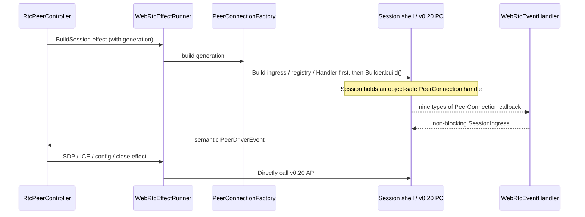


The boundaries of this picture are: Handler only puts raw events into this Session; Session is normalized and then handed over to Controller;
The Controller only controls the PC through the effect port and cannot directly operate the PC from the Handler callback.
**Figure B: How business messages pass through DataChannel**
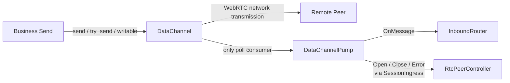


Business payload does not enter the Controller; the Controller only receives Channel life cycle facts.
**Figure C: How media track is consumed**
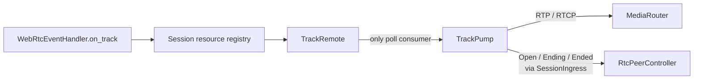


`Runtime` is a build-time injection item, and Stats is an on-demand query item of Session; they are not real-time event links.
Therefore, the above three main flow charts are no longer included, and each is explained independently later.

#### Construction and configuration APIs

`PeerConnectionFactory` MUST use v0.20's configuration and PeerConnection builders. The target call
sequence is shown below; each generation receives a fresh `MediaEngine`, `SettingEngine`, interceptor
registry, and Handler:
```rust
let configuration = RTCConfigurationBuilder::new()
    .with_ice_servers(ice_servers)
    .with_ice_transport_policy(ice_transport_policy)
    .with_bundle_policy(bundle_policy)
    .with_rtcp_mux_policy(rtcp_mux_policy)
    .with_ice_candidate_pool_size(ice_candidate_pool_size)
    .build();

let pc = PeerConnectionBuilder::new()
    .with_configuration(configuration)
    .with_media_engine(media_engine)
    .with_setting_engine(setting_engine)
    .with_interceptor_registry(interceptor_registry)
    .with_runtime(runtime)
    .with_handler(handler)
    .with_udp_addrs(bind_plan.udp_addrs)
    .with_sctp_receive_buffer_size(buffer_config.sctp_receive_window)
    .with_data_channel_send_buffer_limit(buffer_config.per_channel_send_limit)
    .with_dedicated_reactor_thread(runtime_profile.dedicated_reactor)
    .with_reactor_pool_size(runtime_profile.reactor_pool_size)
    .build()
    .await?;

let pc: Arc<dyn PeerConnection> = Arc::new(pc);
```

Specification requirements:
- `with_handler()` MUST pass in the Handler of this generation before `build()`; v0.20 does not have "first
  build, and then complete all PC callback" target usage;
- `with_runtime()` MUST explicitly pass in the Runtime selected by Actr, and cannot rely on the feature combination that happens to be selected.
  default runtime;
- `with_udp_addrs()` MUST use the determined bind plan generated by `LocalAddressProvider`; empty address, fixed port
  fail-fast when there is a conflict or the platform does not support it;
- `with_tcp_addrs()` can only be enabled after the ICE/TCP interoperability test passes, and it is not equal to TURN/TCP;
- `with_sctp_receive_buffer_size()` MUST be configured together with maximum inbound message and memory
  budgets. Its parameter is `u32`; `0` MUST NOT be treated as infinite;
- `with_data_channel_send_buffer_limit()` MUST pass in a non-zero finite value. Default value for v0.20 as well as explicit
  `0` are equivalent to unlimited and cannot meet the resource budget of this RFC;
- `with_dedicated_reactor_thread(true)` MAY is used for server profile. The mobile version is turned off by default;
  `with_reactor_pool_size()` is only valid when the dedicated reactor is turned on, and has a built-in Runtime pool
  Lazy initialization by process, a unified value must be configured at the process level;
- Builder is consumed at `build()`, Factory MUST NOT cache and reuse Builder;
- `build()` returns opaque `impl PeerConnection`, and the Session MUST be immediately encapsulated as
  `Arc<dyn PeerConnection>`, interceptor generics must not be spread to business modules.

#### PeerConnectionEventHandler APIs

v0.20.0 provides nine high-level Handler callbacks. The implementation MUST map every callback
explicitly; diagnostic-only callbacks MUST NOT be ignored. Upstream events do not carry Actr peer or
generation identity, so `WebRtcEventHandler` must add both from its own fields.
| v0.20.0 callback | Internal event/action | Purpose |
| --- | --- | --- |
| `on_negotiation_needed()` | `NegotiationNeeded` | Merge duplicate notifications, scheduled by Controller according to role and negotiation epoch Offer |
| `on_ice_candidate(RTCPeerConnectionIceEvent)` | `LocalIceCandidate` | Give the Candidate after `event.candidate.to_json()` to SignalingRouter; retain `url` only for desensitization diagnosis |
| `on_ice_candidate_error(RTCPeerConnectionIceErrorEvent)` | `IceCandidateError` | Record address/port/url/error code; a single gather error is not directly equivalent to PC failure |
| `on_signaling_state_change(RTCSignalingState)` | `SignalingStateChanged` | Update PC signaling fact, check glare/rollback; must not be mapped to Actr signaling WebSocket status |
| `on_ice_connection_state_change(RTCIceConnectionState)` | `IceConnectionStateChanged` | Driver connection fact, disconnection debounce and Soft/Hard Recovery judgment |
| `on_ice_gathering_state_change(RTCIceGatheringState)` | `IceGatheringStateChanged` | Handling gathering completion, non-trickle peer and connection establishment diagnostics |
| `on_connection_state_change(RTCPeerConnectionState)` | `PeerConnectionStateChanged` | Provides DTLS/ICE aggregate transport facts; Connected alone is still not enough to issue a sendable |
| `on_data_channel(Arc<dyn DataChannel>)` | `SessionIngress::RawDataChannel` | Non-blocking delivery to this Session; event pump stores objects and issues resource token/metadata, and the Controller only starts the only poll pump after accepting it |
| `on_track(Arc<dyn TrackRemote>)` | `SessionIngress::RawTrack` | Non-blocking delivery to this Session; the event pump stores the object and sends out resource token/metadata, and the Controller only starts the only TrackRemote poll pump after accepting it |
Handler callback is async, but its implementation MUST only do lightweight transformations, latest state updates, or be non-blocking
`try_publish`. It cannot wait for bounded queue capacity, nor can it call PC, Hook, signaling I/O within callback
or start a long-lived poll loop. This ensures that a slow Handler cannot block other PC drivers in the
same dedicated-reactor pool.
Handler callbacks MUST NOT await the Controller or driver task. Session ingress MUST use bounded event
and byte budgets; it MUST NOT accumulate events in an unbounded queue. When a limit is reached, the
implementation MUST apply an explicit policy (drop reconstructible diagnostics, coalesce level-triggered
state, or perform controlled shutdown) and expose the overflow.

#### PeerConnection operation APIs

The Controller does not hold mutable driver state. It emits an identity-tagged effect. The
`WebRtcEffectRunner` looks up the production Session by generation, clones its `Arc<dyn PeerConnection>`,
releases the registry lock, calls the v0.20 method, and returns a result tagged with `pc_generation` and
`operation_id`.
| Controller effect | v0.20.0 method | Actr semantics |
| --- | --- | --- |
| `CreateOffer` / `CreateAnswer` | `create_offer()` / `create_answer()` | Generate local SDP for this negotiation epoch |
| `ApplyLocalDescription` | `set_local_description()`, read `local_description()` or `current_local_description()` if necessary | Only completions that pass identity recheck can issue SDP |
| `ApplyRemoteDescription` | `set_remote_description()`, read `remote_description()`, `current_remote_description()`, `pending_remote_description()` | Handle Offer/Answer, glare and pending/current status diagnostics |
| `DetectTrickleCapability` | `can_trickle_ice_candidates()` | remote description determines whether to continue trickle after taking effect; returning `None` means that it cannot be determined yet |
| `AddRemoteCandidate` | `add_ice_candidate(RTCIceCandidateInit)` | Only inject Candidates matching the current PC/ICE generation and ufrag |
| `RestartIce` | `restart_ice()` | Mark the next time `create_offer()` executes ICE restart; the Controller explicitly schedules the Offer and merges other negotiation-needed events in the same epoch |
| `RefreshConfiguration` | `get_configuration()` / `set_configuration()` | Update v0.20 allows dynamically changed ICE server/TURN credential; enters Hard Recovery or fails explicitly on rejection |
| `CreateLane` | `create_data_channel(label, Option<RTCDataChannelInit>)` | Create a local Lane, store the returned object in the Session resource registry, and start the only pump according to the Controller decision |
| `AddTrack` / `RemoveTrack` | `add_track()` / `remove_track()` | Serial renegotiation triggered by negotiation-needed event after updating sender |
| `AddTransceiver` | `add_transceiver_from_track()` / `add_transceiver_from_kind()` | Media scenarios that require explicit direction/transceiver |
| `InspectMedia` | `get_senders()` / `get_receivers()` / `get_transceivers()` | Diagnosis and reconciliation, not as concurrent modification entry |
| `SampleStats` | `get_stats(Instant::now(), StatsSelector)` | Generate network path, transmission, channel and media observation data |
| `CloseSession` | `close()` | Final PC shutdown steps for Session close barrier |
The v0.20 high-level `PeerConnection` trait does not provide a synchronized connection-state getter.
`RtcPeerController` MUST cache the `RTCPeerConnectionState`, `RTCIceConnectionState`,
`RTCIceGatheringState`, and `RTCSignalingState` reported by the Handler. It MUST NOT query the PC
temporarily to derive public status. Description getters assist negotiation reconciliation but cannot
replace generation and operation identity checks.

#### DataChannel APIs and lane policies

There are direct compilation differences between v0.20's `RTCDataChannelInit` and 0.14: `ordered` changes
from `Option<bool>` to `bool`, and `protocol` changes from `Option<String>` to `String`. A single Lane
configuration function MUST construct the four Lane variants so callers cannot assemble them inconsistently:
| Lane | `RTCDataChannelInit` | Send API |
| --- | --- | --- |
| `RpcReliable` | `ordered: true`, without setting lifetime/retransmit limit, `negotiated: None` | `send().await` with deadline/cancellation |
| `RpcSignal` | `ordered: true`, do not set lifetime/retransmit limit, `negotiated: None` | Call `send().await` after high priority bounded queue |
| `StreamReliable` | `ordered: true`, do not set lifetime/retransmit limit, `negotiated: None` | `writable().await` post-sharding `send().await` |
| `StreamLatencyFirst` | `ordered: false`, `max_retransmits: Some(3)`, `negotiated: None` | `try_send()`, discarded according to product policy or fail quickly when buffer is full |
`protocol` and label MUST maintain existing wire conventions. After receiving `on_data_channel()`, register the effect to use
`label()`, `protocol()`, `ordered()`, `max_packet_life_time()`, `max_retransmits()`,
`negotiated()` and `id()` verify the remote Channel; unknown, duplicate or semantically unmatched Lanes must be closed and cannot
Overwrite the current active Lane.
Each Channel starts one and only one `poll()` loop and processes it completely:
- `OnOpen`: Update the Lane status of this generation; only `RpcReliable` Open can satisfy readiness
  anchor;
- `OnMessage`: payload directly enters InboundRouter;
- `OnError`, `OnClosing`, `OnClose`: report to the Controller and revoke the corresponding Lane and SendPermit;
- `OnBufferedAmountHigh`/`OnBufferedAmountLow`: ignored; send-buffer flow control is the
  per-channel send-buffer limit itself, and Actr maintains no watermark state.
The sending side rules are:
- `send()` only waits for the send-buffer capacity and completes the enqueue, which does not mean that the remote end has confirmed receipt;
- `try_send()` quickly returns an error when the limited send-buffer is full, and will consume the incoming `BytesMut`; required
  The caller of retry must retain payload ownership before calling;
- `writable()` is a level-triggered primitive waiting for capacity. It does not reserve an exclusive permit and has multiple senders.
  Per-lane admission of Actr is still required;
- `outstanding_bytes()` indicates SCTP sent bytes that have not yet been released; Actr reads it only for
  diagnostics and the uncertain-delivery decision on close. Drain cannot be interpreted as application layer delivery acknowledgment;
- `ready_state()` is only used for checksum diagnostics at registration time. The Lane status maintained by the Controller from the `poll()` event is
  Input of sendability;
- `DataChannel::close()` MUST be called before PC `close()`, errors are aggregated but do not prevent subsequent resource shutdown.

#### Track and media APIs

- `on_track(Arc<dyn TrackRemote>)` only completes registration; each remote Track is called by a separate task
  `TrackRemote::poll()`, consume `OnOpen`, `OnRtpPacket`, `OnRtcpPacket`, mute/unmute, ending
  and ended;
- Local Track uses `Arc<dyn TrackLocal>`. `TrackLocal::poll()` consumes remote RTCP by the only task
  feedback; media writing uses the static track provided by `write_rtp()`/`write_rtcp()` or v0.20;
- Controller via `PeerConnection::add_track()`, `remove_track()` and transceiver APIs
  Serialized media topology changes; Track pump shall not initiate renegotiation on its own;
- Track, sender, receiver, transceiver and their poll tasks all belong to one PC generation,
  Unrebound objects cannot be reused across Hard Recovery.

#### Runtime and network-test APIs

`with_runtime(Arc<dyn Runtime>)` is the official per-PeerConnection injection point for v0.20. Distinguish here
production runtime and testing tools instead of creating multiple backends for `RtcPeerEffectPort`:
1. production Tokio Runtime: the default implementation of Android, iOS, and desktop;
2. `InstrumentedRuntime`/`RuntimeFaultProbe`: packaging production runtime, in
   `wrap_udp_socket()`, `wrap_tcp_listener()`, `connect_tcp()`, `resolve_host()`, timer and
   Collect indicators at the task boundary and inject a small amount of socket error, blackhole, and driver exit into the contract test
   and cancellation;
3. Upstream `MockRuntime`: only used for v0.20 Runtime’s own deterministic timer/task test; Actr
   The reducer uses standalone `PolicyClock` and does not rely on WebRTC Runtime.
The boundary is as follows: the v0.20 Builder first binds the addresses supplied through
`with_udp_addrs()`/`with_tcp_addrs()` and then hands the sockets to the Runtime wrapper. A custom Runtime
can intercept I/O on those bound sockets, but cannot emulate a network interface, NAT, shared UDP mux, or
bind failure independently. Deterministic loss, delay, reorder, duplicate, and partition are covered by
the Sans-I/O lab; real network loss, NAT, TURN, and interface switching require Linux netns/`tc`, Coturn,
or an Android/iOS environment. Upstream `MockRuntime` returns `Unsupported` for sockets and cannot build
two real PCs. Controller time tests use `ManualPolicyClock`; protocol packet/deadline tests drive the
test-only `rtc::RTCPeerConnection`; high-level tests use Tokio Runtime or `RuntimeFaultProbe`; real NAT,
TURN, and interface tests use the system network.

#### Stats APIs

Peer level sampling uses:
```rust
pc.get_stats(Instant::now(), StatsSelector::None).await
```

`RTCStatsReport::transport()` provides `selected_candidate_pair_id`; obtained via `report.get(id)`
`RTCStatsReportEntry::IceCandidatePair`, then `local_candidate_id` and
`remote_candidate_id` obtains Candidate entry. of any selected Candidate
When `candidate_type == RTCIceCandidateType::Relay`, Snapshot’s `NetworkPath` is updated to
`Relayed`; `Direct` when the selected pair is clear and neither party is Relay; maintained when data is missing or reports are inconsistent
`Unknown`.
Media indicators MAY use `StatsSelector::Sender(id)` or
`StatsSelector::Receiver(id)` to avoid scanning the entire report each time. Stats is an asynchronous observation capability and does not participate in
Synchronization judgment of `sendable`; sampling failure cannot change the connected Peer to unsendable. `RtpSender` `RtpReceiver`

#### v0.20 capabilities deliberately not used

- production does not directly drive the underlying Sans-I/O `rtc::RTCPeerConnection`; uses v0.20 high-level async
  driver;
- Do not create a single Handler instance shared by all Actr; only share the Handler implementation type;
- Do not restore v0.14 per-event callback registration adapter;
- Run real network PeerConnection without using upstream `MockRuntime`;
- Dedicated reactor is not enabled by default on the mobile terminal; benchmark must be enabled before the server is enabled;
- Do not treat `with_tcp_addrs()` as proof of TURN/TCP/TLS support;
- Do not rely on the default infinite value of `with_data_channel_send_buffer_limit()`;
- Read `ready_state()` instead of `DataChannel::poll()` without looping;
- Do not put `get_stats()` in Handler callback or business sending hot path.

### Target architecture

```text
Actr instance
└── RtcConnectionManager
    ├── PeerConnectionFactory
    ├── SignalingRouter
    ├── NotificationHub
    ├── RecoverySupervisor
    └── peers: HashMap<ActrId, RtcPeerControllerHandle>
        ├── RtcPeerController: peer B
        │   ├── slots: active 5 / pending 6 / retiring 4
        │   └── WebRtcEffectRunner
        │       └── physical sessions: generation 4 / 5 / 6
        ├── RtcPeerController: peer C
        │   ├── slots: active 2
        │   └── WebRtcEffectRunner -> physical session 2
        └── RtcPeerController: peer D
            ├── slots: active 9
            └── WebRtcEffectRunner -> physical session 9
```

`RtcConnectionManager` is the global directory and shared resource entry; `RtcPeerController` is for single Peer
Logical connection state machine; `WebRtcEffectRunner` executes the Controller effect and holds the Peer’s physical Session
registry; `PeerConnectionSession` is a single-generation physical resource owner.
The following diagram only expresses ownership and does not mix events, signaling or data flow:
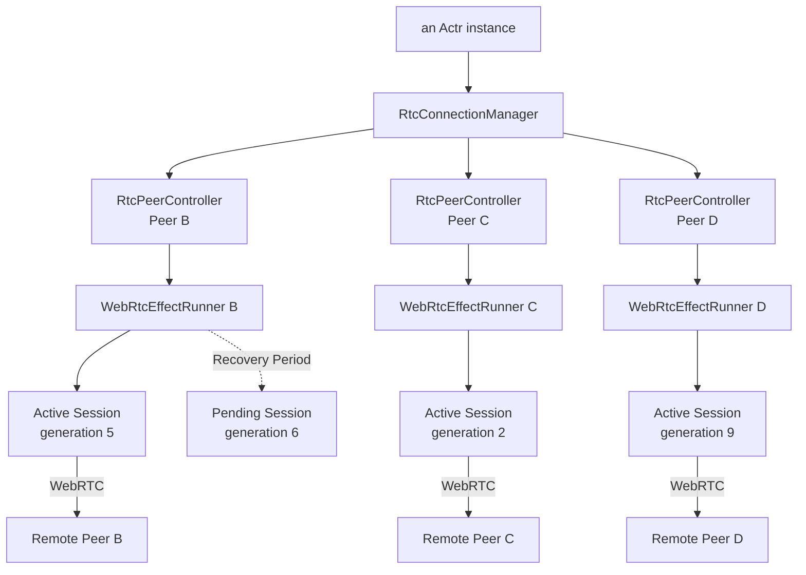


When Peer B rebuilds PeerConnection, it only updates the slot of Controller B and lets Runner B replace the physical Session;
Controller B itself, as well as Peer C and Peer D, remain unchanged.

### Component responsibilities

#### RtcConnectionManager

Suggested structure:
```rust
struct RtcConnectionManager {
    factory: Arc<PeerConnectionFactory>,
    signaling_router: Arc<SignalingRouter>,
    notification_hub: Arc<NotificationHub>,
    peers: RwLock<HashMap<ActrId, RtcPeerControllerHandle>>,
}
```

It MUST be responsible for:
- Create, find, and delete Controllers by `ActrId`;
- Create independent event sink and `WebRtcEffectRunner` for each Controller, share the Factory but not share it
  Session registry;
- Create an Answerer Controller when receiving an Offer from an unknown Peer;
- Manage process/Actr level runtime and resource configuration;
- Limit the number of simultaneous builds, restarts and hard rebuilds;
- Provide query, subscribe, close-peer and close-all;
- Coordinate shutdown without holding peers lock across `.await`.
It MUST NOT save:
- The role or SDP status of a single Peer;
- Single Peer ICE candidate and ICE generation;
- DataChannel/Track status of a single Peer;
- Single Peer physical session registry;
- recovery flag for single peer;
- Single Peer sendable judgment.

#### RtcPeerController

Suggested structure:
```rust
struct RtcPeerController {
    peer_id: ActrId,
    pc_generation: u64,
    ice_generation: u64,
    operation_id: u64,

    state: RtcPeerState,
    effect_port: Arc<dyn RtcPeerEffectPort>,
    active_session: Option<RtcSessionSlot>,
    pending_session: Option<RtcSessionSlot>,
    retiring_session: Option<RtcSessionSlot>,

    command_rx: mpsc::Receiver<RtcPeerCommand>,
    event_rx: PeerEventMailbox,
    snapshot_tx: watch::Sender<RtcPeerSnapshot>,
}
```

The Controller MUST be the only writer of the remote peer RTC control state and is responsible for:
- Offerer/Answerer role and glare;
- SDP Offer/Answer and negotiation epoch;
- ICE generation, ufrag and pending candidates;
- PeerConnection build, restart, replacement and close;
- DataChannel/Track registration and life cycle;
- Soft/Hard Recovery;
- derivation of sendable and public status;
- Generation, operation id and stale completion judgment.
The Controller SHOULD be a Tokio task around a reducer/effect shell rather than executing asynchronous
operations directly in the event loop:
```rust
fn reduce(
    state: &mut RtcPeerState,
    input: RtcPeerInput,
) -> Vec<RtcPeerEffect>;
```

`build()`, `create_offer()`, `set_remote_description()`, `restart_ice()`, and `close()` are executed by
effect tasks. Every completion MUST carry:
```text
peer_id
pc_generation
operation_id
ice_generation (when applicable)
```


The Controller MUST re-authenticate its identity after receiving completion and cannot assume that the state when the operation was initiated is still valid.
The reducer is a pure boundary: it MUST NOT call `Instant::now()`, read a socket or Runtime, or
`.await`. Time enters as an explicit `RtcPeerInput`/`PolicyClock` value or a `TimerElapsed` fact.
This keeps T1 able to reproduce deadlines, stale events, and concurrency races without creating a
PeerConnection.

#### RtcPeerControllerHandle

Suggested structure:
```rust
struct RtcPeerControllerHandle {
    command_tx: mpsc::Sender<RtcPeerCommand>,
    snapshot_rx: watch::Receiver<RtcPeerSnapshot>,
    lanes: ActiveLaneRegistry,
}
```

The Handle is used by Manager, PeerGate, and the business layer. Status queries and Lane lookup SHOULD NOT
wait for the Controller to process another mailbox round. The send path reads the latest Snapshot and
LaneHandle from the Handle and then performs the generation recheck.

#### RtcPeerEffectPort

The Controller only saves the lifecycle/identity of `RtcSessionSlot` and does not directly save the PC related to WebRTC implementation.
object. Each Controller holds a crate-private effect port, implemented by `WebRtcEffectRunner`:
```rust
trait RtcPeerEffectPort: Send + Sync {
    fn submit(
        &self,
        operation: TaggedRtcPeerEffect,
        completion_tx: RtcEffectCompletionSender,
    ) -> Result<()>;
}
```

The only production implementation, `WebRtcEffectRunner`, owns the Controller-private Session registry
and binds the Controller's semantic event sink when it is constructed. It executes effects by calling the
v0.20 API directly. The registry lock MUST be released before `.await`: clone the generation-bound Session
handle first, then perform the asynchronous operation. Register a Session after a successful build and
send completion; after close, remove the Session before sending completion.

This port is the Controller's asynchronous effect boundary, not an external WebRTC facade. It MUST NOT
copy the complete v0.20 object interface or restore the 0.14 callback-registration model. A Controller is
bound to one runner for its lifetime, and production always uses `WebRtcEffectRunner`. T1's
`ControllerTestHarness` and `TestEffectSink` record `TaggedRtcPeerEffect` and inject completions/facts;
they do not own a Session or implement a full v0.20 effect. Sans-I/O remains an independent protocol lab.

#### PeerConnectionSession

Suggested structure:
```rust
struct PeerConnectionSession {
    generation: u64,
    pc: Arc<dyn PeerConnection>,
    channels: DataChannelSet,
    tracks: TrackSet,
    resources: SessionResourceRegistry,
    ingress: SessionIngressHandle,
    cancellation: CancellationToken,
    tasks: JoinSet<()>,
}
```

Session MUST have:
- An object-safe PeerConnection handle;
- All DataChannels of this generation;
- All Tracks and senders of this generation;
- DataChannel/Track pump task;
- cancellation token and explicit close process;
- Resource statistics for this generation.
Session MUST NOT save business Hook state or cross-generation recovery strategies.
`WebRtcEffectRunner` owns the Session's physical resources. The Controller retains logical ownership
through `RtcSessionSlot` and generation and decides pending/active/retiring transitions. The runner MUST
NOT promote a pending Session or publish a Snapshot without the Controller.

#### PeerConnectionFactory

Suggested structure:
```rust
struct PeerConnectionFactory {
    runtime_config: RtcRuntimeConfig,
    codec_config: RtcCodecConfig,
    ice_config: RtcIceConfig,
    address_provider: Arc<dyn LocalAddressProvider>,
}
```

Factory MUST create new Builder, MediaEngine, interceptor registry,
EventHandler and socket. Builders that have been consumed MUST NOT be reused.
Factory is responsible for:
- Codec/interceptor registration;
- `RTCConfigurationBuilder`;
- bind address and socket strategies;
- DataChannel send buffer limit;
- SCTP receive window;
- Runtime/reactor strategy;
- Returns a PC that can be stored as `Arc<dyn PeerConnection>`.
Factory is not responsible for signaling, Hooks, Controller maps or business receive loops.

#### SignalingRouter

The SignalingClient receive stream MUST have one consumer. `SignalingRouter` routes Offer, Answer, Candidate,
and restart requests by remote `ActrId` to the corresponding Controller. When an Offer arrives from an
unknown peer, the Router requests Manager to create an Answerer Controller. Other unknown-peer messages are
rejected, cached, or recorded according to protocol rules; they MUST NOT be delivered to an existing Controller.

#### NotificationHub

The Controller only publishes Snapshots and does not directly call workloads or FFI Hooks. NotificationHub is responsible for:
- Distributed in peer and revision order;
- Remove duplicate Snapshots;
- Call Rust/FFI/Android/iOS/Web observer;
- Capture Hook panic or execution errors;
- Prevent slow Hook from blocking Controller and webrtc driver;
- Project unified Snapshot to existing three Hooks.

#### RecoverySupervisor

Existing global RecoverySupervisor retains global network/App lifecycle policies, but only broadcasts facts or commands:
```rust
enum RtcNetworkEvent {
    NetworkUnavailable,
    NetworkAvailable,
    LocalAddressChanged,
    AppBackground,
    AppForeground,
    ForceReconnect,
}
```

Each Controller determines Soft Recovery, Hard Recovery or termination by itself. RecoverySupervisor MUST
NOT directly modify Controller internal state or PeerConnection.

### State ownership and invariants

Implementations MUST maintain the following invariants:
1. One remote `ActrId` corresponds to at most one live controller.
2. A Controller can publish at most one sendable PC generation.
3. The pending Session must not publish a sendable Lane before it becomes active.
4. Retiring Session must not re-enter active.
5. Events and completions of the old PC generation must not change the state of the new generation.
6. The Candidate of the old ICE generation must not inject the new ICE generation.
7. Controller is the only producer of `RtcPeerSnapshot`.
8. Handler, pump, and effect tasks do not directly modify public status.
9. Manager does not hold peers global lock across `.await`.
10. EventHandler does not call PeerConnection's blocking or asynchronous control API.
11. Business data does not pass through the Controller mailbox.
12. All PeerConnections are explicitly closed by their Session.
13. Retiring a PC generation invalidates only generation-bound lanes, permits, and pending requests;
    it MUST NOT evict a logical connection flight while recovery is active.
14. A terminal peer attempt invalidates both the physical Sessions and the matching transport-layer
    connection flight. A closed PC MUST NOT remain advertised as a ready wire.
15. Transport retirement is compare-and-swap guarded by a stable connection-flight/lifecycle identity;
    a delayed terminal event from an old generation MUST NOT evict a replacement transport.

### Control plane and data plane

Control plane inputs include:
```text
business control command
signaling message
network lifecycle event
webrtc driver event
effect completion
```

These inputs go into a single Peer Controller, which updates the state and generates effects.
The data plane must bypass the Controller:
```text
outbound:
business send
  -> RtcPeerControllerHandle
  -> SendPermit
  -> LaneHandle
  -> DataChannel.send / try_send

inbound:
DataChannel.poll
  -> DataChannelPump
  -> InboundRouter
  -> workload
```

The Controller is only responsible for installing, replacing and canceling LaneHandle, and does not process the message payload.
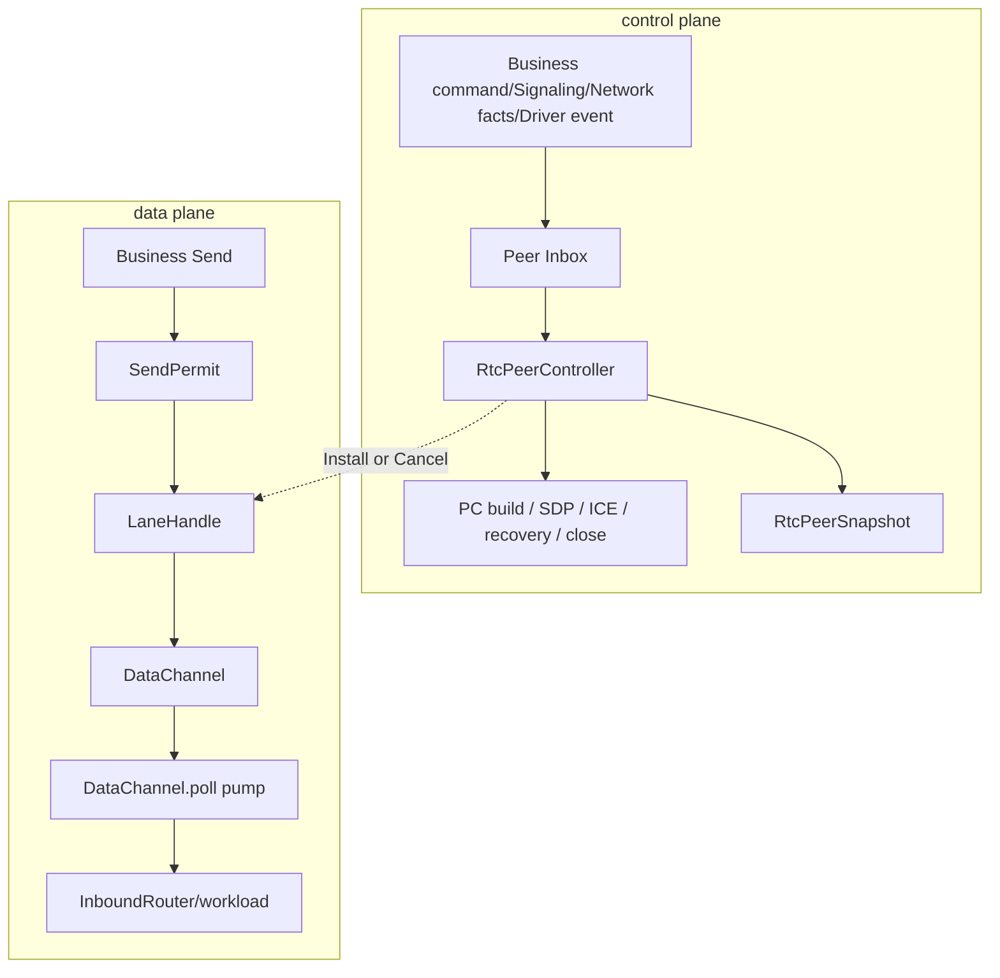


Solid lines represent execution paths within each plane; dotted lines represent only the Controller's
control over Lane lifecycle. Business payload never enters the Peer Inbox.

### Command and event mailboxes

Use three external channels and add a generation-owned ingress to each Session:
1. `RtcPeerCommand`: Business and Manager control commands, using bounded mpsc;
2. `PeerDriverEvent`: The semantic fact after Session normalization must be non-blocking;
3. `RtcPeerSnapshot`: Use watch to indicate the latest authoritative status.
`SessionIngress` combines Handler input and the Session event pump. Mergeable events use a
latest-value-plus-notify slot; structural events such as candidates, DataChannels, and Tracks enter a
bounded queue that may temporarily hold `Arc<dyn DataChannel>`/`Arc<dyn TrackRemote>`. A monotone ingress
sequence lets the single Session pump merge both sources. Raw resources are stored in the Session registry
first; the Controller receives only `SessionResourceId`, metadata, and semantic state. Controllers and
reducers never hold WebRTC implementation objects directly.

EventHandlers MUST NOT wait for queue capacity. If a structural queue overflows, the Handler MUST expose
the overflow and wake the Controller; the Controller SHOULD mark that generation unhealthy and perform
Hard Recovery. Key events MUST NOT be silently dropped while the connection is reported healthy.

### WebRtcEventHandler

Create one Handler instance per PC generation:
```rust
struct WebRtcEventHandler {
    peer_id: ActrId,
    generation: u64,
    ingress_tx: SessionIngressSender,
}
```

What is unified is the implementation type, not the global singleton:
```text
peer B / generation 5 -> handler B5
peer C / generation 2 -> handler C2
peer B / generation 6 -> handler B6
```

Handler MUST be created and injected before `PeerConnectionBuilder::build()` to ensure that the
The event has a clear recipient. Factory MUST first create Session ingress, resource registry and event pump,
Call `build()` again; if the build fails, you must close the ingress, stop the pump and release the temporary resources.
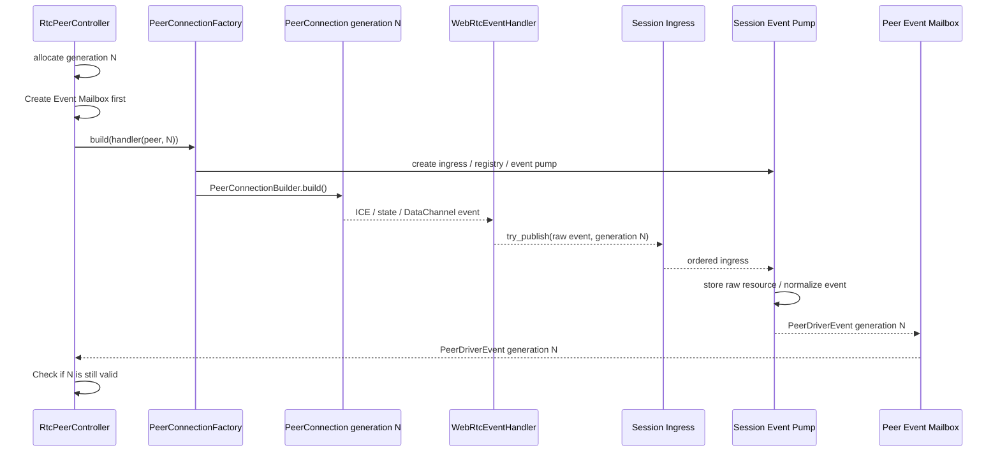


Even if the driver generates an event before `build()` returns, the event will enter the existing Peer mailbox. Handler
It will not call back the Manager, execute business hooks, or shut down the PC.
Session event pump converts v0.20 events into internal types:
```rust
enum PeerDriverEvent {
    PeerConnectionStateChanged {
        generation: u64,
        state: RTCPeerConnectionState,
    },
    IceConnectionStateChanged {
        generation: u64,
        state: RTCIceConnectionState,
    },
    IceGatheringStateChanged {
        generation: u64,
        state: RTCIceGatheringState,
    },
    SignalingStateChanged {
        generation: u64,
        state: RTCSignalingState,
    },
    LocalIceCandidate {
        generation: u64,
        candidate: RTCIceCandidateInit,
    },
    IceCandidateError {
        generation: u64,
        error: RtcIceCandidateError,
    },
    DataChannelDiscovered {
        generation: u64,
        resource_id: SessionResourceId,
        descriptor: DataChannelDescriptor,
    },
    TrackDiscovered {
        generation: u64,
        resource_id: SessionResourceId,
        descriptor: TrackDescriptor,
    },
    LaneStateChanged {
        generation: u64,
        lane: LaneKind,
        state: RtcLaneState,
    },
    TrackStateChanged {
        generation: u64,
        resource_id: SessionResourceId,
        state: RtcTrackState,
    },
    NegotiationNeeded {
        generation: u64,
    },
    DriverExited {
        generation: u64,
        error: Option<RtcError>,
    },
}
```

The Handler and Session event pump MUST NOT:
- Call business Hook;
- Obtain Coordinator/Manager global write lock;
- Wait for a channel send that may apply backpressure;
- Execute Offer/Answer;
- Call `restart_ice()` or `close()`;
- Start long-term DataChannel/Track loop without controller accepting resource token;
- Process business messages.
The Controller receives `DataChannelDiscovered`/`TrackDiscovered` and emits a registration effect.
Production Session retrieves the high-level object from its resource registry and starts the sole poll pump.
The test-only Sans-I/O Session uses the corresponding core channel/track ID. Rejected, duplicate, stale, or
semantically unmatched tokens are closed by the Session; raw resources MUST NOT leak. The pump republishes
lifecycle facts to SessionIngress, while only message or media payload enters InboundRouter/MediaRouter
directly without passing through the Controller.

### Peer lifecycle

The internal state is suggested to be:
```rust
enum RtcPeerPhase {
    Idle,
    Building,
    Negotiating,
    TransportReady,
    Sendable,
    Recovering,
    Closing,
}
```

Main conversions:
```text
Idle
  -> Building
  -> Negotiating
  -> TransportReady
  -> Sendable
  -> Recovering
  -> Negotiating       // Soft Recovery
  -> Building          // Hard Recovery
  -> Closing
  -> Idle
```

The Controller MUST determines transformations and effects through reducers, and does not allow Handlers or pumps to write phases directly.
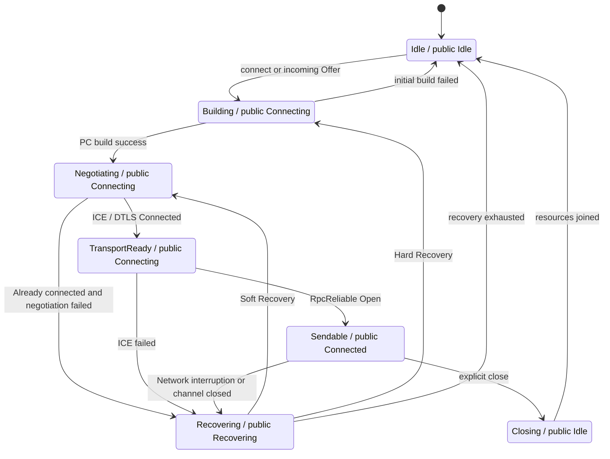

`Idle` alone is not a cache-retirement signal: a fresh Controller and a terminally unavailable
Controller both project `Idle`. The terminal decision also requires a terminal reason and no
active/building/pending Session. In particular, `RecoveryExhausted`, a terminal initial
build/negotiation failure, an unrecoverable `PeerConnection`/ICE `Closed`, and an unrecoverable
`DriverExited` MUST retire the current connection flight. `Disconnected`, Soft Recovery, and Hard
Recovery before its total budget expires MUST retain that flight.

### Generation and transport retirement

The Controller/Manager lifecycle crosses two cache boundaries and MUST expose separate semantic
edges:

```text
GenerationRetired(peer, pc_generation)
TransportRetired(peer, transport_lifecycle_id, reason)
```

`GenerationRetired` MUST:

- revoke all generation-bound `SendPermit`s and remove its `LaneHandle`s;
- fail already-sent requests correlated with that generation;
- close and join the generation-owned Session, DataChannels, Tracks, and PeerConnection;
- retain the logical `DestTransport`/`WirePool` while recovery can still converge.

`TransportRetired` MUST:

- retire every active, pending, building, or orphan Session belonging to that attempt;
- fail all pending requests for the peer;
- transition the matching WebRTC `WirePool` slot out of `Ready` and remove the matching
  `DestTransport` connection flight;
- allow a later send/connect to start a fresh connection flight and PC generation.

`TransportRetired` is required for recovery-budget exhaustion, terminal initial build or
negotiation failure, unrecoverable PC/ICE close or driver exit, and explicit `close_peer`/`close_all`.
When a `WirePool` exhausts every candidate before any candidate has ever become ready, the failed
connection flight MUST also be evicted. The retirement edge MUST be published before discarding the
identity needed for compare-and-swap cleanup, or carry an immutable connection-flight identity that
survives the terminal `Idle` snapshot.
Moving a WebRTC slot from `Connecting`/`Ready` to `Failed` MUST retain that lifecycle identity until
the connection flight is evicted; a racing closed-like send error must not erase the only key that a
subsequent terminal-retirement edge can safely match.

The cleanup matrix is normative:

| State or transition | Physical generation resources | Logical transport/cache |
| --- | --- | --- |
| Fresh `Idle` (`unavailable_reason = None`) | No live generation is expected | No retirement edge |
| `Building`, `Negotiating`, `TransportReady`, `Sendable` | Retain current attempt resources | Retain `DestTransport` and `WirePool` |
| Established `Disconnected` or recoverable `Failed` entering Soft Recovery | Retain the active PC, lanes, and permits | Retain the connection flight |
| Hard Recovery within the total recovery budget | Close each superseded/failed PC generation and remove only its lanes, permits, and pending correlations | Retain the connection flight and Controller |
| Pending replacement reports `Failed`/`Closed` | Close and remove only that pending generation, then build a newer generation | Retain the connection flight |
| Established PC/ICE `Closed` or `DriverExited` while recovery remains possible | Close the affected generation and enter Hard Recovery | Retain the connection flight until recovery converges or exhausts |
| Terminal initial build/negotiation failure, initial `Closed`, or initial `DriverExited` | Close every created/late-orphan generation; clear attempt-scoped SDP, ICE, lane, and permit state | Fail peer pending requests, clear the matching ready slot, and evict the matching `DestTransport` |
| `RecoveryExhausted` | Close active, pending, and late-orphan generations; clear all attempt-scoped resource state | Fail peer pending requests and evict the matching connection flight |
| Explicit `close_peer` / `close_all` | Run the full close barrier for all generations | Evict the connection flight and remove the Controller |

A cache MUST be cleared according to its ownership scope: generation-owned caches are cleared on
generation retirement; attempt-owned caches are cleared on transport retirement; Manager-wide
Controller/revision floors are cleared only by explicit Manager lifecycle teardown. Merely calling
`PeerConnection::close()` is insufficient because it does not remove `LaneRegistry`,
pending-request, `WirePool::Ready`, or `PeerTransport` destination entries owned by higher layers.


### Initial connection

Active connection process:
1. Business call `connect(peer)`.
2. Manager finds or creates a Controller.
3. Controller publishes `Connecting`.
4. Controller allocates new PC generation and operation id.
5. Controller creates Peer event mailbox.
6. Controller submits `BuildSession` effect; Runner calls Factory to create generation-owned
   Session ingress/resource registry/event pump and Handler, and then build PeerConnectionSession.
7. Offerer pre-creates `RpcReliable` DataChannel.
8. The Controller executes Offer, local description and signaling send serially.
9. Router delivers Answer and remote candidate.
10. PC driver reports Connected.
11. `RpcReliable` pump reports Open.
12. The Controller calculates `sendable=true` and issues `Connected`.
Passive connection process:
1. Router receives an Offer from an unknown Peer.
2. Manager creates Answerer Controller.
3. Controller builds Session through Runner and applies remote description.
4. Controller creates and sends Answer.
5. The `RpcReliable` created remotely is reported to the pump through the Handler and registered.
6. Release `Connected` after PC Connected and `RpcReliable` Open.
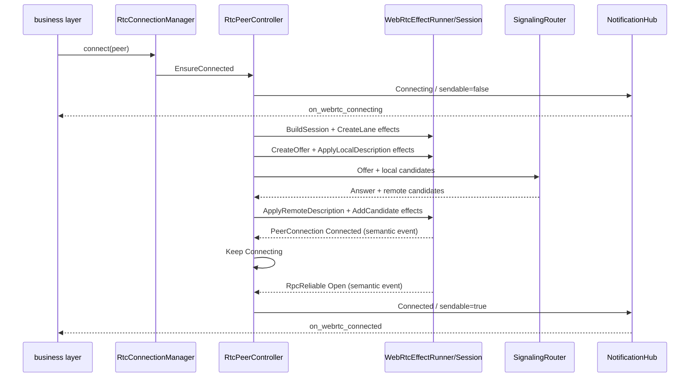


The figure deliberately retains the state in which the PC is Connected while business status remains
Connecting. Business status becomes Connected only after the required control channel is Open.

### Role and glare handling

An active connect and an incoming Offer for the same peer must enter the same Controller. Stable role rules
and negotiation epochs serialize SDP operations. Every Offer/Answer completion MUST carry an operation ID.
After a role or generation change, an old completion is recorded only as stale; it cannot submit SDP or send
signaling.

### ICE generation and candidates

Candidate must be associated with:
```text
peer_id
pc_generation
ice_generation
ufrag
```

The Controller holds the current remote ufrag and pending candidates classified by ICE generation. Only
candidates matching the current generation and ufrag are submitted. Candidates from an old PC or ICE
generation MUST be rejected or recorded as a stale metric and MUST NOT be injected into the current PC.

### DataChannel model

Keep the current four logical lanes:
- `RpcReliable`;
- `RpcSignal`;
- `StreamReliable`;
-`StreamLatencyFirst`.
`RpcReliable` MUST be created during the initial connection phase and serves as the peer-level readiness
anchor. Other Lanes MAY be created lazily on demand.
There MUST be only one `DataChannel::poll()` consumer per DataChannel. suggestion:
```rust
struct DataChannelSlot {
    generation: u64,
    lane: LaneKind,
    channel: Arc<dyn DataChannel>,
    state: watch::Receiver<DataChannelState>,
    cancellation: CancellationToken,
}
```

DataChannelPump is responsible for:
- Report Open/Close/Error as control events to Controller;
- Deliver the Message directly to InboundRouter;
- Exit after cancellation and join by Session;
- Reject duplicate consumers.

### Sendability and public state

Keep it:
```rust
enum WebRtcPeerStatus {
    Idle,
    Connecting,
    Connected,
    Recovering,
}
```

Internal state mapping:
| Internal phase | Public status | sendable |
| --- | --- | ---: |
| `Idle`, `Closing` | `Idle` | false |
| `Building`, `Negotiating`, `TransportReady` | `Connecting` | false |
| `Sendable` | `Connected` | true |
| `Recovering` | `Recovering` | false |

Business sendability is defined as:
```text
active PC generation
AND PeerConnection state == Connected
AND RpcReliable state == Open
AND recovery_inflight == false
AND session cancellation is not triggered
```

`PeerConnectionState::Connected` or "any DataChannel Open" alone are not sufficient to publish Connected.
The authoritative snapshot:
```rust
struct RtcPeerSnapshot {
    peer: ActrId,
    pc_generation: u64,
    revision: u64,
    status: WebRtcPeerStatus,
    sendable: bool,
    network_path: NetworkPath,
    unavailable_reason: Option<RtcUnavailableReason>,
}

enum NetworkPath {
    Unknown,
    Direct,
    Relayed,
}
```

`network_path` is updated asynchronously through stats and does not participate in sendability. It remains
Unknown when a query fails, and publishing Connected MUST NOT wait for stats.

The public API adds:
```rust
fn get_rtc_peer_status(peer: ActrId) -> Option<RtcPeerSnapshot>;

fn list_rtc_peer_statuses() -> Vec<RtcPeerSnapshot>;

fn subscribe_rtc_peer_status(
    peer: ActrId,
) -> watch::Receiver<RtcPeerSnapshot>;
```

SUBSCRIBE MUST replay the latest Snapshot immediately; an observer MUST NOT wait for a future transition
after recovery or re-registration. The unified notification is `on_webrtc_state_changed(snapshot)`.
Existing notifications remain available during migration:
- `on_webrtc_connecting`;
- `on_webrtc_connected`;
- `on_webrtc_disconnected`;
Converted by NotificationHub based on Snapshot:
```text
sendable false -> true
  => on_webrtc_connected

sendable true -> false and automatic recovery starts
  => on_webrtc_disconnected(Recovering)

recovery exhausted or explicit terminal close
  => on_webrtc_disconnected(Idle)
```

The same transition also emits the terminal transport-retirement edge described above. Hooks remain
observation only; `PeerGate`/`PeerTransport` consume the lifecycle edge to release pending requests
and invalidate the matching transport cache.

Hook is the change prompt, and Snapshot is the authoritative state. Even though the Snapshot shows sendable, the actual `send()` is still
MUST handle `ConnectionNotReady` caused by last minute network changes.

### Send path and SendPermit

`RtcPeerControllerHandle` provides the latest Snapshot and LaneHandle to the send path. Created when sending:
```rust
struct SendPermit {
    peer: ActrId,
    generation: u64,
    lane: LaneKind,
    channel: Arc<dyn DataChannel>,
    cancellation: CancellationToken,
}
```

Sending steps:
1. Find remote peer Handle;
2. Check Snapshot `sendable`;
3. Get the target LaneHandle;
4. Generate SendPermit bound to generation;
5. Check cancellation/generation again before calling DataChannel;
6. Use `send()`, `try_send()` or `writable()`;
7. Convert closed, buffer-full and uncertain delivery into stable Actr errors.
PeerGate MUST delete its own recovering-peer collection; the Controller Snapshot and LaneHandle are the
only preflight status sources. Reliable RPC SHOULD use `send().await` with a deadline and cancellation;
the latency-first Lane MAY fail fast with `try_send()`; streaming SHOULD use `writable()` and an explicit
chunk budget.
If data has entered the underlying send buffer and the Session disconnects before the send result is
confirmed, Actr SHOULD report `DataChunkDeliveryUncertain`.
`outstanding_bytes()` is used for diagnostics and shutdown drain. It MUST NOT be interpreted as remote
delivery confirmation.
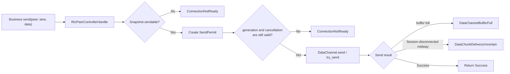


### Send-buffer flow control and memory budget

Send-side flow control is the webrtc crate's native per-DataChannel send-buffer
limit, which Actr opts into at the factory (`with_data_channel_send_buffer_limit`):
a reliable lane's `send()` blocks until the channel buffer drains below the limit,
and the latency-first lane's `try_send()` fails fast with `DataChannelBufferFull`.
Actr layers no aggregate per-peer or Actr-wide send budget on top; the send path
performs no admission accounting beyond the `SendPermit` generation/cancellation
re-validation.

Configuration includes at least:
- per-channel send buffer limit;
- SCTP receive window;
- maximum inbound message size;
- stream fragment/reassembly limit.
SCTP receive window MUST be no smaller than the maximum supported single message, otherwise the configuration should fail-fast at startup or build time.
Every receive-side queue MUST also define maximum message-count and byte limits, or use explicit
protocol-level backpressure supplied by upstream. Production MUST NOT use an unbounded channel as a
long-lived event queue. Unsupported v0.20 capabilities or conflicting resource settings
MUST fail fast during build/configuration; they MUST NOT silently degrade to an
unlimited queue or the old callback behavior.

#### Landing order for the v0.20 compatibility work

PR #495 currently contains two long-lived receive queues in its adapter (`PeerEvent` and `ChannelEvent`).
Those queues are a temporary migration exception only; they MUST be replaced with count-and-byte-bounded
queues (or explicit protocol backpressure) before the v0.20 production cutover and before this RFC is
accepted as an implementation contract. The exception is not open-ended: the #495 follow-up that bounds
both queues is a prerequisite for Stage 4, and the CI gate MUST assert that no production
`UnboundedSender` remains on those receive paths.

### Soft Recovery

Soft Recovery is suitable for:
- The local interface and address have not changed;
- The driver and current Session are still healthy;
- Temporary network loss;
- TURN credential/config updates can take effect via the current PC.
process:
1. Controller issues `Recovering` and cancels the old SendPermit;
2. `ice_generation += 1`;
3. Call `set_configuration()` when necessary;
4. The Offerer calls `restart_ice()`. The Answerer performs no local
   `restart_ice()` here: v0.20 applies the implicit local ICE restart (ufrag
   roll, stale candidate discard, socket rebind per webrtc-rs/webrtc#868)
   inside `set_remote_description()` when it detects the Offerer's changed
   credentials, so the Answerer's credentials can only roll atomically with
   an incoming restart offer — never out from under an answer it just sent;
5. Offerer creates restart Offer;
6. Answerer sends a restart request, and Offerer initiates Offer;
7. Only accept Candidates matching the new ICE generation/ufrag;
8. Re-publish Connected after PC and `RpcReliable` are restored.
If one Offerer ICE restart attempt times out while the local address and active
Session are still usable, the Controller starts another Soft Recovery attempt
on the same PC generation. The Answerer instead retransmits its correlated
restart request within a bounded request budget; exhaustion retains the Hard
Recovery fallback because the remote Session may no longer exist. The total
recovery-cycle budget still bounds these retries.
Soft Recovery does not increase PC generation.

### Hard Recovery

Hard Recovery is suitable for:
- Local interface or IP changes;
- PeerConnection driver exits or the status does not converge;
- A Soft Recovery operation fails irrecoverably;
- Session mailbox overflow;
- The current socket/bind plan cannot be used anymore;
- Application lifecycle policy requires the connection to be re-established.
process:
1. Publish `Recovering` and make `sendable=false`;
2. Cancel all SendPermits of the old generation;
3. `pc_generation += 1`;
4. Create pending Session;
5. pending Session completes SDP/ICE;
6. pending PC Connected and `RpcReliable` Open;
7. Atomic switching of active generation and Lane registry;
8. Publish Connected;
9. Mark the old Session for retiring and close it explicitly.
If resource budget or network reasons do not allow make-before-break, the Controller MAY build a new Session before
The old Session is closed, but the public state remains Recovering, and the generation rules remain unchanged.
Recovery must use global semaphore and per-peer jitter to avoid all peers building and
get_stats and send Offer.
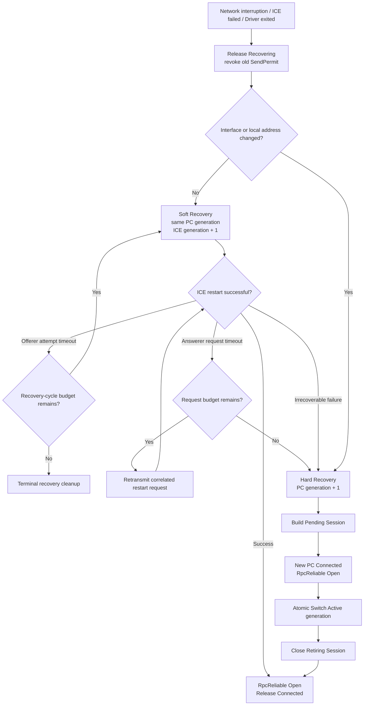


Soft Recovery only increases ICE generation; Hard Recovery increases PC generation. Both paths ultimately
`RpcReliable Open` must be met again before Connected can be released.

### Close and shutdown

Single Peer closing process:
1. Controller enters Closing;
2. Publish sendable=false;
3. Cancel LaneHandle and new SendPermit;
4. Submit the `CloseSession` effect with generation;
5. `WebRtcEffectRunner` cancels DataChannel/Track pump;
6. Perform bounded drain according to close mode;
7. Close DataChannel;
8. Execute `pc.close().await` and join/abort Session task;
9. The runner removes the physical Session from the registry, and the Controller releases the Slot after receiving the completion;
10. Publish Idle and notify the Manager that the Controller can be recycled.
EventHandler MUST NOT CALL `close()`. Manager `close_all()` MUST first copy the Handle in the lock and release it
After locking, it is bounded and concurrently closed according to the overall deadline, and timeout cannot be accumulated in Peer order.
Drop can only be used as an exception cover and cannot replace an explicit close.

Recovery exhaustion and other terminal failures use the same physical cleanup barrier, but they do
not require destruction of the long-lived Controller. The Controller MAY remain as a clean `Idle`
control-plane object for a later `Connect`; the failed `DestTransport`/`WirePool` flight MUST still be
retired. A later connection therefore reuses only the Controller identity, never a closed physical PC
or stale transport-ready cache entry.

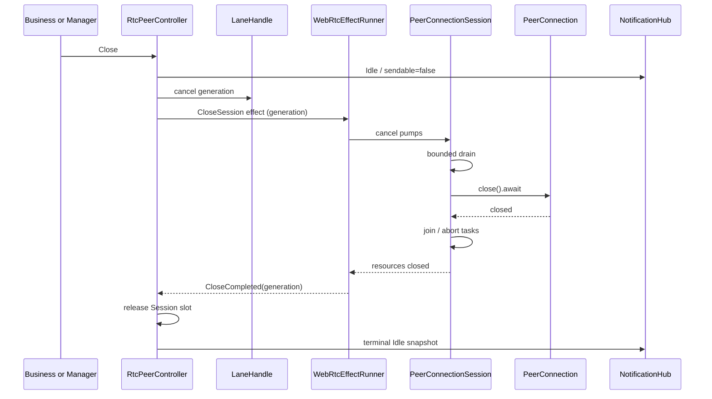


Business sendability expires immediately when shutdown begins; physical resource recycling is completed in the background according to the overall deadline.

### Runtime strategy

Recommended default strategy:
- Android/iOS uses Tokio runtime driver;
- The dedicated reactor pool is not enabled by default on the mobile terminal to avoid additional threads and energy consumption;
- Shared bounded reactor pool can be enabled on the server side or in high-connection scenarios;
- The reactor pool configuration is a process-level configuration and cannot be set conflictingly by different Actr instances;
- Customized runtime wrapper for socket indicators and high-level driver boundary fault testing;
- Runtime callbacks, EventHandlers, and Hooks MUST NOT block the driver.

The virtual timer provided by `runtime-mock` is not a complete virtual network. Deterministic packet-fault
and recovery testing uses the test-only Sans-I/O lab; Runtime probes verify only high-level driver
boundaries; real system and platform behavior is verified in end-to-end network environments.

### Test structure based on v0.20 layered architecture

This section defines test ownership and stable seams, not the future scenario matrix. Production always
uses the same path; test layers observe or drive different boundaries of that path.

#### Clock capability boundary

The published webrtc-rs v0.20.0 `Runtime` trait does not currently expose `Runtime::now()`. It abstracts
how tasks wait (`sleep`, `interval`, and `yield_now`), not the current time. The clock seam therefore has
three explicit acceptance levels:

1. **Clock level A — create the seam.** Submit or vendor the small upstream patch that adds a default
   `Runtime::now() -> Instant` method and routes the six production-path clock reads through it. The
   patch must also thread one sampled timestamp into `RTCTcpTransport::on_read` and sample `now` once
   at the top of the TURN relayer event loop. Existing Runtime implementors remain source-compatible
   because the method has a default implementation.
   The six reads are the driver timeout arithmetic and timeout handler, driver UDP ingress,
   `RTCTcpTransport` ingress, and the two TURN-relay ingress paths; the similarly named seventh site in
   `turn_relayer.rs` is test-only.
2. **Clock level B — validate the high-level seam.** With the patch applied, validate Runtime clock
   reads, `poll_timeout()`/`handle_timeout(now)`, and Actr `PolicyClock`/`ManualPolicyClock`. This supports
   reducer tests, driver deadlines, and teardown, but does not establish a fully virtual protocol clock.
3. **Clock level C — validate protocol time.** Sans-I/O fast-forward/replay across ICE, DTLS, and SCTP
   is valid only after protocol-core paths no longer call `Instant::now()` internally, or upstream exposes
   an equivalent Clock injection point. Until then, tests use explicit semantic deadlines and record safe
   advancement steps; a Runtime mock MUST NOT be described as bit-exact replay.

Current implementation note (2026-08-10): Actr pins the unmodified crates.io v0.20.0 release and carries
no local `Runtime::now()` backport. Clock level A and high-level-driver clock injection are therefore
unavailable; `ManualPolicyClock` remains limited to deterministic Actr policy tests. This is an explicit
dependency-policy deviation from the rollout prerequisite below until a later upstream release is adopted.

Clock level A is a Stage 1 prerequisite, while `ManualPolicyClock` belongs to rollout Stage 2. The
different numbering is intentional and must not be conflated with the seven rollout stages below.

#### Design principles

1. Production has exactly one path:
   `RtcPeerController -> RtcPeerEffectPort -> WebRtcEffectRunner -> PeerConnectionSession`
   -> webrtc-rs v0.20 high-level API.
2. T1/T2/T3 are proof layers, not replaceable WebRTC backends. They reuse the same Controller,
   Snapshot, Hook, Lane, and error semantics.
3. T1 never creates a PeerConnection. T2 uses real v0.20 APIs. T3 uses the complete
   `RtcConnectionManager` and multi-peer production wiring, with system or platform environments when required.
4. The Sans-I/O rig is an optional deterministic tool inside T2. It is not a second production path and
   never becomes an Actr effect runner.
5. The Controller reducer is pure: time is an explicit input or timer fact, never an implicit wall-clock read.

#### Overall test structure

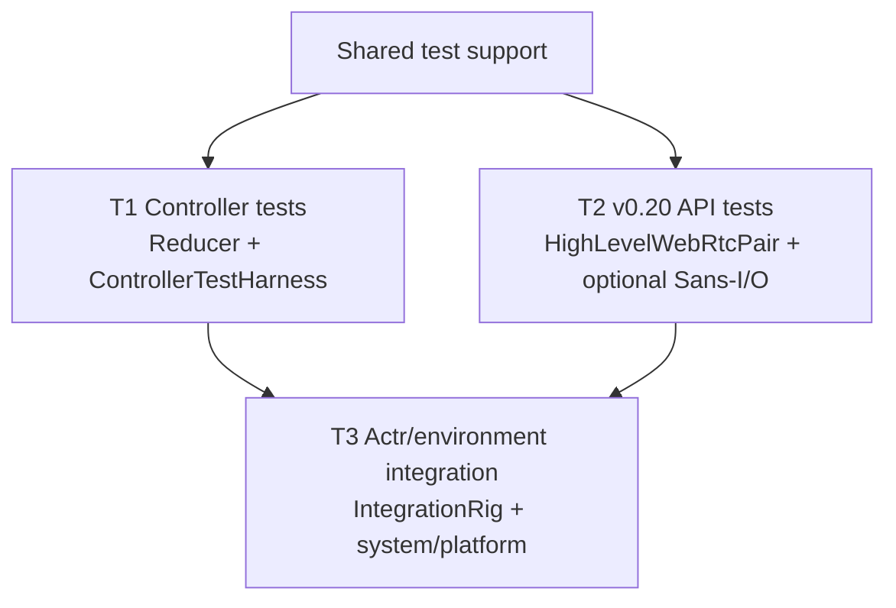

L0-L6 in the implementation plan are CI/release-gate labels mapped to T1/T2/T3; they do not represent
seven backends.

#### Production code and test seam

```text
RtcConnectionManager
└── RtcPeerController (one per remote peer)
    └── RtcPeerEffectPort (crate-private)
        └── WebRtcEffectRunner (only production implementation)
            └── PeerConnectionSession (one per PC generation)
                └── Arc<dyn PeerConnection> (webrtc-rs v0.20)
```

- `RtcPeerEffectPort` carries effects, completions, and semantic facts tagged with `peer_id`,
  `pc_generation`, and `operation_id`.
- `WebRtcEffectRunner` owns the Session registry, Handler ingress, DataChannel/Track pumps,
  cancellation, and explicit close. The Controller never touches those concrete objects.
- T1 uses `TestEffectSink` to record effects and inject completions/facts. It does not own a Session or
  implement a fake WebRTC API.
- T2 uses the official v0.20 high-level API to verify Factory, Session, Runtime, Handler, poll,
  backpressure, stats, and resource contracts. `SansIoProtocolRig` is enabled only for deterministic
  packet/deadline evidence.
- T3 uses the complete production Manager/Controller/Runner and connects external network or platform
  harnesses according to the gate.

#### Test-layer responsibilities

| Layer | Minimal fixture | Proves | Does not prove |
| --- | --- | --- | --- |
| T1 Controller | `ControllerTestHarness`, `TestEffectSink`, `ManualPolicyClock` | reducer purity, Controller task, mailbox, effect identity, Snapshot/Hook | v0.20 API, protocol packets, real network |
| T2 v0.20 API | `HighLevelWebRtcPair`, real Runtime; optional `SansIoProtocolRig` | Builder, Handler, PeerConnection/DataChannel/Track `poll()`, backpressure, stats, explicit close | Actr multi-peer policy, system network, mobile lifecycle |
| T3 Actr/environment | `ActrRtcIntegrationRig`, system/platform harness | Manager routing, multi-peer isolation, business sendability, real network/platform behavior | exhaustive reducer combinations or every protocol packet detail |

#### Shared support

Shared support provides observation and scheduling only; it does not keep a second RTC state machine:

- `ControllerTestHarness`: real Controller task, `TestEffectSink`, fact injector, Snapshot/Hook recorder,
  and policy clock;
- `HighLevelWebRtcPair`: two real v0.20 high-level PeerConnections for T2 contracts and T3 smoke tests;
- `SansIoProtocolRig`: optional core endpoints, deterministic network, and trace recorder;
- `ActrRtcIntegrationRig`: Manager, multiple Controllers, signaling, and resource probes;
- `MilestoneWaiter`, `SnapshotRecorder`, `HookRecorder`, and `ResourceProbe`: common public-result observers;
- `TestClock`, `FaultPlan`, and `TraceRecorder`: explicit time, directed faults, and replay evidence.

Fixtures are per-test-instance. They MUST NOT share process-wide mutable fault flags, Runtime profiles,
Handler recorders, or logical clocks. Tests observe public or controlled `pub(crate)` seams and never mutate
Controller-private fields.

#### Inter-layer data flow

```text
Command / Signaling / NetworkFact
                │
                ▼
        RtcPeerController
                │
                ├── RtcPeerEffectPort → effect executor
                │                         └── completion / driver fact
                ▼
        Snapshot / Hook / SendPermit / message result
```

Tests may vary input sources and external environments, but never replace Controller state semantics.
Shared assertions use Snapshot, Hook, Lane milestones, message results, and resource counts; raw events
are verified only by the layer that owns them.

#### CI gates

| Gate | Default content | Purpose |
| --- | --- | --- |
| Pull request | T1, T2 basic contracts, T3 minimum smoke | Fast state-machine, v0.20 API, and production-wiring feedback |
| RTC integration | T2 with Sans-I/O when needed, T3 integration rig | Protocol-tool and multi-peer production-loop evidence |
| Nightly | T2 resource/lifecycle, T3 long-running and system-network checks | Resource leaks and long-term stability |
| Release | T3 system/platform, browser, and TURN checks | Real-environment release confidence |

The exact scenarios, seeds, network profiles, and device matrix are maintained in a later test plan.

#### Migration structure for existing tests

Migrate by behavior ownership rather than copying files:

| Behavior | Target layer | Migration rule |
| --- | --- | --- |
| role, glare, generation, recovery policy, sendability | T1 | Extract pure state/effects; remove real sockets and fixed sleeps |
| Builder, Handler, DataChannel/Track poll, Runtime, backpressure, close | T2 | Use real v0.20 API; keep only API/resource contracts |
| packet loss, delay, reorder, deadlines, protocol recovery | T2 (optional Sans-I/O) | Move fault control into deterministic core tooling |
| Manager routing, Controller isolation, Snapshot/Hook, business messages | T3 | Use the production Runner and a small integration fixture |
| NAT, TURN, bind, IPv4/IPv6, browser interoperability | T3 system | Use real system network environments |
| Wi-Fi/cellular, foreground/background, FFI observers, resource recovery | T3 platform | Use platform harnesses and public Snapshot/Hook assertions |
| topology, signaling, waiters, cleanup, trace | Shared support | Compose fixtures; forbid global mutable fault state |

A lightweight inventory (`test_area | target_layer | owner | ci_gate | status`) is created first. The RFC
intentionally does not decide which old test is retained, merged, or deleted.

#### Explicitly deferred

The following belong to the later test plan or implementation PRs:

- test function names and assertion code;
- loss/delay/reorder/disconnection parameter matrices;
- seeds, time budgets, retry counts, and resource values;
- the exact test list for each CI gate;
- file-by-file deletion or merge decisions;
- Android/iOS devices, browsers, and TURN vendors.

The later plan MUST preserve the layer ownership and production seams defined above.

### Local addresses and sockets

Add the following platform abstraction:
```rust
trait LocalAddressProvider {
    async fn current_addresses(&self) -> Result<Vec<IpAddr>>;

    fn subscribe_changes(
        &self,
    ) -> watch::Receiver<LocalAddressSnapshot>;
}
```

MUST:
- Use the activity interface information provided by Android/iOS/desktop platform;
- Support address change notification;
- Trigger Hard Recovery when the interface address changes;
- Avoid the race condition of "first detect the port, close the socket, and then let the Builder bind";
- Configure fail-fast for unsatisfiable binds.
Implementations SHOULD NOT infer a unique local IP from a connection's public address (for example,
connecting UDP to a fixed public address as the only address source).

### Shared UDP mux and fixed ports

v0.20 currently does not fully expose legacy shared UDP mux injection capabilities. The target implementation defaults to using the real interface address plus
per-PeerConnection ephemeral UDP socket.
The old `ice_udp_mux_port` configuration MUST NOT be silently ignored:
- If the product no longer promises the capability, the configuration must be discarded and stated in the migration instructions;
- If a fixed shared port is a hard requirement for production, production cutover MUST wait for upstream/fork to provide it
  pre-bound socket or mux injection capabilities;
- Start SHOULD fail-fast when capability is missing instead of printing warning and then binding randomly.

### TURN transports

TURN/UDP MUST be covered by interoperability testing. TURN/TCP/TLS support depends on the actual v0.20
capabilities; this RFC makes no commitment until issue #848 is resolved and Actr completes end-to-end
verification. Configuration parsing MUST distinguish "unsupported" from "temporary connection failure";
an unsupported transport SHOULD return an explicit error before PeerConnection build.

### Media

Media uses native object safe types:
- `Arc<dyn TrackRemote>`;
- `Arc<dyn RtpSender>`;
- One poll consumer per Track;
- Track task binding generation and cancellation;
- Track add/remove triggers renegotiation serially through Controller effect;
- The Track task of the old generation exits after cancellation.
Track pump only forwards media and reports structure status, and cannot directly modify the Controller phase.

#### Deliberate regressions

**Answerer-initiated media renegotiation is dropped (breaking, Stage 7).**
The 0.14 `Coordinator::renegotiate_connection` created a re-offer from
whichever side changed its track set — either role could initiate. The v0.20
reducer only drives `CreateOffer` for `role == Offerer` (perfect-negotiation
lite: one offerer per peer pair, which is what makes glare tractable). An
answerer-side `NegotiationNeeded` is therefore deliberately ignored: the
track registers locally but the remote never learns of it.

Consequences and migration:

- Only the offerer may add/remove media tracks mid-connection. Peers that
  need answerer-published media must swap roles at connect time, or have the
  answerer ask the offerer (out of band) to add the m-line.
- The answerer still applies INCOMING offerer re-offers (same-ufrag offer on
  an established session is a renegotiation, not stale) and its pre-answer
  track set rides the initial answer as before.
- This is a wire-visible behavior break versus 0.14 mixed fleets: a 0.14
  answerer re-offers to a v0.20 offerer still works (the v0.20 offerer
  answers), but a v0.20 answerer never re-offers to a 0.14 offerer.

### Error model

At least a stable distinction is required:
- `ConnectionNotReady`;
- `PeerConnectionBuildFailed`;
- `NegotiationFailed`;
- `IceRestartFailed`;
- `PeerConnectionRebuildFailed`;
- `DataChannelBufferFull`;
- `DataChunkDeliveryUncertain`;
- `UnsupportedRtcCapability`;
- `RtcResourceLimitExceeded`;
- `RecoveryExhausted`;
- `Closed`;
- `StaleRtcOperation`, internal diagnostics or trace only.
Snapshot's `unavailable_reason` SHOULD uses a stable enum instead of exposing the underlying error string directly to
FFI. Low-level errors are kept in logs and error source chain.

### Observability

All RTC logs and spans contain at least:
```text
peer_id
pc_generation
ice_generation
operation_id
role
internal_phase
public_status
```

`ActrId` in logs, errors, and tracing MUST use `ActrId::to_string_repr()`.
Indicators include at least:
- The number of Peers for each public status;
- PC build/rebuild success and failure;
- ICE restart times and time;
- stale driver event/completion number;
- Handler mailbox depth and overflow;
- Number of active/pending/retiring Sessions;
- DataChannel number and buffer-full events;
- Number of socket/FD and session tasks;
- Direct/Relayed/Unknown network path;
- Hook execution takes time and fails;
- Controller recovery latency.
Stats sampling must be performed at staggered peaks or on demand, and `get_stats()` cannot be called on all peers at the same time after the network is restored.

### Security and privacy

- TURN username/password MUST NOT write to logs, Snapshots or metrics labels.
- SDP, Candidate and network address log SHOULD support desensitization levels.
- Runtime/socket fault injection MUST only be enabled in test or explicit debug configuration.
- `unavailable_reason` exposed by FFI MUST use stable enumeration and cannot contain credentials or any underlying errors
  String.
- Receive-side budgets and mailbox overflow MUST prevent the remote end from causing unbounded memory growth through events or message storms.

### Target module layout

Suggested final directory:
```text
core/hyper/src/wire/webrtc/
├── manager.rs
├── factory.rs
├── event_handler.rs
├── events.rs
├── notification.rs
├── status.rs
├── peer/
│   ├── controller.rs
│   ├── handle.rs
│   ├── state.rs
│   ├── reducer.rs
│   ├── effects.rs
│   ├── effect_runner.rs
│   ├── recovery.rs
│   └── session/
│       ├── mod.rs
│       ├── ingress.rs
│       ├── resources.rs
│       ├── data_channel.rs
│       ├── media.rs
│       └── stats.rs
└── signaling/
    ├── router.rs
    └── protocol.rs
```

Current file migration relationship:
| Current module | Target change |
| --- | --- |
| `coordinator.rs` | Split into Manager, Controller, Router and NotificationHub |
| `connection.rs` | Split into EffectRunner, Session ingress/resource registry, DataChannel and Media |
| `negotiator.rs` | Factory configuration and Controller negotiation effects |
| `signaling.rs` | Retain signaling transport; Peer routing is split to Router |
| `peer_gate.rs` | Remove recovering set and use Snapshot and SendPermit instead |
| `framework/src/workload.rs` | Add Snapshot query/subscribe and unified status Hook |
| `bindings/ffi/src/workload.rs` | Add Snapshot observer and initial replay |
| migration adapter | final removal |

## Drawbacks

### Large refactor surface

The migration touches `core/hyper`, framework Hooks, PeerGate, FFI, and mobile bindings. The review and
regression surface is larger than a dependency-only upgrade.

### Temporary duplication

Keeping the 0.14 and v0.20 paths buildable during migration temporarily increases dependency count,
compile time, and test cost. This duplication is bounded by the staged cutover and MUST be removed at the
end of Stage 7.

### More explicit lifecycle code

v0.20 makes resource boundaries visible, but Actr must implement the reducer, effect identity, pump
ownership, close orchestration, and resource budgets explicitly. The code may not become smaller; implicit
concurrency is replaced with explicit ownership and sequencing.

### Mailbox policy becomes product behavior

Queue bounds, buffer-full behavior, overload recovery, and uncertain delivery become observable business
errors. Their limits and policies must be selected deliberately and measured under the target peer scale.

### Per-connection sockets may increase resource usage

If v0.20 cannot provide the legacy shared UDP mux, multi-peer deployments may use more sockets, file
descriptors, and NAT mappings. Stress testing at the target scale is required before production cutover.

### Public API expansion

Snapshot query/subscribe, `NetworkPath::Unknown`, and `on_webrtc_state_changed` expand the Rust, FFI,
Android, iOS, and Web API surfaces. The binding rollout must be synchronized across platforms.

## Alternatives

### Alternative 1: Stay on webrtc-rs 0.14

Remaining on 0.14 avoids immediate migration cost, but cannot adopt v0.20's Runtime model, unified Handler,
object-safe handles, or native backpressure. It is acceptable only as a short-term stabilization branch,
not as the long-term mainline.

### Alternative 2: Treat a v0.20 callback adapter as the final architecture

An adapter makes the old code compile quickly, but reimplements callback slots, early-event caching,
and wrapper status on top of the 0.14 execution model. It would have to be deleted during the structural
refactor. An adapter MAY be used for short-term API comparison, but MUST NOT be the final production path.

### Alternative 3: Keep one global mutable Coordinator

Adding `peer_id` to Handler events while keeping all peer state in one global Coordinator reduces the
initial code movement, but candidate storms, recovery, close, and generation races still contend on global
maps and locks. It does not satisfy multi-peer isolation.

### Alternative 4: One Controller per physical PeerConnection

Creating a new Controller for every rebuild requires handing off role, business status, Hook revisions,
and recovery budget. Old Controllers could continue publishing late events. A long-lived Controller per
logical peer with replaceable physical Sessions cleanly separates logical connection from generation.

### Alternative 5: Drive the Sans-I/O `rtc` core directly

Driving the core in production would make Actr responsible for sockets, timers, deadlines, STUN/TURN
gathering, event dispatch, and resource lifecycle. That increases maintenance and behavioral-drift risk
relative to the official high-level wrapper. This RFC therefore permits Sans-I/O only as a test tool whose
output is normalized to Actr semantic events; production continues to use the official `webrtc` async
wrapper, and the two paths share semantic contracts rather than WebRTC objects.

### Alternative 6: Big-bang replacement

Changing dependencies, structure, signaling, DataChannel, recovery, media, and bindings in one PR may
reduce temporary duplication, but makes review, regression isolation, and rollback difficult. The RFC
chooses phased vertical slices with explicit exit criteria and removes the old implementation only in Stage 7.

### Alternative 7: Make no change

Not upgrading does not immediately break existing connections, but leaves new recovery, resource, and
mobile lifecycle capabilities on the old callback architecture. The cost and risk increase as more features
and platform tests are added.

## Acceptance criteria

### Architecture

- A remote peer can have at most one live `RtcPeerController`.
- A Controller can have at most one sendable generation.
- Old generation event/completion does not change new generation.
- The reducer does not read wall-clock time or I/O; deadlines arrive as explicit inputs or timer facts.
- All production PCs are built by `PeerConnectionBuilder`, and injected with this generation before building
  `Runtime` and `PeerConnectionEventHandler`.
- Controller only saves `RtcSessionSlot`; each Peer's `WebRtcEffectRunner` holds the physical Session,
  production session saves `Arc<dyn PeerConnection>`.
- raw DataChannel/Track only enters the generation-owned Session resource registry; Controller only consumes
  resource token, metadata and semantic events.
- `WebRtcEffectRunner` is the only production runner; T1 only uses Controller harness, T2
  Sans-I/O is available as an optional test-only tool.
- The nine `PeerConnectionEventHandler` callbacks are clearly internally mapped and tested.
- At most one `poll()` consumer per DataChannel, TrackRemote and TrackLocal.
- Data payload does not go through the Controller mailbox.
- PeerGate and Coordinator no longer maintain duplicate recovering states.
- EventHandler does not perform blocking, signaling, Hooking, restarting or closing.
- EventHandler callbacks do not await the Controller or driver task; Session ingress and receive queues
  are bounded by count and bytes (or use explicit protocol backpressure), and overflow is observable.
- Unsupported v0.20 capabilities or resource configurations fail fast; they never silently downgrade.
- All Sessions are explicitly closed and tasks converged.
- Manager peers lock is not held across `.await`.

### Functional behavior

- Both Offerer/Answerer can establish connections.
- simultaneous connect/glare can be converged into a logical connection.
- Four DataChannel Lane behaviors remain compatible.
- PC Connected but still Connecting when `RpcReliable` is not Open.
- Connected must be equivalent to `sendable=true`.
- Mobile late subscribe to get the current Snapshot immediately.
- Send quick return `ConnectionNotReady` during Recovering.
- Only one Connected transition will occur if the recovery is successful.
- When the sending buffer has been entered but the result is uncertain, `DataChunkDeliveryUncertain` can be reported.
- Media Track add/remove and renegotiation work properly.

### Recovery and lifecycle

- Soft ICE restart does not increase PC generation after success.
- Local interface changes trigger Hard Recovery.
- Hard Recovery atomic switch active generation.
- racing close with build/restart will not revive a closed Session.
- close-all uses the overall deadline to close all peers concurrently.
- One peer recovery or event storm does not block other peers.
- Recovery exhaustion closes every physical Session, retires the matching transport flight, and a
  subsequent send/connect creates a fresh flight instead of reusing a stale ready wire.
- Soft Recovery and an in-budget Hard Recovery never evict the logical transport flight; successful
  Hard Recovery retires only the old generation.
- Initial terminal build/negotiation failure and unrecoverable PC/ICE close or driver exit converge to
  terminal `Idle` with no live generation and no cached ready wire.
- A delayed retirement event from an old generation cannot remove a newer connection flight.

### Resource and overload

- DataChannel, SCTP and Actr queues have explicit upper limits.
- `with_data_channel_send_buffer_limit()` uses tested non-zero finite values and cannot retain v0.20 default
  Unlimited send buffer.
- Handler mailbox overflow is observable and can be safely converged.
- Socket, FD, task and memory meet the budget under multi-peer target scale.
- Slow Hook and slow message consumer do not block the webrtc driver.
- There is no continuously growing Session, socket, task or buffer after a long soak.

### Interoperability

- Rust peer-to-peer interoperability.
- Browser WebRTC interoperability.
- TURN/UDP interoperability.
- IPv4 and IPv6 interoperability within the supported range.
- Android/iOS Wi-Fi, cellular, network disconnection and front and backend recovery pass.
- Unsupported TURN/TCP/TLS or mux configuration fail-fast.

### Test architecture
- T1/T2/T3 are layered according to the responsibilities defined in this section. Each layer uses independent fixtures, and the test layer is not called a replaceable runner.
- T1 only verifies Controller and effect ports, does not create PeerConnection, and does not implement a complete WebRTC fake.
- T2 verifies the resource contract between v0.20 high-level API and `WebRtcEffectRunner`; deterministic packet or deadline is required
  Only enable the test-only Sans-I/O tool.
- T3 verifies the complete Actr production wiring, and accesses the real system network and platform life cycle according to access control, and reuses it publicly
  Snapshot/Hook semantics.
- All fixtures must have a clear owner, CI gate, resource baseline and teardown; specific scenario and parameter matrix
  and a file-by-file migration checklist defined in subsequent test plans.

### Required verification

Every implementation PR MUST execute at least:
```bash
cargo fmt
cargo clippy --fix --lib --bins --all-targets --allow-dirty
cargo test --workspace
```

Stages involving mobile recovery MUST also execute the corresponding T3 platform gate. Each implementation
PR documents the affected test layer, fixture, and CI gate; later test plans own scenarios, seeds, matrices,
and device combinations. Passing only the T1 harness MUST NOT be used to declare the v0.20 production
migration complete.

## Unresolved questions

### RFC tracking number

The tracking issue is #504 and this RFC is proposed in PR #505.

### Shared UDP mux requirement

Confirm whether production requires fixed shared UDP ports. If it does, upstream or a fork must expose
pre-bound socket or mux injection before cutover; otherwise the migration must remove that capability from
its compatibility promise and fail fast when configured.

### Resource defaults

Benchmarks must set the DataChannel send-buffer limit, SCTP receive window,
maximum parallel PC builds/restarts, Controller mailbox limit, and shutdown drain deadline.

### Dedicated reactor policy

Measure thread count, throughput, latency, and power for the mobile Tokio driver and server bounded reactor
pool before choosing default profiles.

### Sans-I/O clock and replay completeness

Rollout Stage 1 is blocked until the `Runtime::now()` seam exists, either in upstream or as a vendored patch.
After Clock level B, determine whether internal v0.20 `Instant::now()` calls participate in ICE/DTLS/SCTP
deadlines and whether certificate/ICE-credential randomness changes packet ordering. Until protocol time
and randomness are injectable, record safe advancement steps and do not claim full virtual time or bit-exact replay.

### Hard Recovery handoff mode

Choose make-before-break or break-before-make per platform. Both modes must preserve the one-active-generation
invariant; resource peak and recovery latency are the trade-offs.

### Public API compatibility window

Decide how long `on_webrtc_state_changed`, Snapshot APIs, and the three existing Hooks coexist, and how
`relayed: bool` migrates to `NetworkPath`.

### TURN/TCP/TLS scope

Record a support matrix for each platform and TURN transport before cutover. Unverified capabilities cannot
be included in compatibility guarantees.

## Future possibilities

### Shared socket provider upstream API

Submit pre-bound socket, shared UDP mux, or endpoint-provider capabilities to webrtc-rs so multi-peer
servers and mobile clients can reduce socket/NAT mappings.

### Full virtual network control plane and injectable clock

The Sans-I/O lab deterministically controls core packets, endpoint routes, and protocol deadlines, but not
candidate gathering, bind, STUN/TURN, mDNS, NAT mappings, or system interfaces. Future upstream work could
add an injectable Clock and expose pre-bound sockets, endpoint providers, or alternative gatherers in the
high-level Builder. Until then, Sans-I/O packet tests cannot replace system-network tests.

### Model-based controller tests

Generate random commands, driver events and completion sequences based on reducer, verify one-active-generation,
Hook deduplication, close linearization, and stale-event invariants.

### Aggregate status

Non-authoritative aggregate state can be added on top of Snapshot, such as connected/recovering peer counts
and `has_any_sendable_peer`, for UI and monitoring. It MUST NOT be used as a send prerequisite for a
specific peer.

### Make-before-break optimization

On platforms where the resource budget allows, Hard Recovery can close the old Session after the new
Session is ready, reducing the availability gap.

### Runtime profiles

Provides predefined runtime, buffer, socket and recovery concurrency based on server, desktop, Android and iOS
profile while maintaining process-level configuration consistency.

## References

- [webrtc-rs v0.20.0 release](https://github.com/webrtc-rs/webrtc/releases/tag/v0.20.0)
- [webrtc-rs v0.20.0 PeerConnection source](https://github.com/webrtc-rs/webrtc/blob/v0.20.0/src/peer_connection/mod.rs)
- [webrtc-rs v0.20.0 DataChannel source](https://github.com/webrtc-rs/webrtc/blob/v0.20.0/src/data_channel/mod.rs)
- [webrtc-rs v0.20.0 TrackRemote source](https://github.com/webrtc-rs/webrtc/blob/v0.20.0/src/media_stream/track_remote/mod.rs)
- [webrtc-rs v0.20.0 TrackLocal source](https://github.com/webrtc-rs/webrtc/blob/v0.20.0/src/media_stream/track_local/mod.rs)
- [webrtc-rs v0.20.0 Runtime source](https://github.com/webrtc-rs/webrtc/blob/v0.20.0/src/runtime/mod.rs)
- [webrtc-rs v0.20.0 MockRuntime source](https://github.com/webrtc-rs/webrtc/blob/v0.20.0/src/runtime/mock.rs)
- [webrtc-rs v0.20.0 async PeerConnection driver source](https://github.com/webrtc-rs/webrtc/blob/v0.20.0/src/peer_connection/driver.rs)
- [webrtc-rs v0.20.0 official integration tests](https://github.com/webrtc-rs/webrtc/tree/v0.20.0/tests)
- [webrtc-rs v0.20.0 data-channel backpressure test](https://github.com/webrtc-rs/webrtc/blob/v0.20.0/tests/data_channel_send_backpressure.rs)
- [webrtc-rs v0.20.0 custom Runtime interop test](https://github.com/webrtc-rs/webrtc/blob/v0.20.0/tests/custom_runtime_interop.rs)
- [rtc v0.20.0 RTCConfigurationBuilder source](https://github.com/webrtc-rs/rtc/blob/v0.20.0/src/peer_connection/configuration/mod.rs)
- [rtc v0.20.0 `RTCPeerConnection` Sans-I/O `Protocol` implementation](https://github.com/webrtc-rs/rtc/blob/v0.20.0/src/peer_connection/handler/mod.rs)
- [rtc v0.20.0 rtc-to-rtc DataChannel driver test](https://github.com/webrtc-rs/rtc/blob/v0.20.0/tests/data_channels_negotiated_rtc2rtc.rs)
- [rtc v0.20.0 ICE restart interop test](https://github.com/webrtc-rs/rtc/blob/v0.20.0/tests/ice_restart_by_rtc_interop.rs)
- [sansio 1.0.1 `Protocol` source](https://github.com/webrtc-rs/sansio/blob/c10077d311406070693168dfa493389d57638f7c/src/lib.rs)
- [rtc v0.20.0 statistics source](https://github.com/webrtc-rs/rtc/tree/v0.20.0/src/statistics)
- [webrtc-rs issue #848: TURN/TCP support](https://github.com/webrtc-rs/webrtc/issues/848)
- `core/hyper/src/wire/webrtc/coordinator.rs`
- `core/hyper/src/wire/webrtc/connection.rs`
- `core/hyper/src/wire/webrtc/negotiator.rs`
- `core/hyper/src/wire/webrtc/signaling.rs`
- `core/hyper/src/outbound/peer_gate.rs`
- `core/framework/src/workload.rs`
- `bindings/ffi/src/workload.rs`

## Compatibility and phasing

### Wire compatibility

This RFC does not plan to modify the existing Offer, Answer, ICE Candidate, restart request, or application message wires
format. If the wire schema must be modified during implementation, the protocol design and compatibility strategy must be submitted separately at the corresponding stage and cannot be
as an implicit implementation detail of this RFC.

### Rust and binding API compatibility

The new Snapshot query/subscribe and `on_webrtc_state_changed` are additive APIs. There are three
Hook continues to be retained during the migration period and is generated by NotificationHub projection.
If `PeerEvent.relayed: bool` is migrated to `NetworkPath`, it will cause breaking change in the binding layer. Implement
The stage should use the project 0.x breaking-change process, or add new fields first and keep old fields for a compatibility period.

### Configuration compatibility

Capabilities configured but not satisfied by v0.20 MUST fail-fast and cannot fall back silently. Highlights include:
- shared UDP mux/fixed port;
- NAT 1:1 behavior;
- UDP port range;
- TURN/TCP/TLS;
- Runtime clock seam (`Runtime::now()` upstream patch or vendored equivalent);
- Existing VNet test configuration and migrated Sans-I/O link-rule/system-network configuration.
Each configuration must enter the capability matrix before cutover, marked as supported, unsupported,
deprecated or blocked.

### Dependency policy

After the Stage 7 cutover (2026-08): `webrtc = "0.20.0"` is the only RTC
crate in actr-hyper; `rtc = "=0.20.0"` is a pinned production dependency
(the outbound media path names `rtc::rtp` / `rtc::media_stream` /
`rtc::peer_connection::configuration::media_engine` types that `webrtc`
0.20 does not re-export). The 0.14 line remains only as `webrtc014` for
actrix's TURN/STUN server crates. Long-term callback adapters keeping the
old Coordinator functional on v0.20 are not allowed.

### Stage 1: Introduce and validate webrtc-rs v0.20

Goal: Verify v0.20 native capabilities without migrating the complete old architecture.
Work content:
1. Inventory existing Hook, signaling, Lane, close and mobile behaviors, and register them in the test migration inventory;
2. Introduce v0.20 in parallel and apply the `Runtime::now()` upstream patch (or a temporary vendored
   patch) before claiming the clock seam is available;
3. Use `RTCConfigurationBuilder` and `PeerConnectionBuilder` to implement the minimum Factory and call it explicitly
   `with_configuration()`, `with_media_engine()`, `with_setting_engine()`,
   `with_interceptor_registry()`, `with_runtime()`, `with_handler()`, `with_udp_addrs()`,
   `with_sctp_receive_buffer_size()`, `with_data_channel_send_buffer_limit()` and `build()`;
4. Implement minimal `LocalAddressProvider`, Tokio Runtime, and standalone
   `PeerConnectionEventHandler`; verify Handler reception before build and verify the patched Runtime clock;
5. Use two `Arc<dyn PeerConnection>`, pass `create_offer()`,
   `set_local_description()`, `set_remote_description()`, `create_answer()` and
   `add_ice_candidate()` complete Offer/Answer/trickle ICE;
6. Use `create_data_channel()` and `RTCDataChannelInit` to open `RpcReliable`, and both parties use unique
   `DataChannel::poll()` loop completes bidirectional `send()`;
7. Set limited send buffer and verify `send()`, `try_send()`, `writable()`, high/low water
   event and `outstanding_bytes()`;
8. Call `DataChannel::close()` and `PeerConnection::close()` to verify task/socket convergence;
9. Verify that `get_stats(Instant::now(), StatsSelector::None)` can parse the selected candidate path;
10. Confirm `with_udp_addrs()`, `with_tcp_addrs()`, UDP mux, TURN/TCP, NAT, IPv4/IPv6,
    dedicated reactor, and the Runtime clock patch as capability-matrix entries/blockers;
11. Create `HighLevelWebRtcPair`, `RuntimeFaultProbe`, `ResourceProbe`, and shared semantic-assertion scaffolding;
12. Reserve seams for test-only `SansIoProtocolRig` and `DeterministicNetwork`; do not fix a specific
    fault rule, scenario, or replay matrix in this stage;
13. Establish fixture owners, CI gates, resource baselines, and teardown conventions for T1-T3; specific use cases will be added later.
Phase exit criteria:
- v0.20 minimum connection establishment, sending, closing closed loop is stable;
- The old production path is not affected;
- No old callback API adapter;
- v0.20 contract fixtures for Builder, Handler, poll, backpressure, stats, and explicit close are established;
- The seams and dependency boundaries of the Sans-I/O harness have been determined, and there is no requirement to complete a specific fault matrix at this stage;
- high-level async harness uses real v0.20 wrapper, resource probe and teardown conventions have been determined;
- the Runtime clock patch is tracked upstream or vendored, and `Instant::now()` restrictions on fast-forward
  have a clear conclusion and enforceable constraints;
- The capability matrix and cutover blocker have clear conclusions.

### Stage 2: Build Manager, Controller and Session skeleton

Goal: First prove the concurrency and state model, and then connect to the complete business.
Work content:
1. Implement `RtcConnectionManager` and Handle registry;
2. Implement `RtcPeerController` reducer/effects;
3. Implement `PeerConnectionSession` and generation;
4. Implement command, semantic driver event and Snapshot channels;
5. Implement the crate-private `RtcPeerEffectPort` seam with peer/generation/operation identities on
   effects and completions;
6. Implement `ControllerTestHarness`, `EffectRecorder`, `FactInjector`, and `ManualPolicyClock`.
   Stabilize T1 input, output, and teardown seams without implementing scripted WebRTC;
7. Let the raw DataChannel/Track object stay in the Session, and the Controller only receives resource token, metadata and
   `LaneOpened`/`LaneClosed`/`TrackOpened` etc. semantic fact;
8. Implement the basic interfaces of generation, completion identity and close barrier;
9. Implement NotificationHub skeleton;
10. Establish test entrances for reducer, Handler mapping, pump ownership, Snapshot and Hook contract;
    Specific assertions and use cases will be added later.
Phase exit criteria:
- T1 fixture can drive Controller without building PeerConnection;
- Test entrances for generation, completion, close and Snapshot/Hook contracts are available;
- Multiple Controllers can run in parallel;
- Taking over the production data path is not yet required.

### Stage 3: Migrate real PeerConnection and signaling

Goal: The new structure completes multi-peer connection establishment and signaling.
Work content:
1. Implement the only production `WebRtcEffectRunner` by returning v0.20 of `Arc<dyn PeerConnection>`
   Factory executes Controller effect;
2. Each PC generation is injected independently through `PeerConnectionBuilder::with_handler()`
   EventHandler, and receives all nine callbacks;
3. Implement SignalingRouter;
4. Use `create_offer()`, `create_answer()`, `set_local_description()` and
   `set_remote_description()` migrates Offerer/Answerer and glare;
5. Use current/pending description getters and `can_trickle_ice_candidates()` to complete
   negotiation reconciliation;
6. Use `RTCPeerConnectionIceEvent.candidate.to_json()` and `add_ice_candidate()` to migrate SDP,
   ICE generation, ufrag, and candidate handling;
7. Incoming Offer automatically creates Answerer Controller;
8. Migrate negotiation effect identity and merge duplicate `on_negotiation_needed()`;
9. Support multiple Peers to establish and close connections at the same time;
10. Keep `SansIoProtocolRig` as an independent test-only tool; if combined verification is required, only add narrow
    test-only adapter, do not implement it as a second effect runner;
11. Create fixtures, resource boundaries, and per-link fault seams for T2 protocol tools and T3
    `ActrRtcIntegrationRig`; add topology, scenario, and fault matrices later;
12. Define the version and owner of the T2/T3 shared semantic contract without requiring the layers to
    share WebRTC objects.
Phase exit criteria:
- T2 high-level API/protocol tools and T3 production rig fixtures can run independently;
- Multiple Peer, signaling, fault and resource assertions have clear ownership layers;
- The version, owner and teardown rules of T2/T3 shared semantic contract have been determined;
- Role, ICE, and lifecycle status no longer rely on the old global map.

### Stage 4: Migrate DataChannel and business send path

Goal: The new architecture officially takes over business data.
Work content:
1. Use v0.20 `RTCDataChannelInit` and `create_data_channel()` to implement four Lanes and migrate
   `ordered: bool` and `protocol: String`;
2. Each `Arc<dyn DataChannel>` has a `poll()` pump, covering all `DataChannelEvent`;
3. `RpcReliable` becomes readiness anchor;
4. Implement LaneHandle and SendPermit;
5. Modify PeerGate and delete duplicate recovering status;
6. Use metadata getters to verify the incoming Channel and reject duplicate or unmatched Lanes;
7. Use `send()`, `try_send()`, `writable()` and `outstanding_bytes()`;
8. Rely on the per-channel send-buffer limit for flow control (no Actr-level aggregate send budget);
9. Report uncertain delivery;
10. Ensure inbound and outbound payloads bypass the Controller;
11. Shutdown explicitly calls each `DataChannel::close()`;
12. Establish test entrances for DataChannel messages and resource contracts for T2/T3;
    Specific Lane, event and fault use cases will be added later.
Phase exit criteria:
- RPC, signal, reliable stream, and latency-first stream all take new paths;
- Fixtures for DataChannel, SendPermit, and generation contract can be run;
- Connected is equivalent to `sendable=true`;
- The new structure takes over the production business data path.

### Stage 5: Migrate recovery and shutdown

Goal: Complete mobile network recovery, PC replacement, and resource convergence.
Work content:
1. RecoverySupervisor broadcasts network facts to Controller;
2. Use `get_configuration()`/`set_configuration()` and `restart_ice()` for Soft ICE restart. The
   Controller explicitly schedules `create_offer()` after restart and deduplicates other
   negotiation-needed events in the same epoch;
3. Implement Hard PeerConnection rebuild;
4. Implement pending/active/retiring Session handoff;
5. Implement address changes and App front and back policies;
6. Implement TURN configuration refresh; a rejected `set_configuration()` change enters Hard Recovery;
7. Add build/restart semaphore and jitter;
8. Implement close-peer and close-all with `DataChannel::close()`, Track cancellation, and
   `PeerConnection::close()`;
9. Implement mailbox overflow recovery;
10. Create fault-injection seams for `DeterministicNetwork`, `RuntimeFaultProbe`, system harness, and
    platform harness; do not fix a loss/reorder or device matrix at this stage;
11. Unify recovery, resource, and teardown observation for T2-T3;
12. Move specific network, NAT, TURN and mobile use cases into subsequent test plans.
13. Implement separate generation-retired and transport-retired lifecycle edges, including
    `RecoveryExhausted` and initial terminal failure cache invalidation;
Phase exit criteria:
- T2-T3 recovery, resource, and teardown fixture boundaries have been established;
- system/platform harnesses can access unified Snapshot/Hook/resource observation;
- the specific network and mobile recovery matrix is transferred to the subsequent testing plan.
- T2/T3 proves Connected -> RecoveryExhausted removes the cached transport and that the next send
  establishes a fresh PC generation; an old-generation close cannot evict that replacement.

### Stage 6: Migrate media, status API and bindings

Goal: Complete all caller-visible abilities.
Work content:
1. Use `on_track()`, `TrackRemote::poll()` and `TrackLocal::poll()` to implement unique poll
   ownership;
2. Use `add_track()`, `remove_track()`, transceiver APIs, and sender/receiver getters to migrate media
   topology and renegotiation;
3. Use `get_stats(Instant, StatsSelector::{None, Sender, Receiver})` to complete selected path,
   transport, DataChannel and media observations;
4. Complete Snapshot query, list and subscribe;
5. Complete initial replay;
6. Add `on_webrtc_state_changed`;
7. Map the existing three Hooks to Snapshot transition;
8. Update FFI, Android, iOS and Web binding;
9. Update mobile terminal sending and retry examples;
10. Establish Track, stats, Snapshot/Hook initial replay, and binding-observation contract seams for T2-T3;
    add specific media and platform use cases later.
Phase exit criteria:
- The media, status and binding observation seams of T2-T3 are operational;
- Each platform reuses unified Snapshot/Hook semantics;
- Specific media and mobile use cases will be transferred to subsequent testing plans.

### Stage 7: Cut over, remove compatibility code and harden

Goal: Make the new v0.20 architecture the only production implementation.
Work content:
1. Switch all production entrances to `RtcConnectionManager`;
2. Delete the per-peer state in the old Coordinator;
3. Delete the old connection callback wrapper;
4. Delete the old negotiator flight/recovery status;
5. Delete migration adapter;
6. Delete duplicate recovery states of PeerGate and other modules;
7. Delete webrtc-rs 0.14;
8. Rename `webrtc_v020` to the official `webrtc`;
9. Establish a release gate for long-term stability, memory, FD, socket and mobile terminal power consumption testing;
10. Complete the migration of T1-T3 fixture, owner, CI gate and teardown contract;
11. Remove test support that relies on the old VNet/callback structure and has been covered by the new layer;
12. Update API, configuration and migration documentation.
Phase exit criteria:
- The code base only retains v0.20 production backend;
- All acceptance criteria completed;
- Resource usage meets the budget under the target multi-peer scale;
- Browser, TURN/UDP, IPv4/IPv6 and mobile release gate have been connected;
- There is no long-term callback adapter or duplicate state source.

**Status (2026-08, cutover landed):** items 1-8 and 10-12 are complete — the
v0.20 backend is the only production path (the 0.14 coordinator / connection /
negotiator / gate / PeerGate Legacy authority / webrtc 0.14 dependency are
deleted; `webrtc_v020` is renamed to the canonical `webrtc`; the VNet-era
test support is gone, replaced by the S5-10 `RuntimeFaultProbe` /
`DeterministicNetwork` seams). The T1-T3 fixture/owner/teardown contract and
API/configuration/migration documentation are implemented in
`docs/webrtc-v020-test-contract.md` and the companion v0.20 documents. Item 9
remains a release-qualification gate: local deterministic and loopback
coverage is implemented, while browser, live TURN/UDP, IPv4/IPv6 system,
Android/iOS device, long-soak memory/FD/socket, and mobile-power runs require
their external CI/lab environments and are not claimed by a local workspace
test run.

### Rollback

Stages 1-3 do not switch the production data path and can roll back by disabling the new entry. Stage 4
starts switching business data; each implementation PR MUST retain a clear revert boundary and MUST NOT
delete all old paths in one change. Stage 7 requires a stable observation period before deleting the old
backend. After deletion, rollback reverts the cutover/cleanup PR as a whole rather than switching
individual peers between backends, avoiding divergent state or wire behavior.
