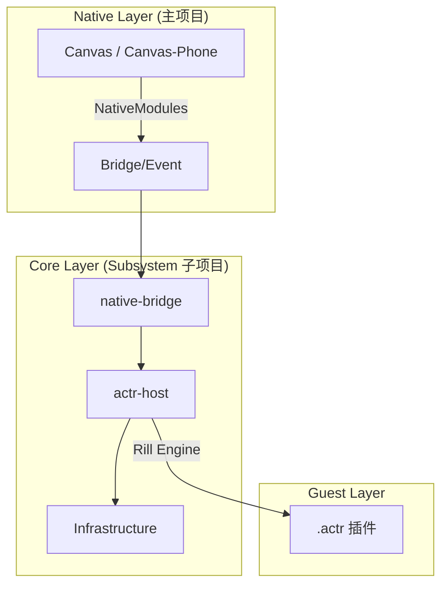

# AskAway-Pad/Phone 系统架构总览

本项目是一个跨平台的移动端 AI 交互系统，采用 **Native iOS 外壳 + React Native 运行时** 的混合架构。通过一套 `Subsystem` 业务内核同时驱动 iPad（Canvas）和 iPhone 两端。

---

## 1. 整体分层架构

### 分层概览

| 层级 | 职责说明 |
|---|---|
| **Native Layer** | 负责应用生命周期、多标签页容器管理、系统级 API (Actr SDK, Speech, Camera, Safe Area)。 |
| **JS Native-Bridge** | 实现 JS 与 Native 的双向通信，对 Actr WebRTC 信号进行封装、路由及引用计数管理。 |
| **JS Actr-Host (内核宿主)** | 业务逻辑核心。负责路由调度、插件生命周期管理、双端响应式 UI 组件。 |
| **Infrastructure (基础设施)** | 会话初始化流程编排、SQLite 异步持久化、全局状态管理 (Zustand)。 |

---

## 2. 模块职责与协作关系

### 关键组件协作
- **TabRouter** (RN 入口)：接收 Native 传入的配置，按类型路由到 `ActrApp` (插件) 或系统内置应用 (登录/历史)。
- **ActrApp / ActrTabView**：管理 Rill Engine 实例池。负责下载、校验插件包，初始化渲染沙箱，并向原生推送监控快照。
- **native-bridge**：作为 JS 与原生 SDK 间的唯一通道，处理复杂的 WebRTC 连接逻辑，实现消息流的端到端路由。
- **Infrastructure (api/repo/services)**：`AppSessionService` 负责会话的完整初始化流程（获取信息 -> 校验包 -> 解析脚本）。

### 设计规范原则
- **分层隔离**：`native-bridge` 隔离原生复杂性，上层业务无需关心 WebRTC 细节。
- **职责分离**：内存 Store 控制 UI 呈现，Repository 负责 SQLite 读写。
- **响应式 UI**：基于同一套逻辑内核，自动适配 Pad (三栏/侧边栏) 与 Phone (单栏/覆盖层) 布局。

---

## 3. 项目协作与仓库说明

- **主仓库 (Current)**:
    - `Canvas/` & `Canvas-iPhone/`: Native 壳源码与构建环境。
    - 职责：多窗口管理、原生能力增强、渲染层稳定性。
- **子仓库 (Loom - Submodule)**:
    - `Subsystem/`: 纯 JS/TS 业务内核。
    - 职责：业务逻辑、数据持久化、双端逻辑适配。
    - **详细逻辑文档：[Subsystem/AGENTS.md](./Subsystem/AGENTS.md)**

---

## 4. 核心数据流

### A. 应用加载流
Native 启动 -> `TabRouter` 分发 -> `AppSessionService` 初始化插件容器 -> `ActrTabView` 激活插件运行时。

### B. 消息交互闭环
1.  **发送**: 用户输入 -> `ActrInput` -> `native-bridge` -> `Native Actr SDK` -> `Server`。
2.  **接收**: `Native Event` -> `native-bridge` (流式分发) -> `useMessageStore` (内容累加) -> `UI` 呈现。

---

## 5. 开发规范
- 跨端共用的业务逻辑不要直接在 Native 层实现，要下沉至 `Subsystem`。
- 原生模块引用须在 `native-bridge` 中收敛。
