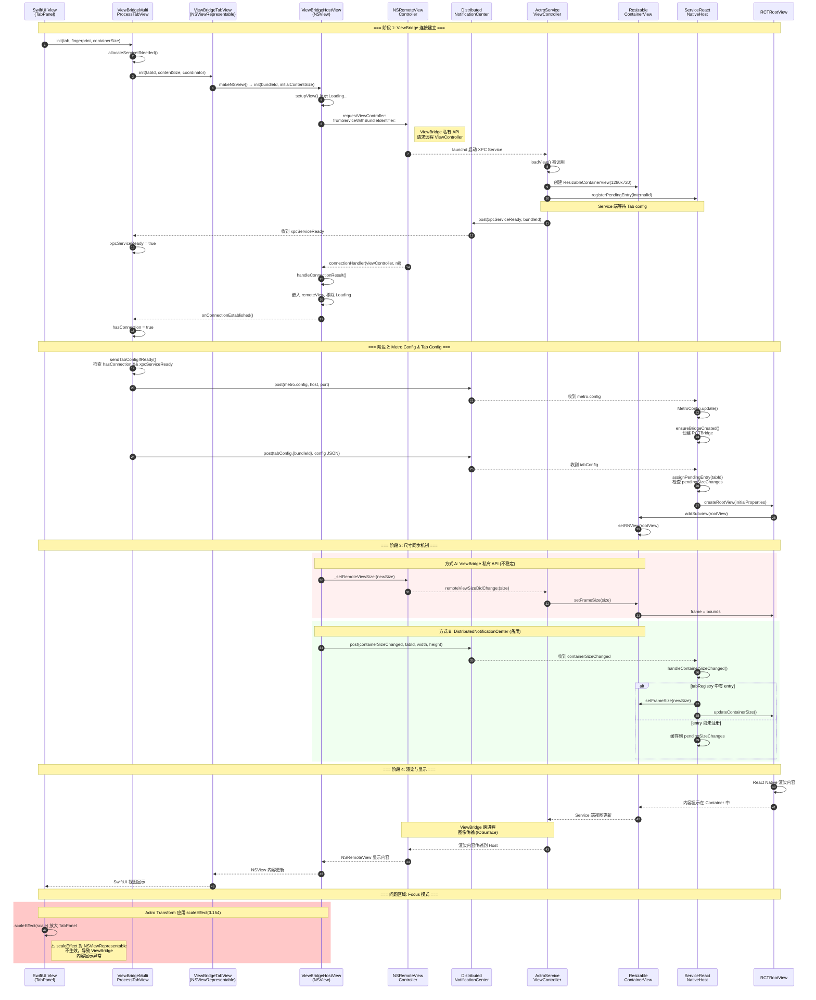

# ViewBridge XPC 架构文档

> 历史文档。现行路径见 [Renderer-Process-Pool.md](Renderer-Process-Pool.md)。

## 1. 架构概述

Actro 使用 ViewBridge (macOS 私有框架) 实现跨进程视图渲染，将 React Native 内容运行在独立的 XPC Service 进程中。

```
┌─────────────────────────────────────────────────────────────────┐
│                        Actro Host App                          │
│  ┌─────────────────┐  ┌─────────────────┐  ┌─────────────────┐ │
│  │   SwiftUI View  │  │  MetroManager   │  │ XPCServicePool  │ │
│  │   (TabPanel)    │  │  (Port: 动态)   │  │  (4 slots)      │ │
│  └────────┬────────┘  └────────┬────────┘  └────────┬────────┘ │
│           │                    │                    │           │
│  ┌────────▼────────┐           │                    │           │
│  │ ViewBridgeHost  │           │                    │           │
│  │     View        │◄──────────┼────────────────────┘           │
│  │ (NSRemoteView)  │           │                                │
│  └────────┬────────┘           │                                │
└───────────┼────────────────────┼────────────────────────────────┘
            │                    │
            │ ViewBridge         │ DistributedNotificationCenter
            │ (macOS Private)    │
            │                    │
┌───────────▼────────────────────▼────────────────────────────────┐
│                    XPC Service Process                          │
│              (RCTViewService0/1/2/3.xpc)                        │
│  ┌─────────────────┐  ┌─────────────────┐  ┌─────────────────┐ │
│  │ ActroService   │  │ ServiceReact    │  │   RCTBridge     │ │
│  │ ViewController  │  │ NativeHost      │  │  (共享实例)      │ │
│  └────────┬────────┘  └────────┬────────┘  └────────┬────────┘ │
│           │                    │                    │           │
│  ┌────────▼────────────────────▼────────────────────▼────────┐ │
│  │              RCTRootView (per Tab)                        │ │
│  │         渲染尺寸由 containerSize 决定                       │ │
│  └───────────────────────────────────────────────────────────┘ │
└─────────────────────────────────────────────────────────────────┘
            │
            │ WebSocket (Metro Protocol)
            │
┌───────────▼─────────────────────────────────────────────────────┐
│                     Metro Bundler                               │
│              (动态端口, 如 50319, 58242, 65045)                  │
│  - 打包 JS Bundle                                               │
│  - Hot Reload 支持                                              │
│  - 源码映射                                                      │
└─────────────────────────────────────────────────────────────────┘
```

## 2. 关键组件

### 2.1 Host 端 (Actro App)

| 组件 | 文件 | 职责 |
|------|------|------|
| `ViewBridgeHostView` | ViewBridgeHostView.swift | NSRemoteViewController 包装，管理跨进程视图 |
| `ViewBridgeCoordinator` | ViewBridgeHostView.swift | 管理单个 Tab 的 XPC 连接生命周期 |
| `ViewBridgeMultiProcessTabView` | ViewBridgeHostView.swift | SwiftUI 视图，集成 ViewBridge |
| `XPCServicePool` | XPCServicePool.swift | 管理 4 个 XPC Service slot 的分配 |
| `MetroManager` | MetroManager.swift | Metro bundler 生命周期管理 |
| `TabPanel` | WorkspaceMainView.swift | Tab 卡片视图，管理渲染尺寸 |

### 2.2 XPC Service 端

| 组件 | 文件 | 职责 |
|------|------|------|
| `ActroServiceViewController` | ActroServiceViewController.swift | 动态注册的 NSServiceViewController |
| `ServiceReactNativeHost` | ActroServiceViewController.swift | 管理共享 RCTBridge 和 per-Tab RCTRootView |
| `TabViewControllerEntry` | ActroServiceViewController.swift | 单个 Tab 的 ViewController 和 RCTRootView |
| `ResizableContainerView` | ActroServiceViewController.swift | 可调整尺寸的容器，响应 ViewBridge 尺寸同步 |
| `MetroConfig` | ActroServiceViewController.swift | 存储从 Host 接收的 Metro 配置 |

## 3. 尺寸计算 (关键数据)

### 3.1 坐标系统

基于日志分析的实际数值：

| 参数 | 典型值 | 说明 |
|------|--------|------|
| `viewportSize` | 589 x 398 | 实际视口尺寸（窗口内容区域） |
| `cardWidth` | 186.7 | Overview 模式下的卡片宽度 |
| `cardHeight` | 126.2 | Overview 模式下的卡片高度 |
| `scale` | 3.154 | Focus 模式的缩放比例 (viewportSize / cardSize) |

### 3.2 尺寸关系

```
viewportSize.width / cardWidth = scale
589 / 186.7 ≈ 3.154

viewportSize.height / cardHeight = scale
398 / 126.2 ≈ 3.154
```

### 3.3 渲染模式

| 模式 | ViewBridge 渲染尺寸 | Actro Transform | 最终显示尺寸 |
|------|---------------------|------------------|--------------|
| Overview | cardSize (187x126) | scale=1 | 187x126 |
| Focus | viewportSize (589x398) | scale=3.154 | 589x398 |

**关键发现**：ViewBridge XPC 在独立进程渲染，不受 Host 端 Actro Transform 影响。Focus 模式必须让 XPC Service 用 viewportSize 渲染，否则内容会模糊。

## 4. 通信机制

### 4.1 DistributedNotificationCenter 通知

| 通知名称 | 方向 | 用途 |
|----------|------|------|
| `com.actro.xpcServiceReady` | XPC → Host | XPC Service 就绪，可接收配置 |
| `com.actro.tabConfig.<bundleId>` | Host → XPC | 发送 Tab 配置（tabId, systemAppType 等） |
| `com.actro.metro.config` | Host → XPC | 广播 Metro 配置（host, port） |
| `com.actro.containerSizeChanged` | Host → XPC | 容器尺寸变化通知 |
| `com.actro.openBookmark` | XPC → Host | 用户点击书签 |
| `com.actro.openHistoryItem` | XPC → Host | 用户点击历史记录 |

### 4.2 Tab Config 结构

```json
{
  "tabId": "90009605-812D-4507-BDFA-126296F9B672",
  "title": "Start Page",
  "systemAppType": "startPage",
  "backgroundColor": "#260f43",
  "containerWidth": 186.74,
  "containerHeight": 126.19
}
```

### 4.3 Metro Config 结构

```json
{
  "host": "127.0.0.1",
  "port": 65045
}
```

## 5. ViewBridge 连接时序图



## 6. 启动时序 (关键)

```
┌─────────────────────────────────────────────────────────────────┐
│ 1. Actro App 启动                                              │
│    - CrashHandler.setup()                                       │
│    - TabProcessManager 初始化                                    │
│    - XPCNotificationBridge 初始化                                │
│    - [DEBUG] MetroManager.start() 自动启动                       │
└─────────────────────────────────────────────────────────────────┘
                              ↓
┌─────────────────────────────────────────────────────────────────┐
│ 2. Metro Bundler 启动 (异步)                                     │
│    - 动态分配端口 (findAvailablePort)                            │
│    - 等待 "Dev server ready" 输出                                │
│    - broadcastMetroConfig() 广播配置                             │
└─────────────────────────────────────────────────────────────────┘
                              ↓
┌─────────────────────────────────────────────────────────────────┐
│ 3. Tab 创建 & XPC 分配                                          │
│    - XPCServicePool.allocate() 分配 service slot                │
│    - ViewBridgeHostView 创建，请求 NSRemoteViewController        │
│    - setupXPCReadyListener() 监听 xpcServiceReady               │
└─────────────────────────────────────────────────────────────────┘
                              ↓
┌─────────────────────────────────────────────────────────────────┐
│ 4. XPC Service 启动                                             │
│    - registerActroServiceViewController() 动态注册类            │
│    - ServiceReactNativeHost.shared 初始化                        │
│    - setupTabConfigListener() 设置通知监听                       │
│    - postXPCServiceReady() 通知 Host                            │
│    ⚠️ 此时还未创建 RCTBridge (等待 Metro config)                 │
└─────────────────────────────────────────────────────────────────┘
                              ↓
┌─────────────────────────────────────────────────────────────────┐
│ 5. Host 收到 xpcServiceReady                                    │
│    - 广播 Metro config 到 XPC Service                           │
│    - 检查 hasConnection && xpcServiceReady                      │
│    - sendTabConfigToService() 发送 Tab 配置                     │
└─────────────────────────────────────────────────────────────────┘
                              ↓
┌─────────────────────────────────────────────────────────────────┐
│ 6. XPC Service 收到 Metro config                                │
│    - MetroConfig.update() 更新配置                              │
│    - ensureBridgeCreated() 创建 RCTBridge                       │
│    ✅ RCTBridge 使用正确的 Metro 端口                            │
└─────────────────────────────────────────────────────────────────┘
                              ↓
┌─────────────────────────────────────────────────────────────────┐
│ 7. XPC Service 收到 Tab config                                  │
│    - handleTabConfigNotification()                              │
│    - createRootViewWithConfig() 创建 RCTRootView                │
│    - RN 开始渲染内容                                             │
└─────────────────────────────────────────────────────────────────┘
```

**关键发现**：RCTBridge 必须在收到 Metro config 之后才能创建，否则会使用默认的 8081 端口导致连接失败。

## 6. XPC Service Pool

### 6.1 配置

- **Pool 大小**: 4 个 slot (RCTViewService0 - RCTViewService3)
- **Bundle ID 格式**: `io.actrium.actro.rctviewservice{N}`

### 6.2 分配策略

```swift
// 相同 fingerprint 的 Tab 共享同一个 XPC Service
// 不同 fingerprint 分配不同的 XPC Service
// 系统应用统一使用 slot 0
```

| 应用类型 | Fingerprint | 分配的 Service |
|----------|-------------|----------------|
| Start Page | system.startPage | RCTViewService0 |
| Bookmarks | system.bookmarks | RCTViewService0 |
| History | system.history | RCTViewService0 |
| 用户应用 A | {appFingerprint} | RCTViewService1 |
| 用户应用 B | {appFingerprint} | RCTViewService2 |

## 7. 已解决的问题

### 7.1 Metro 端口不匹配

**问题**: RCTBridge 创建时使用默认 8081 端口，但 Metro 运行在动态端口

**解决**: 延迟创建 RCTBridge，等待收到 Metro config 通知后再创建

### 7.2 尺寸同步时序问题

**问题**: `containerSizeChanged` 通知在 `tabRegistry` entry 分配之前到达，导致尺寸无法更新

**解决**:
- 在 Service 端添加 `pendingSizeChanges` 缓存存储早期到达的尺寸变化
- 当 entry 被分配时自动应用缓存的尺寸
- 添加 `hasPendingSizeApplied` 标记区分缓存尺寸和 config 尺寸

### 7.3 尺寸同步不可靠

**问题**: ViewBridge 私有 API 尺寸同步不稳定

**解决**: 添加 DistributedNotificationCenter 备用机制 (`com.actro.containerSizeChanged`)

## 8. 未解决的问题：Focus 模式渲染

### 8.1 问题描述

React Native 内容在 Focus 模式下无法正确显示。具体表现：
- Overview 模式：能看到 cardSize 的卡片内容 ✓
- Focus 模式：看不到内容，或者只有拖动窗口时偶尔闪烁

### 8.2 目标

| 模式 | 期望的渲染尺寸 | 期望的显示尺寸 | 期望效果 |
|------|---------------|---------------|---------|
| Overview | cardSize (187x126) | cardSize (187x126) | 小卡片，清晰显示 |
| Focus | viewportSize (589x398) | viewportSize (589x398) | 全尺寸，清晰显示 |

### 8.3 核心难点

```
┌─────────────────────────────────────────────────────────────────┐
│                        Actro Transform                          │
│   - Overview 模式: scale = 1.0                                   │
│   - Focus 模式: scale = viewportSize / cardSize ≈ 3.154         │
│                                                                  │
│   问题：Actro Transform 会放大 TabPanel，但 NSViewRepresentable │
│         (ViewBridge) 不会被 scaleEffect 正确缩放                 │
└─────────────────────────────────────────────────────────────────┘
```

**关键发现**: `scaleEffect` 对 `NSViewRepresentable` 不生效（macOS 限制）。
这导致无法像 SwiftUI 原生视图那样通过 scaleEffect 预缩小来抵消 Actro Transform 的放大。

### 8.4 尝试过的方案

#### 方案 A: viewportSize 渲染 + scaleEffect 缩小 ❌

```swift
// 思路：Focus 模式用 viewportSize 渲染，scaleEffect 缩小到 cardSize，
//       Actro Transform 再放大回 viewportSize
ViewBridgeMultiProcessTabView(containerSize: viewportSize)
    .scaleEffect(cardWidth / viewportSize.width)  // ≈ 0.317
```

**失败原因**: `scaleEffect` 对 `NSViewRepresentable` 不生效，ViewBridge 内容不会被缩小

#### 方案 B: 始终以 cardSize 渲染 ❌

```swift
// 思路：ViewBridge 始终以 cardSize 渲染，由 Actro Transform 负责放大
ViewBridgeMultiProcessTabView(containerSize: cardSize)
// 不使用 scaleEffect
```

**结果**:
- Overview 模式：内容正确显示 ✓
- Focus 模式：Actro Transform 放大后内容模糊/不显示 ❌

**观察**: 拖动窗口时能偶尔看到闪烁的画面，说明内容确实在渲染

#### 方案 C: 动态切换 containerSize ❌

```swift
// 思路：根据 isFocused 动态更新 containerSize
let renderSize = isFocused ? viewportSize : cardSize
ViewBridgeMultiProcessTabView(containerSize: renderSize)
```

**失败原因**:
1. `containerSizeChanged` 通知时序问题（已通过 pendingSizeChanges 缓存修复）
2. 即使尺寸正确传递，Focus 模式下仍有显示问题

### 8.5 当前现状

```
┌─────────────────────────────────────────────────────────────────┐
│ Service 端状态（从日志确认）                                      │
│ - RCTRootView 创建成功 ✓                                        │
│ - 尺寸正确设置 (187x126 或 589x398) ✓                           │
│ - React Native 内容正在渲染 ✓                                    │
└─────────────────────────────────────────────────────────────────┘
                              ↓
┌─────────────────────────────────────────────────────────────────┐
│ ViewBridge 传输（推测问题区域）                                   │
│ - NSRemoteView 连接到 NSServiceViewController ✓                 │
│ - 跨进程图像传输 ?                                               │
│ - 尺寸同步 ?                                                     │
└─────────────────────────────────────────────────────────────────┘
                              ↓
┌─────────────────────────────────────────────────────────────────┐
│ Host 端显示                                                      │
│ - Overview 模式：能看到内容 ✓                                    │
│ - Focus 模式：看不到/偶尔闪烁 ❌                                  │
│ - 拖动窗口时：偶尔能看到画面闪烁                                  │
└─────────────────────────────────────────────────────────────────┘
```

### 8.6 对比：Web 内容的解决方案

Web 内容（WKWebView）也面临相同问题，其解决方案是 **FocusedWebOverlay**：

```swift
// Focus 模式下，Web 内容在 Actro Transform 之外独立渲染
if case .focus(let tabId) = mode, case .web(let url) = tab.contentType {
    FocusedWebOverlay(
        tab: tab,
        url: url,
        viewportSize: viewportSize  // 直接以 viewportSize 渲染
    )
    .frame(maxWidth: .infinity, maxHeight: .infinity)
}
```

关键点：
1. Focus 模式下的 Web 内容**不在 Actro Transform 内**
2. 使用 `WebViewHolderManager` 管理持久化的 WKWebView 实例
3. Overview 和 Focus 共享同一个 WKWebView，只是位置不同

### 8.7 可能的解决方向

#### 方向 1: FocusedReactNativeOverlay

类似 Web 内容，创建独立的 overlay 在 Actro Transform 之外渲染：

```swift
if case .focus(let tabId) = mode, case .reactNative = tab.contentType {
    FocusedReactNativeOverlay(
        tab: tab,
        viewportSize: viewportSize,
        coordinator: coordinator
    )
}
```

**挑战**:
- ViewBridge 连接是一对一的，不能同时显示两个 ViewBridgeHostView
- 需要在 Focus/Overview 切换时重建 ViewBridge 连接？

#### 方向 2: 调查 Actro Transform 对 NSRemoteView 的影响

可能 Actro Transform（通过 CALayer transform）影响了 NSRemoteView 的显示。

**调试方向**:

- 检查 NSRemoteView 的 layer 属性
- 尝试禁用 Actro Transform 看是否能正常显示
- 研究 ViewBridge 私有 API 中的尺寸同步机制

### 8.8 关键日志

```
# Service 端日志 - 确认 RCTRootView 正确创建
[F2C28491] Using container size from config: (186.74, 126.19)
[F2C28491] Creating RCTRootView, size: (186.74, 126.19)
[F2C28491] RCTRootView frame set to: (0.0, 0.0, 186.74, 126.19)
[F2C28491] RCTRootView created and added to container

# Host 端日志 - 确认 ViewBridge 连接建立
ViewBridgeHostView: Remote view embedded, size=(186.74, 126.19)
📤 XPC connection established for tab: F2C28491

# 尺寸更新日志 - 确认通知正确发送
📐 Posted containerSizeChanged: tabId=88C5221A, size=(589.0, 398.0)
```

## 9. 文件清单

```
Actro/
├── Actro/
│   ├── App/
│   │   └── ActroApp.swift               # 应用入口，Metro 自动启动
│   ├── MultiProcess/
│   │   ├── ViewBridgeHostView.swift     # ViewBridge Host 端实现
│   │   ├── XPCServicePool.swift         # XPC Service 池管理
│   │   └── TabProcessManager.swift      # Tab 进程管理
│   ├── DevTools/
│   │   ├── MetroManager.swift           # Metro bundler 管理
│   │   └── MetroAddressResolver.swift   # Metro 地址解析
│   └── Views/
│       └── WorkspaceMainView.swift      # TabPanel, 渲染尺寸计算
├── ActroViewService/
│   └── ActroServiceViewController.swift # XPC Service 实现
├── scripts/
│   └── generate_xpc_pool.sh             # XPC Service Pool 生成脚本
└── packages/actro-runtime/
    └── src/
        ├── TabRouter.tsx                # RN Tab 路由
        └── system-apps/
            ├── StartPageApp.tsx
            ├── BookmarksApp.tsx
            └── HistoryApp.tsx
```

## 10. 调试技巧

### 10.1 日志过滤

```bash
# Host 端日志
log show --predicate 'process == "Actro"' --last 1m

# XPC Service 日志
log show --predicate 'process contains "ActroViewService"' --last 1m

# Metro 相关
log show --predicate 'eventMessage contains "Metro"' --last 1m
```

### 10.2 关键日志标记

| 标记 | 含义 |
|------|------|
| `📐` | 尺寸相关 |
| `📤` | 发送通知/配置 |
| `📡` | 接收通知/建立连接 |
| `🔵` | ViewBridge 相关 |
| `📦` | XPC Service Pool |
| `🆕` | 创建新实例 |

---

*文档更新时间: 2026-01-09*
*基于 Actro 项目实际运行日志分析*
*第 8 节"未解决的问题"记录了 Focus 模式渲染问题的调试过程*

## 11. 新问题：Remote / Local 视图错位

### 11.1 现象（对应截图）

- 工具栏标题和侧边栏高亮显示的是 `History / Bookmarks`，但右侧 ViewBridge 画面仍然是 Start Page 的卡片栅格。
- 切换到 Bookmarks 时右侧几乎空白，只剩 “0 bookmarks” 底栏；切换到 History 时偶尔又变成 Start Page 的空状态大卡。
- 说明 Host 侧认为当前 Tab A，但 Service 侧给到的画面是 Tab B（或旧连接）。

### 11.2 根因分析

1) **Tab 配置路由缺少“连接维度”**
   - Host → Service 的配置广播只有 `com.actro.tabConfig.<bundleId>`，未携带哪个 NSRemoteViewController/连接在请求该配置。
   - Service 侧用 `assignPendingEntry(tabId:)` 的 FIFO 策略把收到的 `tabId` 绑定到“最老的 pending entry”——即最早 `loadView` 的连接。
   - 当同一进程槽（slot0）里同时有 StartPage/Bookmarks/History 三个连接时，只要“连接建立顺序”和“配置发送顺序”不一致，就会把 TabA 的 config 绑定到 TabB 的远程视图，出现内容错位。

2) **Service 端未清理旧 entry，容易复用到错误连接**
   - `registerActroServiceViewController` 里定义了 dealloc block，但没有 `class_addMethod` 注册，`unregisterEntry` 从未被调用。
   - SwiftUI 若重建 Host 侧 ViewBridge（例如切换模式或尺寸变化导致视图替换），旧的 entry 仍在 `tabRegistry`，新的 pending entry 拿不到 `tabId` 绑定，导致新连接渲染不到内容或拿到旧内容。

3) **xpcServiceReady 只在首个 tabConfig 前重发**（次要但加剧混乱）
   - Service 在收到首个 tabConfig 后停止重发 ready。后续新建的 coordinator 如果错过 ready，`xpcServiceReady=false` 就不会再触发 sendTabConfig，仍然保留旧画面。

### 11.3 建议的修复方向

- **引入 connectionId（或直接用 tabId）做一对一绑定**
  - Host 在请求 NSRemoteViewController 时生成 `connectionId` 并存到 coordinator；Service 的 `loadView` 将内部 `internalId` 回传或暴露 setter（例如新增 `setHostTabId:` 方法），让 Host 用「连接专属」的通知名或方法调用把 `tabId` 绑定到正确的 entry，而不是 FIFO。
- **修复 Service 清理逻辑**
  - 正式注册 dealloc / disconnect 钩子调用 `unregisterEntry(internalId:)`，确保关闭/重建连接时不会遗留旧 entry。
  - 在 `remoteViewSizeDidChange:` 等回调里也可检测连接断开并清理。
- **Ready 广播幂等化**
  - 要么在 Host 侧：如果 `hasConnection && !xpcServiceReady` 超时仍未 true，就主动发送 config；要么在 Service 侧：始终在新连接建立时再发一次 `xpcServiceReady`（带 bundleId 和 connectionId）。
  - 这样新 coordinator 不会卡在旧画面。
- **临时缓解方案**
  - 若短期内不做 connectionId，至少避免多个 Tab 共享同一 service：系统页可以临时拆分到独立 slot，减少 FIFO 误绑概率（代价：更多进程）。

> 调试建议：在 Service `assignPendingEntry`、`handleTabConfigNotification` 里打印 `connection(internalId) -> tabId -> title` 的绑定关系，观察是否出现 “tabId 绑定到非当前 NSRemoteViewController” 的情况；同时打印 `pendingEntries.count / tabRegistry.keys`，确认清理是否生效。
