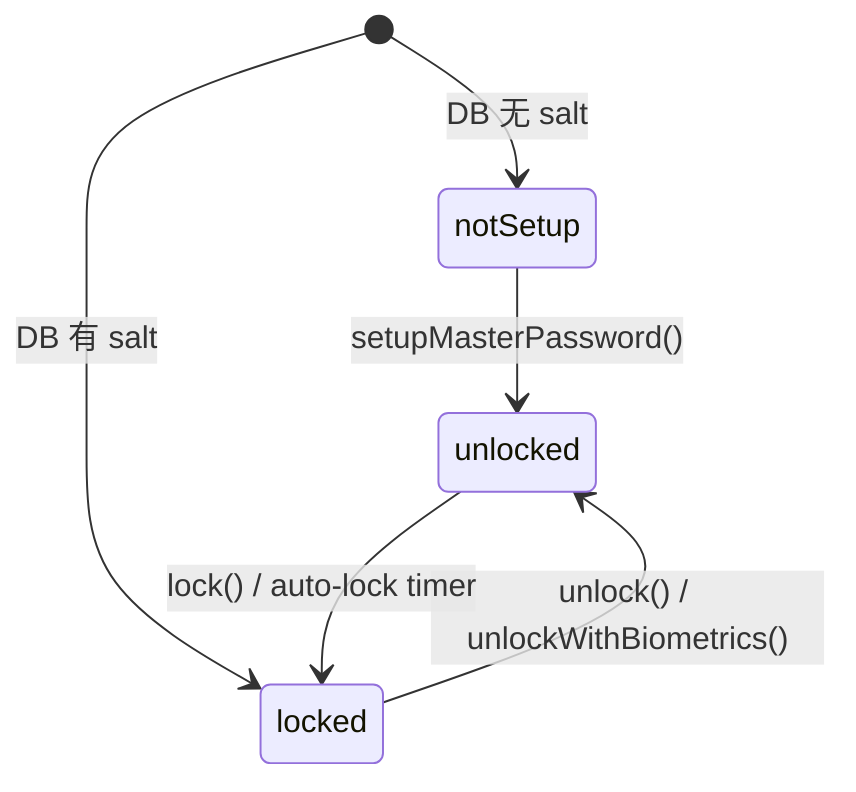
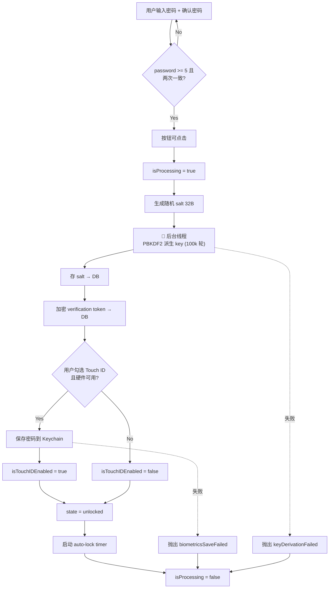
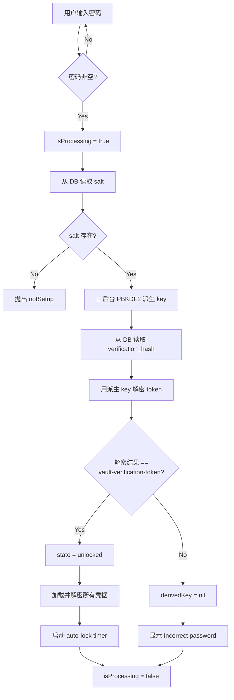
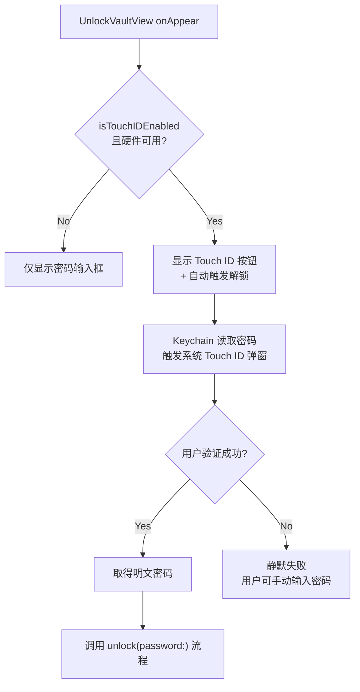
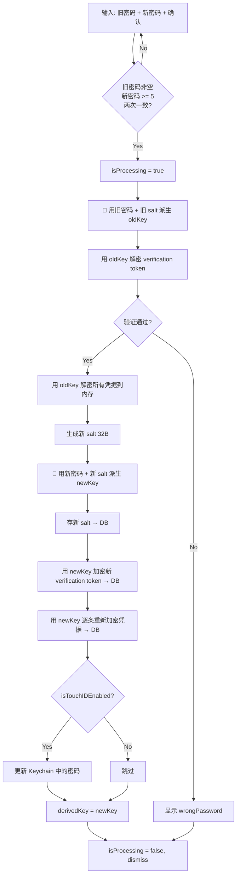
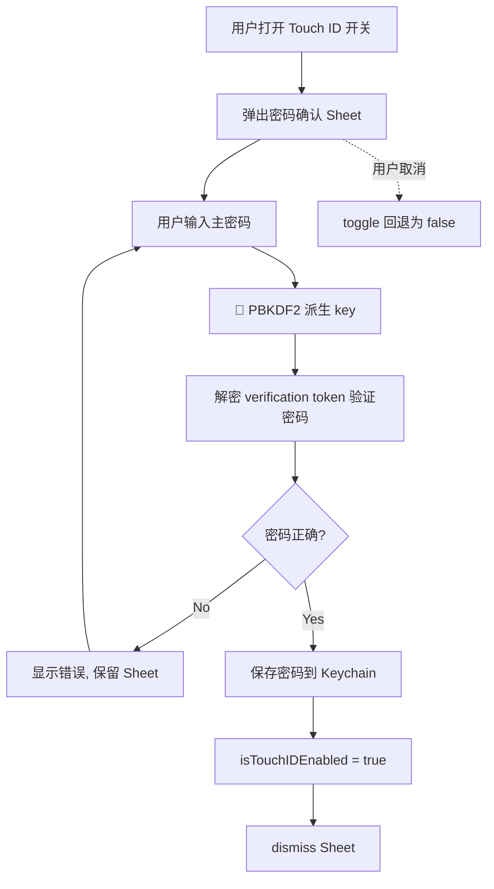
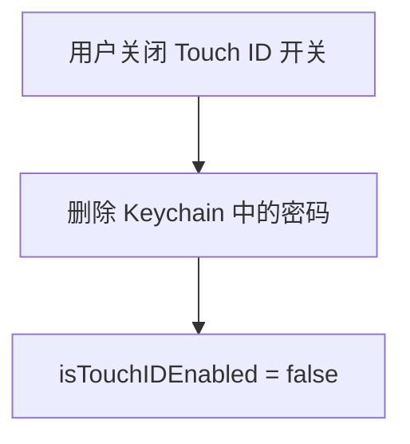
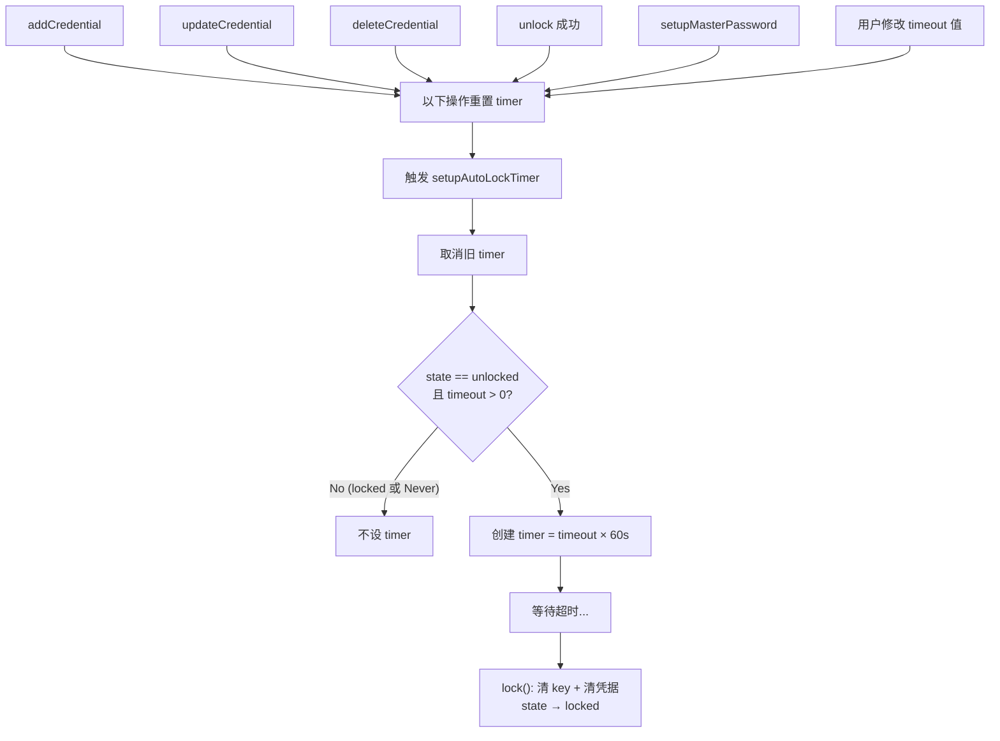
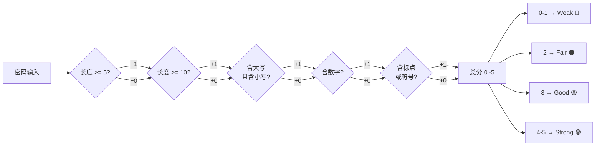

# Password Vault Flow Diagrams

Password Vault 模块的完整逻辑流程文档。

涉及文件：
- `Canvas/Settings/Security/VaultManager.swift` — 核心状态机、加密、Keychain、auto-lock
- `Canvas/Settings/Security/SetupMasterPasswordView.swift` — 首次设置密码 UI
- `Canvas/Settings/Security/UnlockVaultView.swift` — 解锁 UI
- `Canvas/Settings/PasswordSettingsView.swift` — 已解锁管理页（凭据列表、Touch ID、改密码）

---

## 1. Vault State Machine

三态有限状态机，持久化判据为 DB 中是否存在 `salt` 记录。

| State | 含义 | UI |
|-------|------|-----|
| `notSetup` | 从未设置过主密码 | SetupMasterPasswordView |
| `locked` | 已设置，需输入密码 | UnlockVaultView |
| `unlocked` | 已解锁，可操作凭据 | UnlockedVaultView |

---

## 2. Setup Master Password

首次设置主密码。创建 salt、派生加密 key、存储验证令牌、可选启用 Touch ID。

**关键实现细节：**
- PBKDF2 通过 `Task.detached` 在后台线程执行，避免阻塞 UI
- Touch ID toggle 仅在 `isBiometricsAvailable` 时显示，默认跟随硬件可用性
- 按钮在 `isProcessing` 期间显示 loading spinner 并禁用

---

## 3. Unlock with Password

密码解锁流程。从 DB 读取 salt，派生 key，验证是否能正确解密 verification token。

---

## 4. Unlock with Biometrics (Touch ID)

Touch ID 解锁是密码解锁的快捷路径：从 Keychain 取出密码 → 走常规密码解锁。

**设计决策：** 自动解锁失败时不弹错误提示，避免干扰用户手动输入。

---

## 5. Change Master Password

修改主密码需要：验证旧密码 → 解密所有凭据 → 生成新 salt/key → 重新加密所有凭据。

**注意：** 改密码涉及两次 PBKDF2 派生（旧 key + 新 key），耗时较长，loading 状态尤为重要。

---

## 6. Enable Touch ID (Post-Setup)

已解锁状态下开启 Touch ID，必须验证主密码后才能将密码存入 Keychain。

**安全考量：** 不直接绑定 toggle 到 `vault.isTouchIDEnabled`，而是用 `@State` 中间变量 + `onChange` + Sheet 确认流程。

---

## 7. Disable Touch ID

关闭 Touch ID 不需要密码验证，直接删除 Keychain 条目。

---

## 8. Auto-Lock Timer

自动锁定计时器，在多个操作后重置。`timeout = 0` 表示 Never。

**Timeout 选项：** `Never (0)` / `1 min` / `5 min` / `10 min` / `15 min`，默认 5 min。

---

## 9. Password Strength Evaluation

密码强度实时评估，用于 Setup 和 Change Password 页面的强度指示条。

| 得分 | 等级 | 颜色 | 指示条亮起段数 |
|------|------|------|--------------|
| 0-1 | Weak | 红色 | 1/4 |
| 2 | Fair | 橙色 | 2/4 |
| 3 | Good | 黄色 | 3/4 |
| 4-5 | Strong | 绿色 | 4/4 |

---

## Crypto Summary

| 组件 | 算法/参数 |
|------|----------|
| Key Derivation | PBKDF2-HMAC-SHA256, 100,000 iterations, 32B salt |
| Encryption | AES-256-GCM (CryptoKit) |
| Key Storage | macOS Keychain (Touch ID protected) |
| Verification | 加密固定字符串 `"vault-verification-token"` 作为密码校验 |
