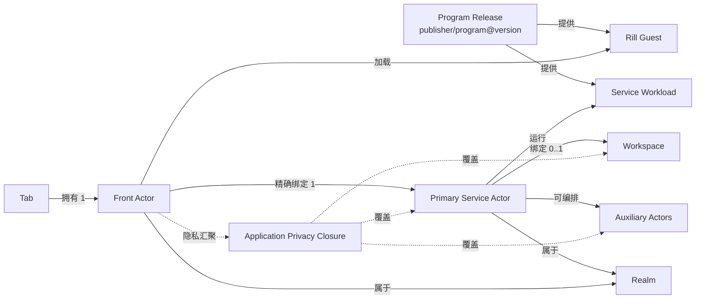

# 02. 领域模型

## 1. 总览



## 2. 六个核心对象

### 2.1 Program

程序的稳定名称，不包含安装状态和运行实例。

```text
ProgramId = publisher/program
```

示例：

```text
notes.example/team-notes
```

`publisher` 是规范化 DNS 域名；`program` 是该域名命名空间内唯一的程序名。

### 2.2 Program Release

程序的不可变版本：

```text
ProgramReleaseId = publisher/program@version
```

它必须解析到一个固定 `.actr` package digest。Program Release 描述：

- Service workload；
- Rill Guest 入口；
- Front–Service 契约；
- 申请的能力和组件；
- Rill/Actro/Actr ABI 兼容范围；
- 资源配额；
- Workspace 模式；
- Publisher 签名信息。

### 2.3 Service Actor

一个真实、可寻址、有状态的程序实例：

- 有持久 `ActorId`；
- 固定运行某个 Program Release digest；
- 持有 Workspace capability；
- 持有实例配置和访问控制；
- 生命周期独立于 Tab；
- 可以本地运行，也可以远端运行；
- 可以编排其他 Actor，但对 Front 暴露一个主 façade。

Service 不是“程序类型”，也不是可随意替换的负载均衡候选。

### 2.4 Front Actor

一个 resident app Tab 对应的短生命周期交互 Actor：

- workload 由 Actro 固定；
- 内含 Rill Host、Actr client、capability broker 和生命周期管理；
- 加载经过验证的 Rill Guest；
- 只持有绑定 Service 的受限 capability；
- Tab 关闭、崩溃或系统回收后可以重建；
- ActorId 可以是会话级的，不承担持久业务身份。

### 2.5 Tab

Actro Shell 中的用户交互容器。Tab 保存本地浏览状态，例如：

- 本地 `tab_id`；
- 当前规范化 `actr://` URI；
- 页面内 route；
- 后退/前进栈；
- 显示标题、图标；
- suspend/restore 元数据。

Tab 不保存 Workspace 密钥，不拥有业务数据。

Tab record 可以在内存回收后继续存在。此时它是 dormant Tab，没有 live Front Actor；再次激活时由同一 URI 重建新的 Front Actor。

### 2.6 Workspace

Service 的持久数据边界。它不是简单文件路径，而是一个由 Host 托管的 capability：

```text
WorkspaceBinding
├── workspace_id
├── provider_type
├── provider_locator
├── access_mode
├── credential_ref
├── lease_policy
└── backup/migration metadata
```

`credential_ref` 指向系统安全存储，不能出现在 URL、普通数据库或 Guest launch context 中。

## 3. “Tab–Service 1:1”的精确定义

### 3.1 产品不变量

在任意运行时刻：

- 一个处于 loading/running/suspended 的 resident Tab 恰好拥有一个 Front Actor；
- 一个被 Shell 丢弃但保留在 Tab strip 的 dormant Tab 没有 live Front Actor；
- 一个 Front Actor 最多绑定一个 Primary Service Actor；
- 完成启动后，一个 Front Actor必须恰好绑定一个 Primary Service Actor；
- 一个 Service 可以暂时没有 Front；
- Service 与历史 Front 不是永久双射。

形式化表示：

```text
Tab 1 ── 0..1 Live Front Actor
Live Front Actor 1 ── 1 Primary Service Actor
Primary Service Actor 1 ── 0..1 Active Front Lease（v1 exclusive）
Primary Service Actor 1 ── 0..1 Workspace
```

同一个 Service 在时间上可以先后被多个 Front Actor 重连；这不是同一时刻的运行时基数。v1 默认会话策略为 `exclusive`，同一时刻只授予一个交互 Front 主租约。

### 3.2 为什么不定义全局严格双射

如果 Service 永远只能属于某一个具体 Front Actor，就会立即产生矛盾：

- 关闭 Tab 后 Service 是否必须删除；
- Actro 重启后新 Front Actor 如何连接；
- Front 崩溃是否导致 Workspace 失去所有者；
- 从收藏重新打开为何不能继续原实例；
- 同一实例迁移到新设备后为何必须改身份。

因此最简模型不是“两个生命周期绑死”，而是：

> Front 始终只面对一个 Service；Service 独立存在，并接受经过授权的新 Front 会话。

### 3.3 独占与共享

Program Manifest 声明：

```toml
[actro.session]
attachment_policy = "exclusive"
```

v1 只承诺 `exclusive`：

- 本机已打开同一 Service 时，打开相同 URI 聚焦已有 Tab；
- 另一设备请求连接时，Service 可拒绝、等待租约到期或触发用户确认的接管；
- 网络中断后有有限 lease grace period，防止瞬时断线被误判为释放。

`shared` 是后续能力，需要额外定义多会话权限、并发写、焦点和协作状态，不作为 v1 隐式行为。

## 4. 身份、类型与实例

### 4.1 Program coordinate 与 ActrType

Program Release 与 Service `ActrType` 一一对应：

```text
publisher/program@version
            ↓
ActrType {
  manufacturer = publisher
  name         = program
  version      = version
}
```

Actr 当前把 manufacturer/name 共用较短的 `Name` 约束。目标设计必须把 Publisher 校验改为完整 DNS/IDNA 规则，并支持最长 253 字节的 A-label 域名。

### 4.2 ActorId

Service ActorId 必须满足：

- `Realm authority + realm_id + serial + ActrType` 的整体全局可区分；
- 自身携带可验证、可解析的 Realm authority；
- 在 Realm 内永久唯一；
- Realm 不得把已使用 ID 分配给另一个实例；
- 凭据正常续期、hard re-auth、信令切换、进程重启和运行位置迁移时保持不变；
- 与 Actor 长期密钥绑定；
- 可以解析为当前在线地址，也可以明确报告 offline；
- ActorType 是 ID 的组成部分且必须与 Program Release 相同。

当前 Actr 的 legacy 文本形式是：

```text
<serial_hex>@<realm_id>/<publisher>:<program>:<version>
```

它缺少 Realm authority。v1 必须扩展 ActorId 数据模型与标准 formatter，使 DNS Realm 可从 ActorId 本身解析；例如：

```text
<serial_hex>@<realm_id>~dns:<realm-domain>/<publisher>:<program>:<version>
```

本地 Realm 使用 `local:<installation-id>` authority。最终 wire/text 编码由 Actr ADR 冻结，但不能退回“只给一个 realm_id，再靠 Actro 私下猜 Realm”的语义。

同时，其生命周期语义必须从“本次注册地址”升级为“可续租的持久逻辑 Actor 身份”。

### 4.3 ActorId 不是秘密

ActorId 可以进入地址栏、历史和收藏，但不能单独授予访问权。连接还必须验证：

- Realm 签发的 Actor credential；
- Service 所有者/成员 ACL；
- Front 的会话 challenge；
- Program coordinate、package digest 和协议 fingerprint；
- attachment lease。

### 4.4 不增加公共 ServiceInstanceId

目标模型不再向 URL 增加一层公共“逻辑服务键”。如果 ActrId 不能稳定，就应修复 ActrId，而不是让所有上层长期维护：

```text
ServiceInstanceId → current ActorId
```

Actro 本地数据库可以有纯存储用途的 `record_id`，但它不是网络身份，也不出现在共享 URL 中。

## 5. 状态归属

| 状态 | 权威所有者 | 说明 |
|---|---|---|
| Tab 排列、前进/后退 | Actro Shell | 可同步，丢失不应破坏业务状态 |
| Guest UI 临时状态 | Front Actor / Rill Guest | suspend 可快照，崩溃后允许重建 |
| 当前绑定 Service ActorId | Tab Session | 来自规范化 URI |
| 业务状态 | Service Actor | 不放在 Front |
| Workspace 内容 | Workspace Provider | 由 Service capability 访问 |
| Workspace 绑定 | Service Actor | Front 不可重绑 |
| Program Release metadata | Program Catalog | 以 coordinate + digest 为主键 |
| Actor 长期私钥 | 安全存储 | 不进入普通 SQLite |
| Realm membership credential | 安全存储 | 短期、可续期、可撤销 |
| 权限授予 | Actro Permission Store | 绑定 publisher/program/major/digest/Workspace 范围 |
| ActorAssurance | 验证者（issuer ≠ subject） | 针对准确 `ActorStateId` 的节点结论 |
| ApplicationAssurance | 应用评定者 | 无根图当前切面的汇聚结论；展示还须 Ready |

## 6. 创建、发现与精确连接

三种行为必须分开：

### 6.1 创建

无 `service` 的 URI 是 Create Intent。Actro：

1. 解析并验证 Program Release；
2. 选择 Realm 与 Workspace；
3. 在本地创建一个新的 Service Actor；
4. 获得持久 ActorId；
5. 用该 ID 创建 Front 会话；
6. 原位改写 URI。

### 6.2 类型发现

按 `ActrType` 发现适合无状态基础设施、辅助服务或管理操作。它不用于替换用户已经指定的 Workspace-bound Service。

### 6.3 精确连接

有 `service` 的 URI 必须走 `Dest::Peer(ActorId)`：

- 不做 LB；
- 不换同类型候选；
- 不因为 offline 而创建新实例；
- Program/Version 不匹配时拒绝；
- Realm 未配置时请求导入或信任 Realm Profile。

## 7. Primary Service façade

为了保持 Front 极简，Guest 只能获得：

```typescript
primaryService.call(route, request)
primaryService.tell(route, event)
primaryService.on(eventName, handler)
```

Guest 不直接获得：

- `discover(ActrType)`；
- `call(ActorId)`；
- 信令/TURN 配置；
- Workspace handle；
- Service credential；
- 任意 socket。

如果程序需要多个后台 Actor，Primary Service 在自己的权限边界内完成发现、创建和编排。

## 8. 系统程序

Actro Shell 的地址栏、Tab strip、权限弹窗和安全信息属于 Shell，不是普通 Tab 内容。

历史、收藏、Program Catalog、Service Inventory 等可见页面应采用以下两种方式之一：

1. 作为 Shell 原生管理面板，不进入普通应用 Tab；或
2. 作为 Actro 自有、签名的系统 Program，仍遵守 Front–Service 模型。

不得为系统页面暴露一套第三方不可用的隐式 Guest 权限。系统级能力必须由不同签名等级和显式 Host policy 授予。

## 9. 应用图

Front 只直接绑定 Primary Service，但保障必须覆盖 Front 所属的**无根**有效依赖连通分量。Front 和 Primary Service 都只是定位入口，不是图根。

```text
Front ──定位──▶ CC(U(有效 Transfer(ActorId)))
```

图不是 Publisher 静态名单，而是有效声明中的 Actor 依赖。通道无效则阻断，不评分。展示颜色取各节点最弱项，且须 `Ready`。

关键约束：

- Actor 健康状态不能代替 `ActorAssurance`；
- Actor 自报不能代替验证者结论，也不能自签；
- 任一节点 `UNKNOWN`，应用最多黄；
- 任一节点 `UNCONTROLLED`，应用为红；
- 任一成员挂起，不得展示绿；
- 不依赖变化节点的成员可 `LocalContinue`；
- 新配置只作用于新数据；
- 完整语义见 [docs/security](../../security/README.zh.md) 与 [13](13-privacy-state-and-aggregation.md)。
