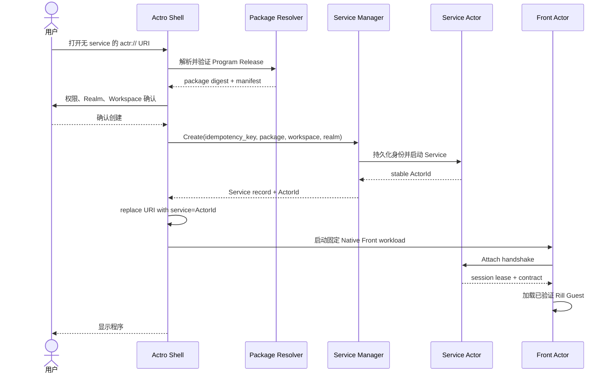

# 03. 用户体验

## 1. 信息架构

Actro 的一级产品面由五部分组成：

```text
Actro Shell
├── Tab 与地址栏
├── Program Catalog（程序库）
├── Service Inventory（实例库）
├── Realm & Identity（身份与网络）
└── Security Center（权限、风险、撤销与审计）
```

### 1.1 Program Catalog

回答“我可以运行什么”：

- 已安装程序；
- Marketplace 收藏或推荐；
- Publisher 直接来源；
- 本地导入和开发程序；
- 每个程序已知版本、digest、来源与更新状态。

### 1.2 Service Inventory

回答“我已经创建了什么”：

- Service ActorId；
- 程序和精确版本；
- Workspace 显示名；
- Local/Remote 运行位置；
- Realm；
- 生命周期、可达性、健康度和会话占用四组独立状态；
- 最近打开时间和当前 Tab；
- 启动、停止、打开、导出链接、迁移、归档、移入回收站和彻底清除等操作。

Program 与 Service 必须在 UI 和数据模型中分开。安装一个程序不等于已经创建实例；删除程序缓存也不等于删除 Workspace。

## 2. 地址栏

地址栏同时表达三个问题：

| 信息 | 来源 | 用户问题 |
|---|---|---|
| `publisher/program@version` | URI 主体 | 我正在运行谁发布的哪个版本？ |
| `service=<ActorId>` | URI 查询参数 | 我是在创建，还是连接哪个现有实例？ |
| Realm authority | Service ActorId；Create 时可选 `realm` 参数 | 这个 Actor 在哪个信任/网络域里？ |

### 2.1 安全指示

地址栏左侧安全控件必须显示：

- 当前应用保障：绿 / 黄 / 红，或正在重新验证；
- Publisher 域名及 verified/development/revoked 状态；
- 当前 package digest 的短指纹；
- Realm 名称；
- Service 连接状态：local、P2P、TURN relayed、offline；
- 当前权限是否有高风险授权。

不得只用一个含义模糊的“锁”图标把 TLS、包安全、Actor 身份和权限混在一起。

只有 `Ready` 且应用结论为 `CONTROLLED` 才能显示绿色。黄不等于已知泄露，但同样不能显示绿色。挂起或切面过期时显示「正在重新验证 / 通信已阻断」。点击必须能看到当前策略、Actor 数、workload 种类、声明出口、最弱项、所信验证者和结论有效期。

### 2.2 创建与连接的可见差异

- 无 `service`：显示“将创建新实例”。
- 有 `service`：显示实例名或 ActorId 短指纹，提示“连接现有实例”。
- 创建完成后地址栏必须立即变成带 `service` 的规范化 URI。
- 连接失败时地址栏保持原 URI，不自动删除 `service`。

## 3. 首次启动

Actro 首次启动完成以下配置：

1. 在 OS 安全存储中创建设备密钥；
2. 建立带 `local:<installation-id>` authority 的本地 Realm；
3. 设置默认新建位置为“本机”；
4. 允许用户稍后加入组织 Realm；
5. 展示 Program Catalog 和 Service Inventory 的区别；
6. 默认关闭匿名遥测和开发模式。

本地 Realm 允许离线运行本机 Front 与 Service，但其 URI 只在该 Actro 安装内可解析。跨设备连接需要先把 Service 迁移到带 DNS authority 的联网 Realm。

## 4. 安装程序

### 4.1 从 Marketplace

1. 用户打开程序详情；
2. Actro 显示 Publisher、版本、digest、权限、Workspace 模式和市场审核状态；
3. Actro 从 Publisher HTTPS 入口解析并下载 `.actr`；
4. 校验 HTTPS、Publisher key、包签名、digest、兼容性和压缩包限制；
5. 记录 Program Release；
6. 只缓存程序，不自动创建 Service，除非用户点击“创建实例”。

Marketplace 返回的下载地址不是最终信任源；Actro 必须回到 Publisher 可信元数据或校验已固定的 Publisher 签名和 digest。

### 4.2 从 `actr://` URI

如果 Program Release 尚未安装：

- 先进入受控安装页；
- 显示完整来源和权限；
- 安装成功后继续原 Create/Attach Intent；
- 取消安装不产生 Service 或 Front Actor。

### 4.3 本地导入

本地 `.actr` 包：

- 仍必须通过结构、hash 和签名检查；
- 签名 key 不属于已验证域名时标记为“本地开发身份”；
- 不得占用同名 verified Publisher 的可信记录；
- 不自动同步到其他设备；
- 运行时始终显示开发标记。

## 5. 创建实例

### 5.1 主流程



### 5.2 Workspace 选择

Manifest 必须分别声明三个维度，不能把它们压进一个枚举：

- requirement：`none`、`optional` 或 `required`；
- provisioning：`managed` 或 `user-selected`；
- access：`read-only` 或 `read-write`。

它还可以限制允许的 Provider，例如 `managed-store`、`local-folder`、`cloud-drive` 或 `remote-repository`。`managed` 是配置方式，不是“是否需要 Workspace”；`read-only` 是访问模式，也不是生命周期模式。

选择器显示：

- Provider；
- 路径或逻辑位置；
- 读写模式；
- 是否已有其他 Service 占用；
- 备份和同步能力；
- 删除 Service 时 Workspace 的处理方式。

### 5.3 创建幂等

同一次导航事务必须携带本地 `creation_intent_id`：

- UI 重绘、网络重试、回退再前进和包下载重试不能重复创建；
- 创建成功但 Front 启动失败时，Service 仍进入 Inventory，页面提供“重试连接”；
- 用户再次显式打开同一个无 `service` URI，表示新的 Create Intent，需要再次确认；
- 外部来源短时间批量触发创建必须受配额和速率限制。

## 6. 连接已有实例

### 6.1 主流程

1. 解析 URI；
2. 从 Service ActorId 解析 Realm authority；
3. 验证 ActorId 中的 `ActrType` 与 URI coordinate 完全一致；
4. 确保精确 Program Release 已安装并匹配 digest；
5. 连接指定 ActorId；
6. 完成双方身份和 challenge 验证；
7. 协商 Front–Service contract；
8. 获取独占 lease；
9. 加载 Rill Guest。

### 6.2 本机重复打开

如果已有活跃 Tab 连接同一 ActorId：

- 默认聚焦已有 Tab；
- 用户显式选择“在新 Tab 打开”时，v1 提示该实例为独占会话；
- 不创建第二个 Service；
- 不以同类型 Service 替代。

### 6.3 远端已占用

页面显示：

- 当前会话占用设备的可公开名称；
- lease 预计到期时间；
- “等待”“请求接管”“取消”操作；
- 接管必须由 Service policy 和当前用户权限决定。

## 7. Tab 行为

Actro UI 中有两类 Tab：

- **Shell Navigation Tab**：安装、创建确认、错误详情、Program 和 Service 管理页面；它不代表应用运行，因此可以没有 Front Actor。
- **Resident App Tab**：处于 loading、running 或 suspended 的应用页；任一时刻必须恰有一个 live Front Actor，并且 Front 完成 Attach 后恰有一个 Primary Service。

内存压力下被淘汰的应用页进入 dormant 状态，此时可暂时没有 Front；重新激活时必须重建 Front 并 Attach 原 Service。产品文案所说的“每个 Tab 一个 Actor”特指 resident app Tab，而不是所有 Shell 页面或磁盘中的休眠记录。

### 7.1 新建

- 创建 URI：走 Create Intent。
- 连接 URI：走 Attach Intent。
- 从 Service Inventory 点“打开”：构造连接 URI。

### 7.2 刷新

刷新只重建 Front/Rill Guest 并重新连接同一 Service：

- 不创建 Service；
- 不重绑 Workspace；
- 不升级版本；
- Guest 临时 UI 状态可以丢失，业务状态不可丢失。

如果地址仍处于创建前，刷新继续同一个 `creation_intent_id` 或回到确认页。

### 7.3 关闭

关闭 Tab：

1. 撤销 Front session capability；
2. 发送 `Detach`；
3. 销毁 Rill Engine；
4. 销毁 Front Actor；
5. 保留 Service、Workspace 和实例记录。

关闭不是停止，更不是删除。

### 7.4 后台与恢复

- 后台 Tab 调用 `Engine.pause()`，冻结 Guest timer 和事件投递；
- Service 是否继续运行由实例策略和平台能力决定；
- 恢复时 `resume()` 并发送生命周期事件；
- 内存压力下可以销毁 Front，回到前台时重建并重新 Attach；
- Guest 不得假设 JS heap 永久存在。

### 7.5 崩溃

Front 崩溃页提供：

- 重新加载 Front；
- 查看错误摘要；
- 暂时禁用新增权限；
- 打开实例管理；
- 举报程序。

Guest 崩溃不得自动重启 Service。Service 崩溃则显示单独状态，并允许按策略重启同一 ActorId。

## 8. 历史、收藏与分享

### 8.1 两类收藏

Actro 必须明确区分：

- **程序模板收藏**：不含 `service`，每次打开都创建新实例。
- **实例收藏**：含 `service`，回到同一 Service。

UI 文案不得都叫“收藏页面”。

### 8.2 历史

- 创建成功后只记录规范化连接 URI；
- 创建确认页可以记录为非持久导航事件，不加入同步历史；
- ActorId 不是秘密，但历史同步设置应允许用户排除实例 URI；
- URL 中绝不记录 credential、Workspace path 或邀请 token。

### 8.3 分享

分享实例 URI只分享地址，不自动授予访问权：

- 接收者仍需属于 Realm；
- Service ACL 必须允许；
- 邀请通过 Realm/Service 的独立授权流程完成；
- bearer token 不进入 URI query 或 fragment。

Local Realm 实例没有 portable link。“复制链接”只能复制明确标记的本机链接；真正分享前必须迁移到联网 Realm，并获得新的 ActorId。

## 9. Program Catalog 体验

每个程序显示：

- Publisher 域名；
- 程序名和说明；
- 已安装版本；
- package digest；
- Marketplace 来源和审核标记；
- 权限摘要；
- Workspace 模式；
- 已创建实例数量；
- 更新、撤销、兼容性状态；
- “创建实例”“查看实例”“移除缓存”。

“移除缓存”若仍有 Service 使用该 digest，应拒绝或保留运行所需副本。

Program Catalog 只能显示 Release assurance（签名、digest、撤销、审核），不能预先宣称某个未来运行实例或整张应用图为绿。

## 10. Service Inventory 体验

每个实例显示：

- 用户名称；
- ActorId 短指纹和复制入口；
- Program Release；
- Workspace；
- Realm；
- 本地/远端；
- 运行状态；
- 当前会话；
- 权限；
- 最近备份/快照；
- 创建、最近打开时间。

Service Inventory 可以显示最后一次观察到的应用结论与时间，但必须标记为历史快照。只有当前切面 `Ready` 后，地址栏才显示实时颜色。

操作语义：

| 操作 | Service | Workspace |
|---|---|---|
| 打开 | Attach | 不变 |
| 停止 | 离线但保留身份 | 不变 |
| 启动 | 用同一 ActorId 恢复 | 不变 |
| 归档 | 停止并从默认列表隐藏 | 不变 |
| 移入回收站 | 停止并隐藏，保留身份和实例状态 | 不变 |
| 恢复 | 以同一 ActorId 回到 stopped | 不变 |
| 彻底清除实例 | 撤销身份、删除 key/store、保留 tombstone | 默认保留 |
| 删除 Workspace | 不隐式删除 Service | 高风险二次确认 |
| 升级 | 创建新 Service 并迁移 | 显式交接 |

## 11. 错误体验

错误页面必须区分：

| 错误 | 用户含义 | 主要操作 |
|---|---|---|
| Program not found | Publisher 没有该版本 | 检查地址、选择已安装版本 |
| Publisher untrusted | 域名或 key 未受信 | 查看证书/开发模式 |
| Digest conflict | 同版本出现不同内容 | 阻止运行、查看安全报告 |
| Package revoked | 版本被撤销 | 查看原因、隔离运行或删除 |
| Realm unknown | 不知道如何验证/寻址 | 导入 Realm Profile |
| Service offline | 精确实例不在线 | 重试、查看实例；仅本地已知 stopped 时提供启动 |
| Permission denied | 找到了但无权 Attach | 请求授权 |
| Session occupied | 独占 lease 被占用 | 等待或请求接管 |
| Identity mismatch | Actor 身份或类型不符 | 硬阻止 |
| Contract mismatch | Front/Service 协议不兼容 | 安装正确版本或迁移 |
| Workspace unavailable | Provider/凭据/锁错误 | 修复 Workspace，不新建 Service |
| Guest crashed | 前台代码失败 | 重新加载 Front |
| Service crashed | 后台实例失败 | 重启同一 ActorId、查看日志 |
| 保障为黄 | 必要事实无法确认 | 查看 workload 类型 / 声明，限制受保护数据 |
| 保障为红 | 已确认未受控出口或 Retain | 阻止数据路径、查看最弱项 |
| 图不完整 | 无法证明无根图完整发现 | 禁用受保护能力或迁移到受支持 Host |

错误页不得用统一的“无法连接”隐藏安全差异。

## 12. 开发者体验

开发者模式提供：

- 导入本地 `.actr`；
- 配置 `actr-dev://` HTTPS Origin；
- 查看 manifest、digest、contract 与 capability；
- 热更新 Guest，但每次变更使用新的开发 digest；
- 启动本地 Realm/Service；
- 检查 Front–Service RPC；
- 查看 Rill render ops、CPU、heap、timer 和 capability 调用；
- 模拟权限拒绝、离线、TURN、Service 崩溃和 Front 重建。

开发模式不改变正式 URI 和正式 Publisher 的信任规则。

## 13. 可访问性与国际化

- 所有安全状态不能只靠颜色；
- ActorId、digest 和域名支持复制及屏幕阅读器可读短描述；
- IDNA 域名同时提供 Unicode 显示和 ASCII A-label 检查；
- 权限文案以用户行为描述，不暴露底层 API 名；
- 键盘导航、动态字体、高对比度和 Reduce Motion 为 MUST；
- 错误代码稳定，展示文案可本地化。

## 14. Realm、设备与身份体验

Actro 的身份页至少支持：

- 加入 Realm：通过组织域名或一次性邀请完成登录、设备注册和 Profile 固定；
- 重新认证：credential 到期或管理员要求时，暂停新的 Attach，保留本地数据并引导恢复；
- 设备撤销：列出设备、最后活动时间和已托管 Service；撤销后使设备 credential 失效；
- 离开 Realm：先说明受影响的 Service、Workspace 与分享关系，不静默迁到 Local Realm；
- Realm key 变更：展示经过签名的轮换链；没有有效轮换链时按身份变化处理；
- 恢复：设备丢失后只恢复已加密备份或远端宿主中的数据，不承诺恢复从未备份的 Actor 私钥。

加入 Realm 不等于获得所有 Service 的访问权；它只建立成员和设备身份，实际 Attach 仍由 Service ACL 决定。

## 15. 分享、邀请与 ACL

Service 的最小 ACL 角色为：

| 角色 | 能力 |
|---|---|
| owner | 管理 ACL、迁移、回收站和彻底清除 |
| editor | Attach 并按 contract 修改业务状态 |
| viewer | 只读 Attach；是否可用取决于程序 contract |

分享流程：

1. owner 选择成员/组织主体、角色和过期时间；
2. Service 或 Realm issuer 生成一次性邀请；
3. 邀请通过独立安全通道传递，不写进 `actr://` URI；
4. 接收者登录目标 Realm、接受邀请；
5. Service ACL 记录主体和角色，邀请随即失效；
6. owner 可以撤销 ACL；下一次调用必须失败，活跃会话按策略立即终止或降权。

只复制实例 URI 不改变 ACL。邀请过期、已使用、被撤销和 Realm 不匹配必须是不同错误。

## 16. 权限授予时机

- 安装页只展示 package 请求的 capability，不授予运行权限；
- 创建时授予 Service、Workspace 和长期后台能力，并写入持久 grant；
- Front 的相机、麦克风、剪贴板等交互能力按首次使用即时请求，可选“仅本次会话”；
- 管理员 policy 可以预先拒绝或约束 scope，但不能在 UI 中伪装成用户同意；
- 撤销持久 grant 后，Host 必须立即失效相关 capability handle，并结束仍在使用它的调用；
- 远端 Service 的宿主级权限由远端宿主管理；本地 Actro 只能显示经签名声明的结果，不能替用户修改另一台宿主的 OS 权限。

## 17. 远端 Service 的来源与管理边界

v1 的 Create Intent 只在当前 Actro 支持的本地 Service Host 上创建。远端 Service 通过以下途径进入 Inventory：

- 打开已有 Attach URI；
- 接受 Service 邀请；
- 从同一用户的加密 Inventory 同步实例地址；
- 显式导入带签名的 Service 元数据。

Actro 只有在远端宿主另行授予 management capability 时，才能远程启动、停止、迁移或清除 Service；否则只提供 Attach、请求授权和查看可验证状态。iOS/Android 上“长期在线”通常意味着连接桌面、服务器或其他远端宿主，不意味着移动端能任意创建云端进程。通用服务器宿主和云调度不属于 Actro v1 客户端范围。

## 18. Guest 导航语义

Guest 不能直接改写 Shell 地址栏，只能调用 `host:navigate`：

- 同一 Program 内的 route/query 使用 `push` 或 `replace`，保留当前 `service`；
- 跳转到无 `service` 的 `actr://` URI 会触发新的 Create Intent 和确认页；
- 跳转到另一实例会触发 Attach Intent，不能把当前 capability 带过去；
- `https://` 外链交给系统浏览器或受控 WebView，并显示目标域名；
- route 和 query 必须受长度、字符和敏感字段策略约束；
- back/forward 重放的是规范化 URI，不重放权限 token 或 RPC。

## 19. Publisher 开发与发布路径

官方工具链应提供一条可重复流程：

```text
actro init
→ 编写 Rill Guest、Service Component 与 contract
→ build
→ validate（schema、capability、hash、沙箱兼容性）
→ sign
→ 生成/更新 Publisher Profile 与 Release Descriptor
→ 上传 package
→ 从公网按 coordinate 回读验证
→ 可选提交 Marketplace 审核
```

Publisher key 创建、轮换、撤销和离线 root 备份必须有明确命令与恢复说明。开发热更新只服务 `actr-dev://`，不能覆写已经发布的精确版本。
