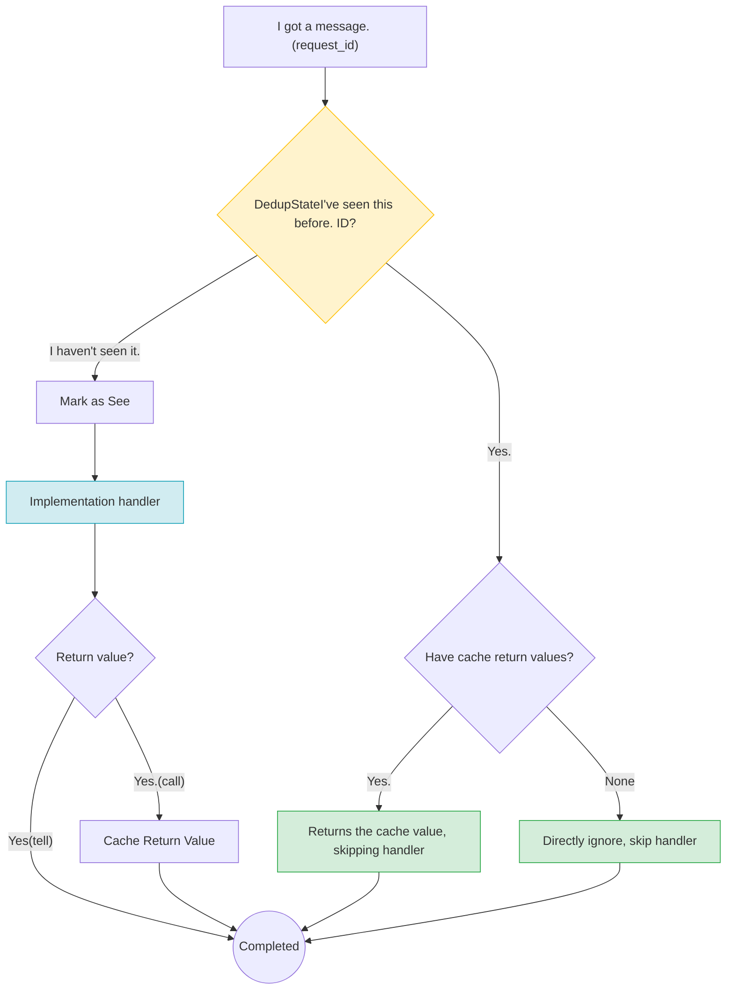

# Transient Error Auto-Retry Design(Pending confirmation)

> **Version**: v1.0 | **Status**: Programme review | **Update**: 2026-02-06
>
> **Pending decision**: which methods need to be retried? and the receiving end should be reused[Programme I](#Programme I business level heavy on its own)Or is it?[Programme II](#Re-recommended within the framework of option 2)?

---

## 1. Problem

When the network is briefly broken (if WiFi→4G Switch, signal fluctuations) , although the framework can automatically complete the reconnect,**Sending request does not automatically retry**:

```
Caller Send Request → Network disconnected → Request failed. Error dropped to caller
                                       ↑
                  Meanwhile, the backstage has been automatically reconnected. ← But the request failed.
```

The root causes are simple:**The frame is only done."Autoreconnection"I didn't do it."Autorelease"**.

| Capacity | Status |
|------|------|
| Breakwire Reconnect | ✅ Achieved (in thousands of United States dollars)WirePool Autoreconnection) |
| Failed to re-issue | ❌ Not achieved (Error to caller) |

---

## 2. Solutions: Sendend AutoRetry

Thinking: Having met Transient When an error occurs, the frame is automatically retrying at the sending end.
### Which methods need to be retried (⏳ (To be confirmed)

Planned **`OutprocOutprocOutGate`**(Travelling process) Add a retest to the following approach.

| Methodology | Upper Call | Add Retry | Annotations |
|------|---------|---------|------|
| `send_request()` | `ctx.call()` | ✅ Plan to join | RPC Please,Transient Autoremit when an error |
| `send_message()` | `ctx.tell()` | ✅ Plan to join | The news is one-way.Transient Autoremit when an error |
| `send_data_stream()` | `ctx.send_data_stream()` | ❌ Not Add | Fast Path Low delay passage, retrying conflict with its design |
| `send_media_sample()` | `ctx.send_media_sample()` | ❌ Not Add | RTP The protocol itself handles the re-transmittance. |

> **Why? OutprocOutGate Layer?** OutprocOutGate It's all over the process./The single export of web-based information, the enhanced testing of which can be fully transparent to the upper level and can only be transversal/The network path is retried. In addition, this layer clearly distinguishes between different modes of delivery, without prejudice to each other.

### What is it? Transient Error

Just... **Transient(Interim)** You're not trying again until you're wrong. —— Name"I'll try again in a minute.". Other errors do not change the result, and return directly.

Judgement

Frame `RuntimeError` It's defined. `ErrorClassification` and `is_retryable()` Methodology (%)TODOThe error needs to be combed:

| Classification | `RuntimeError` Variable | Annotations |
|------|---------------------|------|
| **Transient(may be repeated)** | `Unavailable` | Connections are disconnected, cross-board overload, temporary resources are depleted |
| | `DeadlineExceeded` | Network delay, slow response to end |
| **Permanent(not retried)** | `NotFound` | Objective Actor Cannot initialise Evolution's mail component. |
| | `InvalidArgument` | Request parameter error |
| | `FailedPrecondition` | System state is not satisfactory |
| | `PermissionDenied` | Insufficient Permissions |
| **Poison(A manual intervention required)** | `DecodeFailure` | Message's broken. In. Dead Letter Queue |

> **Status issues (A/CN.9/WG.III/WP.10)TODO)**: Current error code is not used —— `OutprocOutGate` Direct Use `ProtocolError`(if `TransportError`, `Timeout`♪ No one's going to go ♪ `RuntimeError` . You need to regulate the wrong number before you can retry: combo `ProtocolError` → `RuntimeError` Map relationship to ensure that retesting is used uniformly `RuntimeError::is_retryable()`.


### Retry Policy

Adopt**Index Refuse + Randomly Dithering**Yes. deadline Maximum internal retry 3 Number of times:

- Double each retry interval (%)1s → 2s → 4s) with random shaking to avoid retrying at the same time
- All retrys must be original timeout Internally completed (inward)deadline Mode)
- Each request is independently re-tryed without prejudice
- Keep Same When Try Again `request_id`, to facilitate the identification of duplicates by the receiving end

```
Example:timeout = 30s

I'm not sure. 1 Subsend → Failed (TransportError)
  Wait. ~1s
I'm not sure. 2 Subsend → Failed (TransportError)
  Wait. ~2s
I'm not sure. 3 Subsend → Success ✅(total time-consuming) ~3s)

♪ The world is so full of shit ♪
  3 Every time I fail. → Return Last Error
  deadline First. → Back Timeout
```

---

## 3. New issues arising from re-testing

The automatic re-testing is intended to improve the reliability of the network in case of instant failure, but it also introduces new problems:
| Problem | Annotations | How? |
|------|------|---------|
| **The message is waiting.** | Sendingend thought it failed, but no. 1 It's actually the receiving end. → Two to the receiving end. | The receiving side is heavy. (See [§4](#4-Receiving End to Heavy Scheme--Pending decision)) |
| **Try Storm again** | A large number of clients encounter a web shake at the same time and try again collectively → The flow doubles in a moment, crushes the service. | Index Refuse + Wandering randomly, breaking the time point for retry |
| **Delay Zooming** | Retrying requires waiting for the retreat interval and increasing the delay felt by the caller | deadline Mode: All retrys must be original timeout Internally completed, no additional extension waiting |
| **Cascade failure** | Downstream service overload, retesting to further increase load → Avalanche | Most 3 Try again + deadline Pump bottom; follow-up expands the melting mechanism (Circuit Breaker) |

of which**The message is waiting.**It is a core issue that requires decision-making at the framework level, and is detailed below.

### It's a typical scene for the news.

```
Sendend                        Receiver
  │── Request (id=abc) ──────────→│  ← I'm not sure. 1 Times: Receiving end normal processing
  │                   ←─ Response ──│
  │         ✗ Response missing          │
  │                             │
  │   I thought I was losing. Try again.        │
  │── Request (id=abc) ──────────→│  ← I'm not sure. 2 It's the same message. It's coming again.
```

**Decision-making is needed: who will handle it?** Two options are given below.

---

## 4. Receiving End to Heavy Scheme — Pending decision

### Option 1: Self-heavy at the operational level

Frame only ensures that retrying is done `request_id` No change.**To re-engineer the business. handler I'm gonna make it happen.**.

- **Advantages**: frame zero intrusion, no additional memory cost, full control of the heavy particle size in the business layer
- **Disadvantages**: Each handler It's all about re-writing the logic.
- **Fit**: Natural Zirconium, etc. (reading, overwriting), already in place de-weight mechanisms (e.g., DB (Unique bound)
- **Framework changes**: None

```rust
// Example: Utilization DB Only bound to heavy
async fn handle_transfer(&mut self, req: TransferRequest, ctx: &impl Context) -> ActorResult<Bytes> {
    match self.db.insert_transfer(&req.transfer_id, &req).await {
        Ok(_) => { /* First request, normally processed */ }
        Err(DbError::DuplicateKey) => {
            // Repeat requests, return directly to the results before
            return self.db.get_transfer_result(&req.transfer_id).await;
        }
    }
    // ...
}
```

### Option II: Replacing within the framework (recommended)

Frame in handler The blogger says that the police are not responsible for the incident.**The business level is completely unconscious.**.

- **Advantages**: zero changes in business layer, zero lock (use) Actor Serial processing, no parallel competition
- **Disadvantages**: Repeat message will still enter Mailbox(to be executed after release), additional memory expenses
- **Fit**: Most conventional operations, developers don't want to care about the heavy
- **Framework changes**: Add `DedupState` + Adaptation `handle_incoming`

Go over process:



Key design points:

- `DedupState` Yes. ActrNode Normal Fields (`HashMap`) ) Not needed `Mutex`
- Actor It's... [`handle_incoming`](#b2-actrnode-Integration) Yes. Mailbox Line call in line out of the cycle, no natural competition
- Inspection + Mark completed in the same step, no. TOCTOU Window
- Inert clean-up of expired entries (clean-up every check)

### Programme comparison

| | Option 1: Reloading the business layer | Option II: Replacing within the framework |
|------|------------------|-------------------|
| **Thinking.** | Framework assurance `request_id` It's the same. Business is heavy. | Frame Auto Intercept Repeat Messages |
| **Advantages** | Zero intrusion, no extra cost. | Business zero perception, zero lock. |
| **Disadvantages** | Every one. handler Maybe we should start over. | Repeating message still in. Mailbox |
| **Framework changes** | None | Add `DedupState` + Adaptation `handle_incoming` |
| **Fit** | Natural Zirconium, etc. | Most of the regular operations |

### Recommendations

The frame itself was re-tested, and it was built itself."The message is waiting."Problem. If option one is the framework creates problems and leaves them to business, developers can easily ignore the resulting silent duplication of implementation.

Recommendations:**Option two is default and Option one is optional** —— The framework provides for de-protection by default and can be closed if the operation has special needs.

---

## 5. Implementation plans

### Phase 1Sendend retrying

| Tasks | Annotations |
|------|------|
| Achieved `ExponentialBackoff` | Index Refuse + Randomly Dithering |
| Achieved `retry_with_backoff()` | Universal retest function, comply deadline |
| Adaptation `send_request()` | Add Retry Logic |
| Adaptation `send_message()` | Add Retry Logic |

### Phase 2: Receiving end to heavy (⏳ (depending on programme decision-making)

| Decision-making | Follow-up |
|------|---------|
| Option 1 | No change in the frame. Just add the description of the document. |
| Option II | Achieved `DedupState` And integrate into `ActrNode.handle_incoming()` |

---

## Appendix ASendend reference code

### A.1 Retry Constant

```rust
// outbound/retry.rs

use std::time::Duration;

const MAX_ATTEMPTS: u32 = 3;
const INITIAL_DELAY: Duration = Duration::from_millis(1000);
const MAX_DELAY: Duration = Duration::from_secs(5);
const MULTIPLIER: f64 = 2.0;
const JITTER_FACTOR: f64 = 0.2;
const MESSAGE_DEFAULT_TIMEOUT: Duration = Duration::from_secs(30);
```

### A.2 Index Refuse

```rust
// outbound/backoff.rs

use std::time::Duration;
use rand::Rng;

pub struct ExponentialBackoff {
    current: Duration,
    max: Duration,
    multiplier: f64,
    jitter_factor: f64,
    retries: u32,
    max_retries: u32,
}

impl ExponentialBackoff {
    pub fn new() -> Self {
        Self {
            current: INITIAL_DELAY,
            max: MAX_DELAY,
            multiplier: MULTIPLIER,
            jitter_factor: JITTER_FACTOR,
            retries: 0,
            max_retries: MAX_ATTEMPTS,
        }
    }

    pub fn next_delay(&mut self) -> Option<Duration> {
        if self.retries >= self.max_retries {
            return None;
        }

        let base_ms = self.current.as_millis() as f64;
        let jitter = rand::thread_rng()
            .gen_range(-self.jitter_factor..self.jitter_factor);
        let delay_ms = (base_ms * (1.0 + jitter)).max(0.0) as u64;
        let delay = Duration::from_millis(delay_ms);

        let next_ms = (base_ms * self.multiplier) as u64;
        self.current = Duration::from_millis(next_ms).min(self.max);

        self.retries += 1;
        Some(delay)
    }
}
```

### A.3 Universal Retest Function

```rust
// outbound/retry.rs

use std::future::Future;
use tokio::time::{self, Instant};

/// Retest implementer with retreat (in strict compliance) deadline)
pub async fn retry_with_backoff<T, E, F, Fut>(
    deadline: Instant,
    mut operation: F,
    is_retryable: fn(&E) -> bool,
    timeout_error: fn() -> E,
) -> Result<T, E>
where
    F: FnMut(Duration) -> Fut,
    Fut: Future<Output = Result<T, E>>,
    E: std::fmt::Debug,
{
    let mut backoff = ExponentialBackoff::new();
    let mut last_error: Option<E> = None;

    loop {
        let remaining = deadline.saturating_duration_since(Instant::now());
        if remaining.is_zero() {
            break;
        }

        let attempt = time::timeout(remaining, operation(remaining)).await;

        match attempt {
            Ok(Ok(result)) => return Ok(result),
            Ok(Err(e)) if is_retryable(&e) => {
                last_error = Some(e);
                let remaining = deadline.saturating_duration_since(Instant::now());
                if remaining.is_zero() { break; }
                match backoff.next_delay() {
                    Some(delay) => time::sleep(delay.min(remaining)).await,
                    None => break,
                }
            }
            Ok(Err(e)) => return Err(e),
            Err(_) => break, // deadline Interrupt
        }
    }

    Err(last_error.unwrap_or_else(timeout_error))
}
```

### A.4 send_request / send_message Try again

```rust
// outbound/outproc_out_gate.rs

impl OutprocOutprocOutGate {
    pub async fn send_request(&self, target: &ActrId, envelope: RpcEnvelope) -> ActorResult<Bytes> {
        let deadline = Instant::now() + Duration::from_millis(envelope.timeout_ms as u64);
        let request_id = envelope.request_id.clone();

        // Registration response waiter(Registration only once, retrying the same channel)
        let (tx, mut rx) = oneshot::channel();
        self.pending_requests.write().await
            .insert(request_id.clone(), tx);

        let mut backoff = ExponentialBackoff::new();
        let mut last_error: Option<ProtocolError> = None;

        loop {
            let remaining = deadline.saturating_duration_since(Instant::now());
            if remaining.is_zero() {
                self.pending_requests.write().await.remove(&request_id);
                return Err(last_error.unwrap_or(ProtocolError::Timeout).into());
            }

            // Send
            if let Err(e) = self.do_send(target, PayloadType::RpcReliable, &envelope).await {
                if Self::is_retryable_transport(&e) {
                    last_error = Some(e);
                    if let Some(delay) = backoff.next_delay() {
                        let remaining = deadline.saturating_duration_since(Instant::now());
                        time::sleep(delay.min(remaining)).await;
                        continue;
                    } else {
                        break;
                    }
                } else {
                    self.pending_requests.write().await.remove(&request_id);
                    return Err(e.into());
                }
            }

            // Wait for a response.
            let wait = time::sleep(remaining);
            tokio::pin!(wait);

            select! {
                biased;
                res = &mut rx => {
                    self.pending_requests.write().await.remove(&request_id);
                    return res
                        .map_err(|_| ProtocolError::TransportError("channel closed".into()))
                        .map(Into::into);
                }
                _ = &mut wait => {
                    self.pending_requests.write().await.remove(&request_id);
                    return Err(ProtocolError::Timeout.into());
                }
            }
        }

        self.pending_requests.write().await.remove(&request_id);
        Err(last_error.unwrap_or(ProtocolError::Timeout).into())
    }

    pub async fn send_message(&self, target: &ActrId, envelope: RpcEnvelope) -> ActorResult<()> {
        let deadline = Instant::now() + MESSAGE_DEFAULT_TIMEOUT;
        retry_with_backoff(
            deadline,
            |_remaining| self.do_send(target, PayloadType::RpcReliable, &envelope),
            Self::is_retryable_transport,
            || ProtocolError::Timeout,
        ).await
    }

    fn is_retryable_transport(e: &ProtocolError) -> bool {
        matches!(e, ProtocolError::TransportError(_))
    }
}
```

---

## Appendix B: Receiving end-to-end deretroreference code (option II)

### B.1 DedupState

```rust
// lifecycle/dedup.rs

use bytes::Bytes;
use std::collections::HashMap;
use std::time::{Duration, Instant};

const DEDUP_TTL: Duration = Duration::from_secs(120);

enum DedupResult {
    New,                        // First time.
    DuplicateRequest(Bytes),    // Repeat RPC, return Cache Response
    DuplicateMessage,           // Repeat one-way messages, ignore them
}

/// Per-Actor To take the weight (no need) Mutex, Actor Serial security)
///
/// - Normal HashMap + TTLInert cleanup
/// - check-and-mark One step complete, no competition.
struct DedupState {
    seen: HashMap<String, (Instant, Option<Bytes>)>,
    ttl: Duration,
}

impl DedupState {
    fn new() -> Self {
        Self { seen: HashMap::new(), ttl: DEDUP_TTL }
    }

    fn check(&mut self, request_id: &str) -> DedupResult {
        self.cleanup();

        if let Some((ts, cached)) = self.seen.get_mut(request_id) {
            if ts.elapsed() < self.ttl {
                *ts = Instant::now();
                return match cached {
                    Some(resp) => DedupResult::DuplicateRequest(resp.clone()),
                    None => DedupResult::DuplicateMessage,
                };
            }
        }

        self.seen.insert(request_id.to_string(), (Instant::now(), None));
        DedupResult::New
    }

    fn cache_response(&mut self, request_id: &str, response: Bytes) {
        if let Some(entry) = self.seen.get_mut(request_id) {
            entry.0 = Instant::now();
            entry.1 = Some(response);
        }
    }

    fn cleanup(&mut self) {
        let ttl = self.ttl;
        self.seen.retain(|_, (ts, _)| ts.elapsed() < ttl);
    }
}
```

### B.2 ActrNode Integration

```rust
// lifecycle/actr_node.rs

impl<W: Workload> ActrNode<W> {
    // Add Field: dedup_state: DedupState

    pub async fn handle_incoming(
        &mut self,
        envelope: RpcEnvelope,
        caller_id: Option<&ActrId>,
    ) -> ActorResult<Bytes> {
        // Reconstruct.
        match self.dedup_state.check(&envelope.request_id) {
            DedupResult::DuplicateRequest(cached) => return Ok(cached),
            DedupResult::DuplicateMessage => return Ok(Bytes::new()),
            DedupResult::New => {}
        }

        // Normal
        let ctx = self.context_factory.create(/* ... */);
        let result = W::Dispatcher::dispatch(&self.workload, envelope.clone(), &ctx).await;

        // Cache RPC Response
        if let Ok(ref response) = result {
            self.dedup_state.cache_response(&envelope.request_id, response.clone());
        }

        result
    }
}
```

---

## Appendix C: Test case

### C.1 Send End Retry

```rust
#[tokio::test]
async fn test_retry_succeeds_on_second_attempt() {
    // First time. TransportErrorSecond time, it worked. → Return succeeded
}

#[tokio::test]
async fn test_no_retry_for_non_transport_error() {
    // SerializationError → No retry, go straight back to the error.
}

#[tokio::test]
async fn test_retry_stops_at_deadline() {
    // Continuous failure + Short timeout → Yes. deadline Internal Stop
}

#[tokio::test]
async fn test_independent_retry_per_request() {
    // Request A Retrying, Request B Send Normal → It's not affecting each other.
}
```

### C.2 Receiving end weight (option II)

```rust
#[tokio::test]
async fn test_first_request_passes_through() {
    // First request_id → DedupResult::New
}

#[tokio::test]
async fn test_duplicate_rpc_returns_cached() {
    // Same request_id Again. → Back Cache Response
}

#[tokio::test]
async fn test_duplicate_message_ignored() {
    // Same request_id It's... message → Ignore
}

#[tokio::test]
async fn test_expired_entry_treated_as_new() {
    // TTL Expired → Deal with as a new request
}
```
