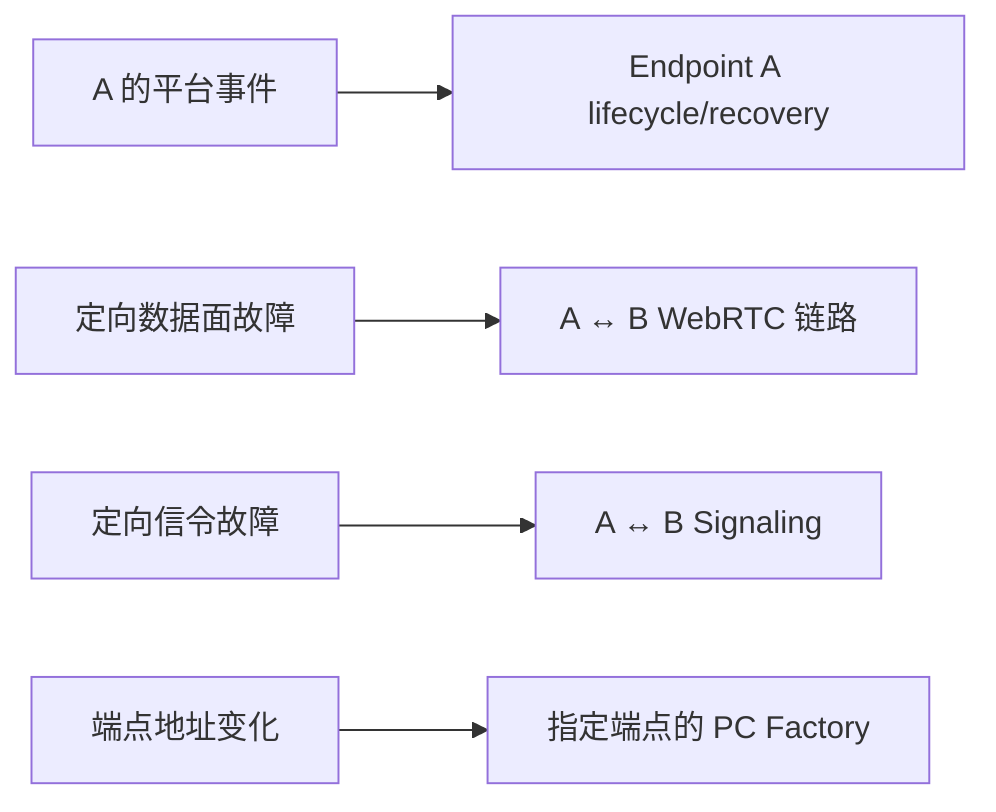
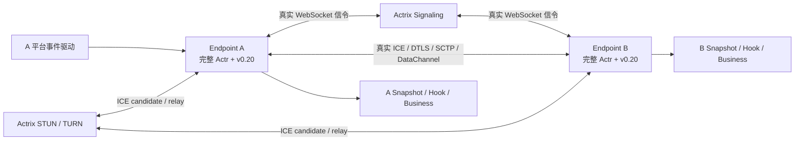

# Actr 移动端双端 WebRTC 连接、生命周期与网络恢复测试方案

> 历史文档：沿用撰写时的名称（如 Actrix、AIS、manufacturer），现行名称见[术语表](../GLOSSARY.zh.md)「历史名称对照」。

状态：Rust 阶段 A–D 已实现并完成严格补强，等待 CI 运行时验证；阶段 E/F 仍属于
真机、系统网络与长稳门禁

日期：2026-08-12

基线提交：`69df070622d3`
依赖基线：webrtc-rs v0.20 API 线，当前实际版本 `0.20.1`

关联文档：

- [v0.20 分层测试与网络验证方案](webrtc-v020-test-plan.zh.md)
- [v0.20 架构 RFC](../../rfcs/actr/0504-webrtc-v020-rtc-controller-architecture.md)
- [恢复测试与发布门禁](webrtc-v020-recovery-test-plan.md)
- [T1/T2/T3 测试契约](webrtc-v020-test-contract.md)

本文中的“必须”“禁止”“应该”用于描述测试契约。第 9 节区分本分支已经实现的
Rust T3/T5 证据与仍需外部设备/系统环境完成的门禁，不能把后者当作当前已有覆盖。

---

## 1. 目标与核心结论

### 1.1 测试目标

本方案验证下面这条完整产品链路：

```text
移动端系统事件
  → Swift/Kotlin adapter 等价的 NetworkEventHandle 输入
  → Actr lifecycle reconciler
  → v0.20 RtcRecoverySupervisor
  → A、B 两端各自的 RtcPeerController
  → 两端真实 webrtc-rs v0.20 PeerConnection 协商与数据传输
  → 两端 WebRtcPeerState / Hook
  → A→B、B→A 业务发送
```

测试的最终问题不是“移动端 A 自己是否又变成 Connected”，而是：

> A 发起或接收一条到 B 的真实连接后，当 A 的生命周期或网络发生变化，A、B
> 两个独立端点能否通过同一条连接的协议交互收敛，并恢复两个业务方向。

### 1.2 核心结论

本方案采用以下硬规则：

1. 最小集成测试单元是一条连接 `RtcLink(A, B)`，不是单个端点。
2. A、B 是两个独立 Actr 端点；可以运行在同一测试进程中，但不能共享 Manager、
   Controller、PeerConnection、状态存储或故障开关。
3. 初连时只允许一个端点调用 Connect，但 Connect 只是发起角色仲裁，不能把调用方
   直接视为 offerer：
   - offerer/answerer 以 Actrix 返回给两端的 `RoleAssignment` 为准；
   - 无显式角色偏好时，Actrix 按
     `(realm_id, serial_number, publisher, name)` 的逆序确定 offerer；
   - 角色定向用例必须通过测试 `ActrId` 或 `webrtc_role=answer` 偏好得到目标角色，
     不能在测试端伪造 `RoleAssignment`；
   - 只有专门的 glare 用例才允许双方同时发起。
4. A→B 和 B→A 业务流量复用同一条已建立连接，不能通过再建第二条连接实现“双向”。
5. A 收到移动端事件时，禁止为了让测试方便而把同一个平台事件镜像注入 B；B 应
   通过自己的 PeerConnection/ICE 回调或信令消息感知变化。
6. 用例通过条件是双方达到各自预期终态，并完成恢复后的 A→B、B→A 业务验证；
   只看到 A `sendable=true` 不算通过。
7. A、B 的 `pc_generation` 是两个本地单调序列，禁止比较原始数值是否相等。
8. 业务端只依赖本地公开的 `sendable` 判断能否向对应 peer 发送；测试框架才同时
   观察两端状态并形成 pair 级判定。
9. 测试集中凡需要信令、STUN 或 TURN 服务的用例，服务端都必须由 Actrix 提供：
   信令使用 Actrix Signaling，STUN 使用 Actrix STUN，TURN 使用 Actrix TURN；禁止
   用手写 mock、独立测试服务器或 Coturn 代替后，将结果作为 Actr 集成/E2E 验收
   证据。定向故障可以通过 Actrix 的测试控制面或其外部 fault proxy 注入，但不能
   替换 Actrix 本身的协议和认证实现。
10. T3/T5 移动生命周期用例必须走生产的 v0.20 recovery feed：
    `NetworkEventHandle → gated reconciler → publish_v020_network_fact →
    manager.supervisor() → RtcPeerController`。禁止用测试 processor 手工发布
    `RtcNetworkEvent` 后，将结果视为完整 production wiring 覆盖。

### 1.3 范围边界

Rust 集成测试负责证明：给定规范化平台事件、链路事实和信令事实，Actr 的恢复逻辑
一定正确。Android/iOS 真机测试负责证明：OS callback、radio、NAT、进程挂起和 FFI
在真实设备上产生了这些事实。

Rust 测试不能替代以下行为：

- `ConnectivityManager`/`NWPathMonitor` 的真实 callback 顺序；
- Wi-Fi/蜂窝 handoff、NAT rebinding、captive portal、VPN；
- Doze、锁屏、进程挂起和系统回收；
- Swift/Kotlin adapter、UniFFI 线程切换及对象生命周期；
- 移动业务代码是否真正按照公开状态停发和恢复发送。

---

## 2. 双端连接测试模型

### 2.1 一条连接，而不是两个单端测试

```text
平台事件（通常只发生在 A）
            │
            ▼
┌──────────────────────── Endpoint A ────────────────────────┐
│ 独立 Actr Node / Manager                                   │
│ NetworkEventHandle → Reconciler → RecoverySupervisor       │
│ RtcPeerController(B) → PeerConnection A(gA)                │
│ WebRtcPeerState(B) / Hook A / Business Gate A              │
└───────────────────────────────┬─────────────────────────────┘
                                │
                   Offer / Answer / ICE Candidate
                       ICE / DTLS / SCTP / DataChannel
                                │
┌───────────────────────────────┴─────────────────────────────┐
│ PeerConnection B(gB) ← RtcPeerController(A)                │
│ WebRtcPeerState(A) / Hook B / Business Gate B              │
│ 独立 Actr Node / Manager                                   │
└──────────────────────── Endpoint B ────────────────────────┘
```

`RtcPeerController(B)` 与 `RtcPeerController(A)` 是同一条逻辑连接在两端的本地
控制对象，不是两条独立连接。`PeerConnection A` 和 `PeerConnection B` 则是 WebRTC
协议天然需要的两个对等协议实例。

即使 A、B 为了测试速度运行在同一个 Rust 进程中，也必须满足：

- A、B 使用不同 `ActrId`；
- A、B 各自创建 `RtcConnectionManager`；
- A、B 各自创建 `RtcPeerController`、Handler、Session 和 PC；
- 信令必须经过真实 signaling transport/router；
- 数据必须经过真实 v0.20 ICE/DTLS/SCTP/DataChannel；
- B 不能是固定返回 SDP、固定返回 `pong` 的协议 stub；
- 只有业务 handler 可以是确定性的 echo handler。

### 2.2 初连角色与连接建立方式

| 用例配置 | 唯一 Connect 调用 | Actrix 仲裁结果 | 期望信令方向 |
| --- | --- | --- | --- |
| A 被配置为 offerer | `A.connect(B)` | A=offerer，B=answerer | A offer → B answer |
| A 被配置为 answerer | `B.connect(A)` | A=answerer，B=offerer | B offer → A answer |
| Connect 调用方输掉仲裁 | 只调用任意一端 Connect | 调用方=answerer，被动端=offerer | 被动端收到 assignment 后主动发 offer |
| 初连 glare | A、B 同时 connect | 由同一次确定性规则收敛 | 只有最终 offerer 的 offer 生效 |

普通用例禁止先 `A.connect(B)`，再调用 `B.connect(A)` 来“补双向”。连接建立后，
两端都应能在同一条 DataChannel/peer session 上发送 RPC 或 DataChunk。

测试必须从实际 Actrix 信令记录和两端状态确认 offerer/answerer，不能根据“谁调用了
Connect”或“移动端一般是 client”推断。测试 fixture 当前不声明角色偏好，因此角色
定向场景通过上述 ActorId 逆序规则选择 A/B 标识。

### 2.3 “双端”和“双向”的四层含义

| 层面 | 必须验证的内容 |
| --- | --- |
| 端点 | A、B 均为完整且独立的 Actr 端点 |
| 协议 | offer/answer、candidate、ICE restart、PC replacement 由两端协作完成 |
| 状态 | 分别记录 A 看 B、B 看 A 的 snapshot、Hook、generation 和 revision |
| 业务 | 建连后、恢复后均验证 A→B 与 B→A；在途场景按方向参数化 |

两个端点的中间状态不要求锁步。例如 A 进入后台时，A 可以先变成
`sendable=false`，B 可能暂时仍认为连接可用；单向黑洞下，B 也可能比 A 更早检测
异常。测试要验证的是每一端的合法轨迹和最终收敛，而不是强迫两个状态在同一时刻
相等。

### 2.4 Pair 级测试判定

定义两个仅供测试使用的组合判定：

```text
PairReady(A, B)
  = A.state(B).sendable
  && B.state(A).sendable

PairUsable(A, B)
  = PairReady(A, B)
  && probe(A → B) 成功
  && probe(B → A) 成功
```

`PairReady`/`PairUsable` 不是新的生产公开状态。真实移动业务只能看到 A 的本地状态：

- `A.state(B).sendable=false`：A 不应向 B 发起新的业务发送；
- `A.state(B).sendable=true`：A 可以尝试向 B 发送；
- A 不需要也不应直接读取 B 的本地 snapshot；
- 测试框架额外观察 B，是为了证明协议另一端也已经收敛。

### 2.5 Generation 语义

设初始值为 `gA0=A.state(B).pc_generation`、
`gB0=B.state(A).pc_generation`：

| 恢复类型 | A 侧断言 | B 侧断言 |
| --- | --- | --- |
| Noop/Probe 成功 | `gA1 == gA0` | `gB1 == gB0` |
| Soft / ICE Restart | `gA1 == gA0` | `gB1 == gB0` |
| Hard / PC replacement | `gA1 > gA0` | `gB1 > gB0` |
| Cleanup | 旧 generation 不再产生有效状态 | 远端最终退出旧 session |

禁止断言 `gA == gB`。即使两端当前都从 1 开始，这也只是实现巧合，不是协议契约。

---

## 3. 事件、链路事实和故障方向

### 3.1 四类输入必须分开控制



| 输入 | 作用域 | 例子 |
| --- | --- | --- |
| 平台事件 | 指定端点/node | A Background、A NetworkUnavailable |
| 数据面事实 | 指定 link + direction + generation | 只丢 A→B UDP、双向黑洞 |
| 信令事实 | 指定 link + direction + 消息类型 | 丢 restart request、延迟 answer |
| 地址事实 | 指定端点 | A 的 Wi-Fi 地址替换为蜂窝地址 |

事件表示“平台告诉 Actr 什么”，故障表示“底层实际上发生什么”。二者分离后才能
覆盖：

- 平台事件先于真实故障；
- B 先通过 ICE callback 检测到故障，A 的系统 callback 后到；
- 网络已经恢复，但 A 的 Available callback 延迟；
- 平台误报 offline，但物理链路仍正常；
- UDP 正常而信令中断；
- 信令正常而 UDP 单向或双向中断。

### 3.2 移动场景到 Actr 输入的映射

| 移动场景 | A 侧规范化输入 | 典型物理事实 |
| --- | --- | --- |
| 进入后台 | `AppLifecycleChanged::Background` | 可无故障，也可随后挂起 socket |
| 返回前台 | `Foreground { background_duration_ms }` | 旧链路可能仍可用或已失效 |
| 完全断网 | `NetworkPathChanged(Unavailable)` | A 相关 UDP/信令双向不可达 |
| 网络恢复 | `NetworkPathChanged(Available)` | 数据面/信令恢复 |
| Wi-Fi→蜂窝 | Available/Unavailable 序列 + 地址变化 | A 的本地地址和 NAT 映射改变 |
| 蜂窝→Wi-Fi | 两个 Available 也可能连续到达 | 不保证先出现 Unavailable |
| VPN/hotspot | transport/fingerprint 变化 | 路由、MTU、出口地址可能改变 |
| captive portal | `availability=Unknown` | probe 成功或失败 |
| App terminate/logout | `CleanupConnections` | A 释放全部本地资源 |
| 用户主动重连 | `ForceReconnect` | 明确要求 Hard Recovery |

B 默认不接收上表中的 A 侧平台事件。B 的状态变化来源应是：

- v0.20 `PeerConnectionEventHandler` 的 PC/ICE callback；
- A 发来的 restart request、offer、answer、candidate 或 close；
- B 自己的 policy timeout；
- 只有 B 也是真实受影响移动端时，才向 B 注入独立的 B 侧平台事件。

### 3.3 定向数据面故障

目标故障接口必须至少支持：

```rust,ignore
enum LinkDirection {
    AToB,
    BToA,
    Both,
}

enum PacketRule {
    Pass,
    Blackhole,
    DropEvery(u32),
    Delay(Duration),
    DeterministicLoss { percent: u8, seed: u64 },
}

struct FaultScope {
    local: ActrId,
    remote: ActrId,
    pc_generation: u64,
    direction: LinkDirection,
}
```

每个 PC generation 必须有独立 fault handle：

- Soft Recovery 沿用原 PC 和原 handle；
- Hard Recovery 创建新 PC 和新 handle；
- 场景必须显式决定新 generation 是否继续继承故障；
- 旧 generation handle 不得影响 replacement；
- fault hit count 必须大于 0，防止测试没有真正命中数据路径却误判通过。

当前 `with_vnet()` 使用 harness-wide 开关，会同时影响多个 peer，不能满足单链路和
单方向验证；它只能作为兼容 fixture，目标实现应使用 per-link Runtime wrapper。

### 3.4 定向信令故障

信令 fault 必须支持：

- A→B、B→A、Both；
- Offer、Answer、Candidate、ICE Restart Offer、Restart Request/Reject；
- drop、delay、duplicate、reorder、partition/heal；
- 按 exchange id 或第 N 条消息命中；
- 固定 seed、命中次数和消息时间线。

这样才能分别验证：

- answerer 的 restart request 丢失后重传；
- restart offer 到达已经移除旧 Controller 的对端后被拒绝并重建；
- answer 丢失时不能提前恢复 sendable；
- 信令不可用但已建数据面仍正常时，不应无条件杀死业务连接。

### 3.5 地址变化不是一个布尔事件

Wi-Fi/蜂窝切换测试必须同时提供：

1. A 的规范化 `NetworkSnapshot`；
2. A 的 `LocalAddressProvider` 从旧地址集合切换到新地址集合；
3. 旧地址上的数据路径失效；
4. replacement PC 从新地址重新 bind/gather candidate。

只调用 `local_address_changed()` 而不改变 Factory 可见的地址，最多能证明 Soft
Recovery 策略选择，不能证明 v0.20 ICE restart 实际重新 bind/gather 了新接口。
真实 bind/address 行为在 T4/T5 验证，T3 至少要使用可替换的测试地址 provider
和 Runtime socket observation，验证 Soft rebind 实际消费了变化后的地址集合。

---

## 4. 目标 `MobileRtcPairHarness`

### 4.1 总体拓扑



服务侧统一启动 Actrix 提供的 Signaling、STUN 和 TURN 实现。测试可以把 Actrix
作为同进程 fixture、子进程或独立测试环境运行，但不能改用自定义
`TestSignalingServer`、mock STUN/TURN 或 Coturn 作为本层验收后端。A、B 的 RPC
echo handler 可以保持简单，以便把失败定位到 RTC 链路而不是业务逻辑。

### 4.2 每个 Endpoint 必须拥有的对象

| 组件 | Endpoint A | Endpoint B |
| --- | --- | --- |
| 身份 | 独立 `ActrId` | 独立 `ActrId` |
| 生命周期 | 移动 `Gated` profile | 默认 `Ungated`，或明确的第二移动 profile |
| RTC 管理 | 独立 `RtcConnectionManager` | 独立 `RtcConnectionManager` |
| peer 控制 | `RtcPeerController(B)` | `RtcPeerController(A)` |
| v0.20 对象 | Handler/Session/PC A | Handler/Session/PC B |
| 状态观察 | A 看 B 的 snapshot/Hook | B 看 A 的 snapshot/Hook |
| 业务端点 | A 发请求、收请求 | B 发请求、收请求 |

### 4.3 建议结构

```rust,ignore
struct MobileRtcPairHarness {
    a: EndpointHarness,
    b: EndpointHarness,
    rtc_faults: DirectedRtcFaultRegistry,
    signaling_faults: DirectedSignalingFault,
    addresses: TestAddressRegistry,
    trace: PairTraceRecorder,
}

struct EndpointHarness {
    id: ActrId,
    node: TestNodeHandle,
    mobile_events: Option<MobileEventDriver>,
    peer_state: PeerStateRecorder,
    hooks: HookRecorder,
    business: BusinessProbe,
}

struct PairSnapshot {
    a_to_b: WebRtcPeerState,
    b_to_a: WebRtcPeerState,
    role_a: NegotiatedRole,
    role_b: NegotiatedRole,
}
```

`PairSnapshot` 只是读取两个生产 snapshot 后的测试结构，不得成为第三套状态机。

### 4.4 建议操作接口

```rust,ignore
pair.establish(ConnectionInitiator::A).await;
pair.wait_pair_ready(deadline).await;
pair.assert_rpc_both_directions("baseline").await;

pair.events(Endpoint::A).background().await;
pair.rtc_faults().blackhole(LinkDirection::Both);
pair.events(Endpoint::A).network_unavailable(seq).await;

pair.rtc_faults().heal();
pair.events(Endpoint::A).network_available(next_seq, Transport::Cellular).await;
pair.wait_pair_usable(deadline).await;

pair.close_both(deadline).await;
pair.assert_resources_released();
```

还需要以下观察能力：

- `state(A, B)`、`state(B, A)`；
- `wait_endpoint_state(endpoint, predicate)`；
- `wait_pair_state(predicate_a, predicate_b)`；
- `rpc(A, B)`、`rpc(B, A)`；
- `data_chunk(A, B)`、`data_chunk(B, A)`；
- `signaling_trace()`、Handler 派生的 snapshot/Hook 时间线、`fault_metrics()`；
- `generation_handles(endpoint, remote)`；
- `pending_requests(endpoint)`、`outstanding_bytes(endpoint)`。

Handler 继续保持纯翻译器，不额外安装会改变调度或状态的 test callback。其可验收
证据由带 generation 的 Controller snapshot、mailbox overflow 指标和生产 Hook 投影
组成；更细的原始 callback 顺序保留在结构化 tracing 中。

### 4.5 Production-equivalent 生命周期入口

A 的 mobile driver 必须使用生产等价链路：

```text
NetworkEventHandle
  → supervisor_internal_channel_gated()
  → run_network_event_reconciler_with_channel_and_v020_recovery()
  → A.manager.supervisor()
  → A 的各个 RtcPeerController
```

#### 4.5.1 生产实现状态

生产 Node 已经完成这段 wiring，不属于生产功能缺失：

- `create_gated_network_event_handle()` 创建 `LifecycleProfile::Gated` 的 internal
  channel；
- `Node::start()` 从 `v020_manager` 取得 `manager.supervisor().clone()`；
- 存在 v0.20 manager 时，Node 启动
  `run_network_event_reconciler_with_channel_and_v020_recovery()`；
- reconciler 接受平台事件后调用 `publish_v020_network_fact()`，再由
  `RtcRecoverySupervisor` 广播给每个 `RtcPeerController`。

因此这里要补的是 production-equivalent 测试证据，而不是重新实现生产接线。

#### 4.5.2 已补齐的 production wiring 测试入口

兼容入口 `spawn_gated_network_event_supervisor()` 仍只创建 gated lifecycle reconciler，
调用不带 v0.20 feed 的 `run_network_event_reconciler_with_channel()`。单独启动旧 helper
仍然只能证明：

```text
NetworkEventHandle
  → Gated lifecycle policy/reconciler
  → NetworkEventProcessor
```

它仍不能证明：

```text
→ publish_v020_network_fact
→ manager.supervisor()
→ 真实 RtcPeerController
→ 真实 PeerConnection recovery
```

兼容测试中还有一个容易造成误判的旁路：`RtcAwareNetworkEventProcessor` 会在处理
`NetworkRecoveryAction` 后手工调用 `rtc.publish(RtcNetworkEvent::...)`。这些测试可能
最终恢复成功，但它们验证的是：

```text
lifecycle action
  → test processor 手工发布 RTC fact
  → RtcPeerController
```

这与生产实现的“平台原始事实被接受后直接进入 v0.20 feed”并不等价。具体差异包括：

- 生产 feed 发布 accepted raw fact，测试旁路发布 effect/action 映射；
- Background/Foreground 落到 Noop/Probe 时，测试旁路可能不向 Controller 发布事实；
- Cleanup 在测试 wrapper 中可能映射为 `ForceReconnect`，而生产 fact mapper 不把
  Cleanup 映射为 RTC fact；
- 给现有 `RtcAwareNetworkEventProcessor` 再接入 v0.20 feed 会造成事实重复发布。

本分支新增 `spawn_gated_v020_network_event_supervisor()` 和
`MobileRtcPairHarness`，由 `mobile_rtc_pair_contract.rs` 连续验证 gated handle、fact
mapper、manager supervisor、Controller、真实双端 PeerConnection 和恢复后双向业务。
因此新 pair 用例属于“完整 production wiring 覆盖”；旧 helper 用例的层级不变。

#### 4.5.3 已实现的 test-utils 构造

production-equivalent 构造接口如下：

```rust,ignore
spawn_gated_v020_network_event_supervisor(
    processor,
    &peer.rtc,
)
```

`TestRtcControl` 在 helper 内取得并克隆 `manager.supervisor()`，避免向外部集成测试
暴露 crate-private 的 `RtcRecoverySupervisor`。内部必须直接复用生产入口：

```rust,ignore
run_network_event_reconciler_with_channel_and_v020_recovery(
    event_rx,
    gated_channel,
    processor,
    shutdown,
    manager.supervisor().clone(),
)
```

该构造必须遵守以下规则：

- processor 使用不包含 RTC 手工发布副作用的生产 `DefaultNetworkEventProcessor`；
- 不得再使用 `RtcAwareNetworkEventProcessor` 额外发布同一个 RTC fact；
- 每个被接受的平台事件最多进入 v0.20 feed 一次；
- 测试同时记录 lifecycle policy revision、RTC snapshot revision 和 recovery count；
- 至少用一条真实 A↔B 连接验证 Background→Foreground 与
  Unavailable→Available；
- 只向 A 的 `NetworkEventHandle` 输入事件，B 通过 Handler/ICE/信令参与恢复；
- 双方重新 sendable 且 A→B、B→A 均成功后，才判定完整链路通过。

长后台契约也已补齐：`RtcNetworkEvent::AppForeground` 现在保留
`background_duration_ms`，v0.20 reducer 与 lifecycle policy 共用
`LONG_BACKGROUND_RECONNECT_THRESHOLD_MS`（当前为 30,000ms）。达到阈值时 Controller
执行 Hard Recovery；阈值以下执行 Soft Recovery。P03 只从 `NetworkEventHandle`
注入 65s 前后台事件，不再补调 test-only `force_reconnect()`。

T3 移动用例只能从 A 的 `NetworkEventHandle` 输入平台事件。直接调用
`A.rtc.network_available()`、`A.rtc.force_reconnect()` 或向 B 镜像事实，仅允许保留
在更低层的 T1/T2 机制测试中。

### 4.6 利用 webrtc-rs v0.20 的测试 seam

| v0.20 能力 | 在双端测试中的用途 |
| --- | --- |
| `PeerConnectionBuilder::with_handler` | 每个 PC generation 在 build 前安装统一 Handler，记录两端真实 driver 事件 |
| `PeerConnectionEventHandler` | 让 B 从 PC/ICE/DataChannel callback 自主感知 A 的链路变化 |
| `PeerConnectionBuilder::with_runtime` | 为 A、B 的 PC 注入独立 Runtime wrapper，按方向控制 UDP/TCP |
| `with_udp_addrs` | 验证新 generation 使用端点当前地址集合 |
| `PeerConnection::restart_ice()` | 在原 PC 上执行 Soft Recovery，而不是测试专用重连替身 |
| `create_offer/create_answer` 与 local/remote description | 验证真实 restart/rebuild 协商和 exchange 关联 |
| DataChannel `poll()`/send-buffer limit | 验证双向业务、背压、在途消息和唯一消费者约束 |
| Track `poll()` | 媒体用例验证 generation 隔离和恢复后帧归属 |
| `get_stats()` | 异步确认 selected candidate pair/direct/relayed，不阻塞 sendable |
| `close()` | 两端 session owner 显式关闭旧 PC 和 teardown |

`PeerConnectionEventHandler` 只负责把 callback 翻译成带 generation 的事件，不能在
Handler 内发 Hook、做 offer/answer、调用 restart、等待背压 channel 或处理业务消息。
双端测试应验证这一分层，而不是通过 test-only Handler 直接改变 Controller 状态。

### 4.7 禁止的测试捷径

以下写法不能作为 T3 移动双端覆盖：

- 只创建 A 的 PC，B 用固定 SDP/固定 callback stub；
- A、B 共用一个 Manager 或 Controller map；
- 为了“双向”分别建立 A→B 和 B→A 两条连接；
- A 收到 offline 后立即向 B 注入相同 `RtcNetworkEvent`；
- 直接把最终状态设为 Connected；
- long-background 用例直接调用 test-only `force_reconnect()`；
- 只等待 A `sendable=true`；
- 只验证最终 echo，不验证故障是否命中、两端状态和恢复类型；
- 使用固定 sleep 代替 milestone/watch 等待；
- 通过 retry 掩盖 deterministic 场景不稳定。
- 使用自定义测试信令服务、mock STUN/TURN 或 Coturn 代替 Actrix，并将结果计入
  T3/T4/T5 集成或发布门禁覆盖。

---

## 5. 基于 v0.20 分层结构的测试分工

### 5.1 同一契约分层证明

同一个移动场景不应该全部塞进一个超长集成测试。应把它拆成不同层的证据，但 T3/T5
必须保留真实双端连接：

| 层 | Fixture | 双端含义 | 负责证明 |
| --- | --- | --- | --- |
| T1 Policy | Reducer/Controller + TestEffectSink | 分别验证 A/B 本地状态机，不建 PC | 事件顺序、阈值、恢复预算、generation、stale 拒绝 |
| T2 v0.20 API | 两个真实高层 PeerConnection | 两个 v0.20 对等协议实例 | Builder、Handler、Runtime、restart、DataChannel、close |
| T2.5 Sans-I/O | 两个 `rtc` core endpoint | 可重放的协议双端 | 精确 packet loss/reorder、ICE/SCTP 边界；可选 |
| T3 Actr 集成 | 两个完整 Actr endpoint | 一端主动连接、另一端被动应答 | Manager/Controller/信令/业务/状态完整链路 |
| T4 系统网络 | 两进程/netns + Actrix STUN/TURN | 两个真实 socket 网络端点 | NAT、MTU、jitter、真实 bind、relay |
| T5 移动 E2E | 手机 A + 真实远端 B | 两台设备或手机+服务端 | OS callback、radio、FFI、业务 Hook |
| T6 Scale/Soak | A 管理多个 B/C/D | 每条仍是独立 pair | 单链路隔离、恢复风暴、资源长稳 |

### 5.2 v0.20 分层的使用原则

1. T1 不创建 PC，快速穷举 long-background 阈值前 1ms、阈值点和阈值后 1ms
   （当前为 29,999/30,000/30,001ms），以及重复和乱序事件。
2. T2 直接使用正式高层 API，验证 Actr 对 v0.20 的适配契约。
3. 只有 packet/event 级问题无法用高层 API 稳定复现时，才增加 T2.5 Sans-I/O 用例。
4. T2.5 不复制 `RtcPeerController`，不生成另一套 `sendable`，不成为生产 backend。
5. T3 必须使用生产 Manager→Controller→EffectRunner→Session→v0.20 路径。
6. T4/T5 不重复穷举 Reducer 组合，只验证真实环境能否满足抽象及业务契约。
7. v0.20 `Runtime` 当前没有 `now()`，不能把 Runtime mock 宣称为完整协议虚拟时钟；
   策略时间在 T1 用 `ManualPolicyClock`，真实协议在 T2/T3 使用明确总 deadline。

### 5.3 一条移动场景的证据链

以“短后台期间链路暂时失效”为例：

```text
T1：Background/Foreground(5s) → Soft obligation，PC generation 不变
T2：两个真实 v0.20 PC 在 UDP blackhole/heal 后可以完成 ICE restart
T3：A 的公共事件入口驱动恢复，B 被动参与，双方状态收敛并双向 RPC
T5：真实手机产生 callback，公开 FFI state 驱动 UI 停发/恢复发送
```

只有四段证据都存在，才能说该移动场景完整覆盖；不能用 T1 的 action recorder 代替
真实连接，也不能用一次真机 echo 代替状态机边界测试。

---

## 6. 统一测试流程和断言

### 6.1 每个 T3 双端用例的固定流程

1. 创建两个独立端点 A、B，并安装两端状态和 Hook recorder。
2. 根据角色参数，只让一个端点调用 Connect。
3. 等待 `PairReady`，确认实际 offerer/answerer。
4. 执行 A→B、B→A 基线 RPC；需要时再执行 DataChunk/大消息。
5. 记录 A/B 各自的 generation、revision、lane、pending 和资源基线。
6. 在明确方向和 generation 上设置物理/信令 fault，并确认 fault 命中。
7. 只向事件所有者注入平台事件；另一端通过协议和 driver callback 自主响应。
8. 分别等待 A、B 的预期中间状态；不要求两个状态同时变化。
9. 在指定方向注入故障期新请求或在途请求，验证有界结果。
10. 按场景解除 fault、发送恢复事件或推进 policy deadline。
11. 验证真实 Soft/Hard 协商以及 A/B 各自 generation 变化。
12. 等待 `PairReady`，再执行 A→B、B→A 恢复后业务验证。
13. 检查 Hook、pending、outstanding bytes、旧 generation 和 fault registry。
14. 关闭两端，并在一个不可延长的总 deadline 内验证资源收敛。

### 6.2 两端状态断言

每个端点分别验证：

- `peer` 指向正确远端；
- `revision` 单调，订阅首次立即回放当前值；
- `status` 与 Controller 阶段一致；
- `sendable` 是本地业务准入的唯一依据；
- `unavailable_reason` 是稳定枚举；
- Soft 不增加本地 `pc_generation`；
- Hard 严格增加本地 `pc_generation`；
- 旧 generation callback 不修改新 snapshot；
- `network_path=Unknown` 不阻塞 sendable；stats 后续可更新 Direct/Relayed。

Pair 级验证：

- A/B 允许按不同顺序进入 Recovering；
- 任何一端尚未达到预期终态时，不宣布 pair 恢复；
- 恢复后双方均 sendable；
- 两端 revision/generation 只和各自基线比较；
- 两端状态不得串到其他 peer。

### 6.3 Hook 与移动业务断言

A、B 分别验证：

- `on_webrtc_state_changed` 与同 revision snapshot 字段一致；
- Hook 投影消费 Controller 的有序 snapshot commit stream，不能用 latest-value `watch`
  合并掉快速的 `sendable=false→true` 边；状态查询/订阅仍可用 watch 回放最新值；
- `on_webrtc_connecting/connected/disconnected` 只保留兼容边沿语义；
- 重复 callback 不产生重复 Connected→Connected 业务通知；
- Hook 携带正确 remote peer；
- Hard Recovery 不允许旧 generation 的 Hook 迟到后把业务重新打开。

移动业务 A 的验收逻辑为：

```text
收到 A.state(B).sendable=false
  → 停止创建发往 B 的新消息，或立即向用户返回不可发送

收到更新 revision 且 sendable=true
  → 允许新的消息发送
  → 不自动重放交付状态不确定的旧消息
```

### 6.4 协议与恢复断言

| 恢复轨迹 | 必须看到的双端证据 |
| --- | --- |
| Noop | 无新 offer/restart/build；双方 generation 不变 |
| Probe | probe 有界完成；成功不重建，失败升级为明确 obligation |
| Soft | 原 PC 上 restart；offerer 发 restart offer；answerer request/answer；双方 generation 不变 |
| Hard | 新 PC/Handler/Session；真实 offer/answer；双方 active generation 增长；旧 session close |
| Soft→Hard | Soft 只启动一次，超时/强事实后只建立一个 replacement；无 storm |
| Cleanup | close barrier 后 late callback 不复活连接；远端最终退出旧 session |
| Exhausted | 双方或受影响端进入稳定不可发送；后续显式 Connect 可建立新连接 |

Soft/Hard 的通过条件都包含两端协商完成，不能只统计触发端调用过
`restart_ice()` 或 `build()`。

Answerer 触发 Hard Recovery 时采用下面的生产协议闭环：

```text
Answerer: build pending replacement
  → Answerer → Actrix: RoleNegotiation
  → Actrix → 两端: 重发稳定的 RoleAssignment
  → Offerer: Hard Recovery + build replacement + fresh Offer
  → Answerer: 将 fresh Offer 应用到 pending generation 并返回 Answer
  → 双方 replacement ready 后切换 active generation
```

这里不能让 answerer 自行发送 offer，也不能只在本地 build 后等待一个不会自动出现的
offer。`RoleNegotiation` 复用 Actrix 的生产角色仲裁，远端稳定 offerer 收到重复的
offerer assignment 后必须把它解释为 replacement 唤醒信号。

节点级 `close_all` 必须在 Manager 保留 peer 级入站准入墓碑。旧 session 触发的晚到
普通 Offer 或 `RoleAssignment` 只能被丢弃，不能在 registry 中重新发布 Controller；
只有本地显式 Connect 才能清除该墓碑并开始一轮新的 Actrix 角色仲裁。准入检查和
Controller publication 必须与 `close_all` 线性化，不能只在进入 router 时检查一次后
留下 TOCTOU 窗口。

单 peer 的 `close_peer` 不保留持久入站墓碑：远端仍拥有逻辑连接时，fresh ordinary
Offer 是生产恢复路径，必须允许它以 Manager 保存的 generation/revision 下界重建
Controller。携带未知 restart session 的 restart Offer 仍由 signaling router 拒绝，
不能借此创建 Controller。

Controller 在 Hard Recovery 开始 replacement build 时，将被替代的 PC generation
发布给 PeerGate，用于立即释放已经提交到该 generation、但仍在等待 Response 的
pending RPC；Soft Recovery 不替换 Session，已提交的可靠请求仍允许在同一 Session
恢复后完成，保持旧版本语义。对于只从本端 Handler 较晚感知到远端恢复的方向，
Controller 还要把完整的 `sendable` 下降/上升边发布给 PeerGate：下降边启动 5 秒
grace，上升边取消 grace；同一 peer 在 grace 内恢复时保留 pending，持续不可发送时
释放等待 Response 的 pending。两种清理都只负责旧业务收敛，新请求仍只由 Snapshot
做准入，也都不能关闭 DestTransport。Hard Recovery 在同一 DestTransport 内替换 PC
generation；显式 close 携带被淘汰的 `pc_generation`，并通过
`WireIdentity::WebRtc` 做 generation-guarded 清理，迟到 close 不得关闭 replacement
transport。

### 6.5 故障期业务语义

| 发送时刻 | 允许结果 |
| --- | --- |
| 本地已 `sendable=false` 后的新请求 | 立即 `ConnectionNotReady`，不新增 pending |
| 本地尚未检测故障且仍 sendable | 完整成功，或在业务 deadline 内明确失败 |
| 已获取 SendPermit、首片前发生恢复 | 成功或有界失败；generation 校验阻止串代 |
| 多分片中断 | 完整成功或有界失败；禁止损坏 payload |
| RPC 已到远端、response 返回途中 | 成功或 timeout；禁止重复业务执行/重复 response |
| DataChannel 已接受但远端未确认 | 成功或 delivery-uncertain/transport error；禁止盲目安全重发 |

所有恢复后新请求必须使用当前 active generation。至少验证：

- A→B 小 RPC；
- B→A 小 RPC；
- 代表性场景的两个方向 200 KiB 分片 RPC；
- 两个方向 DataChunk/StreamReliable；
- payload 长度、hash、request id 和 response 唯一性。

### 6.6 资源与结束断言

- 两端 pending request 最终为 0；
- 两端 outstanding bytes 最终回到基线；
- replacement 激活后旧 PC/lane/session 不再传业务；
- Manager peer count、Controller task、driver task、socket 和 handler registry 收敛；
- 旧 generation fault handle 被移除；
- signaling partition 未恢复时，shutdown 仍必须有界；
- 测试 teardown 同时关闭 A、B，不能只关闭移动端。

### 6.7 统一时间线证据

失败时必须输出一条合并时间线，每条记录至少包含：

```text
timestamp | endpoint | source | peer | pc_generation | revision
          | status | sendable | operation/exchange | fault hit | result
```

事件来源至少区分：platform、reconciler、controller、handler、signaling、business、
fault、teardown。等待必须基于 watch/milestone；固定 sleep 只能用于 fault duration 或
总 watchdog，不能作为“应该已经恢复”的断言。

---

## 7. 双端场景矩阵

### 7.1 参数维度

每个场景显式声明：

```rust,ignore
struct PairScenario {
    initial_initiator: Endpoint,      // A 或 B；普通场景只允许一个
    platform_event_owner: Scope,      // A、B、Both、None
    first_detector: DetectionOrder,   // A、B、Simultaneous
    rtc_fault: DirectedPacketFault,
    signaling_fault: DirectedSignalingFault,
    address_change: EndpointScope,
    event_sequence: Vec<TimedEvent>,
    in_flight: Option<BusinessInterruption>,
    expected_a: EndpointTrajectory,
    expected_b: EndpointTrajectory,
    expected_pair: PairOutcome,
}
```

不在 PR 中跑完整笛卡尔积：

- 角色：A offerer、A answerer；
- 数据故障：A→B、B→A、Both；
- 业务方向：A→B、B→A、双向并发；
- 事件顺序：事件先、故障先、恢复后迟到、重复/乱序；
- payload：小 RPC、大 RPC、DataChunk。

T1 穷举精确边界，T3 用 pairwise 组合覆盖交互，nightly/T5 补完整角色和方向。

### 7.2 核心场景清单

| ID | 场景 | 事件所有者与真实故障 | 预期轨迹 | 双端关键断言 |
| --- | --- | --- | --- | --- |
| P00 | 干净初连 | 无故障；分别由 A/B 单端发起 | Initial Connect | 被动端自动应答；PairUsable；无第二条连接 |
| P01 | 短后台、链路正常 | A: Background→Foreground(5s)；无 fault | Soft（当前移动策略） | B 不接收 A lifecycle；双方 generation 不变；双向业务恢复 |
| P02 | 短后台、链路暂失效 | A lifecycle；A 相关 UDP 双向短黑洞 | Soft | A 触发，B 从 driver 感知；原 PC；双方最终 ready |
| P03 | 长后台 | A: Foreground(duration≥配置阈值；60s 为代表值)；旧 socket 标记不可信 | Hard | 不直接 force；双方 replacement；旧 session 退出 |
| P04 | 短离线、地址不变 | A: Unavailable→Available；UDP/可选信令短断 | Soft | 只给 A 平台事实；双方原 generation；无 restart storm |
| P05 | Wi-Fi→蜂窝 | A snapshot + A 地址集合变化 + 旧路径失效 | Soft→Hard（失败时） | 优先同代 ICE restart；失败时新 PC 从新地址 bind；双方最终恢复双向业务 |
| P06 | 蜂窝→Wi-Fi、无 offline callback | A: Available→Available + 地址变化 | Soft | 不依赖 Unavailable；双方优先复用原 generation，失败时升级 replacement |
| P07 | 飞行模式/完全离线 | A: Unavailable；A 相关 UDP/信令双向断开 | Soft→Hard/Exhausted 后恢复 | B 无平台事件；两端请求有界；恢复后 PairUsable |
| P08 | 远端先检测 | 先断链；B 先收到 ICE/PC failed；A callback 后到 | Soft 或 Hard | B 的恢复动作有效；A 迟到事件不重复启动恢复 |
| P09 | A 为 answerer 并先检测 | 只让 B 初连；故障首先被 A 发现 | Soft | A 发 restart request，B 作为 offerer 发 restart offer |
| P10 | 双方同时检测 | 双向 fault；A/B driver 同时报告 | Soft glare/dedup | 只收敛为一个有效 exchange；无两个孤儿连接 |
| P11 | 仅信令中断 | 数据面保持；按方向丢 restart request/offer/answer | 保持或有界恢复 | 已建业务不被误杀；需要协商时重传或升级 |
| P12 | Soft 超时升级 Hard | restart 已发但 UDP/answer 持续丢失 | Soft→Hard | Soft 一次；replacement 一次；预算不被迟到事件延长 |
| P13 | callback storm | A 重复/乱序 Available、Foreground、旧 source epoch | Noop/dedup | 两端 revision 单调；旧事件不回退；无 offer storm |
| P14 | 在途 RPC | P02/P05/P07 中暂停指定方向 RPC | 继承对应恢复 | 完整成功或有界失败；无损坏、重复执行、永久 pending |
| P15 | 在途 DataChunk/大消息 | 指定方向中断分片或已接受 DataChannel send | 继承对应恢复 | 内容完整或 delivery-uncertain；恢复后新流双向成功 |
| P16 | App kill/restart | A Cleanup，保留旧 callback；随后新 A 启动 | Cleanup→Initial Connect | 旧 handle/generation 不复活；B 退出旧 session；新 pair 可用 |
| P17 | Unknown/captive/VPN | A Unknown/route change；probe 成功或失败 | Probe/Restore | probe 成功不误建；失败有界升级；B 状态轨迹合理 |
| P18 | 主动关闭 | A close while ready/recovering/building | Cleanup | B 最终不可用；两端旧 PC 关闭；新显式连接可重建 |
| P19 | 两端均受影响 | A、B 各自收到独立平台事件，时序可不同 | 去重后 Soft/Hard | 事件不镜像；双方独立输入仍只形成一条有效连接 |
| P20 | 单纯屏幕熄灭/点亮 | 不产生 lifecycle/network fact；物理链路正常 | Noop | 不误触发 restart/rebuild；双向业务保持可用；真机确认 OS 行为 |

### 7.3 P00：初连基线

每个后续场景都依赖 P00：

1. 先通过测试 ActorId/角色偏好配置本子用例要求的 A/B 角色；
2. `initial_connect_caller=A` 时只执行 `A.connect(B)`；
3. Actrix 向两端返回互补的 `RoleAssignment`；实际 offerer 收到 assignment 后发送
   真实 offer，actual answerer 创建/取得对应 Controller 并回复 answer；
4. 两端分别等到 PC connected 且 `RpcReliable` lane open；
5. A/B 各自发布 `sendable=true`；
6. A→B RPC 和 B→A RPC 都成功；
7. 两端 Manager 对该 remote 各只有一个 active peer controller/session。

然后交换目标角色和唯一 Connect 调用端重跑，证明 A 作为 answerer。另需保留调用方
输掉 Actrix 仲裁、由被动端成为 offerer 的协议用例。普通业务双向测试不再调用第二次
Connect。

### 7.4 P02：A 单侧短后台，双方协作 Soft Recovery

```text
A: Background
物理链路: A↔B UDP 暂时 blackhole
B: 通过 ICE/PC callback 自主进入受损状态
物理链路: heal
A: Foreground(5s)
A/B: 完成 restart request/offer/answer/candidate
A/B: 各自原 pc_generation，最终 sendable=true
A→B、B→A: 新 RPC 成功
```

关键点：只向 A 发送 Background/Foreground；B 的恢复参与由 WebRTC driver 和信令
触发。允许 B 比 A 早或晚进入 Recovering，但最终必须回到同一可用 pair。

### 7.5 P03：Hard Recovery 是双端 replacement

P03，以及显式 `ForceReconnect` 或 Soft Recovery 失败后的升级路径，触发端完成新
PC build 不代表用例通过。必须验证：

1. A 创建新 Handler、Session、PeerConnection；
2. 由当前有效 offerer 发出新 offer；
3. B 为这次 exchange 创建或切换自己的新 PC generation；
4. 双方完成 description/candidate 交换；
5. 双方新 `RpcReliable` lane ready 后才切换业务 active；
6. A、B 各自 generation 相对自身基线增长；
7. 旧 PC、lane、candidate 和 callback 不再承载或影响业务；
8. 恢复后两个业务方向都落在 replacement 上。

如果 A 当前是 answerer，当前 v0.20 协议保持 Answerer 被动：由稳定 Offerer 发出新
普通 offer，A 在收到 offer 后创建或切换 replacement。此路径不要求 Answerer 发送
`RoleNegotiation`，也不能由 A、B 各自独立创建一条 replacement。

P05 的首次地址变化不属于本节的 Hard 路径：先验证同一 PC 上的 ICE restart、
`pc_generation` 不变且 `ice_generation` 前进；只有 restart 失败并升级时，才套用
本节的 replacement 断言。

### 7.6 P08：B 先检测，A 平台 callback 后到

这是移动测试必须补的非对称时序：

```text
t0  A 的 radio/path 已变化，但平台尚未回调
t1  B 先收到 ICE Disconnected/Failed
t2  B 发起允许的恢复动作或 restart request
t3  A 处理来自 B 的信令
t4  A 才收到 NetworkUnavailable/Available 或 Foreground
t5  迟到事件被合并到已有 obligation，不能启动第二轮恢复
t6  双方收敛，双向业务恢复
```

断言 recovery operation/exchange id、generation delta 和 build/restart 计数，避免只看
最终成功而漏掉重复恢复。

### 7.7 P09/P10：answerer 发起意图与 simultaneous glare

P09：由 B 初连 A，使 A 成为 answerer。A 检测故障后不能假装自己是 offerer；应发
ICE restart request，由 B 创建 restart offer，A 回复 answer。

P10：A、B 同时检测故障时，可以同时产生恢复意图，但最终只能有一个有效协商结果：

- 确定性 glare 规则决定接受哪一个 exchange；
- 被淘汰 operation 的 completion/candidate 必须因 operation/generation/ufrag 过期被拒绝；
- 两端不得各自留下一个自认为 active 的孤儿 PC；
- 最终双方仍各只有一个 active session，且双向业务使用同一逻辑 pair。

### 7.8 P07/P14/P15：完全离线和在途业务

飞行模式建模为：A 的 radio 使 A 相关 UDP 和 signaling 两个方向都不可达，但平台
事件仍只输入 A。B 通过自己的网络观察和超时发现远端不可达。

故障期间分别执行：

- A→B 新 RPC；
- B→A 新 RPC；
- A→B 在途大 RPC；
- B→A 在途大 RPC；
- 两个方向 DataChunk。

每个方向单独命名测试，必要时 nightly 增加双向并发。允许结果必须在用例开始前写入
契约，不能因为最终恢复成功就忽略故障期间永久 await、重复 response 或 payload 损坏。

### 7.9 P16：App kill 与新进程连接

App kill 不是在原 A 对象上调用 ForceReconnect：

1. A 执行 cleanup/shutdown；
2. B 最终退出 A 的旧 session；
3. 保存的旧 `NetworkEventHandle`、Handler callback、operation completion 被触发时必须
   fail-fast 或被判 stale；
4. 创建具有新 node/session/source epoch 的 A2；
5. online 时由一个端点重新 Connect，offline 时有界失败；
6. 网络恢复后 A2↔B 建立新的真实连接并完成双向业务。

---

## 8. 一个 Actr 管理多个 PeerConnection

### 8.1 拓扑

```text
                 Endpoint B
                     │
                     │ RtcLink(A,B)
                     │
Endpoint C ───── Endpoint A ───── Endpoint D
           link A-C         link A-D
```

A 内部有三个 `RtcPeerController`，但 B/C/D 仍是三个独立端点。多 peer 测试不是在
A 内部创建三个假 remote，也不是只检查 A 的 controller map。

### 8.2 Link-local fault

只破坏 `RtcLink(A,B)`：

- fault scope 只匹配 A-B 的两个本地 PC generation；
- A-C、A-D 持续执行双向业务探针；
- 只有 A-B 的状态/generation/recovery count 变化；
- B 恢复失败不能阻塞 C/D；
- A-B Hard Recovery 的新 handle 不继承旧故障，除非场景明确要求；
- close B 后，C/D 的状态订阅、Hook、lane 和业务保持稳定。

### 8.3 Node-wide 移动事实

A 的 Background/Foreground 或本地地址切换是 node 级事实，应广播给 A 的所有
Controller，但不能向 B/C/D 镜像平台事件：

- A-B、A-C、A-D 可以因实际链路情况不同分别 Noop、Soft、Hard 或 Exhausted；
- `LocalAddressChanged` 通常要求 A 的所有 active PC 在原 generation 上执行 ICE
  restart；restart 失败时再由各 Peer 独立升级为 Hard Recovery；
- 每条连接的协商、generation、成功/失败和 Hook 必须独立；
- 同时恢复由各 Peer 独立推进，不能因节点级信号量形成跨 Peer 阻塞；
- 一个 peer 的 slow/partitioned signaling 不能饿死其他 peer。

### 8.4 多连接核心用例

| ID | 场景 | 必须证明 |
| --- | --- | --- |
| MP01 | 仅 A-B UDP 单向/双向故障 | A-C/A-D 全程 PairUsable，generation 不变 |
| MP02 | A 地址变化 | 三条 link 分别执行同代 ICE restart，`pc_generation` 不变，无状态或 candidate 串线 |
| MP03 | 三条 link 同时恢复 | Peer 独立性、总 deadline 和最终收敛 |
| MP04 | A-B 信令持续 partition | C/D 恢复和业务不被 B 阻塞 |
| MP05 | recovery 中 `close_peer(B)` | B 不能复活，C/D 不受影响 |
| MP06 | `close_all` | 所有端点和本地资源有界收敛；晚到 Offer/RoleAssignment 不得重建；仅显式 Connect 可创建 fresh link |

---

## 9. 当前覆盖审计与迁移策略

### 9.1 当前已有证据

| 现有测试 | 已证明 | 尚不能证明 |
| --- | --- | --- |
| `mobile_network_event_scenarios.rs` | Android/iOS 文档化事件序列、策略和 responsive supervisor | 大部分使用 action recorder/fake processor，不是完整双端 RTC |
| v0.20 reducer/controller tests | Background/Foreground、online/offline、generation、预算、stale/竞态 | 没有两端真实协议和业务 |
| `ice_restart.rs` | 两个真实端点、basic/sequential/dedup、simultaneous glare、unknown answerer rebuild | 多数机制用例直接向 RTC 层发事实，不覆盖移动公共入口 |
| `ice_restart_with_signaling_disruption.rs` | restart request 重传、信令暂停、Soft→Hard | 不是完整移动 lifecycle 链路 |
| `mobile_full_disconnect_recovery.rs` | 两种 mobile role、双向 RPC、Soft/Hard、双方状态 | fault 是全局的，且常向两端同时发布平台等价事实 |
| `recovery_vnet_supervisor.rs` | 事件 handle、双向 RPC/DataChunk、offline grace | 使用不带 feed 的 reconciler + `RtcAwareNetworkEventProcessor` 旁路；long foreground 直接 force |
| `webrtc_large_mobile_recovery.rs` | 两种 role、两个方向、大 RPC/DataChunk、event storm | 多场景聚合且存在 flaky；部分 lifecycle 被简化/绕过 |
| `v020_recovery_feed_maps_lifecycle_facts` | `NetworkEvent` 到 `RtcNetworkEvent` 的映射 | 没有 gated policy、Manager、Controller 或真实双端 PC |
| `node_surface_wires_gated_profile_and_signaling_sink_to_one_supervisor` | Node gated profile 与 signaling fact sink 共用 lifecycle supervisor | 测试入口使用 `v020_recovery=None`，没有验证 v0.20 Controller |
| 生产 `Node::start()` wiring | 代码已取得 `manager.supervisor()` 并调用带 feed 的 reconciler | 缺少从 gated handle 到真实 A↔B 恢复的组合集成测试 |
| Swift/Kotlin adapter tests | duration、snapshot、source epoch、串行化和 close 后 callback | 不建立 A↔B 真实 RTC |
| 现有移动 E2E | 部分 online/前后台 echo | role、server→mobile、DataStream、切网和双端状态证据不完整 |

本分支新增的实现证据：

| 新实现 | 已覆盖 |
| --- | --- |
| `test_support/actrix_services.rs` | 同一 fixture 启动真实 Actrix Signaling、STUN、TURN，初始化 realm/ACL/AId 公钥缓存，并生成可被生产 Signaling 校验的短期 AId 凭据和 Actrix TURN HMAC 凭据 |
| `test_support/mobile_rtc_pair.rs` | 两个独立 endpoint、单一 Connect 发起者、PairReady、双向 RPC/DataChunk、端点级移动事件与 teardown |
| `spawn_gated_v020_network_event_supervisor()` | `NetworkEventHandle → gated reconciler → publish_v020_network_fact → manager.supervisor() → Controller` 的生产等价 feed |
| lifecycle feed acceptance gate | 只有真正推进 policy revision 的平台事实才发布到 v0.20 feed；stale `(epoch, sequence)` 和结构重复 snapshot 只被公共入口确认，不会绕过去重再次触发 RTC recovery |
| `DirectedRtcFaultRegistry` | 基于 v0.20 `with_runtime` 的 per-link、per-direction、per-generation UDP/TCP fault、命中 milestone 和该 generation 的精确 `with_udp_addrs` 证据 |
| `DirectedSignalingFaultRegistry` | 生产 WebSocket transport 外层按 link、方向、消息类型、Nth 消息或 exchange id 注入 drop/delay/reorder/duplicate；delay/reorder 可取消且 heal 只取消目标 pair，不影响其他 peer |
| `TestEvidenceTimeline` | 失败时合并输出 platform、reconciler、真实 Handler→mailbox fact、controller snapshot、Hook、signaling、business、fault、teardown，并携带 endpoint/peer/generation/revision/时间 |
| Manager/Hook milestone | Controller 创建/移除和公开状态使用 watch，Hook 使用有序 snapshot commit stream，请求到达和 fault hit 使用 Notify milestone；不依赖固定 sleep 猜测状态已经变化 |
| 多 Peer generation/snapshot 观测 | MP03 断言 A 的三条 Controller replacement 都在同一总 deadline 内独立推进并最终恢复 sendable |
| `mobile_rtc_pair_contract.rs` | P00–P20；平台事件只注入受影响端；角色、双端状态/Hook、generation、在途 RPC/大消息/DataChunk 与双向业务 |
| `mobile_rtc_multi_peer.rs` | MP01–MP06；A 同时管理 B/C/D 时的链路隔离、地址切换、恢复公平性、close_peer/close_all |
| `.config/nextest.toml` | 新 pair/multi-peer 门禁 `retry=0`，不以重试掩盖竞态 |

当前结论是：Rust 阶段 A–D 已经形成统一、production-equivalent 的双端 harness 和
测试用例；新的 T3/T5 用例全部使用 Actrix Signaling/STUN/TURN，且 lifecycle 场景
复用了生产 v0.20 recovery feed。依赖 `TestSignalingServer` 的旧用例仍只属于兼容/
低层机制回归，不能替代这组新证据。

本次严格补强代码已通过 `cargo fmt` 和
`cargo clippy --fix --lib --bins --all-targets --allow-dirty`。按照本分支约定未在开发机
执行测试；因此上述场景的运行时结果仍必须以 PR CI 的 retry=0 报告为准，不能把
“代码已实现”写成“CI 已通过”。

尚未完成的是阶段 E/F 所需的 Android/iOS 真机 callback、真实 radio/NAT、Linux
netns/netem、规模和 2–8 小时长稳环境。这些必须在对应 CI/设备实验室执行，Rust
进程内 fault seam 不能冒充其验收结果。

### 9.2 迁移原则

1. 保留老测试原有业务语义和断言，不用降低断言换取通过。
2. 机制测试可以继续直接注入 RTC fact，但文件名和层级必须标明 T1/T2。
3. 移动 T3 用例迁移到 `MobileRtcPairHarness` 后，删除对 B 的平台事件镜像。
4. `simulate_disconnect()` 拆成：定向物理 fault、A 平台事件、可选 B 独立事件。
5. long-background 删除测试代码直接 `force_reconnect()` 的绕过。
6. monolithic 大矩阵拆为独立测试名，保留 helper 和业务检查。
7. 每个迁移用例补齐双方 snapshot、实际 role、业务两个方向和资源收敛。
8. 在新 harness 稳定前保留兼容用例；等价证据齐备后再删除重复测试。
9. T3/T4/T5 harness 统一启动或连接 Actrix Signaling/STUN/TURN；故障注入放在
   Actrix 控制面或外部 proxy，不再把自定义测试服务作为验收后端。
10. T3 移动 lifecycle 用例使用带 v0.20 feed 的 gated helper 和无 RTC 副作用的
    `DefaultNetworkEventProcessor`；`RtcAwareNetworkEventProcessor` 仅保留给明确标注
    的兼容/低层机制测试，禁止与 recovery feed 同时使用。

### 9.3 建议文件组织

| 文件 | 职责 |
| --- | --- |
| `mobile_network_event_scenarios.rs` | T1 事件序列和策略，不创建 PC |
| `webrtc_v020_pair_contract.rs` | P00、角色、同一连接双向业务、pair oracle |
| `mobile_rtc_lifecycle_pair.rs` | P01–P03、P16、P18、P19 |
| `mobile_rtc_network_pair.rs` | P04–P13、定向数据/信令/地址故障 |
| `mobile_rtc_inflight_pair.rs` | P14/P15，每个方向和 interruption 独立测试 |
| `mobile_rtc_public_state_pair.rs` | 双端 snapshot/Hook 与 A 侧业务准入 |
| `mobile_rtc_multi_peer.rs` | MP01–MP06 |
| `test_support/mobile_rtc_pair.rs` | 只组合生产对象、fault 和 observer，不实现状态机 |

---

## 10. CI、Nightly 与真机分配

### 10.1 PR 必跑

- P00：A/B 分别作为唯一初连发起者；
- P02：A 单侧短后台 + 双向临时黑洞；
- P04：A 单侧 offline/online + Soft Recovery；
- P05：A 地址变化 + Soft Recovery（失败时升级 Hard）；
- P08：B 先检测、A callback 后到；
- P09：A answerer 发起 restart request；
- P10：simultaneous recovery/glare；
- P12：Soft→Hard；
- P14：一个 A→B 和一个 B→A 在途 RPC；
- MP01：单链路故障隔离；
- 双端状态/Hook 和 teardown 公共断言。

PR 使用 pairwise role/direction，deterministic 用例 `retry=0`。每个测试有独立名字和
总 deadline，不能把全部组合封装成一个长循环。

### 10.2 Nightly

- P00–P20 的 role × fault direction × business direction 扩展矩阵；
- Offer/Answer/Candidate/Restart 消息分类故障；
- 大 RPC、DataChunk、媒体恢复；
- MP01–MP06 和 10 peer 恢复风暴；
- Linux netns/netem + Actrix Signaling/STUN/TURN，覆盖 direct/relay-only；
- Swift simulator 与 Android emulator 生命周期；
- 30 分钟恢复循环和资源趋势。

报告至少包含：flake rate、`time_to_not_sendable`、`time_to_pair_ready`、Soft/Hard
次数、A/B generation delta、fault hits、pending/outstanding 和资源增量。

### 10.3 Android/iOS 真机发布门禁

每个真机用例仍是两个真实端点：

```text
手机 A（完整 Actr） ←──── 真实网络/WebRTC ────→ 远端 B（完整 Actr）
```

远端 B 必须能够主动连接手机并调用手机 workload，才能覆盖：

- 手机 A 为 offerer 和 answerer；
- mobile→remote 与 remote→mobile RPC；
- mobile→remote 与 remote→mobile DataStream；
- Wi-Fi→蜂窝、蜂窝→Wi-Fi、飞行模式；
- 5s/60s 前后台、screen off/on、Doze/锁屏；
- VPN/captive portal；
- App kill/restart；
- 手机公开状态/Hook 驱动停发和恢复发送。

每次结果必须记录实际 role、连接发起者、业务方向、payload、A/B 状态时间线和日志
证据。缺少远端调用能力时，应标记 harness gap，不能把 mobile→server 成功当作双向
覆盖。

---

## 11. 分阶段实施计划

### 阶段 A：建立真实 Pair 契约和观察器

工作：

- 新增 `MobileRtcPairHarness`，内部创建两个独立 Manager/Controller/PC；
- 实现“单一 Connect 发起者”接口；
- 增加双方 snapshot、Hook、role、signaling 和业务 recorder；
- 实现 `PairReady`、`PairUsable`、双向 RPC 和双端 teardown。

退出条件：P00 两种角色稳定通过，且证明同一条连接支持两个业务方向。

### 阶段 B：接通 production mobile event 链路

工作：

- 新增 `spawn_gated_v020_network_event_supervisor(processor, &peer.rtc)`，内部复用
  `run_network_event_reconciler_with_channel_and_v020_recovery()`；
- 为 pair harness 提供无 RTC 手工发布副作用的 `DefaultNetworkEventProcessor`；
- 禁止带 feed 的 helper 与 `RtcAwareNetworkEventProcessor` 组合，防止重复 fact；
- A 的事件只从 `NetworkEventHandle` 输入；
- 删除 T3 helper 中直接 `rtc.force_reconnect/network_available` 的绕过；
- B 不接收 A 的平台事件，依靠 Handler/信令响应。

退出条件：

- P01–P04 在不镜像 B 事件、不直接调用 RTC action 的情况下稳定通过；
- 测试时间线能连续证明 `NetworkEventHandle → gated reconciler →
  publish_v020_network_fact → manager.supervisor() → RtcPeerController`；
- 每个 accepted event 只产生一次对应 RTC fact/recovery obligation；
- A/B 都恢复 sendable，恢复后 A→B、B→A 均成功；
- 该组用例从“部分 production wiring 覆盖”升级为“完整 production wiring 覆盖”。

### 阶段 C：实现 per-link、per-direction、per-generation fault

工作：

- 通过 v0.20 `with_runtime` 注入独立 Runtime wrapper；
- 数据面支持 A→B、B→A、Both；
- signaling transport 支持方向和消息分类；
- 地址 provider 支持端点级地址集合替换；
- 输出 fault hit count，并清理旧 generation handle。

退出条件：P05–P13 稳定，MP01 中 A-B 故障不影响 A-C/A-D。

### 阶段 D：迁移业务恢复与多 peer 用例

工作：

- 迁移并拆分 large-message/in-flight 用例；
- 补 P14/P15 的两个业务方向；
- 补 P16–P20 和 MP02–MP06；
- 所有场景复用统一双端状态、Hook、资源断言。

退出条件：核心 T3 用例 retry=0，不再存在用全局断网或双端事件镜像冒充移动场景的
常规门禁用例。

### 阶段 E：移动 binding 与真机 E2E

工作：

- Swift/Kotlin 使用公开 `get/list/subscribe` 和 `on_webrtc_state_changed`；
- 远端 harness 支持主动连接手机、向手机发 RPC/DataStream；
- emulator/simulator 覆盖 lifecycle，真机覆盖 radio/network switch；
- 保存双端日志、真实 role、方向和状态证据。

退出条件：Android/iOS 业务仅依赖本地 `sendable` 控制发送，两个角色和两个业务方向
都有真实证据。

### 阶段 F：系统网络、规模与长稳

工作：

- netns/netem + Actrix Signaling/STUN/TURN 验证真实 bind、NAT、MTU、
  loss/jitter/relay；
- 10/50/100 peer 梯度和多 link 随机故障；
- 30 分钟 nightly、2–8 小时 release soak；
- release gate 禁止 retry。

退出条件：无永久半开、跨 peer 污染、恢复风暴失控或资源持续增长。

---

## 12. 完成定义

本方案完成时必须同时满足：

- 每个 T3/T5 用例都包含两个独立、完整的 Actr 端点；
- T3/T4/T5 所需信令、STUN、TURN 均由 Actrix 提供；
- 普通初连只有一个 Connect 发起者，另一端真实被动应答；
- A→B、B→A 使用同一条连接并在恢复前后验证；
- A 的平台事件不会被测试代码镜像给 B；
- gated `NetworkEventHandle` 到 `publish_v020_network_fact`、
  `manager.supervisor()` 和真实 `RtcPeerController` 的链路有组合集成测试；
- production-equivalent 用例不依赖 `RtcAwareNetworkEventProcessor` 手工发布 RTC fact；
- B 的变化由真实 v0.20 Handler、ICE/PC callback 和信令驱动；
- A 作为 offerer/answerer 均有覆盖；
- 单向、双向数据故障和定向信令故障可独立注入；
- Soft/Hard 通过两端本地 generation 和协议 exchange 明确区分；
- Pair 通过要求双方达到预期终态，且恢复后双向业务成功；
- 移动业务通过本地公开 `sendable`/Hook 判断发送时机；
- 一个 Actr 管理多个 peer 时，单链路故障不影响其他连接；
- 在途 RPC/DataChunk 有成功、有界失败或 delivery-uncertain 的明确契约；
- teardown 后无旧 PC、Controller、task、socket、lane、pending 或 fault handle；
- deterministic 集成测试 retry=0；
- 真机覆盖真实 OS/radio/FFI，并保存可审计的双端证据。
