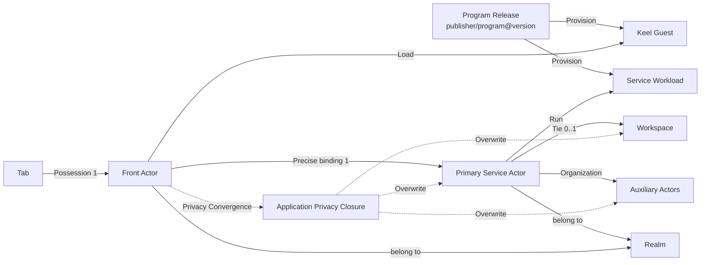

# 02. Area model

## 1. Overview



## 2. Six core objects

### 2.1 Program

Program stable name, does not contain examples of installation status and operation.

```text
ProgramId = publisher/program
```

Example:

```text
notes.example/team-notes
```

`publisher` It's a regularity. DNS Domain names;`program` is the only program name in the domain namespace.

### 2.2 Program Release

Unchangeable version of the procedure:

```text
ProgramReleaseId = publisher/program@version
```

It has to be analyzed to a fixed `.actr` package digest.Program Release Description:

- Service workload;
- Keel Guest (a) Entry points;
- Front–Service (a) Contracts;
- Capacity and components to apply;
- Keel/Actrium/Actr ABI Compatibility scope;
- (a) Resource quotas;
- Workspace (a) Modes;
- Publisher Can not open message

### 2.3 Service Actor

A real, addressable and state-of-the-art example of a procedure:

- Last `ActorId`;
- Fixed Run Some Program Release digest;
- Hold Workspace capability;
- Holds case profiles and access controls;
- Life cycle independent of Tab;
- It can be run locally or at a remote end;
- It may orchestrate other Actors while exposing one primary interface to the Front.

Service No, it's not.“Program Type”Nor is it a freely replaceable load-balanced candidate.

### 2.4 Front Actor

One. resident app Tab Corresponding short life cycle interactions Actor:

- workload By Actrium (b) Fixed;
- Inline Keel Host, Actr client, capability broker and life-cycle management;
- Load certified Keel Guest;
- Only binds Service ♪ I'm limited ♪ capability;
- Tab (a) Rebuilding after closure, collapse or system recovery;
- ActorId It can be session-level and does not assume a permanent business identity.

### 2.5 Tab

Actrium Shell .Tab Saves local browsing status, e.g.:

- Local `tab_id`;
- Current Normalization `actr://` URI;
- Page route;
- Back/Forwarding the bar;
- Displays titles, icons;
- suspend/restore Metadata.

Tab Do Not Save Workspace Key, no business data.

Tab record It can continue after memory recovery. It is at this time dormant TabNo, I don't. live Front Actor;by same when reactivated URI Rebuild New Front Actor.

### 2.6 Workspace

Service . It's not a simple file path, it's a one-- Host Host. capability:

```text
WorkspaceBinding
├── workspace_id
├── provider_type
├── provider_locator
├── access_mode
├── credential_ref
├── lease_policy
└── backup/migration metadata
```

`credential_ref` Point to system secure storage. Not allowed to be present. URL, general database or Guest launch context Medium.

## 3. “Tab–Service 1:1”Accurate definition of

### 3.1 Product is not variable

At any time of operation:

- One in the middle of a loading/running/suspended It's... resident Tab Just happens to have one. Front Actor;
- One by Shell Abandoned but kept in Tab strip It's... dormant Tab No, I don't. live Front Actor;
- One. Front Actor One at most. Primary Service Actor;
- After starting, one Front ActorWe have to tie one to the right one. Primary Service Actor;
- One. Service Not yet. Front;
- Service And history Front Not a permanent double.

Formalized means:

```text
Tab 1 ── 0..1 Live Front Actor
Live Front Actor 1 ── 1 Primary Service Actor
Primary Service Actor 1 ── 0..1 Active Front Lease(v1 exclusive)
Primary Service Actor 1 ── 0..1 Workspace
```

The same. Service You can be multiple in time. Front Actor reconnect; this is not the running-time base at the same time.v1 Default Session Policy is `exclusive`, only one interactive at the same time Front Main lease.

### 3.2 Why not define a strict double-fire across the board?

If Service It's always just one specific thing. Front Actor, and it immediately creates a contradiction:

- Close Tab Back Service Whether it is necessary to delete;
- Actrium Restart New Front Actor How to connect;
- Front Whether the crash caused Workspace (a) Loss of ownership;
- The following video shows the event:
- The same example is why it is necessary to change identity after moving to new equipment.

So the simplest model is not“Two life-cycles tied to death.”and instead:

> Front Always face one. Service;Service Independent presence and acceptance of a new mandate Front Session.

### 3.3 Monopoly and sharing

Program Manifest Declaration:

```toml
[actrium.session]
attachment_policy = "exclusive"
```

v1 Promises only `exclusive`:

- The machine is open for the same Service , open the same URI Focus already. Tab;
- The other device is requested to connect.Service (b) May refuse, wait for the expiration of the lease or trigger a user-confirmed takeover;
- There's a limit to the network after it's broken. lease grace period, to prevent the instant break-through from being miscalculated as release.

`shared` It is a follow-up capability that requires additional definition of multi-session privileges, simultaneous writing, focus and collaborative status, and inaction v1 Invisible behavior.

## 4. Identity, type and example

### 4.1 Program coordinate with ActrType

Program Release with Service `ActrType` One to one:

```text
publisher/program@version
            ↓
ActrType {
  manufacturer = publisher
  name         = program
  version      = version
}
```

Actr Current manufacturer/name Shorter share. `Name` Containment. Target design must put Publisher For verification read completeness DNS/IDNA Rules and support for maximum 253 Bytes A-label Domain name.

### 4.2 ActorId

Service ActorId It is essential to meet:

- `Realm authority + realm_id + serial + ActrType` The overall picture is distinguishable;
- Carrying a verifiable, decipherable. Realm authority;
- Yes. Realm (a) Permanent and sole;
- Realm We must not use them. ID (b) To allocate another example;
- On the basis of normal renewal,hard re-auth, the change of letters, the re-launching of processes and the relocation of operational positions remain the same;
- with Actor (b) Long-term key binding;
- You can interpret it as the current online address or you can report it clearly. offline;
- ActorType Yes. ID AND HAVE TO BE COMPLETED WITH Program Release Same.

Current Actr It's... legacy The text is in the form of:

```text
<serial_hex>@<realm_id>/<publisher>:<program>:<version>
```

It's missing. Realm authority.v1 It has to be expanded. ActorId Data models and standards formatter♪ And make DNS Realm From ActorId (a) Self-determine; for example:

```text
<serial_hex>@<realm_id>~dns:<realm-domain>/<publisher>:<program>:<version>
```

Local Realm Use `local:<installation-id>` authorityFinally. wire/text Encoding by Actr ADR Freezing, but not returning.“Just one. realm_idFuck! Actrium Private guess. Realm”Semantics.

At the same time, the semantics of its life cycle must be derived from“Current registration address”Upgrade to“Durable logic of renewable rent Actor Identity”.

### 4.3 ActorId It's not a secret.

ActorId The connection must also be verified:

- Realm Issued Actor credential;
- Service Owner/Members ACL;
- Front Session challenge;
- Program coordinate, package digest and agreements fingerprint;
- attachment lease.

### 4.4 No increase in public ServiceInstanceId

Target model no longer oriented URL Add a public layer“Logical Service Key”. If ActrId If we can't stabilize, we should fix it. ActrIdInstead of keeping all the upper levels long:

```text
ServiceInstanceId → current ActorId
```

Actrium Local databases can have pure storage. `record_id`But it's not a network identity, and it's not shared. URL Medium.

## 5. Status Attribution

| Status | Author of authority | Annotations |
|---|---|---|
| Tab Arrange, move forward./Back | Actrium Shell | It's synchronous. The loss should not disrupt the business. |
| Guest UI Temporary state | Front Actor / Keel Guest | suspend But a snapshot. Once the crash is over, it's allowed to rebuild. |
| Current binding Service ActorId | Tab Session | From Regularization URI |
| Business status | Service Actor | Not on it. Front |
| Workspace Contents | Workspace Provider | By Service capability Visits |
| Workspace Tie | Service Actor | Front No re-tabling. |
| Program Release metadata | Program Catalog | Here. coordinate + digest As Primary Key |
| Actor Long-term private key | Secure Storage | Not normal SQLite |
| Realm membership credential | Secure Storage | Short-term, renewable, revocable |
| Permissions granted | Actrium Permission Store | Tie publisher/program/major/digest/Workspace Scope |
| ActorAssurance | Authenticator (%1)issuer ≠ subject) | For accuracy `ActorStateId` Nodal conclusion |
| ApplicationAssurance | Applied assessor | Consemination conclusions of current no root map cut-off; presentation required Ready |

## 6. Create, detect and accurately connect

The three acts must be separated:

### 6.1 Create

None `service` It's... URI Yes. Create Intent.Actro:

1. Parsing and Validating Program Release;
2. Selection Realm with Workspace;
3. Create a new local Service Actor;
4. Get a hold of it. ActorId;
5. Use the... ID Create Front Sessions;
6. In-place Rewrite URI.

### 6.2 Type found

Press `ActrType` It is not used to replace a user that has already been designated Workspace-bound Service.

### 6.3 Exact Connection

Yes. `service` It's... URI We have to go. `Dest::Peer(ActorId)`:

- Do not do LB;
- No candidate of the same type;
- Not because offline The project will be a new one.
- Program/Version Reject when matching;
- Realm Request import or trust if not configured Realm Profile.

## 7. Primary Service Interface

To keep it. Front Very simple.Guest Only:

```typescript
primaryService.call(route, request)
primaryService.tell(route, event)
primaryService.on(eventName, handler)
```

Guest Not directly obtained:

- `discover(ActrType)`;
- `call(ActorId)`;
- Letter/TURN Configuration;
- Workspace handle;
- Service credential;
- Any socket.

If the program needs more backstages, Actor, Primary Service Discovery, creation and organization within the limits of their competence.

## 8. System Program

Actrium Shell address bar,Tab strip, access to bullet windows and security information belongs to ShellNot normal. Tab Content.

History, collection,Program Catalog, Service Inventory The visible pages should be either:

1. As Shell Native management panel, not in normal applications Tab(a) The contract or other contract; or
2. As Actrium Own-owned, signed systems ProgramStill in compliance Front–Service Models.

Do not expose a third party hidden form for the system page Guest Permissions. System-level capabilities must be signed at different levels and visible Host policy Granted.

## 9. Apply Graphics

Front Just tie it down. Primary Service, but the guarantee must cover Front From the one you own.**No root.**Effective reliance on connectivity.Front and Primary Service It's just a location entrance, not a Tugan.

```text
Front ──Positioning──▶ CC(U(Valid. Transfer(ActorId)))
```

It's not. Publisher Static list, but valid statement. Actor Dependence. The channel is not valid, it is blocked and no rating is given. Displays the colours to take the weakest entries from each node and must `Ready`.

Key constraints:

- Actor There's no substitute for health. `ActorAssurance`;
- Actor Self-reporting cannot replace the findings of the certifying officer, nor can it sign out;
- Any Node `UNKNOWN`, application of maximum yellow;
- Any Node `UNCONTROLLED`, applied in red;
- (a) A member hangs up and shall not exhibit green;
- Members who do not depend on the change node `LocalContinue`;
- The new configuration will only be used for new data;
- Full semantics [docs/security](../../security/README.zh.md) with [13](13-privacy-state-and-aggregation.md).
