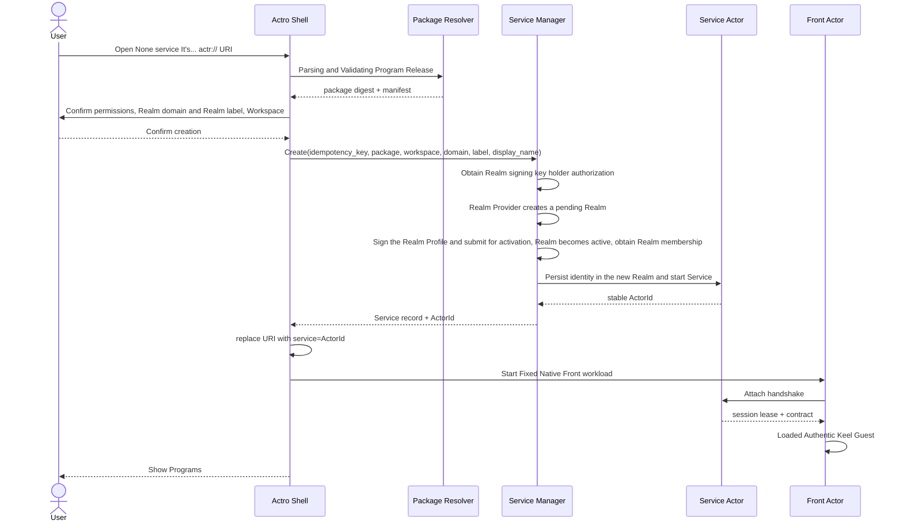

# 03. User Experience

## 1. Information architecture

Actro The primary product sector consists of five components:

```text
Actro Shell
├── Tab With Address Bar
├── Program Catalog(Processor library)
├── Service Inventory(Examples repository)
├── Realm & Identity(identity and networking)
└── Security Center(authorities, risks, revocations and audits)
```

### 1.1 Program Catalog

Answer“What can I run?”:

- (a) The installed program;
- Marketplace Collection or recommendation;
- Publisher Direct sources;
- Local import and development programs;
- Each program is known to be,digest, source and status of update.

### 1.2 Service Inventory

Answer“What have I created?”:

- Service ActorId;
- (a) A precise version of the procedure and the procedure;
- Workspace Display name;
- Local/Remote (a) Run location;
- Realm name (Realm label + Realm domain);
- (a) Life cycle, accessibility, health and session occupation of four sets of independence;
- Recent Open Time and Current Tab;
- Start, stop, open, export links, move, archive, move to the wastebin and clean up.

Program with Service It must be. UI separates from the data model. Installing a program does not equal the created instance; deleting the program cache does not equal the deleted Workspace.

## 2. Address Bar

The address bar also expresses three questions:

| Information | Source | User problems |
|---|---|---|
| `publisher/program@version` | URI Subject | I'm running which version of who's issuing? |
| `service=<ActorId>` | URI Query Parameters | Am I creating, or is there a connection to any existing example? |
| Realm name | Service ActorId; on Create, the optional `domain` parameter selects the domain for the new Realm | Which Realm does this instance belong to, and which domain issued it? |

### 2.1 Security instructions

The security control on the left side of the address bar must show:

- Current application security: green / Yellow / red, or re-validation;
- Publisher Domain name and verified/development/revoked (a) Status;
- Current package digest Short fingerprints;
- The Realm name and its Realm domain; when the Realm domain equals or is under the Realm Provider ID, state that the trust root is that Realm Provider, otherwise the trust root is the Realm domain;
- Service Connection status:local, P2P, TURN relayed, offline;
- Is there a high-risk mandate for the current mandate?

It's not just about a vague one.“Lock”Icons TLS♪ Pack safe,Actor Identity and authority are mixed.

Just... `Ready` And apply the conclusion to `CONTROLLED` . Yellow does not equal known leaks, but does not show green either. Hang up or cut out shows 'revalidating' when you have expired / The current strategy must be visible on the click.Actor Number,workload Type, declared export, weakest item, trusted certifier and validity period.

### 2.2 Create visible differences with connections

- None `service`: Show“New instance will be created”, together with the domain in which the new Realm will be created.
- Yes. `service`: Show example name or ActorId Short prints, tips.“Connect existing instance”.
- The address bar must be immediately made a belt after the creation is completed `service` Regularization of the URI.
- Keep address bar when connection failed URI,do not automatically delete `service`.

## 3. First Start

Actro The following configurations were completed for the first start:

1. Initialize Actro's key store in OS secure storage (used to generate Realm client keys);
2. Generate a random `installation-id`; local Realms use the pseudo-domain `<installation-id>.actr.alt`;
3. Set the default new position to“This machine.”, i.e. new instances get a local Realm;
4. Allow users to later trust a Realm domain, or join other instances' Realms by Realm invitation;
5. Presentation Program Catalog and Service Inventory (b) Distinction;
6. Default to close anonymous telemetry and development mode.

First start creates no Realm; each local instance gets its own local Realm when it is created. A local Realm allows the local Front and Service to run offline, but its URI is only resolvable within that Actro installation. Cross-device connection requires first migrating the Service to a new Realm in a domain, which yields a new ActorId.

## 4. Installer

### 4.1 From Marketplace

1. User-opening program details;
2. Actro Show Publisher, version,digest, powers,Workspace (a) Modes and market audit status;
3. Actro From Publisher HTTPS Inlet parsing and downloading `.actr`;
4. Verify HTTPS, Publisher key, bag signature,digestCompatibility and compression restrictions;
5. Records Program Release;
6. Cache program only, not automatically created Service, unless the user clicks“Create instance”.

Marketplace The downloaded address returned is not the ultimate source of trust;Actro We have to go back. Publisher Valid metadata or verifications Publisher Signature and digest.

### 4.2 From `actr://` URI

If Program Release Not installed:

- (a) Enter the controlled installation page first;
- Displays the full source and permission;
- Continue after installation is successful Create/Attach Intent;
- Uninstalled does not generate Service or Front Actor.

### 4.3 Local Import

Local `.actr` Package:

- It must still be adopted through structures,hash and signature checks;
- Signature key Mark as if not a validated domain name“Locally developed identity”;
- No use of the same name verified Publisher (a) Credible records;
- Do not automatically synchronize to other devices;
- Displays the development tags at all times of running.

## 5. Create instance

### 5.1 Main Process



### 5.2 Realm domain and Realm label

Every new instance creates a new Realm. The confirmation page shows:

- Realm domain: a local Realm by default; optionally any trusted Realm domain. No domain, no Realm (except local Realms); a user without a domain uses a Realm allocated by a Realm Provider under its own domain;
- `label`: by default Actro generates a fully random short string (e.g. `k7m2q9xh`, lowercase base32) that contains no program name or user input; the human-readable name goes into `display_name`, which is shown to users and appears only locally and in the Realm Profile, never in the ActorId; the user may explicitly choose a readable `label` instead (e.g. `notes`), and the confirmation page warns that a readable name is exposed in shared links;
- Creation must be authorized by the Realm signing key holder of that Realm domain. When the Realm domain equals or is under the Realm Provider ID, the confirmation page states that the trust root is that Realm Provider, and the user signs in with their Realm Provider account (OAuth 2.0 + PKCE; Actro keeps the session after the first sign-in); Realm admin rights are bound to that account, so signing in again restores them on a new or lost client. For any other Realm domain, the holder's signing service authenticates the current user under its own policy and signs the Actr management envelope and the Realm Profile, and the page shows the Realm domain as the trust root (delegated custody is invisible to users);
- If authorization is refused or the holder is unreachable, a clear error is shown, without falling back to another Realm domain.

If the Realm domain is not yet trusted, first-time trust must be completed on the confirmation page.

`label` cannot be changed after creation, and a name already used in the same domain cannot be used again.

### 5.3 Workspace Selection

Manifest Three dimensions must be declared separately and cannot be pressed into one enumerator:

- requirement: `none`, `optional` or `required`;
- provisioning: `managed` or `user-selected`;
- access: `read-only` or `read-write`.

It can also limit the allowed Workspace Providers, for example `managed-store`, `local-folder`, `cloud-drive` or `remote-repository`.`managed` It's a configuration, no.“Do you need it? Workspace”;`read-only` It is a mode of access and not a life cycle model.

Selector display:

- Workspace Provider;
- Path or logical position;
- (b) Reading and writing patterns;
- Is there anything else? Service (a) Occupation;
- Backup and synchronization capabilities;
- Delete Service Time Workspace - The way it's handled.

### 5.4 Create a Tile etc.

The same navigation transaction must carry a locally persisted `idempotency_key` (the Create Intent's identifier):

- UI Re-draw, re-test the network, back-up and re-test the package;
- Create Successful But Front When the start failed,Service Still in. Inventorypage availability“Retry Connection”;
- User again visible opens the same no-no `service` URI, new Create Intent, needs to be reconfirmed;
- Short-term bulk triggers from external sources must be subject to quotas and speed limits.

The Create transaction runs in the order "holder authorization → pending Realm → sign the Realm Profile and submit it for activation → Realm active → create Service Actor":

- If any step fails before the Realm becomes active, no Service Actor is created and no half-built instance appears in the Inventory; the page states which step failed (authorization refused, Realm Provider unreachable, Realm Profile publication failed) and offers a retry;
- The default random Realm label is generated once when the Create Intent is created and persisted with it, so a retry never generates a new one;
- A retry reuses the same `idempotency_key` and continues the same pending Realm and `label`, without creating another; if the Realm was activated but the response was lost, the retry returns only its state and the Realm admin token is recovered with `reissue_admin_token`;
- If the user gives up, the Realm Provider cleans up the pending Realm automatically on expiry.

## 6. Connection already exists

### 6.1 Main Process

1. Parsing URI;
2. Parse the Realm name from the Service ActorId, fetch the domain's Realm signing keys and the Realm Profile, and verify their signatures;
3. Authentication ActorId Medium `ActrType` with URI coordinate (a) Full consistency;
4. Ensure accuracy Program Release Installed and Matched digest;
5. Connection Aspect ActorId;
6. Completion of the status of the parties and challenge Validation;
7. Consultations Front–Service contract;
8. Getting a monopoly lease;
9. Load Keel Guest.

### 6.2 This machine is open again.

If active Tab Connect to the same ActorId:

- Default Focus Already Tab;
- User visible selection“In New Tab Open”I'm not sure if I'm going to be able to do this.v1 The example is suggested as a monopolistic session;
- Do not create a second Service;
- Unsame Type Service Alternative.

### 6.3 Far-Wide occupied

Page display:

- (a) The publicly available name of the current session-in-occupying device;
- lease (a) The expected expiry date;
- “Wait”“Request for takeover”“Cancel”Operations;
- The takeover must be Service policy , and the current user permissions are determined.

## 7. Tab Behaviour

Actro UI There are two types of them. Tab:

- **Shell Navigation Tab**: Install, create confirmation, error details,Program and Service managing pages;it does not represent application running, so it can not be Front Actor.
- **Resident App Tab**: in loading, running or suspended application page; one must be present at any given time live Front ActorAnd... Front Completed Attach There's one right after. Primary Service.

Use page to be phased out under memory pressure dormant State, not at this time. Front;reactivated must be rebuilt Front and Attach Original Service. The product book says“Every one. Tab One. Actor”Special finger. resident app Tab♪ Not all ♪ Shell A hibernation record on a page or disk.

### 7.1 New

- Create URI: Go Create Intent.
- Connection URI: Go Attach Intent.
- From Service Inventory Points“Open”: Construct a connection URI.

### 7.2 Refresh

Refresh Only Rebuild Front/Keel Guest And reconnect to the same Service:

- Do Not Create Service;
- No re-linking Workspace;
- (a) No upgrade;
- Guest Temporary UI The state of operation can be lost and the state of business cannot be lost.

If the address is still pre-creation, a refresh continues the same `idempotency_key` or returns to the confirmation page.

### 7.3 Close

Close Tab:

1. Undo Front session capability;
2. Send `Detach`;
3. Destruction Keel Engine;
4. Destruction Front Actor;
5. Reservations Service, Workspace And a record of the cases.

Close is not to stop, let alone delete.

### 7.4 Backstage and Recovery

- Backstage. Tab Call `Engine.pause()`, Freeze Guest timer and the delivery of events;
- Service Continued operation is determined by the case-by-case strategy and platform capacity;
- When Restore `resume()` And send life cycle events;
- It can be destroyed under memory pressure. Front♪ Rebuild and recreate when you get back to the front desk Attach;
- Guest No presumption. JS heap Permanent.

### 7.5 Crash

Front Crash page provides:

- Reload Front;
- View the error summary;
- (a) Disables the new privileges;
- Opens the case management;
- Reporting procedures.

Guest Collapse cannot automatically restart Service.Service The crash shows a separate state and allows a strategic restart of the same ActorId.

## 8. History, collection and sharing

### 8.1 Two types of collection

Actro A clear distinction must be made between:

- **Program Template Collection**: Not included `service`, each time you open it, you create a new instance.
- **Example Collection**: Ham `service`Back to the same Service.

UI It's not all about writing.“Collection Pages”.

### 8.2 History

- Only standardized connections are recorded after successful creation URI;
- Create confirmation page to record non-persistent navigation events without synchronizing history;
- ActorId It's not a secret, but the history sync settings should allow the user to exclude the example URI;
- URL No record of it. credential, Workspace path Or invitation. token.

### 8.3 Share

Share Examples URIShare addresses only, not automatically granted access:

- The recipient still needs to join the instance's Realm;
- Application permissions must allow it;
- Invitations are completed through the independent authorization flow of that Realm and Service;
- bearer token Do Not Enter URI query or fragment;
- The ActorId in an instance URI reveals the Realm domain and `label`; warn about this before sharing a private instance, with an additional warning when the instance uses a readable `label`.

Local Realm instances have no portable link.“Copy Link”Only clearly marked local links can be copied; before genuine sharing, the instance must migrate to a new Realm under a domain and get a new ActorId.

## 9. Program Catalog Experience

Each program shows:

- Publisher Domain names;
- (a) Name and description of the procedure;
- (a) The installed version;
- package digest;
- Marketplace Source and audit marking;
- (a) Summary of competence;
- Workspace (a) Modes;
- Number of examples created;
- (a) Update, withdraw, compatibility;
- “Create instance”“View Examples”“Remove Cache”.

“Remove Cache”If there is still one, Service Use this digest, the required copy for running shall be refused or retained.

Program Catalog Show Only Release assurance(Signed,digest, revocation, review) cannot pre-describe a future example of operation or a whole application to green.

## 10. Service Inventory Experience

Each example shows that:

- (a) User name;
- ActorId Short fingerprints and copying entrances;
- Program Release;
- Workspace;
- Realm name;
- Local/(a) Far end;
- (a) State of operation;
- Current session;
- (a) Competence;
- Recent Backup/Scratch;
- Create, recently open.

Service Inventory You can show the application conclusions and time of the last observation, but only if it is marked as a historical snapshot. `Ready` , the address bar is then displayed in real time colours.

Operating syntax:

| Operation | Service | Workspace |
|---|---|---|
| Open | Attach | No change. |
| Stop | Offline but maintain identity | No change. |
| Start | Use the same ActorId Restore | No change. |
| Archive | Stop and hide from the default list | No change. |
| Move to Wastebin | Stop and hide, keep identity and example status | No change. |
| Restore | With the same ActorId Back stopped | No change. |
| Clear instance completely | Revoke the identity, delete keys/store, keep a local instance tombstone | Kept by default |
| Delete Workspace | Do not remove Service | High-risk re-acknowledged |
| Upgrade | Create New Service And move. | Visible Intersection |

## 11. Misperception

Error page must distinguish between:

| Error | User Meaning | Main Operations |
|---|---|---|
| Program not found | Publisher No version available | Check address, select installed version |
| Publisher untrusted | Domain name or key Untrusted | View Certificate/Development Mode |
| Digest conflict | Different content for the same version | Stop running, view security reports |
| Package revoked | Version revoked | View cause, separate or delete |
| Domain untrusted | The instance's domain is not yet trusted | View the domain and key fingerprint, confirm trust |
| Domain authorization failed | The Realm signing key holder refused or is unreachable, so the instance cannot be created under that Realm domain | Contact the domain's administrator, or use a local Realm or another Realm domain |
| Realm not joined | The Realm domain is trusted, but the user has not joined this instance's Realm | Join with a Realm invitation or request one |
| Realm retired | This instance's Realm has been retired | View archive information; do not create a replacement instance |
| Service offline | Exact examples not available online | Retry, view examples; only locally known stopped , and then start it. |
| Permission denied | I found it, but I didn't have the right. Attach | Request for authorization |
| Session occupied | Monarchy lease Intended | Waiting for or requesting takeover |
| Identity mismatch | Actor Identities or types not in line | Hard Stop |
| Contract mismatch | Front/Service The protocol is incompatible. | Install correct version or migration |
| Workspace unavailable | Workspace Provider/Evidence/Lock error | Rehabilitation Workspace,do not create Service |
| Guest crashed | Front-office code failed | Reload Front |
| Service crashed | Back-office instance failed | Restart Same ActorIdChecking logs |
| Guaranteed to yellow | The necessary facts cannot be confirmed. | View workload Type / Declaration, restriction of protected data |
| Guaranteed Red | Confirmed uncontrolled export or import Retain | Stop data paths, view the weakest |
| Figure incomplete | Could not close temporary folder: %s | Disable from using protected capacity or moving to support Actr Host |

The error page should not be used in uniform“Could not close temporary folder: %s”Hide security differences.

## 12. Developer experience

Developer model provides:

- Import Local `.actr`;
- Configure `actr-dev://` HTTPS Origin;
- View manifest, digest, contract with capability;
- Hot Update Guest, but new developments are used every time a change is made digest;
- Start a local Realm and Service;
- Inspection Front–Service RPC;
- View Keel render ops, CPU, heap, timer and capability Call;
- Simulation permission denied, offline,TURN, Service Crash and Front Rebuild.

Development mode does not change official URI and official Publisher Rule of trust.

## 13. Accessibility and internationalization

- All safety conditions cannot be based solely on colour;
- ActorIds, digests and Realm domains support copying and short screen-reader descriptions;
- IDNA Domain name is also available Unicode Show and ASCII A-label Inspection;
- Permissions are described as user behavior, not exposed to the bottom API (a) Name;
- Keyboard Navigation, Dynamic Fonts, High Contrast and Reduce Motion Yes MUST;
- The error code is stable, and the display is localized.

## 14. Realm, equipment and identity experience

A Realm corresponds to a single instance, so the identity page is organized in two layers: trusted Realm domains, and joined Realms (instances). Actro's identity page supports at least:

- Trust a Realm domain: on first encountering a Realm domain, fetch the Realm signing keys from its authority descriptor (`https://<domain>/.well-known/actr`) over HTTPS, show the domain and key fingerprint, and pin it after confirmation by the user or organization policy;
- Join a Realm: join an instance's Realm with a one-time Realm invitation, completing login, client registration and Realm membership; Actro performs client registration for each Realm automatically, without per-Realm user configuration; each Realm uses a separate Realm client key, never reused across Realms, so different instances cannot correlate the same client;
- Re-accreditation:credential Pause new ones when due or when asked by the administrator Attach, preserve local data and guide recovery;
- Client revocation: list clients, last activity time and hosted Services; revocation invalidates that client's Realm client key registration, so it can no longer obtain Actor credentials;
- Leave Realm: this means losing access to that instance; first state the affected Service, Workspace and sharing relationships, and never silently migrate to a local Realm;
- Realm signing key change: display the signed rotation chain; without a valid rotation chain, treat it as an identity change and re-confirm trust;
- Restore: Only encrypted backup or remote host data will be restored after the equipment is lost, and no commitment to restore never-backed Actor Private key.

Trusting a Realm domain does not join any Realm in it; joining a Realm only establishes a Realm client identity, and actual Attach is still decided by application permissions. Realm-domain-level SSO/directories are a later capability, not part of v1.

## 15. Sharing, invitations and application permissions

The minimum application-permission roles of a Service are:

| Role | Capacity |
|---|---|
| owner | Manage application permissions, migration, trash and permanent deletion |
| editor | Attach and modify business state as the contract allows |
| viewer | Read-only Attach; availability depends on the program contract |

Sharing process:

1. The owner selects a member or organization principal, a role and an expiry;
2. The Service or the Issuer of the instance's Realm generates a one-time Realm invitation carrying the Realm name, optionally embedding the Realm Profile;
3. The invitation travels over a separate secure channel and is never written into an `actr://` URI;
4. The recipient trusts the domain (if not yet trusted), joins the Realm and accepts the invitation;
5. Application permissions record the subject and role, and the invitation expires;
6. The owner can revoke application permissions; the next call must fail, and active sessions are terminated or downgraded immediately according to policy.

Copying the instance URI alone does not change application permissions. Expired, used, revoked and Realm-mismatched invitations must produce distinct errors.

## 16. Time for delegation of authority

- Install Pages Only package Requested capability, does not grant operational privileges;
- Granted on creation Service, Workspace and long-term back-office capacity, and to be included in the grant;
- Front The interactive capabilities of cameras, microphones, clipboard, etc., are requested on a first-time basis, optional“This session only”;
- Administrator policy You can refuse or restrain in advance. scopeBut not in UI Concealed as user consent;
- After a persistent grant is revoked, the Actr Host must immediately invalidate the related capability handles and end calls still using them;
- Far Service The host-level privileges are managed by remote host(s); local Actro Only the result of the signed declaration can be shown, and no other host can be modified for the user OS Permissions.

## 17. Far Service Sources and management of borders

v1 It's... Create Intent Only in the current Actro Supported Local Service Host Up. Faraway Service Access through: Inventory:

- Opened already Attach URI;
- Accept Service (a) Invitations;
- Encryption from the same user Inventory Sync the example address;
- Vivid import of signed Service Metadata.

Actro Only a separate host at the far end management capability , and only if you are able to start, stop, migrate or clear remotely Service;or only provided Attach, request authorization and view the verifiable status.iOS/Android Go, go, go!“Long-term online”The common server host and cloud movement does not belong to the mobile side. Actro v1 Client range.

## 18. Guest Navigation syntax

Guest Can't just rewrite it. Shell Address Bar, only callable `host:navigate`:

- Same Program Inside route/query Use `push` or `replace`,Pretain Current `service`;
- Jump to None `service` It's... `actr://` URI It triggers new ones. Create Intent and confirmation pages;
- Jump to another instance to trigger Attach Intent, cannot put the current capability Bring it over;
- `https://` Hand over the outer chain to the system browser or be controlled WebViewand displays the target domain name;
- route and query (a) Must be bound by long, character and sensitive field policies;
- back/forward Replaying is normative. URIDo not redo permissions token or RPC.

## 19. Publisher Develop and release paths

The official tool chain should provide a repetitious process:

```text
actro init
→ Prepared Keel Guest, Service Component with contract
→ build
→ validate(schema, capability, hash)
→ sign
→ Generate/Update Publisher Profile with Release Descriptor
→ Upload package
→ Press from the public network coordinate Readback Authentication
→ Optional submission Marketplace Audit
```

Publisher key Create, rotate, undo and offline root The backup must have a clear command and recovery statement. `actr-dev://`, the exact version that has been issued cannot be overwritten.
