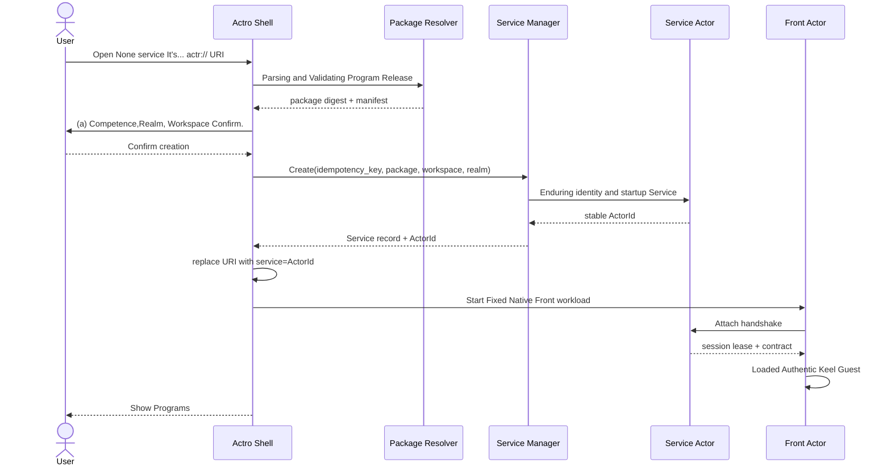

# 03. User Experience

## 1. Information architecture

Actro The primary product sector consists of five components:

```text
Actro Shell
├── Tab With Address Bar
├── Program Catalog(Processor library)
├── Service Inventory(Examples repository)
├── Realm & Identity(identity and networking)
└── Security Center(authorities, risks, revocations and audits)
```

### 1.1 Program Catalog

Answer“What can I run?”:

- (a) The installed program;
- Marketplace Collection or recommendation;
- Publisher Direct sources;
- Local import and development programs;
- Each program is known to be,digest, source and status of update.

### 1.2 Service Inventory

Answer“What have I created?”:

- Service ActorId;
- (a) A precise version of the procedure and the procedure;
- Workspace Display name;
- Local/Remote (a) Run location;
- Realm;
- (a) Life cycle, accessibility, health and session occupation of four sets of independence;
- Recent Open Time and Current Tab;
- Start, stop, open, export links, move, archive, move to the wastebin and clean up.

Program with Service It must be. UI separates from the data model. Installing a program does not equal the created instance; deleting the program cache does not equal the deleted Workspace.

## 2. Address Bar

The address bar also expresses three questions:

| Information | Source | User problems |
|---|---|---|
| `publisher/program@version` | URI Subject | I'm running which version of who's issuing? |
| `service=<ActorId>` | URI Query Parameters | Am I creating, or is there a connection to any existing example? |
| Realm authority | Service ActorId;Create Optional `realm` Parameters | This. Actor In what trust?/In the domain? |

### 2.1 Security instructions

The security control on the left side of the address bar must show:

- Current application security: green / Yellow / red, or re-validation;
- Publisher Domain name and verified/development/revoked (a) Status;
- Current package digest Short fingerprints;
- Realm Name;
- Service Connection status:local, P2P, TURN relayed, offline;
- Is there a high-risk mandate for the current mandate?

It's not just about a vague one.“Lock”Icons TLS♪ Pack safe,Actor Identity and authority are mixed.

Just... `Ready` And apply the conclusion to `CONTROLLED` . Yellow does not equal known leaks, but does not show green either. Hang up or cut out shows 'revalidating' when you have expired / The current strategy must be visible on the click.Actor Number,workload Type, declared export, weakest item, trusted certifier and validity period.

### 2.2 Create visible differences with connections

- None `service`: Show“New instance will be created”.
- Yes. `service`: Show example name or ActorId Short prints, tips.“Connect existing instance”.
- The address bar must be immediately made a belt after the creation is completed `service` Regularization of the URI.
- Keep address bar when connection failed URI,do not automatically delete `service`.

## 3. First Start

Actro The following configurations were completed for the first start:

1. Yes. OS Create a device key in a secure storage;
2. Create a Belt `local:<installation-id>` authority Local Realm;
3. Set the default new position to“This machine.”;
4. Allow users to join the organization later Realm;
5. Presentation Program Catalog and Service Inventory (b) Distinction;
6. Default to close anonymous telemetry and development mode.

Local Realm Allow offline running of the machine Front with ServiceBut it's... URI Just in there. Actro Installs a parseable device. Cross-device connection requires a first handing Service Move to Belt DNS authority Networking of the Internet Realm.

## 4. Installer

### 4.1 From Marketplace

1. User-opening program details;
2. Actro Show Publisher, version,digest, powers,Workspace (a) Modes and market audit status;
3. Actro From Publisher HTTPS Inlet parsing and downloading `.actr`;
4. Verify HTTPS, Publisher key, bag signature,digestCompatibility and compression restrictions;
5. Records Program Release;
6. Cache program only, not automatically created Service, unless the user clicks“Create instance”.

Marketplace The downloaded address returned is not the ultimate source of trust;Actro We have to go back. Publisher Valid metadata or verifications Publisher Signature and digest.

### 4.2 From `actr://` URI

If Program Release Not installed:

- (a) Enter the controlled installation page first;
- Displays the full source and permission;
- Continue after installation is successful Create/Attach Intent;
- Uninstalled does not generate Service or Front Actor.

### 4.3 Local Import

Local `.actr` Package:

- It must still be adopted through structures,hash and signature checks;
- Signature key Mark as if not a validated domain name“Locally developed identity”;
- No use of the same name verified Publisher (a) Credible records;
- Do not automatically synchronize to other devices;
- Displays the development tags at all times of running.

## 5. Create instance

### 5.1 Main Process



### 5.2 Workspace Selection

Manifest Three dimensions must be declared separately and cannot be pressed into one enumerator:

- requirement: `none`, `optional` or `required`;
- provisioning: `managed` or `user-selected`;
- access: `read-only` or `read-write`.

It can also limit the permission. Providerfor example `managed-store`, `local-folder`, `cloud-drive` or `remote-repository`.`managed` It's a configuration, no.“Do you need it? Workspace”;`read-only` It is a mode of access and not a life cycle model.

Selector display:

- Provider;
- Path or logical position;
- (b) Reading and writing patterns;
- Is there anything else? Service (a) Occupation;
- Backup and synchronization capabilities;
- Delete Service Time Workspace - The way it's handled.

### 5.3 Create a Tile etc.

The same navigation service must carry local `creation_intent_id`:

- UI Re-draw, re-test the network, back-up and re-test the package;
- Create Successful But Front When the start failed,Service Still in. Inventorypage availability“Retry Connection”;
- User again visible opens the same no-no `service` URI, new Create Intent, needs to be reconfirmed;
- Short-term bulk triggers from external sources must be subject to quotas and speed limits.

## 6. Connection already exists

### 6.1 Main Process

1. Parsing URI;
2. From Service ActorId Parsing Realm authority;
3. Authentication ActorId Medium `ActrType` with URI coordinate (a) Full consistency;
4. Ensure accuracy Program Release Installed and Matched digest;
5. Connection Aspect ActorId;
6. Completion of the status of the parties and challenge Validation;
7. Consultations Front–Service contract;
8. Getting a monopoly lease;
9. Load Keel Guest.

### 6.2 This machine is open again.

If active Tab Connect to the same ActorId:

- Default Focus Already Tab;
- User visible selection“In New Tab Open”I'm not sure if I'm going to be able to do this.v1 The example is suggested as a monopolistic session;
- Do not create a second Service;
- Unsame Type Service Alternative.

### 6.3 Far-Wide occupied

Page display:

- (a) The publicly available name of the current session-in-occupying device;
- lease (a) The expected expiry date;
- “Wait”“Request for takeover”“Cancel”Operations;
- The takeover must be Service policy , and the current user permissions are determined.

## 7. Tab Behaviour

Actro UI There are two types of them. Tab:

- **Shell Navigation Tab**: Install, create confirmation, error details,Program and Service managing pages;it does not represent application running, so it can not be Front Actor.
- **Resident App Tab**: in loading, running or suspended application page; one must be present at any given time live Front ActorAnd... Front Completed Attach There's one right after. Primary Service.

Use page to be phased out under memory pressure dormant State, not at this time. Front;reactivated must be rebuilt Front and Attach Original Service. The product book says“Every one. Tab One. Actor”Special finger. resident app Tab♪ Not all ♪ Shell A hibernation record on a page or disk.

### 7.1 New

- Create URI: Go Create Intent.
- Connection URI: Go Attach Intent.
- From Service Inventory Points“Open”: Construct a connection URI.

### 7.2 Refresh

Refresh Only Rebuild Front/Keel Guest And reconnect to the same Service:

- Do Not Create Service;
- No re-linking Workspace;
- (a) No upgrade;
- Guest Temporary UI The state of operation can be lost and the state of business cannot be lost.

If the address is still before it is created, refresh and continue with one `creation_intent_id` Or go back to the confirmation page.

### 7.3 Close

Close Tab:

1. Undo Front session capability;
2. Send `Detach`;
3. Destruction Keel Engine;
4. Destruction Front Actor;
5. Reservations Service, Workspace And a record of the cases.

Close is not to stop, let alone delete.

### 7.4 Backstage and Recovery

- Backstage. Tab Call `Engine.pause()`, Freeze Guest timer and the delivery of events;
- Service Continued operation is determined by the case-by-case strategy and platform capacity;
- When Restore `resume()` And send life cycle events;
- It can be destroyed under memory pressure. Front♪ Rebuild and recreate when you get back to the front desk Attach;
- Guest No presumption. JS heap Permanent.

### 7.5 Crash

Front Crash page provides:

- Reload Front;
- View the error summary;
- (a) Disables the new privileges;
- Opens the case management;
- Reporting procedures.

Guest Collapse cannot automatically restart Service.Service The crash shows a separate state and allows a strategic restart of the same ActorId.

## 8. History, collection and sharing

### 8.1 Two types of collection

Actro A clear distinction must be made between:

- **Program Template Collection**: Not included `service`, each time you open it, you create a new instance.
- **Example Collection**: Ham `service`Back to the same Service.

UI It's not all about writing.“Collection Pages”.

### 8.2 History

- Only standardized connections are recorded after successful creation URI;
- Create confirmation page to record non-persistent navigation events without synchronizing history;
- ActorId It's not a secret, but the history sync settings should allow the user to exclude the example URI;
- URL No record of it. credential, Workspace path Or invitation. token.

### 8.3 Share

Share Examples URIShare addresses only, not automatically granted access:

- The recipient still needs to be part of Realm;
- Service ACL (b) Must allow;
- Invited for adoption Realm/Service (a) The completion of the independent delegation process;
- bearer token Do Not Enter URI query or fragment.

Local Realm No examples. portable link.“Copy Link”Only clearly marked links can be copied; migration to network must take place before genuine sharing Realm, and get new ActorId.

## 9. Program Catalog Experience

Each program shows:

- Publisher Domain names;
- (a) Name and description of the procedure;
- (a) The installed version;
- package digest;
- Marketplace Source and audit marking;
- (a) Summary of competence;
- Workspace (a) Modes;
- Number of examples created;
- (a) Update, withdraw, compatibility;
- “Create instance”“View Examples”“Remove Cache”.

“Remove Cache”If there is still one, Service Use this digest, the required copy for running shall be refused or retained.

Program Catalog Show Only Release assurance(Signed,digest, revocation, review) cannot pre-describe a future example of operation or a whole application to green.

## 10. Service Inventory Experience

Each example shows that:

- (a) User name;
- ActorId Short fingerprints and copying entrances;
- Program Release;
- Workspace;
- Realm;
- Local/(a) Far end;
- (a) State of operation;
- Current session;
- (a) Competence;
- Recent Backup/Scratch;
- Create, recently open.

Service Inventory You can show the application conclusions and time of the last observation, but only if it is marked as a historical snapshot. `Ready` , the address bar is then displayed in real time colours.

Operating syntax:

| Operation | Service | Workspace |
|---|---|---|
| Open | Attach | No change. |
| Stop | Offline but maintain identity | No change. |
| Start | Use the same ActorId Restore | No change. |
| Archive | Stop and hide from the default list | No change. |
| Move to Wastebin | Stop and hide, keep identity and example status | No change. |
| Restore | With the same ActorId Back stopped | No change. |
| Clear instance completely | Unidentify, Delete key/storeReservations tombstone | Default Reservations |
| Delete Workspace | Do not remove Service | High-risk re-acknowledged |
| Upgrade | Create New Service And move. | Visible Intersection |

## 11. Misperception

Error page must distinguish between:

| Error | User Meaning | Main Operations |
|---|---|---|
| Program not found | Publisher No version available | Check address, select installed version |
| Publisher untrusted | Domain name or key Untrusted | View Certificate/Development Mode |
| Digest conflict | Different content for the same version | Stop running, view security reports |
| Package revoked | Version revoked | View cause, separate or delete |
| Realm unknown | I don't know how to verify it./Chile | Import Realm Profile |
| Service offline | Exact examples not available online | Retry, view examples; only locally known stopped , and then start it. |
| Permission denied | I found it, but I didn't have the right. Attach | Request for authorization |
| Session occupied | Monarchy lease Intended | Waiting for or requesting takeover |
| Identity mismatch | Actor Identities or types not in line | Hard Stop |
| Contract mismatch | Front/Service The protocol is incompatible. | Install correct version or migration |
| Workspace unavailable | Provider/Evidence/Lock error | Rehabilitation Workspace,do not create Service |
| Guest crashed | Front-office code failed | Reload Front |
| Service crashed | Back-office instance failed | Restart Same ActorIdChecking logs |
| Guaranteed to yellow | The necessary facts cannot be confirmed. | View workload Type / Declaration, restriction of protected data |
| Guaranteed Red | Confirmed uncontrolled export or import Retain | Stop data paths, view the weakest |
| Figure incomplete | Could not close temporary folder: %s | Disable from using protected capacity or moving to support Host |

The error page should not be used in uniform“Could not close temporary folder: %s”Hide security differences.

## 12. Developer experience

Developer model provides:

- Import Local `.actr`;
- Configure `actr-dev://` HTTPS Origin;
- View manifest, digest, contract with capability;
- Hot Update Guest, but new developments are used every time a change is made digest;
- Start Local Realm/Service;
- Inspection Front–Service RPC;
- View Keel render ops, CPU, heap, timer and capability Call;
- Simulation permission denied, offline,TURN, Service Crash and Front Rebuild.

Development mode does not change official URI and official Publisher Rule of trust.

## 13. Accessibility and internationalization

- All safety conditions cannot be based solely on colour;
- ActorId, digest (i) and domain names to support copying and screen readers to read short descriptions;
- IDNA Domain name is also available Unicode Show and ASCII A-label Inspection;
- Permissions are described as user behavior, not exposed to the bottom API (a) Name;
- Keyboard Navigation, Dynamic Fonts, High Contrast and Reduce Motion Yes MUST;
- The error code is stable, and the display is localized.

## 14. Realm, equipment and identity experience

Actro The identity page supports at least:

- Add Realm: Login, equipment registration and registration through an organizational domain name or one-time invitation Profile (b) Fixed;
- Re-accreditation:credential Pause new ones when due or when asked by the administrator Attach, preserve local data and guide recovery;
- Equipment cancelled: equipment, final activity time and hosting Service;deactivation of equipment credential (a) Ineffectiveness;
- Leave Realm: First state the impact Service, Workspace We're not moving in quietly. Local Realm;
- Realm key Change: display of signed rotation chain; processing by identity change when no valid rotation chain exists;
- Restore: Only encrypted backup or remote host data will be restored after the equipment is lost, and no commitment to restore never-backed Actor Private key.

Add Realm Not equal to all Service The right of access; it only establishes membership and equipment, and actual Attach Still by Service ACL Decision.

## 15. Share, invite and ACL

Service The smallest ACL The role is:

| Role | Capacity |
|---|---|
| owner | Management ACLand removal of waste |
| editor | Attach And press contract Modify Business Status |
| viewer | Read-only Attach;availability depends on the procedure contract |

Sharing process:

1. owner Selection of members/(a) The subject, role and expiry of the organization;
2. Service or Realm issuer (a) Generate a one-time invitation;
3. Invite for transmission via the independent safe passage, not written in `actr://` URI;
4. Recipient login target Realmand accepted the invitation;
5. Service ACL Record the subject and role, and the invitation expires;
6. owner It can be revoked. ACL; the next call must fail and active sessions are strategically terminated or reduced immediately.

Only copy instance URI No change. ACL. Expire, used, revoked and Realm The mismatch must be different.

## 16. Time for delegation of authority

- Install Pages Only package Requested capability, does not grant operational privileges;
- Granted on creation Service, Workspace and long-term back-office capacity, and to be included in the grant;
- Front The interactive capabilities of cameras, microphones, clipboard, etc., are requested on a first-time basis, optional“This session only”;
- Administrator policy You can refuse or restrain in advance. scopeBut not in UI Concealed as user consent;
- Undo duration grant I'm not sure.Host It has to be terminated immediately. capability handle; and to end its continued use;
- Far Service The host-level privileges are managed by remote host(s); local Actro Only the result of the signed declaration can be shown, and no other host can be modified for the user OS Permissions.

## 17. Far Service Sources and management of borders

v1 It's... Create Intent Only in the current Actro Supported Local Service Host Up. Faraway Service Access through: Inventory:

- Opened already Attach URI;
- Accept Service (a) Invitations;
- Encryption from the same user Inventory Sync the example address;
- Vivid import of signed Service Metadata.

Actro Only a separate host at the far end management capability , and only if you are able to start, stop, migrate or clear remotely Service;or only provided Attach, request authorization and view the verifiable status.iOS/Android Go, go, go!“Long-term online”The common server host and cloud movement does not belong to the mobile side. Actro v1 Client range.

## 18. Guest Navigation syntax

Guest Can't just rewrite it. Shell Address Bar, only callable `host:navigate`:

- Same Program Inside route/query Use `push` or `replace`,Pretain Current `service`;
- Jump to None `service` It's... `actr://` URI It triggers new ones. Create Intent and confirmation pages;
- Jump to another instance to trigger Attach Intent, cannot put the current capability Bring it over;
- `https://` Hand over the outer chain to the system browser or be controlled WebViewand displays the target domain name;
- route and query (a) Must be bound by long, character and sensitive field policies;
- back/forward Replaying is normative. URIDo not redo permissions token or RPC.

## 19. Publisher Develop and release paths

The official tool chain should provide a repetitious process:

```text
actro init
→ Prepared Keel Guest, Service Component with contract
→ build
→ validate(schema, capability, hash)
→ sign
→ Generate/Update Publisher Profile with Release Descriptor
→ Upload package
→ Press from the public network coordinate Readback Authentication
→ Optional submission Marketplace Audit
```

Publisher key Create, rotate, undo and offline root The backup must have a clear command and recovery statement. `actr-dev://`, the exact version that has been issued cannot be overwritten.
