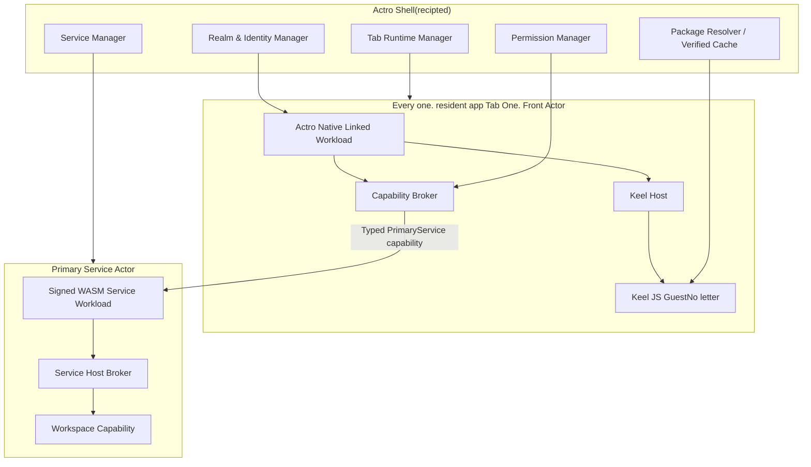

# 06. Run-time with Front–Service Agreements

## 1. Runtime Overview



## 2. Front Actor

### 2.1 Fixed Native workload

Front Use Actr linked/native workload:

- with Actro (a) Build, sign and publish together;
- Publisher package Not carried;
- Every one. resident app Tab Create a Logic Front Actor Examples;
- Responsible Actor Registering, identity, connection, session,Keel Engine and Host capability;
- Realm credential It's just proof. Actor key, ActorId, ActorType with issuer claims, the actual running code cannot be independently proven;
- The Service must treat the Front as an untrusted client and independently enforce principal, application permissions, business commands and Workspace authorization.

“Native workload”Here you are. Actr Host Provided by original of platform, not intended Guest Available native code.

### 2.2 Front Actor Type

Front It's... ActorType Yes. Actro Type of system, e.g.:

```text
actrium/actro-front@1.0.0
```

It describes Host runtimeNot disguised. Program It's... Service ActrType.Attach handshake By Actr Host Additional declarations:

- Program Release coordinate;
- package digest;
- Guest digest;
- Front Host API;
- Keel API;
- protocol fingerprint;
- local tab session nonce.

These fields are normal Actro Host From Authenticated package Construct,Guest Unable to overwrite; for remote Service They are still client statements, used only for compatibility consultations, and cannot be a substitute for business authorization or remote attestation.

Under control. Realm We can put the platform on. app attestation, issue of signature or business equipment certificate to be included credential♪ If ♪ Service policy Request“Official Actro runtime”, Attach The certificate must be validated; in the absence of proof, it cannot be assumed ActorType is equal to the actual run time.

### 2.3 Front Life cycle

```text
Allocated
  → ActorStarting
  → ServiceAttaching
  → ContractNegotiating
  → GuestLoading
  → Running
  ↔ Suspended
  → Detaching
  → Destroyed

Any stage → Failed
```

It is important to ensure that:

- Guest Only Attach and contract (a) Load after success;
- capability Yes. Guest (a) To be completed before implementation;
- close/crash Undo it first. session capabilityAgain. Engine;
- background `pause` Not equal to Service detach;
- After Memory Recovery Front It can be... URI and Service State re-establishment.

## 3. Keel v1 Baseline

### 3.1 Open only JS Guest

v1 Official Marketplace:

- `guest_runtime = "keel-js"`;
- bundle It's self-inflicted. CommonJS;
- Allow only React, JSX runtime, Keel Guest SDK and Actro Declaration `host:*` capability;
- Prohibition of arbitrary npm/runtime require;
- Ban evalnon-physical dynamics import and undeclared capability;
- Build analysis must `fail-on-violation`;
- Still check again at installation, not trusted Publisher Self-reported.

Keel Native WASM Guest Not open for the time being because of its current public construction,UI♪ And the events, ♪pause/destroy and the ability to terminate execution has not yet met the requirement of non-mail release.

### 3.2 Fixed QuickJS

v1 Not permitted Keel AutoSelect JSC/Hermes/QuickJS:

- Fixed QuickJS Native;
- It must be achieved and enabled interrupt handler (a) Hard timeout;
- We have to. per-Guest heap limit ♪ Really bring in every one ♪ QuickJS runtime;
- Every one. Tab Use independence runtime/context;
- Every one. Guest Yes. Actr Host Disable from the special execution thread/worker Run on,UI Only through schema And the quota check. render ops;
- Cleaning up on destruction timer, callback, listener and remote ref;
- A JS engine change is a security-baseline change and requires a version bump and tests.

Fixed QuickJS It's to make the security semantics consistent across the platform. QuickJS Yes. OS Process isolation.

That's the press threshold, not the right one. Actro Current Internal Keel A given capability for a copy. If the consolidated version is ignored timeoutWrite the dead memory cap, can't report. heap Usage, or only non-stop Shell/UI Main Course Execution Guest, then formal third party Guest Don't go online.

### 3.3 Separative caliber

v1 (b) Commit to:

- same-process language sandbox;
- capability isolation;
- heap/time/render-op quota;
- Guest JS crash isolation;
- Do Not Provide Default filesystem/socket/global native module.

v1 No:

- Browser renderer (b) The level of independence process;
- (a) The nuclear boundary;
- QuickJS/C++ We can't influence the security breach in the engine. Actr Host;
- Guest The death of a card will never affect the movement of the process.

High risk Publisher The long-term objectives are:

- macOS XPC/helper process;
- Windows AppContainer/helper process;
- Android isolatedProcess;
- iOS Independence to the extent feasible extension/helper Or stronger. WASM runtime;
- May be Actr Host Force terminate It's... worker.

## 4. Actro Safe Component Registry

Actro We can't just use it. Keel `DefaultComponents` Full exposure to untrustworthy. Guest.

Each component shall have:

- (a) A white list;
- props schema;
- Text, array, hierarchy and render-op (a) Restrictions;
- URI/asset policy;
- event schema;
- RemoteRef (b) A white list of methods;
- Platform differences statements;
- accessibility Request.

Special rules:

- `Image` Default accept only package asset id;
- Far Image Showdown. `host:net` capability Domain names allowlist;
- Guest I'm not taking any of this with me. HTTP headers;
- `WebView` is not in the default Actro Component Registry;
- The outside chain,Modal, StatusBar, file selection and system sharing must be visible capability;
- v1 Default Disable General String RemoteRef, only the typeing method is open.

## 5. Capability Model

### 5.1 Front desk stabilization interface

Short-term based Keel It's... `KeelContractShape`:

- version;
- host modules;
- rpc;
- named events;
- input/output/event schema;
- binary field marker;
- capability manifest.

It's not. WITIt's not supposed to be here. v1 Document or API & Medium WIT.

To make the future compatible. JS/WASM Guest, the semantic of stability is used only:

```text
request/response RPC
fire-and-forget tell
named event
```

Do not transboundary function subscriptionAny callback Or generic RemoteRef As long-term public agreement.

### 5.2 Primary Service capability

Guest ♪ Getting the only Actor Entry:

```typescript
interface PrimaryService {
  call<Route extends CallRoute>(
    route: Route,
    input: InputOf<Route>
  ): Promise<OutputOf<Route>>;

  tell<Route extends TellRoute>(
    route: Route,
    input: InputOf<Route>
  ): Promise<void>;

  on<Event extends EventName>(
    event: Event,
    handler: (payload: EventPayload<Event>) => void
  ): Unsubscribe;
}
```

Actr Host Fixed inside target For Current Service ActorId.Guest It's not passed. target ActorId.

### 5.3 Other Front capability

Example:

- `host:assets`
- `host:clipboard`
- `host:notifications`
- `host:camera`
- `host:microphone`
- `host:location`
- `host:external-link`
- `host:file-import`
- `host:file-export`
- `host:share`
- `host:net`(exceptional capacity, default closure)

Each call must be made by:

1. Contract schema;
2. Manifest requested;
3. Permission grant;
4. session scope;
5. platform policy;
6. rate/resource limit;
7. audit policy.

## 6. Service Actor

### 6.1 Primary Interface

Primary Service:

- Yes. Front (a) The only operational entry;
- Authentication Attach session;
- Hold Workspace;
- Will Guest (a) Intent to convert to a business order;
- Responsible for, inter alia, the delegation of authority, audit and co-processing;
- Callable or Manageable Support Actor.

The front desk is simplified without limiting the backstage to the backstage:

```text
Front
  → Primary Service
      ├── Index Actor
      ├── Sync Actor
      ├── Media Actor
      └── Worker Actors
```

### 6.2 Service Host broker

Third parties Service workload The full host capacity cannot be obtained directly.Broker Provide:

- Actor call/tell/discover (a) Sub-set of statements;
- Workspace capability;
- outbound HTTPS allowlist;
- clock/random/logging;
- secret reference;
- database namespace;
- resource limits;
- lifecycle snapshot/restore.

Service workload The dependence and network capacity must be package manifest It is stated.

### 6.3 Same Realm Request

A Realm corresponds to one application instance, so the Front and the Primary Service are naturally in the same Realm; Auxiliary Actors orchestrated by the Primary Service are in that Realm too:

- before Attach, the Front obtains Realm membership for that instance (usually by Realm invitation);
- the connection ACL decides whether a Front type may connect to a Service type;
- the Service then performs user/instance-level authorization;
- type discovery only happens within this Realm (this instance's Actors);
- cross-instance (cross-Realm) calls are handled by the Service backend: the Service's host obtains a client identity in the target Realm according to that Realm's join policy; the Front never federates directly, and v1 has no federation.

This significantly reduces the level of trust and wrongs.

### 6.4 Native workload Two forms.

```text
NativeCdylib / InProcess
  → with Host Same address space
  → Node of third parties shall be valid CONTROLLED

NativeCapsule / OutOfProcess
  → Every Actor Independent restricted process
  → OS sandbox + brokered typed IPC
  → You can press the exit when it closes. policy Metrics
```

Native Capsule Processes must not have original Actor transport, socket, Workspace path or credential;Actr Host It's done on its behalf. Actor call, HTTP and Workspace Operation.Sandbox It must be effective before the third-party directive is implemented and prohibits any kind of dynamic library, subprocess,ptrace and share the written memory. See the details of the platform.[Privacy tags and condensation protocols](13-privacy-state-and-aggregation.md).

## 7. Front–Service System Protocol

Operations proto The blog is also available.Actro Define stabilization system agreements:

```text
actro.session.v1.Attach
actro.session.v1.Resume
actro.session.v1.Detach
actro.session.v1.Heartbeat
actro.session.v1.Takeover
actro.session.v1.GetStatus
```

`ActorAssurance`, No Roots and `ApplicationAssurance` Use `actro.privacy.v1.*` System protocol, see [13](13-privacy-state-and-aggregation.md)semantics by [docs/security](../../architecture/security/actrium/README.zh.md) Yes.

### 7.1 AttachRequest

```json
{
  "frontActorId": "<ActorId>",
  "serviceActorId": "<ActorId>",
  "program": {
    "publisher": "notes.example",
    "name": "team-notes",
    "version": "1.4.2",
    "packageDigest": "sha256:...",
    "guestDigest": "sha256:..."
  },
  "runtime": {
    "actroVersion": "1.0.0",
    "frontHostApi": "1.0",
    "keelApi": "1.0"
  },
  "protocolFingerprint": "sha256:...",
  "tabSessionNonce": "<random>",
  "requestedLease": "exclusive",
  "challengeResponse": "<signed-proof>"
}
```

### 7.2 AttachResponse

```json
{
  "sessionId": "<opaque>",
  "lease": {
    "mode": "exclusive",
    "expiresAt": "2026-07-29T12:30:00Z",
    "heartbeatIntervalMs": 15000
  },
  "service": {
    "actorId": "<ActorId>",
    "program": "notes.example/team-notes@1.4.2",
    "packageDigest": "sha256:...",
    "protocolFingerprint": "sha256:..."
  },
  "workspace": {
    "displayName": "Team Notes",
    "mode": "read-write"
  },
  "effectiveCapabilities": ["primary-service", "host:clipboard.write"],
  "privacy": {
    "actorStateDigest": "…",
    "applicationStateDigest": "…",
    "assuranceDigest": "sha256:...",
    "expiresAt": "2026-07-29T12:01:15Z"
  },
  "serviceChallenge": "<signed-proof>"
}
```

Guest No contact Actor credential, challenge key Or original. session secret.

## 8. Attach Verify

Service Sequenced examination:

1. Sender Realm credential;
2. caller ActorId with credential claim;
3. Front Actor type;if policy I'm gonna need to be credible. runtime, check the independent platform/runtime attestation;
4. challenge/nonce (b) Protection against re-emergence;
5. target Service ActorId;
6. Program coordinate(Statement of compatibility);
7. package digest(declaration of compatibility; none) attestation is not a remote code certificate;
8. protocol fingerprint;
9. Principal/Device/Workspace application permissions;
10. attachment policy;
11. Current lease;
12. Strategy, current caller 's request `ActorStateDigest` / AA with nonce;
13. Resource and speed constraints.

Any identity or digest mismatch Both. hard fail, Do Not Enter“Compatible Mode”.

Host API or the version of the agreement may be negotiated within the limits of the declaration of the parties; the outcome of the consultation must be fixed to session.

## 9. Session lease

v1 exclusive lease:

- Attach Create short-term renewables after success lease;
- Heartbeat I'm just going to resume. I'm not going to. Actor (a) Identity;
- Breaking line in. grace period;
- `Detach` (a) Active release;
- Front crash Back lease (a) Due;
- Takeover The need for competence and conflict strategies;
- lease id/session secret Save only in Actr Host Memory and security IPCI'm not giving it to you. Guest;
- Same Expiry session The message must be rejected.

## 10. Message Route

```text
Guest call
  → Keel contract validation
  → Front capability broker
  → attach session validation
  → fixed Dest::Peer(service_actor_id)
  → Actr RPC route
  → Service session guard
  → business handler
  → response schema validation
  → Guest
```

Actr Host It has to be attached. GuestOverwrite metadata:

- session id;
- Minimized principal/client id claims;
- program digest;
- trace id;
- deadline;
- idempotency key(where applicable).

Service I can't trust you. Guest payload and the self-reported users,Workspace or permission fields.
Service And you can't just do it. Front Self-reported. Actr Host Version,package digest or ActorType High authority granted.

## 11. Life cycle protocols

### 11.1 Front background

- Keel `pause`;
- Suspension is not critical named events;
- Keep or lower session heartbeat;
- Not Destroyed Service;
- OS Enter on Recovery Detach.

### 11.2 Front resume

- Restore Actor transport;
- Like lease The blogger adds:`Resume`;
- Or you'll start over. `Attach`;
- Keel `resume`;
- Send `lifecycle.foreground` named event;
- Guest Re-raise the state of necessity.

### 11.3 Service restart

- Use same ActorId and long term key;
- Restore Workspace binding and the example store;
- Not accept business until resumption RPC;
- Original session Default lapses,Front Restart Attach;
- No change. URI.

## 12. Resource Quota

### 12.1 Front Guest

At least limit:

- JS heap;
- Single execution wall time;
- Per second callback/timer;
- render batch op;
- (a) the depth of the component tree and the number of nodes;
- Text, Pictures and Binary payload;
- RPC ♪ And the ♪ ♪ The ♪ deadline;
- Log rate;
- Local Guest storage.

### 12.2 Service workload

At least limit:

- WASM memory/table;
- fuel/epoch timeout;
- mailbox Length;
- RPC (a) Parallel distribution;
- data stream Number and bandwidth;
- Workspace I/O;
- outbound network;
- actor discovery/call;
- snapshot Size;
- Log.

Overstretching with a stable error code and a distinction between single call failure,Guest Termination,Service Degrade and stop.

## 13. Crash Isolation

Product objectives:

- Guest Syntax:/Run error only terminates the Tab Guest;
- Guest timeout/heap Overwhelm the destruction of the Keel Engine;
- Front Actor Failures don't change. Service ActorId;
- Service workload Failure does not damage other examples store;
- Multiple in Same Type Service Different uses instance data directory;
- One. Tab It's... callback, timer, RemoteRef and capability We can't spill to another one. Tab;
- helper process After the line,Guest crash No impact Shell.

v1 same-process The achievement of the logical separation targets that must be validated through the injection of failure and are safe UI The honesty is not the same. OS Segregation.

## 14. Observability

Layer by:

- URI parse/resolve;
- package verify;
- Front Actor lifecycle;
- Keel load/pause/resume/destroy;
- capability allow/deny;
- Attach/lease;
- Actr transport(local/P2P/TURN);
- Service lifecycle;
- Workspace I/O Error.

Default logs should not contain:

- Workspace (a) Content;
- credential;
- session secret;
- (a) A complete file path;
- Guest User input;
- Letter-certification instrument.

ActorId Local diagnosis can show standard forms; irreversible, salt-added markings are used before telemetry is uploaded.

## 15. Evidence and grouping

Front Host, Service Host, Workspace broker and Actor transport The actual data export incident must be referred to the forensic path:

- workload kind, digest, imports with runtime instance;
- Actor spawn/discover/call/stream/close;
- capability grant/revoke;
- Workspace With external networks edge;
- package, credential, Actr Host key and policy Undo.

Publisher workload An expected export can be declared, but it cannot be the only source of integrity.Host Yeah. WASM Comparative statements,imports, effective capacity and practical edge, by `structureDigest` With Current `ActorStateDigest` groups; new Actor Current AA Adopted and `ACTIVE` Application data should not be received until now.Front Position the entire unroot map, with the weakest of the nodes; the display must be `Ready`.

The conclusion must be passed on to Shell and session guardGreen. / Yellow / Red and hung must be connected Capability And the data. It can't just be... UI Decoration. New configuration only works on new data.
