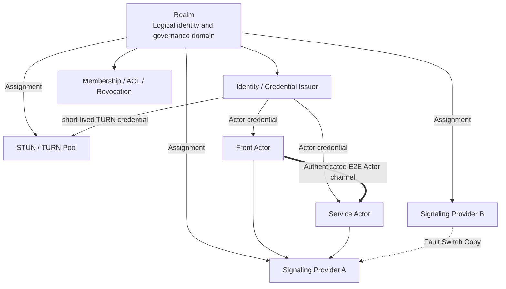

# 07. Realm♪ By letter, by letter, by letter, by letter, by letter, by letter, by letter, by letter, by letter, by letter, by letter, by letter, by letter, by letter, by letter, by letter, by letter, by letter, by letter, by letter, by letter, by letter, by letter, by letter, by letter, by letter, by letter, by letter, by letter, by letter, by letter, by letter, by letter, by letter, by letter, by letter, by letter, by letter, by letter, by letter, by letter, by letter,TURN And identity.

## 1. A picture of the relationship.



Conclusions

- Realm The bond is usually made with a letter, but the bond is“Trust and configuration assignments”No, it's not.“One. Realm It's equivalent to a messenger server.”.
- One. Realm Multiple clusters of letters could be assigned;
- One message cluster can be multiple. Realm Services;
- Physics Provider I can replace it.Realm Identity and ActorId There should be no change.

v1 Multiple signaling endpoint It must be the same logical control, using shared/Copy presence, or let all of them be by the rules. Actor Use same active primaryThey're a copy-and-facilities-to-entry, not a free-standing union. Provider;cross Provider federation It's a follow-up agreement.

## 2. Realm Definitions

Realm Yes. Actr and governance, responsible for:

- Membership, equipment and Actor Access;
- ActorId Namespace;
- Actor credential (a) Issuance and renewal;
- ACL(b) Discontinuation and audit;
- Issue trusted letters,STUN, TURN, issuer Endpoints;
- For the letter and TURN Issuance of short-term, limited-term audience (a) Proof of proof;
- Description Break Realm Rules.

Realm No:

- Marketplace;
- Publisher;
- DNS (a) In itself;
- One. WebSocket (a) Process;
- TURN RFC a string with the same name;
- Workspace.

## 3. Realm Profile

### 3.1 Domain Name Entry

Every one. Realm Use a verifiable domain name as Profile authority:

```text
GET https://<realm-domain>/.well-known/actrium-realm.json
```

The bootstrap URL Must use authority Domain name and standard HTTPS 443Just... Profile After the validation, the assignment was made issuer, signaling, STUN/TURN endpoint You can only use other domain names and visible ports.

bootstrap Do not follow the cross Origin redirect;Realm The move must be old. continuity key Sign rotation/The relocation declaration.

Profile At least include:

- schema version;
- Realm display name;
- Value `realm_id`;
- Realm authority domain;
- Current and Historical Profile continuity keys;
- issuer URL;
- issuer keys/key ids;
- signaling endpoints;
- STUN/TURN endpoints;
- credential audience;
- ACL/(a) Accession strategy;
- key rotation (a) With the time of expiry;
- Profile Signature.

First time trust comes from Web PKI or pre-positioned by the enterprise Realm root pin;Profile I can't sign it. rootI'm not sure I'm going to be able to do this.Profile Use RFC 8785 JCS Normative payload, detached Ed25519 Signature, monotonous `sequence`, life and old key The chain of rotation of signatures provides continuity and rollback protection.

### 3.2 ActorId How to carry Realm

Current Actr ActorId Medium Realm Only one. `u32`:

```text
2af01@42/notes.example:team-notes:1.4.2
```

New equipment only `42` Can not get folder: %s: %s

- Which domain name? issuer key;
- - Which group of letters?
- Realm 42 Is it with the other one? Realm 42 Conflict.

Actro v1 And that's why we're asking for the target. ActorId Bring your own authority;indicative format:

```text
2af01@42~dns:team.example/notes.example:team-notes:1.4.2
```

Networking authority To regularize DNS Domain Name, Local authority Yes `local:<installation-id>`.`service` The parameters themselves can be located. Realm;Attach URI No longer keep the second for long periods `realm` Parameters. Current only contains `u32` It's... ActrId Consider legacy, import must be completed with a visible complement authority ♪ And rewrite it ♪ v1 Standard form.

## 4. The power boundaries of the mail server

### 4.1 It's not.“Purely public, no power.”

Even if the letter does not contain the express application, it may:

- Observation ActorId, IP(b) The time of the connection;
- (b) To determine who can register, discover and exchange information on consultations;
- Delay, abandonment, partition, restriction or ban;
- Back to evil./Error ICE candidate;
- Force more traffic. TURN;
- (b) Conducting traffic linkages;
- It caused the denial of services.

Letters are therefore important control and meta-data processors and must enter threat models.

### 4.2 It should not have powers.

When properly designed, a letter of understanding should not:

- Forgery of arbitrary Actor (a) Identity;
- Decrypt Actor Apply messages;
- Modify Accredited offer/answer and not to be discovered;
- Issuance of any Realm credential;
- Access Workspace capability;
- Use ActorId Around Service ACL.

These borders depend on:

- Realm-signed Actor credential;
- Actor Long term key;
- Both sides challenge;
- SDP/ICE Sessions nonce (b) Signing binding;
- DTLS/SRTP/DataChannel E2E Protection;
- Service Level 2 is renewed.

### 4.3 Signaling Duties of the Office of the United Nations High Commissioner for Human Rights

- Online presence;
- ActorId (a) A temporary map to the current connection;
- Type detection and candidate ranking;
- WebRTC offer/answer/ICE Exchange;
- ACL (a) Initial screening;
- Provider failover;
- Network status events.

It's not for preservation. Service Business status.

## 5. Actro Is there an internal order?

Actro Internal:

- Actr signaling client;
- Realm Profile resolver;
- issuer/credential client;
- STUN/TURN (a) Configuration and failure switching;
- Local Realm It's... loopback/embedded signaling;
- Diagnosis and status UI.

Actro Not writing death:

- (a) The only global courier server;
- (a) Single public interest organizations;
- Unique TURN;
- Publisher (a) His or her own address;
- Static TURN Password.

### 5.1 Local Realm

This machine. Front With the machine. Service:

- Use Priority in-process/loopback transport;
- embedded signaling Locally Only Realm;
- No public network. STUN/TURN;
- Offline is available;
- ActorId Still a permanent identity and includes `local:<installation-id>` authority;
- Only the same. installation Can parse the authority;
- “Copy portable link”must be disabled;to move to DNS Realm New issues ActorId.

### 5.2 Networking Realm

Membership in an organization or public Realm Other Organiser

- User or Administrator Trust Realm Profile;
- Access membership;
- Actor Run-time Profile Medium Provider;
- Provider Switches to Never Change ActorId;
- Profile Updates must verify the signature and the validity period.

## 6. Actor Identity

### 6.1 Identity

Service Actor The status shall consist of at least:

```text
ActorId
+ Actor long-term public key
+ Realm-signed Actor credential/certificate
+ private key proof
```

Credential claims This should include:

- ActorId;
- Realm;
- ActorType;
- actor public key;
- principal/device binding;
- issuer/key id;
- issued/expiry;
- audience;
- capability/role;
- revocation handle.

The alternative client certificate contains a separate:

- platform app attestation;
- Actro Issue Signature/Version;
- device management claim;
- attestation nonce and the duration.

In the absence of such proof,Realm credential No proof that the device is running official Front Host, Service It must be handled by a client who is not trusted.

### 6.2 Persistence ActorId

Service Actor Long-term private key and ActorId Generate in creation/Issued and sustained.

The following operation must be maintained ActorId:

- Actro/Service (a) Relaunching the process;
- credential Regular renewal;
- renewal token Re-certification after loss, provided it proves the same long-term key;
- signaling reconnect;
- endpoint/IP Changes;
- P2P with TURN Switch;
- Realm (a) Internal host migration;
- Realm Provider Replace.

The following actions create new ActorId:

- Create New Service;
- Service Upgrade to New Program Release;
- Move to another one Realm;
- Long term key (a) Is revoked and cannot be reinstated;
- Visible clone/fork.

Actr Current hard rebind Could return new ID.v1 Before you must add“Long-term key reclaim Original ActorId”and sustainable identity/renewal state.

### 6.3 ID Allocation

Realm You have to promise. serial It is permanently not used in its namespace:

- Use the only bound Realm allocator;
- Or use strong enough. key-derived/Random ID And to do collision tests;
- Can't rely on it. hostname/PID Hash's weakness. worker id The only one who claims to be unconditional is the one who has no rights.
- Undo Actor Back serial Keep tombstone.

### 6.4 Host Proof identity

Host Yes workload When export is closed to provide evidence, independent, verifiable Host Evidence key:

- Local Realm (a) The current installation of a binding root, which will only constitute confidence in the installation;
- Networking Realm You can put Host key ♪ Tie it to the device credential;
- The controlled scenes can be further bound. platform/runtime attestation;
- Host (a) The revocation of the evidence key must render the unexpired conclusion relying on the key immediately invalid;
- Host You can't sign your own final form. `ActorAssurance`;
- Actor Long-term in itself key We can't pretend to be Host Evidence keys;
- signaling Only summary of conclusions transmitted, not issued workload kind, egress closure Or a claim to integrity.

The remote certification party decides whether to trust it according to its own strategy. Host Evidence. No accepted evidence. `ActorAssurance` I'm still a possibility. authenticbut nodal conclusion shall be `CONTROLLED`.

## 7. Authentication process

### 7.1 Add Realm

1. HTTPS Access Realm Profile;
2. User/Administrator confirmed Realm;
3. principal/device Completed login or invitation;
4. Realm Issuance membership credential;
5. Device secure storage key/refresh material;
6. Actro Create Realm record.

### 7.2 Actor Registration

1. Host Generate or read ActorLong term key;
2. Request new ActorId or reclaim Existing ActorId;
3. issuer Authentication membership, ActorType And allowed. claim;requires custody runtime Timeout platform attestation;
4. issuer Issuance of short-term Actor credential;
5. Actor Use short-term ticket Connection signaling;
6. signaling Authentication issuer, audience, ActorId and proof.

### 7.3 Peer handshake

1. (b) Letters for the exchange of signed data for consultation;
2. WebRTC/transport Establishment;
3. Both parties verify Realm credential with Actor key;validation of independence when required runtime attestation;
4. challenge/nonce (b) Prevention of re-play;
5. Front–Service Attach Revalidate Program digest with session ACL;
6. After success Guest capability It's only available.

## 8. Letter authentication certificate

The authentication material should not be placed in the long term URL query:

- query It will be recorded in the agent, log, browser history and monitoring system;
- Even a signature may have re-alignable value during its validity.

Target programmes:

- WebSocket `Authorization` header(a) The contract or other contract; or
- issuer One-time, very short-term issuance signaling ticket;
- ticket Tie ActorId, endpoint audience, nonce and due;
- (b) Dismantling of the successful connection immediately after the connection;
- Log Only Record ticket key id, no record value.

`actr://` URI Never carry signaling ticket.

## 9. STUN/TURN

### 9.1 Two. Realm It's not the same thing.

- **Actr Realm**: Product identity and governance domain.
- **TURN REALM**: TURN A valid field string in a long-term certificate algorithm.

They can use the same domain name to facilitate transport, but the agreement has different meanings and cannot be reused in the code and document.

Suggested name:

```text
ActrRealmId
TurnAuthRealm
```

### 9.2 TURN Evidence

It is necessary to:

- (b) Short-term;
- Tie Actor/Session or principal;
- Tie TURN pool audience;
- Got maturity, bandwidth, side hair allocation Quotas;
- By Realm issuer or its authorization credential broker (a) Issuance;
- Support key id and rotation;
- Do Not Use Cross All Realm Single long-term shared secret;
- An anonymous and open relay is not allowed.

### 9.3 TURN Powers

TURN Usually not. DTLS/SRTP/DataChannel Expressly, but can be seen:

- Both IP;
- Time, volume and duration;
- allocation;
- Relay relationships.

It can also throw bags, speed limits, refuse or record traffic. Realm It must be clear. TURN Provider And privacy policy.

## 10. Provider Assignment and failure switch

Realm Profile You can declare more than one endpoint:

```json
{
  "signaling": [
    {"url": "wss://signal-a.realm.example:443/ws", "priority": 10},
    {"url": "wss://signal-b.provider.example:8443/ws", "priority": 20}
  ],
  "ice": [
    {"urls": ["stun:stun.realm.example:3478"]},
    {"urls": ["turns:turn.provider.example:5349"], "credentialAudience": "turn-pool-1"}
  ]
}
```

Rules:

- endpoint Domain name can be different from Realm domain;
- Realm Profile (a) The signature constitutes the delegation of authority;
- (a) Not permitted by default port;
- endpoint Switches to Never Change Realm or ActorId;
- failover Unable to go to undeclared Provider;
- Provider Certificates and ticket audience Must match.

## 11. Port Policy

| scene | Port Policy |
|---|---|
| `actr://` Publisher identity | Port not allowed |
| Publisher Profile bootstrap | Fixed authority Domain Name HTTPS 443 |
| Default Release bootstrap | Fixed Publisher Domain Name HTTPS 443 |
| Profile Assigned resolver/CDN/issuer | Visible port, must HTTPS |
| Realm Profile bootstrap | Fixed authority Domain Name HTTPS 443 |
| Signaling WSS | Visible Port |
| STUN/TURN | By protocol Visible Port |
| `actr-dev://` | Port Available |
| localhost/private CA | Only develop/Business strategy |

This preserves the freedom of deployment without turning the Internet portal into a product namespace.

## 12. Chain of Trust

| Chain of Trust | Root | Authentication Object | After failure |
|---|---|---|---|
| Publisher/Package | DNS/TLS + Publisher key | package bytes/digest | Unmounted Program |
| Realm/Actor | Realm key + Actor key | Peer Identity/Access | Do Not Connect Actor |
| Front Session | Service policy + challenge | Current Front/User/lease | Closed operations RPC |
| Signaling/TURN | Realm Profile Assignment | Control face and trunking resources | Switch or Offline |
| Marketplace | Market Signature/Policy | Review and withdrawal of information | Lower trust/Stop installation |

No chain can replace it.

## 13. Offline ♪ And lost ♪

### 13.1 Local Realm

- Fixed installed digest Offline;
- This machine. Actor credential It's possible. local issuer Rehabilitation;
- loopback No need. TURN;
- The cancellation affects only the management of the machine.

### 13.2 Networking Realm

Realm Profile, credential or when information is not available:

- Short-term established session Sustainable to credential (a) Due;
- (a) The non-infinite extension of expired status;
- Whether read-only offline mode allows by Program/Realm policy Declaration;
- New Attach Default failed to close;
- It can't be because Realm Disconnect to create local replacements of the same type Service.

## 14. Privacy

Realm/Provider The observable metadata must be stated on the privacy page:

- ActorId;
- IP;
- online/offline;
- Connecting targets;
- P2P/TURN;
- Time and volume.

Measures to minimize:

- No, no, no. Program route, Workspace Name or business payload(a) Issue letters;
- Use short-term ticket;
- offer/answer (a) Tie and encrypt the encrypted portion;
- Provider (b) Minimization and short retention of the log;
- (b) Allowing business to host;
- Support multiple Provider and transparent status display.
