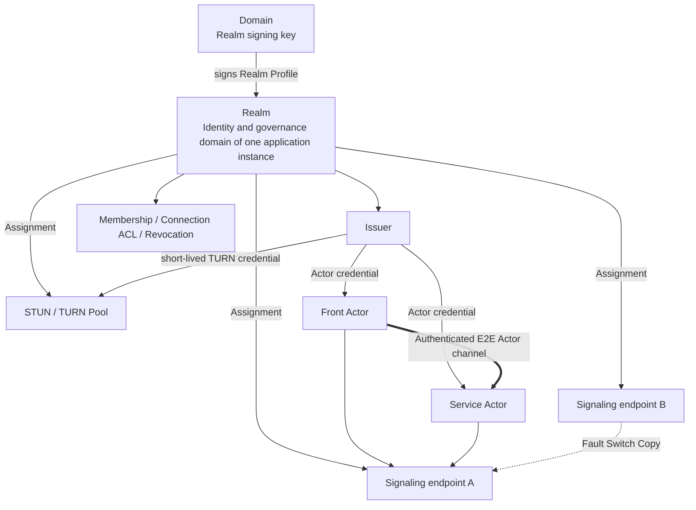

# 07. Realm♪ By letter, by letter, by letter, by letter, by letter, by letter, by letter, by letter, by letter, by letter, by letter, by letter, by letter, by letter, by letter, by letter, by letter, by letter, by letter, by letter, by letter, by letter, by letter, by letter, by letter, by letter, by letter, by letter, by letter, by letter, by letter, by letter, by letter, by letter, by letter, by letter, by letter, by letter, by letter, by letter, by letter, by letter,TURN And identity.

## 1. A picture of the relationship.



Conclusions:

- A Realm corresponds to one application instance: creating an application instance creates a Realm;
- A Realm is named by "Realm label + Realm domain"; one domain can hold many Realms;
- A Realm is usually tightly bound to signaling, but the binding is "trust and configuration delegation", not "one Realm equals one signaling server";
- One Realm can delegate to multiple signaling clusters;
- One Realm Provider (shared infrastructure such as signaling, STUN/TURN and Issuer) hosts a large number of Realms;
- A Realm is bound to one Realm Provider when it is created and can never switch; machines and endpoints inside that Realm Provider can be replaced without changing the Realm identity or ActorIds.

v1 Multiple signaling endpoint It must be the same logical control, using shared/Copy presence, or let all of them be by the rules. Actor Use same active primaryThey're a copy-and-facilities-to-entry, not a free-standing union. Realm Provider;cross Realm Provider federation It's a follow-up agreement.

## 2. Realm Definition

### 2.1 A Realm is an instance concept

A Realm is the logical trust and governance domain of one application instance. In Actrium, when a Create Intent creates a Primary Service instance, it also creates a new Realm under the selected domain; the instance's Primary Service, the Auxiliary Actors it orchestrates, and the Fronts that attach to it all belong to this Realm.

A Realm does not follow the program: the same `notes.example/team-notes` created once by organization A and once by organization B yields two Realms. Nor is a Realm an organization-level membership domain: an organization runs as many Realms as it runs application instances.

A Realm is responsible for:

- Admission of this instance's members, devices and Actors;
- Allocating Actor serials;
- Issuing and renewing Actor credentials;
- connection ACL, revocation and audit;
- Delegating trusted signaling, STUN, TURN and Issuer endpoints through its Realm Profile;
- Issuing short-lived, audience-restricted credentials for signaling and TURN.

v1 has no cross-Realm rules or federation; for cross-instance calls see [06 §6.3](06-runtime-and-protocol.md).

### 2.2 Realm name

Realms are named by a domain. A DNS domain is already globally unique in the real world and its ownership is verifiable; a Realm uses only these two properties and does not require the domain to host any infrastructure.

```text
Realm name = <label>@<domain>
Example    = k7m2q9xh@acme.com
Local      = k7m2q9xh@<installation-id>.actr.alt
```

- `domain` is a normalized DNS name (lowercase IDNA A-label, no scheme, port, userinfo or path), using the same rules as a Publisher ID;
- For a local Realm, `domain` is `<installation-id>.actr.alt`: the `installation-id` is a 128-bit value generated at random at installation (26 lowercase base32 characters); per RFC 9476, `.alt` is never resolved through DNS, so Actrium only consults local records for `.actr.alt` and never sends or resolves it; local Realms use no Realm Profile (see 5.1);
- `label` follows DNS label rules `[a-z0-9-]`, 1..63 characters, not starting or ending with `-`; it is unique within the domain and immutable after creation;
- By default Actrium generates a fully random `label` when creating an instance (e.g. `k7m2q9xh`, lowercase base32, no program name), and the human-readable name goes into the Realm Profile's `display_name`; the user may explicitly choose a readable `label` (e.g. `notes`) on the confirmation screen. The `notes@acme.com` used throughout this document is an example of such an explicitly chosen readable name;
- The Realm label of a retired Realm is never reused: the domain owner must not reuse it, and Realm Providers enforce this with Realm Provider tombstones;
- A domain's Realm signing keys are the long-term trust root of every Realm under it.

A numeric `realm_id` is only a internal database handle of the Realm Provider. It is not a Realm identity and does not appear in ActorIds, Realm Profiles or cross-Provider comparisons.

### 2.3 Realm, Publisher and Realm Provider

| | Publisher | Realm | Realm Provider |
|---|---|---|---|
| What it is | Publisher of programs | Trust domain of one application instance | Shared infrastructure |
| Identifier | Normalized DNS domain | Realm name `<label>@<domain>` | Realm Provider ID (the Realm Provider's domain) |
| Long-term trust root | Publisher key | Realm signing key | None; it is the trust root when it holds Realm signing keys (Realms under its own domain, or delegated custody) |

Each Realm is bound to one Realm Provider when it is created and can never switch. To change operators, create a new instance on the new Realm Provider, migrate data at the application level and retire the old instance.

A Publisher domain names programs (who published); a Realm domain names deployments (who operates). The same package can run in `notes@acme.com` and in `notes@foo.org`. One Realm Provider (such as a Loran deployment) hosts many Realms from many domains.

A Realm is not:

- A Marketplace;
- A Publisher;
- DNS itself;
- A WebSocket process or a signaling server;
- The authentication string of the same name in the TURN RFC;
- A Workspace;
- An organization or user directory.

## 3. Realm Signing Keys and Realm Profile

Discovery and trust have two levels: each domain publishes its Realm signing keys once, inside its Actr authority descriptor, and each Realm has one Realm Profile signed by a Realm signing key. The domain in a Realm name is exactly an Actr authority without a port: the signing keys for `notes@acme.com` come from `actr://acme.com`, and one authority can hold many Realms (see the [Actr URI](../../../actr/protocols/uri.md) specification).

### 3.1 Realm signing keys

```text
GET https://<domain>/.well-known/actr
```

They are not a separate file; it is two items in the authority descriptor, defined in [Actr Authority Discovery](../../../actr/protocols/authority-discovery.md) §4.3–4.4:

- Optional member `realm_signing_keys`: current and historical Realm signing keys and key ids, the rotation signature chain, a monotonic `sequence`, and an overall `signature`;
- Core relation `realms`, protocol `actr-realm-profile/1`: its `href` points to the Realm Profile service.

`realm_signing_keys.signature` is made by an `active` key over the RFC 8785 JCS canonical form of the member with `signature` removed. It covers `sequence` and provides rollback protection once the key is pinned. The rest of the authority descriptor remains an unsigned public document.

Rules:

- Fetching, HTTPS, authority binding checks, redirects and size limits follow Authority Discovery; no sub-path under `/.well-known/actr` may be used;
- Published once per domain; creating further Realms under the domain requires no change to the domain;
- First trust comes from Web PKI or an enterprise-provisioned key pin; signatures inside the descriptor cannot vouch for the first root;
- On Realm signing key rotation, the old key signs `{from, to, public_key, sequence}` to form a rotation chain; a key change without a valid rotation chain is treated as an identity change and requires trust to be confirmed again;
- Removing a key from `keys` revokes everything it signed: clients and Realm Providers refresh `realm_signing_keys` as often as they refresh Realm Profiles, and when the signing key of an accepted Realm Profile has been removed, they discard that Realm Profile and its `sequence` baseline and fall back to the last Realm Profile signed by a key still listed (or fetch again if there is none);
- The descriptor's `signaling`, `identity`, `ice-config` and similar services serve the authority itself and have nothing to do with the Realms under the domain; a Realm is reached only through the Realm Provider named in its Realm Profile. When the Realm Profile cannot be fetched, fails verification or is retired, clients must not use any other Realm Provider to communicate with that Realm;
- The descriptor does not list Realms, so instances cannot be enumerated.

### 3.2 Realm Profile

Location:

```text
GET <realms href>/<label>
```

The `realms` `href` may point to the domain's own static hosting (e.g. `https://acme.com/actr/realms`) or to a Realm Provider (e.g. `https://realms.provider.example/acme.com`, explicit port allowed); a Realm Profile may also be embedded in an invitation. Its validity depends only on the Realm signing key signature, not on where it was fetched from; a Realm Provider can therefore host Realm Profiles without becoming a trust root.

The Realm Profile contains at least:

- schema (`actr.realm/v1`);
- `realm.name` (the full Realm name) and display name;
- `status`: `active` or `retired`;
- A monotonic `sequence` and issue time `issued_at` (Realm Profiles do not expire);
- Issuer URL and Realm issuer keys/key ids (the Actor credential issuer is the Realm name);
- Realm Provider ID, signaling endpoints, STUN/TURN endpoints;
- credential audience;
- join policy (`policy`);
- Realm signing key signature.

The Realm Profile uses an RFC 8785 JCS canonical payload with a detached Ed25519 signature; the signing key must be an `active` Realm signing key, and an existing Realm Profile signed by a key that is later retired stays valid until a higher `sequence` supersedes it. Realm Profiles do not expire: rollback protection relies only on the per-Realm monotonic `sequence` (Realm Profiles with the same `sequence` must be identical), and clients refresh from the `realms` location when establishing a session or at least every 24 hours. `provider.id` is immutable for the Realm's lifetime; clients reject a new Realm Profile whose `provider.id` differs from the accepted one. It contains only non-secret information.

Lifecycle:

- Creation and activation: Realm management requests are `POST`ed to the `realm-management` link of the Realm Provider's own authority descriptor (`https://<provider_id>/.well-known/actr`). `create_realm` asks the Realm Provider to create a pending Realm, and the response carries the Realm Profile payload to sign; the Realm signing key holder signs it and submits it with `publish_profile`, whose response is the activation response and returns the Realm admin token once (when the holder is that Realm Provider, signing and activation happen internally). The Realm Provider idempotency key is `(realm, requester)`: a retry by the same requester for its own pending or active Realm returns its state (without a Realm admin token); a different requester hitting a Realm of the same name, or any request hitting a Realm Provider tombstone, gets a conflict; a repeated `publish_profile` gets a conflict, and a lost Realm admin token is recovered only with `reissue_admin_token`;
- Update: rotating Realm issuer keys, changing endpoints within the same Realm Provider, or changing `display_name` or the join policy each publish a new Realm Profile with a higher Realm Profile sequence;
- Retirement: the only path is for the Realm signing key holder to publish a retired Realm Profile with `status = retired` (same `provider.id`, higher sequence), which stays valid forever; the Realm Provider learns of it by periodic refresh and writes a Realm Provider tombstone; if the Realm Provider has shut down, the domain owner points the `realms` href at a storage location it controls and publishes the retired Realm Profile there; when the domain itself belongs to the defunct Realm Provider, its Realms cannot be retired and can only be recreated elsewhere;
- If every Realm signing key is lost and no usable rotation chain exists, no existing Realm under that Realm domain can get a further Realm Profile. The domain owner can only publish a new Realm signing key (clients treat it as an identity change and must re-confirm trust) and rebuild the instances under new Realm labels.

Creation authorization: no domain, no Realm (except local Realms). The owner of each Realm domain is the Realm signing key holder and may delegate custody of the key to a Realm Provider; creating, activating and reissuing a Realm admin token all require the holder's authorization.

Actrium tells the two paths apart by a single detectable condition: comparing normalized A-labels, the Realm domain equals the Realm Provider ID or ends with `"." + Realm Provider ID` (on a label boundary). Such a Realm is "a Realm under a Realm Provider's domain".

- Local Realm: Actrium creates it locally, with no Realm management request and no Realm Profile;
- Realm under a Realm Provider's domain: that Realm Provider authenticates the requester with a Realm Provider account (OAuth 2.0 authorization code + PKCE; the authorization server entry point is the `href` of the `identity` link in that Realm Provider's own descriptor, which is the OAuth authorization server's issuer identifier (RFC 8414); every Realm Provider accepts the fixed public client ID `actr-host`), and requests carry a bearer token; the Realm Provider counts quota per account and binds Realm admin rights to it, so a new or lost client only needs to sign in again. The Realm Provider can link the instances created by one account (it is the signer anyway); instance members never see the account. The confirmation page shows that Realm Provider as the trust root;
- Any other Realm domain: the Realm signing key holder's signing service issues an Actr management envelope (bound to `provider_id`, valid for at most 5 minutes, with a nonce against replay); how the holder authenticates its own members is up to the holder. The confirmation page shows the Realm domain as the trust root.

When a domain owner delegates custody of its Realm signing keys to a Realm Provider, nothing in the public documents says so, and Actrium still shows the Realm domain as the trust root; the delegated Realm Provider provides the signing service as the holder. Such custody is invisible to users; this is an accepted limitation.

Restricted "creation delegation keys" issued by a Realm signing key (limited by `label` prefix, quota and validity) are a later capability.

### 3.3 How an ActorId carries its Realm

The Realm in a current Actr ActorId is only a `u32`:

```text
2af01@42/notes.example:team-notes:1.4.2
```

From `42` alone a new device cannot know:

- Which domain to fetch the Realm Profile and Realm issuer key from;
- Which signaling cluster to connect to;
- Whether Realm 42 collides with Realm 42 on another Realm Provider.

Actrium v1 therefore requires the ActorId to carry its Realm name, and nothing but the Actor serial and the Realm name:

```text
<serial>.<label>@<domain>
2af01.notes@acme.com
2af01.h3x8p2wq@<installation-id>.actr.alt
```

Like a process ID, an ActorId only says which Actor in which Realm. The program identity (the Actor type `publisher/program@version`) is not part of the ActorId; it is carried by registration and the Actor credential, and connection ACLs and discovery use the type from there. A Publisher changing its domain or a program upgrade never changes the ActorId format.

The earlier draft `2af01@42~dns:team.example/...` (numeric realm_id plus authority) is withdrawn. The `service` parameter alone locates the Realm; Attach URIs no longer keep a second long-lived `realm` parameter. An ActrId that only contains a `u32` and embeds the type is legacy; importing it requires explicitly supplying the Realm name and rewriting it into the v1 canonical form, never guessing.

## 4. The power boundaries of the mail server

### 4.1 It's not.“Purely public, no power.”

Even if the letter does not contain the express application, it may:

- Observation ActorId, IP(b) The time of the connection;
- (b) To determine who can register, discover and exchange information on consultations;
- Delay, abandonment, partition, restriction or ban;
- Back to evil./Error ICE candidate;
- Force more traffic. TURN;
- (b) Conducting traffic linkages;
- It caused the denial of services.

Letters are therefore important control and meta-data processors and must enter threat models.

### 4.2 It should not have powers.

When properly designed, a letter of understanding should not:

- Forgery of arbitrary Actor (a) Identity;
- Decrypt Actor Apply messages;
- Modify Accredited offer/answer and not to be discovered;
- Issuance of any Realm credential;
- Access Workspace capability;
- Use an ActorId to bypass application permissions.

These borders depend on:

- Realm-signed Actor credential;
- Actor Long term key;
- Both sides challenge;
- SDP/ICE Sessions nonce (b) Signing binding;
- DTLS/SRTP/DataChannel E2E Protection;
- Service Level 2 is renewed.

### 4.3 Signaling Duties of the Office of the United Nations High Commissioner for Human Rights

- Online presence;
- ActorId (a) A temporary map to the current connection;
- Type detection and candidate ranking;
- WebRTC offer/answer/ICE Exchange;
- initial connection-ACL screening;
- Realm Provider failover;
- Network status events.

It's not for preservation. Service Business status.

## 5. Actrium Is there an internal order?

Actrium Internal:

- Actr signaling client;
- Realm signing key and Realm Profile resolver;
- Issuer/credential client;
- STUN/TURN (a) Configuration and failure switching;
- Local Realm It's... loopback/embedded signaling;
- Diagnosis and status UI.

Actrium Not writing death:

- (a) The only global courier server;
- (a) Single public interest organizations;
- Unique TURN;
- Publisher (a) His or her own address;
- Static TURN Password.

### 5.1 Local Realm

Local instances use Realm names under the local pseudo-domain `<installation-id>.actr.alt`, with one local Realm per local instance. A local Realm has no Realm Provider and uses no Realm Profile or Realm management request; Actrium keeps only a local record. For a local Front and a local Service:

- Prefer in-process/loopback transport;
- embedded signaling only handles local Realms;
- No public STUN/TURN is needed;
- Available offline;
- The ActorId is still a persistent identity, e.g. `2af01.h3x8p2wq@<installation-id>.actr.alt`;
- Only the same installation can resolve that Realm;
- "Copy portable link" must be disabled; moving under a domain creates a new Realm and issues a new ActorId.

### 5.2 Networked Realm

A networked instance's Realm lives under a domain:

- The user or an administrator first trusts the Realm domain (confirms it once and pins its Realm signing keys);
- When an instance is created, Actrium creates a new Realm under that domain; the Realm owner is the instance creator;
- Other users join this instance's Realm by Realm invitation and obtain Realm membership;
- Actors use the Realm Provider named in the Realm Profile at runtime, which stays the same for the Realm's lifetime;
- Updates to the Realm Profile and to `realm_signing_keys` must verify signatures, rotation chains and `sequence`.

## 6. Actor Identity

### 6.1 Identity

Service Actor The status shall consist of at least:

```text
ActorId
+ Actor long-term public key
+ Realm-signed Actor credential/certificate
+ private key proof
```

A Realm client key is the key one member's client installation uses in one Realm: it is generated separately per Realm (how Actrium generates it internally is not specified) and never reused across Realms, so a single client can be revoked on its own and different instances cannot correlate the same client. The principal/client binding in the Actor credential binds that Realm client key.

Credential claims This should include:

- ActorId;
- Realm;
- ActorType;
- actor public key;
- principal/client binding;
- issuer/key id;
- issued/expiry;
- audience;
- capability/role;
- revocation handle.

The alternative client certificate contains a separate:

- platform app attestation;
- Actrium Issue Signature/Version;
- device management claim;
- attestation nonce and the duration.

In the absence of such proof,Realm credential No proof that the device is running official Front Host, Service It must be handled by a client who is not trusted.

### 6.2 Persistence ActorId

Service Actor Long-term private key and ActorId Generate in creation/Issued and sustained.

The following operation must be maintained ActorId:

- Actrium/Service process restarts;
- normal Actor credential renewal;
- re-authentication after losing the Actor credential renewal token, as long as the same long-term key is proven;
- signaling reconnect;
- endpoint/IP Changes;
- P2P with TURN Switch;
- Machine migration within the Realm.

The following actions create new ActorId:

- Create New Service;
- Service upgrade to a new Program Release (the new Service Actor is still created in the same Realm; members and application permissions carry over);
- Moving to another Realm (including from a local Realm to a Realm under a domain);
- Long term key (a) Is revoked and cannot be reinstated;
- Visible clone/fork.

Actr Current hard rebind Could return new ID.v1 Before you must add“Long-term key reclaim Original ActorId”and sustainable identity/renewal state.

### 6.3 ID Allocation

A Realm must guarantee that an Actor serial is never reused within that Realm:

- Use the only bound Realm allocator;
- Or use strong enough. key-derived/Random ID And to do collision tests;
- Can't rely on it. hostname/PID Hash's weakness. worker id The only one who claims to be unconditional is the one who has no rights.
- After an Actor is revoked, the Realm Provider keeps its Actor serial permanently and never reallocates it;
- A Realm is permanently bound to its Realm Provider, so Actor serials are always allocated by the same Realm Provider.

### 6.4 Actr Host Proof identity

Actr Host Yes workload When export is closed to provide evidence, independent, verifiable Actr Host Evidence key:

- For a local Realm the Actr Host key is bound only to the current installation and is trusted only by that installation;
- A networked Realm may bind the Actr Host key to the Realm client key;
- The controlled scenes can be further bound. platform/runtime attestation;
- Actr Host (a) The revocation of the evidence key must render the unexpired conclusion relying on the key immediately invalid;
- Actr Host You can't sign your own final form. `ActorAssurance`;
- Actor Long-term in itself key We can't pretend to be Actr Host Evidence keys;
- signaling Only summary of conclusions transmitted, not issued workload kind, egress closure Or a claim to integrity.

The remote certification party decides whether to trust it according to its own strategy. Actr Host Evidence. No accepted evidence. `ActorAssurance` I'm still a possibility. authenticbut nodal conclusion shall be `CONTROLLED`.

## 7. Authentication process

### 7.1 Trusting a domain and joining an instance Realm

Trusting a domain (once per domain):

1. Fetch `https://<domain>/.well-known/actr` per Authority Discovery and read `realm_signing_keys`;
2. The user or an administrator confirms the Realm domain;
3. Actrium pins its Realm signing keys and creates a domain record.

Joining an instance's Realm (once per instance):

1. Obtain the Realm name from a Realm invitation or the `service` ActorId; a Realm invitation may embed the Realm Profile;
2. Fetch the Realm Profile and verify the Realm signing key signature, `sequence` and `status`;
3. The client generates a separate Realm client key for this Realm; the principal/client completes the Realm invitation or login required by that Realm's join policy;
4. The Realm Provider registers that Realm client key, which completes client registration and grants Realm membership; no separate membership credential is issued;
5. OS secure storage keeps the Realm client key;
6. Actrium creates the Realm record.

Afterwards, every Actor credential request proves possession of the Realm client key; the Issuer issues only for Realm client keys that are registered and not revoked. Revoking a client revokes its Realm client key registration; short-lived Actor credentials already issued expire.

Joining a Realm covers only that one instance; when a user uses several instances, Actrium performs client registration for each Realm automatically, with a different Realm client key per Realm. Domain-level SSO/directories are a later capability and not part of v1.

Membership and instance authorization are two layers: Realm membership only decides whether one can enter the instance's network, i.e. it is the prerequisite for obtaining an Actor credential, connecting to signaling and performing the Attach handshake; roles and permissions inside the instance (read/write, administration, sharing) are application permissions, decided by the application and session authorization; the Actr runtime decides who may discover and connect to whom by Actor type, which is the connection ACL. The two are never merged even though they belong to the same instance; holding membership grants no permission inside the instance.

### 7.2 Actor Registration

1. Actr Host Generate or read ActorLong term key;
2. Request new ActorId or reclaim Existing ActorId;
3. The Issuer verifies Realm membership, the ActorType and allowed claims, and additionally verifies platform attestation when a managed runtime is required;
4. The Issuer issues a short-lived Actor credential carrying the ActorId and the Actor type;
5. Actor Use short-term ticket Connection signaling;
6. signaling Authentication issuer, audience, ActorId and proof.

### 7.3 Peer handshake

1. (b) Letters for the exchange of signed data for consultation;
2. WebRTC/transport Establishment;
3. Both parties verify Realm credential with Actor key;validation of independence when required runtime attestation;
4. challenge/nonce (b) Prevention of re-play;
5. Front–Service Attach re-verifies the Program digest and the session's application permissions;
6. After success Guest capability It's only available.

## 8. Letter authentication certificate

The authentication material should not be placed in the long term URL query:

- query It will be recorded in the agent, log, browser history and monitoring system;
- Even a signature may have re-alignable value during its validity.

Target programmes:

- WebSocket `Authorization` header(a) The contract or other contract; or
- a one-time, very short-lived signaling ticket issued by the Issuer;
- ticket Tie ActorId, endpoint audience, nonce and due;
- (b) Dismantling of the successful connection immediately after the connection;
- Log Only Record ticket key id, no record value.

`actr://` URI Never carry signaling ticket.

## 9. STUN/TURN

### 9.1 Two. Realm It's not the same thing.

- **Actr Realm**: Product identity and governance domain.
- **TURN REALM**: TURN A valid field string in a long-term certificate algorithm.

They can use the same domain name to facilitate transport, but the agreement has different meanings and cannot be reused in the code and document.

Suggested name:

```text
ActrRealmId
TurnAuthRealm
```

### 9.2 TURN Evidence

It is necessary to:

- (b) Short-term;
- Tie Actor/Session or principal;
- Tie TURN pool audience;
- Got maturity, bandwidth, side hair allocation Quotas;
- issued by the Realm's Issuer or a credential broker it authorizes;
- Support key id and rotation;
- Do Not Use Cross All Realm Single long-term shared secret;
- An anonymous and open relay is not allowed.

### 9.3 TURN Powers

TURN Usually not. DTLS/SRTP/DataChannel Expressly, but can be seen:

- Both IP;
- Time, volume and duration;
- allocation;
- Relay relationships.

It can also throw bags, speed limits, refuse or record traffic. Realm It must be clear. TURN Realm Provider And privacy policy.

## 10. Realm Provider Assignment and failure switch

Realm Profile You can declare more than one endpoint:

```json
{
  "signaling": [
    {"url": "wss://signal-a.realm.example:443/ws", "priority": 10},
    {"url": "wss://signal-b.provider.example:8443/ws", "priority": 20}
  ],
  "ice": [
    {"urls": ["stun:stun.realm.example:3478"]},
    {"urls": ["turns:turn.provider.example:5349"], "credential_audience": "turn-pool-1"}
  ]
}
```

Rules:

- Endpoint domains may differ from the domain in the Realm name;
- A Realm Profile signed by a Realm signing key constitutes the delegation;
- Where the Realm Profile is stored does not affect its validity;
- (a) Not permitted by default port;
- endpoint Switches to Never Change Realm or ActorId;
- failover Unable to go to undeclared Realm Provider;
- Realm Provider Certificates and ticket audience Must match.

## 11. Port Policy

| scene | Port Policy |
|---|---|
| `actr://` Publisher identity | Port not allowed |
| Publisher Profile bootstrap | Fixed authority Domain Name HTTPS 443 |
| Default Release bootstrap | Fixed Publisher Domain Name HTTPS 443 |
| Resolver/CDN/Issuer delegated by the Realm Profile | Visible port, must HTTPS |
| Realm signing keys (authority descriptor `/.well-known/actr`) | Fixed HTTPS 443 on the Realm domain |
| Realm Profile | HTTPS location declared by the `realms` relation (explicit port allowed) |
| Signaling WSS | Visible Port |
| STUN/TURN | By protocol Visible Port |
| `actr-dev://` | Port Available |
| localhost/private CA | Only develop/Business strategy |

This preserves the freedom of deployment without making network ports part of product identifiers.

## 12. Chain of Trust

| Chain of Trust | Root | Authentication Object | After failure |
|---|---|---|---|
| Publisher/Package | DNS/TLS + Publisher key | package bytes/digest | Unmounted Program |
| Realm/Actor | DNS/TLS + Realm signing key in the authority descriptor → Realm Profile → Realm issuer key; Actor key | Peer Identity/Access | Do Not Connect Actor |
| Front Session | Service policy + challenge | Current Front/User/lease | Closed operations RPC |
| Signaling/TURN | Delegation by the Realm Profile signed with a Realm signing key | Control face and trunking resources | Switch or Offline |
| Marketplace | Market Signature/Policy | Review and withdrawal of information | Lower trust/Stop installation |

No chain can replace it.

## 13. Offline ♪ And lost ♪

### 13.1 Local Realm

- Fixed installed digest Offline;
- local Actor credentials can be restored by the Actrium-embedded issuer;
- loopback No need. TURN;
- The cancellation affects only the management of the machine.

### 13.2 Networking Realm

Realm Profile, credential or when information is not available:

- Short-term established session Sustainable to credential (a) Due;
- (a) The non-infinite extension of expired status;
- Whether read-only offline mode allows by Program/Realm policy Declaration;
- New Attach Default failed to close;
- It can't be because Realm Disconnect to create local replacements of the same type Service.

## 14. Privacy

The metadata a Realm and its Realm Provider can observe must be stated on the privacy page:

- ActorId;
- IP;
- online/offline;
- Connecting targets;
- P2P/TURN;
- Time and volume.

Measures to minimize:

- No, no, no. Program route, Workspace Name or business payload(a) Issue letters;
- Use short-term ticket;
- offer/answer (a) Tie and encrypt the encrypted portion;
- Realm Provider (b) Minimization and short retention of the log;
- (b) Allowing business to host;
- Support multiple Realm Provider and transparent status display;
- The authority descriptor does not list Realms.

Realm names appear in ActorIds and URLs and reveal the domain and instance name; Actrium generates a fully random `label` by default so names cannot be guessed or enumerated; a user who explicitly chooses a readable name should know it is exposed when shared.
