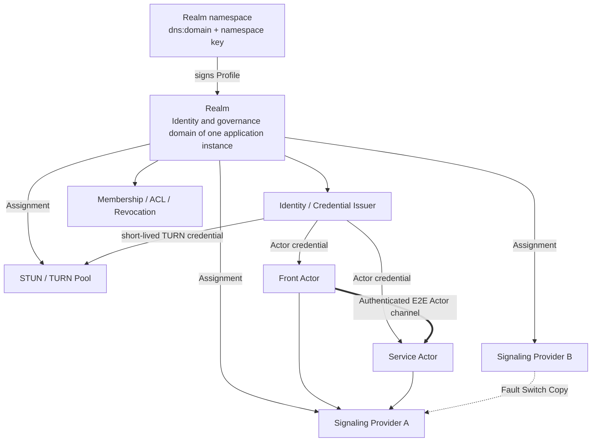

# 07. Realm♪ By letter, by letter, by letter, by letter, by letter, by letter, by letter, by letter, by letter, by letter, by letter, by letter, by letter, by letter, by letter, by letter, by letter, by letter, by letter, by letter, by letter, by letter, by letter, by letter, by letter, by letter, by letter, by letter, by letter, by letter, by letter, by letter, by letter, by letter, by letter, by letter, by letter, by letter, by letter, by letter, by letter, by letter,TURN And identity.

## 1. A picture of the relationship.



Conclusions:

- A Realm corresponds to one application instance: creating an application instance creates a Realm;
- A Realm is named by "namespace + local name"; one domain namespace can hold many Realms;
- A Realm is usually tightly bound to signaling, but the binding is "trust and configuration delegation", not "one Realm equals one signaling server";
- One Realm can delegate to multiple signaling clusters;
- One Provider (shared infrastructure such as signaling, STUN/TURN and issuer) hosts a large number of Realms;
- A Realm is bound to one Provider when it is created and can never switch; machines and endpoints inside that Provider can be replaced without changing the Realm identity or ActorIds.

v1 Multiple signaling endpoint It must be the same logical control, using shared/Copy presence, or let all of them be by the rules. Actor Use same active primaryThey're a copy-and-facilities-to-entry, not a free-standing union. Provider;cross Provider federation It's a follow-up agreement.

## 2. Realm Definition

### 2.1 A Realm is an instance concept

A Realm is the logical trust and governance domain of one application instance. In Actrium, when a Create Intent creates a Primary Service instance, it also creates a new Realm under the selected namespace; the instance's Primary Service, the Auxiliary Actors it orchestrates, and the Fronts that attach to it all belong to this Realm.

A Realm does not follow the program: the same `notes.example/team-notes` created once by organization A and once by organization B yields two Realms. Nor is a Realm an organization-level membership domain: an organization runs as many Realms as it runs application instances.

A Realm is responsible for:

- Admission of this instance's members, devices and Actors;
- The ActorId namespace;
- Issuing and renewing Actor credentials;
- ACL, revocation and audit;
- Delegating trusted signaling, STUN, TURN and issuer endpoints through its Realm Profile;
- Issuing short-lived, audience-restricted credentials for signaling and TURN.

v1 has no cross-Realm rules or federation; for cross-instance calls see [06 §6.3](06-runtime-and-protocol.md).

### 2.2 Namespace and local name

Realms are named inside a namespace. A DNS domain is already globally unique in the real world and its ownership is verifiable; a Realm uses only these two properties and does not require the domain to host any infrastructure.

```text
Realm namespace = dns:<domain> | local:<installation-id>
Realm           = namespace + local_name
Realm reference = <local_name>~dns:<domain> | <local_name>~local:<installation-id>
Example         = notes~dns:acme.com
```

- `domain` is a normalized DNS name (lowercase IDNA A-label, no scheme, port, userinfo or path), using the same rules as a Publisher ID;
- `local_name` follows DNS label rules `[a-z0-9-]`, 1..63 characters, not starting or ending with `-`; it is unique within the namespace and immutable after creation;
- By default Actro generates a fully random `local_name` when creating an instance (e.g. `k7m2q9xh`, lowercase base32, no program name), and the human-readable name goes into the Realm Profile's `display_name`; the user may explicitly choose a readable `local_name` (e.g. `notes`) on the confirmation screen. The `notes~dns:acme.com` used throughout this document is an example of such an explicitly chosen readable name;
- The `local_name` of a retired Realm is never reused: the namespace owner must not reuse it, and Providers enforce this locally with tombstones;
- The namespace key of a DNS namespace is the long-term trust root of every Realm in it; for the local namespace the `installation-id` is derived from the installation root key, and local Realms use no Profile (see 5.1).

A numeric `realm_id` is only a Provider-internal database handle. It is not a Realm identity and does not appear in ActorIds, Realm Profiles, issuer identifiers or cross-Provider comparisons.

### 2.3 Realm, Publisher and Provider

| | Publisher | Realm | Provider |
|---|---|---|---|
| What it is | Publisher of programs | Trust domain of one application instance | Shared infrastructure |
| Identifier | Normalized DNS domain | Namespace + `local_name` | Provider ID |
| Long-term trust root | Publisher key | Namespace key | None (only holds delegated issuer keys) |

Each Realm is bound to one Provider when it is created and can never switch. To change operators, create a new instance on the new Provider, migrate data at the application level and retire the old instance.

A Publisher domain names programs (who published); a Realm namespace names deployments (who operates). The same package can run in `notes~dns:acme.com` and in `notes~dns:foo.org`. One Provider (such as Actrix/Loran) hosts many Realms from many namespaces.

A Realm is not:

- A Marketplace;
- A Publisher;
- DNS itself;
- A WebSocket process or a signaling server;
- The authentication string of the same name in the TURN RFC;
- A Workspace;
- An organization or user directory.

## 3. Namespace Descriptor and Realm Profile

Discovery and trust have two levels: each domain publishes a namespace descriptor once, inside its Actr authority descriptor, and each Realm has one Realm Profile signed by the namespace key. A DNS Realm namespace is exactly an Actr authority without a port: the namespace of `notes~dns:acme.com` is `actr://acme.com`, consistent with "one authority can run multiple realms" in the [Actr URI](../../../actr/protocols/uri.md) specification.

### 3.1 Namespace descriptor

```text
GET https://<domain>/.well-known/actr
```

The namespace descriptor is not a separate file; it is two items in the authority descriptor, defined in [Actr Authority Discovery](../../../actr/protocols/authority-discovery.md) §4.3–4.4:

- Optional member `realm_namespace`: current and historical namespace keys and key ids, the rotation signature chain, a monotonic `sequence`, and an overall `signature`;
- Core relation `realms`, protocol `actr-realm-profile/1`: its `href` points to the Realm Profile service.

`realm_namespace.signature` is made by an `active` namespace key over the RFC 8785 JCS canonical form of the `realm_namespace` member with `signature` removed. It covers `sequence` and provides rollback protection once the namespace key is pinned. The rest of the authority descriptor remains an unsigned public document.

Rules:

- Fetching, HTTPS, authority binding checks, redirects and size limits follow Authority Discovery; no sub-path under `/.well-known/actr` may be used;
- Published once per domain; creating further Realms under the domain requires no change to the domain;
- First trust comes from Web PKI or an enterprise-provisioned namespace key pin; signatures inside the descriptor cannot vouch for the first root;
- On namespace key rotation, the old key signs `{from, to, public_key, sequence}` to form a rotation chain; a key change without a valid rotation chain is treated as an identity change and requires trust to be confirmed again;
- Removing a key from `keys` revokes everything it signed: clients and Providers refresh `realm_namespace` as often as they refresh Profiles, and when the signing key of an accepted Profile has been removed, they discard that Profile and its `sequence` baseline and fall back to the last Profile signed by a key still listed (or fetch again if there is none);
- The descriptor's existing `signaling`, `identity`, `ice-config` and similar services are the authority's default Provider and serve only as a suggestion when creating a new Realm; the actual delegation of a given Realm is solely whatever its Profile says. When the Realm Profile cannot be fetched, fails verification or is retired, clients must not fall back to the default Provider to communicate with that Realm;
- The descriptor does not list Realms, so instances cannot be enumerated.

### 3.2 Realm Profile

Location:

```text
GET <realms href>/<local_name>
```

The `realms` `href` may point to the domain's own static hosting (e.g. `https://acme.com/actr/realms`) or to a Provider (e.g. `https://realms.provider.example/acme.com`, explicit port allowed); a Realm Profile may also be embedded in an invitation. Its validity depends only on the namespace key signature, not on where it was fetched from; a Provider can therefore host Profiles without becoming a trust root.

The Profile contains at least:

- schema (`actr.realm/v1`);
- `namespace`, `local_name` and display name;
- `status`: `active` or `retired`;
- A monotonic `sequence` and issue time `issued_at` (Profiles do not expire);
- Issuer identifier `actr:realm:<Realm reference>:authority`, issuer URL, issuer keys/key ids;
- Provider ID, signaling endpoints, STUN/TURN endpoints;
- credential audience;
- ACL/join policy;
- Namespace key signature.

The Profile uses an RFC 8785 JCS canonical payload with a detached Ed25519 signature; the signing key must be an `active` namespace key, and an existing Profile signed by a key that is later retired stays valid until a higher `sequence` supersedes it. Profiles do not expire: rollback protection relies only on the per-Realm monotonic `sequence` (Profiles with the same `sequence` must be identical), and clients refresh from the `realms` location when establishing a session or at least every 24 hours. `provider.id` is immutable for the Realm's lifetime; clients reject a new Profile whose `provider.id` differs from the accepted one. It contains only non-secret information.

Lifecycle:

- Creation and activation: management requests are `POST`ed to the `realm-management` link of the Provider's own authority descriptor (`https://<provider_id>/.well-known/actr`). The caller requests that the Provider create a pending Realm with a `create_realm` request signed by the namespace key, and the response carries the Profile payload to sign; after signing, the caller always submits the Profile with `activate_realm`, whose response is the activation response and returns the admin token once (in a Provider-owned namespace the Provider signs the Profile itself and activates internally). The idempotency key is `(namespace, local_name, requester)`: a retry by the same requester for its own pending or active Realm returns its state (without an admin token); a different requester hitting a Realm of the same name, or any request hitting a tombstone, gets a conflict; a repeated `activate_realm` gets a conflict, and a lost admin token is recovered only with `reissue_admin_token` (including a lost `create_realm` response in a Provider-owned namespace);
- Update: rotating issuer keys, changing endpoints within the same Provider, or changing `display_name` or the join policy each publish a Profile with a higher `sequence`;
- Retirement: the only path is for the namespace owner to publish a new Profile with `status = retired` (same `provider.id`, higher `sequence`), a tombstone that stays valid forever; the Provider learns of it by periodic refresh and writes a local tombstone; if the Provider has shut down, the namespace owner points the `realms` href at a location it controls and publishes the retired Profile there; a Provider-owned namespace disappears with its Provider, so its Realms cannot be retired and can only be recreated elsewhere;
- If every namespace key is lost and no usable rotation chain exists, no existing Realm in that namespace can sign a further Profile. The domain owner can only publish a new namespace key (clients treat it as an identity change and must re-confirm trust) and rebuild the instances under new `local_name`s.

Creation authorization (who signs the Profile): both the Realm creation request and the Profile must be signed by the namespace key, so the ability to create depends on who can use that key.

- Local namespace: Actro creates the Realm locally, with no signed request and no Profile;
- Provider-owned namespace: signed by the Provider operator; individual users create Realms there self-service, authenticating with their account at that Provider (OAuth 2.0 authorization code + PKCE; the `href` of the descriptor's `identity` link is the OAuth issuer, and every Provider accepts the fixed public client ID `actr-host`); the Provider counts quota per account and binds Realm admin rights to it, so a new or lost device only needs to sign in again. The Provider can link the instances created by one account (it is the signer anyway); instance members never see the account;
- Organization namespace: the organization's signing tool/service that holds the namespace key authenticates members according to the organization's own policy and then signs the creation request and Profile on their behalf; an organization running its own Provider may let that Provider hold the namespace key, which is still the organization's own infrastructure.

In v1, individual users can only create Realms self-service in the local namespace or a Provider-owned namespace. Restricted "creation delegation keys" issued by the namespace key (limited by `local_name` prefix, quota and validity) are a later capability.

### 3.3 How an ActorId carries its Realm

The Realm in a current Actr ActorId is only a `u32`:

```text
2af01@42/notes.example:team-notes:1.4.2
```

From `42` alone a new device cannot know:

- Which namespace to fetch the Realm Profile and issuer key from;
- Which signaling cluster to connect to;
- Whether Realm 42 collides with Realm 42 on another Provider.

Actro v1 therefore requires the ActorId to carry its Realm reference:

```text
<serial_hex>@<local_name>~dns:<domain>/<publisher>:<program>:<version>
2af01@notes~dns:acme.com/notes.example:team-notes:1.4.2
2af01@h3x8p2wq~local:<installation-id>/notes.example:team-notes:1.4.2
```

The earlier draft `2af01@42~dns:team.example/...` (numeric realm_id plus authority) is withdrawn; `local_name` replaces the numeric realm_id. The `service` parameter alone locates the Realm; Attach URIs no longer keep a second long-lived `realm` parameter. An ActrId that only contains a `u32` is legacy; importing it requires explicitly supplying the Realm reference and rewriting it into the v1 canonical form, never guessing.

## 4. The power boundaries of the mail server

### 4.1 It's not.“Purely public, no power.”

Even if the letter does not contain the express application, it may:

- Observation ActorId, IP(b) The time of the connection;
- (b) To determine who can register, discover and exchange information on consultations;
- Delay, abandonment, partition, restriction or ban;
- Back to evil./Error ICE candidate;
- Force more traffic. TURN;
- (b) Conducting traffic linkages;
- It caused the denial of services.

Letters are therefore important control and meta-data processors and must enter threat models.

### 4.2 It should not have powers.

When properly designed, a letter of understanding should not:

- Forgery of arbitrary Actor (a) Identity;
- Decrypt Actor Apply messages;
- Modify Accredited offer/answer and not to be discovered;
- Issuance of any Realm credential;
- Access Workspace capability;
- Use ActorId Around Service ACL.

These borders depend on:

- Realm-signed Actor credential;
- Actor Long term key;
- Both sides challenge;
- SDP/ICE Sessions nonce (b) Signing binding;
- DTLS/SRTP/DataChannel E2E Protection;
- Service Level 2 is renewed.

### 4.3 Signaling Duties of the Office of the United Nations High Commissioner for Human Rights

- Online presence;
- ActorId (a) A temporary map to the current connection;
- Type detection and candidate ranking;
- WebRTC offer/answer/ICE Exchange;
- ACL (a) Initial screening;
- Provider failover;
- Network status events.

It's not for preservation. Service Business status.

## 5. Actro Is there an internal order?

Actro Internal:

- Actr signaling client;
- Realm namespace descriptor and Realm Profile resolver;
- issuer/credential client;
- STUN/TURN (a) Configuration and failure switching;
- Local Realm It's... loopback/embedded signaling;
- Diagnosis and status UI.

Actro Not writing death:

- (a) The only global courier server;
- (a) Single public interest organizations;
- Unique TURN;
- Publisher (a) His or her own address;
- Static TURN Password.

### 5.1 Local Realm

Local instances use the `local:<installation-id>` namespace (the `installation-id` is derived from the installation root key), with one local Realm per local instance. A local Realm has no Provider and uses no Realm Profile or signed request; Actro keeps only a local record. For a local Front and a local Service:

- Prefer in-process/loopback transport;
- embedded signaling only handles local Realms;
- No public STUN/TURN is needed;
- Available offline;
- The ActorId is still a persistent identity and contains the `~local:<installation-id>` Realm reference;
- Only the same installation can resolve that Realm;
- "Copy portable link" must be disabled; moving to a DNS namespace creates a new Realm and issues a new ActorId.

### 5.2 Networked Realm

A networked instance's Realm lives under a DNS namespace:

- The user or organization administrator first trusts the namespace (confirms it once and pins the namespace key);
- When an instance is created, Actro creates a new Realm under that namespace; the Realm owner is the instance creator;
- Other users join this instance's Realm by invitation and obtain membership in that Realm;
- Actors use the Provider named in the Profile at runtime, which stays the same for the Realm's lifetime;
- Updates to the Profile and the namespace descriptor must verify signatures, rotation chains and `sequence`.

Users without their own domain can use a Provider operator's namespace (e.g. `dns:realms.provider.example`). The namespace key is then held by the Provider operator, who becomes the trust root; Actro must display this truthfully.

## 6. Actor Identity

### 6.1 Identity

Service Actor The status shall consist of at least:

```text
ActorId
+ Actor long-term public key
+ Realm-signed Actor credential/certificate
+ private key proof
```

A device uses a separate device key in each Realm (derived from the device root key by Realm reference, or generated independently) and never reuses it across Realms, so different instances cannot correlate the same device by its device key. The principal/device binding in the credential binds that Realm's device key.

Credential claims This should include:

- ActorId;
- Realm;
- ActorType;
- actor public key;
- principal/device binding;
- issuer/key id;
- issued/expiry;
- audience;
- capability/role;
- revocation handle.

The alternative client certificate contains a separate:

- platform app attestation;
- Actro Issue Signature/Version;
- device management claim;
- attestation nonce and the duration.

In the absence of such proof,Realm credential No proof that the device is running official Front Host, Service It must be handled by a client who is not trusted.

### 6.2 Persistence ActorId

Service Actor Long-term private key and ActorId Generate in creation/Issued and sustained.

The following operation must be maintained ActorId:

- Actro/Service (a) Relaunching the process;
- credential Regular renewal;
- renewal token Re-certification after loss, provided it proves the same long-term key;
- signaling reconnect;
- endpoint/IP Changes;
- P2P with TURN Switch;
- Host migration within the Realm.

The following actions create new ActorId:

- Create New Service;
- Service upgrade to a new Program Release (the new Service Actor is still created in the same Realm; members and ACL carry over);
- Moving to another Realm (including from the local namespace to a DNS namespace);
- Long term key (a) Is revoked and cannot be reinstated;
- Visible clone/fork.

Actr Current hard rebind Could return new ID.v1 Before you must add“Long-term key reclaim Original ActorId”and sustainable identity/renewal state.

### 6.3 ID Allocation

Realm You have to promise. serial It is permanently not used in its namespace:

- Use the only bound Realm allocator;
- Or use strong enough. key-derived/Random ID And to do collision tests;
- Can't rely on it. hostname/PID Hash's weakness. worker id The only one who claims to be unconditional is the one who has no rights.
- After an Actor is revoked its serial keeps a tombstone;
- A Realm is permanently bound to its Provider, so serials are always allocated by the same Provider.

### 6.4 Host Proof identity

Host Yes workload When export is closed to provide evidence, independent, verifiable Host Evidence key:

- Local Realm (a) The current installation of a binding root, which will only constitute confidence in the installation;
- Networking Realm You can put Host key ♪ Tie it to the device credential;
- The controlled scenes can be further bound. platform/runtime attestation;
- Host (a) The revocation of the evidence key must render the unexpired conclusion relying on the key immediately invalid;
- Host You can't sign your own final form. `ActorAssurance`;
- Actor Long-term in itself key We can't pretend to be Host Evidence keys;
- signaling Only summary of conclusions transmitted, not issued workload kind, egress closure Or a claim to integrity.

The remote certification party decides whether to trust it according to its own strategy. Host Evidence. No accepted evidence. `ActorAssurance` I'm still a possibility. authenticbut nodal conclusion shall be `CONTROLLED`.

## 7. Authentication process

### 7.1 Trusting a namespace and joining an instance Realm

Trusting a namespace (once per namespace):

1. Fetch `https://<domain>/.well-known/actr` per Authority Discovery and read `realm_namespace`;
2. The user/organization administrator confirms the namespace;
3. Actro pins the namespace key and creates a namespace record.

Joining an instance's Realm (once per instance):

1. Obtain the Realm reference from an invitation or the `service` ActorId; an invitation may embed the Realm Profile;
2. Fetch the Realm Profile and verify the namespace key signature, `sequence` and `status`;
3. The device derives or generates a separate device key for this Realm; the principal/device completes the invitation or login required by that Realm's join policy;
4. The Realm issues a membership credential;
5. Device secure storage keeps the key/refresh material;
6. Actro creates the Realm record.

Joining a Realm covers only that one instance; when a user uses several instances, Actro performs device registration for each Realm automatically, with a different device key per Realm. Namespace-level SSO/directories are a later capability and not part of v1.

Membership and instance authorization are two layers: Realm membership only decides whether one can enter the instance's network, i.e. it is the prerequisite for obtaining an Actor credential, connecting to signaling and performing the Attach handshake; roles and permissions inside the instance (read/write, administration, sharing) are still decided by the Service ACL and session authorization. The two are never merged even though they belong to the same instance; holding membership grants no permission inside the instance.

### 7.2 Actor Registration

1. Host Generate or read ActorLong term key;
2. Request new ActorId or reclaim Existing ActorId;
3. issuer Authentication membership, ActorType And allowed. claim;requires custody runtime Timeout platform attestation;
4. issuer Issuance of short-term Actor credential;
5. Actor Use short-term ticket Connection signaling;
6. signaling Authentication issuer, audience, ActorId and proof.

### 7.3 Peer handshake

1. (b) Letters for the exchange of signed data for consultation;
2. WebRTC/transport Establishment;
3. Both parties verify Realm credential with Actor key;validation of independence when required runtime attestation;
4. challenge/nonce (b) Prevention of re-play;
5. Front–Service Attach Revalidate Program digest with session ACL;
6. After success Guest capability It's only available.

## 8. Letter authentication certificate

The authentication material should not be placed in the long term URL query:

- query It will be recorded in the agent, log, browser history and monitoring system;
- Even a signature may have re-alignable value during its validity.

Target programmes:

- WebSocket `Authorization` header(a) The contract or other contract; or
- issuer One-time, very short-term issuance signaling ticket;
- ticket Tie ActorId, endpoint audience, nonce and due;
- (b) Dismantling of the successful connection immediately after the connection;
- Log Only Record ticket key id, no record value.

`actr://` URI Never carry signaling ticket.

## 9. STUN/TURN

### 9.1 Two. Realm It's not the same thing.

- **Actr Realm**: Product identity and governance domain.
- **TURN REALM**: TURN A valid field string in a long-term certificate algorithm.

They can use the same domain name to facilitate transport, but the agreement has different meanings and cannot be reused in the code and document.

Suggested name:

```text
ActrRealmId
TurnAuthRealm
```

### 9.2 TURN Evidence

It is necessary to:

- (b) Short-term;
- Tie Actor/Session or principal;
- Tie TURN pool audience;
- Got maturity, bandwidth, side hair allocation Quotas;
- By Realm issuer or its authorization credential broker (a) Issuance;
- Support key id and rotation;
- Do Not Use Cross All Realm Single long-term shared secret;
- An anonymous and open relay is not allowed.

### 9.3 TURN Powers

TURN Usually not. DTLS/SRTP/DataChannel Expressly, but can be seen:

- Both IP;
- Time, volume and duration;
- allocation;
- Relay relationships.

It can also throw bags, speed limits, refuse or record traffic. Realm It must be clear. TURN Provider And privacy policy.

## 10. Provider Assignment and failure switch

Realm Profile You can declare more than one endpoint:

```json
{
  "signaling": [
    {"url": "wss://signal-a.realm.example:443/ws", "priority": 10},
    {"url": "wss://signal-b.provider.example:8443/ws", "priority": 20}
  ],
  "ice": [
    {"urls": ["stun:stun.realm.example:3478"]},
    {"urls": ["turns:turn.provider.example:5349"], "credential_audience": "turn-pool-1"}
  ]
}
```

Rules:

- Endpoint domains may differ from the Realm namespace domain;
- A Realm Profile signed by the namespace key constitutes the delegation;
- Where the Profile is hosted does not affect its validity;
- (a) Not permitted by default port;
- endpoint Switches to Never Change Realm or ActorId;
- failover Unable to go to undeclared Provider;
- Provider Certificates and ticket audience Must match.

## 11. Port Policy

| scene | Port Policy |
|---|---|
| `actr://` Publisher identity | Port not allowed |
| Publisher Profile bootstrap | Fixed authority Domain Name HTTPS 443 |
| Default Release bootstrap | Fixed Publisher Domain Name HTTPS 443 |
| Profile Assigned resolver/CDN/issuer | Visible port, must HTTPS |
| Realm namespace (authority descriptor `/.well-known/actr`) | Fixed HTTPS 443 on the namespace domain |
| Realm Profile | HTTPS location declared by the `realms` relation (explicit port allowed) |
| Signaling WSS | Visible Port |
| STUN/TURN | By protocol Visible Port |
| `actr-dev://` | Port Available |
| localhost/private CA | Only develop/Business strategy |

This preserves the freedom of deployment without turning the Internet portal into a product namespace.

## 12. Chain of Trust

| Chain of Trust | Root | Authentication Object | After failure |
|---|---|---|---|
| Publisher/Package | DNS/TLS + Publisher key | package bytes/digest | Unmounted Program |
| Realm/Actor | DNS/TLS + namespace key in the authority descriptor → Realm Profile → issuer key; Actor key | Peer Identity/Access | Do Not Connect Actor |
| Front Session | Service policy + challenge | Current Front/User/lease | Closed operations RPC |
| Signaling/TURN | Delegation by the Realm Profile signed with the namespace key | Control face and trunking resources | Switch or Offline |
| Marketplace | Market Signature/Policy | Review and withdrawal of information | Lower trust/Stop installation |

No chain can replace it.

## 13. Offline ♪ And lost ♪

### 13.1 Local Realm

- Fixed installed digest Offline;
- This machine. Actor credential It's possible. local issuer Rehabilitation;
- loopback No need. TURN;
- The cancellation affects only the management of the machine.

### 13.2 Networking Realm

Realm Profile, credential or when information is not available:

- Short-term established session Sustainable to credential (a) Due;
- (a) The non-infinite extension of expired status;
- Whether read-only offline mode allows by Program/Realm policy Declaration;
- New Attach Default failed to close;
- It can't be because Realm Disconnect to create local replacements of the same type Service.

## 14. Privacy

Realm/Provider The observable metadata must be stated on the privacy page:

- ActorId;
- IP;
- online/offline;
- Connecting targets;
- P2P/TURN;
- Time and volume.

Measures to minimize:

- No, no, no. Program route, Workspace Name or business payload(a) Issue letters;
- Use short-term ticket;
- offer/answer (a) Tie and encrypt the encrypted portion;
- Provider (b) Minimization and short retention of the log;
- (b) Allowing business to host;
- Support multiple Provider and transparent status display;
- The authority descriptor does not list Realms.

Realm references appear in ActorIds and URLs and reveal the namespace and instance name; Actro generates a fully random `local_name` by default so names cannot be guessed or enumerated; a user who explicitly chooses a readable name should know it is exposed when shared.
