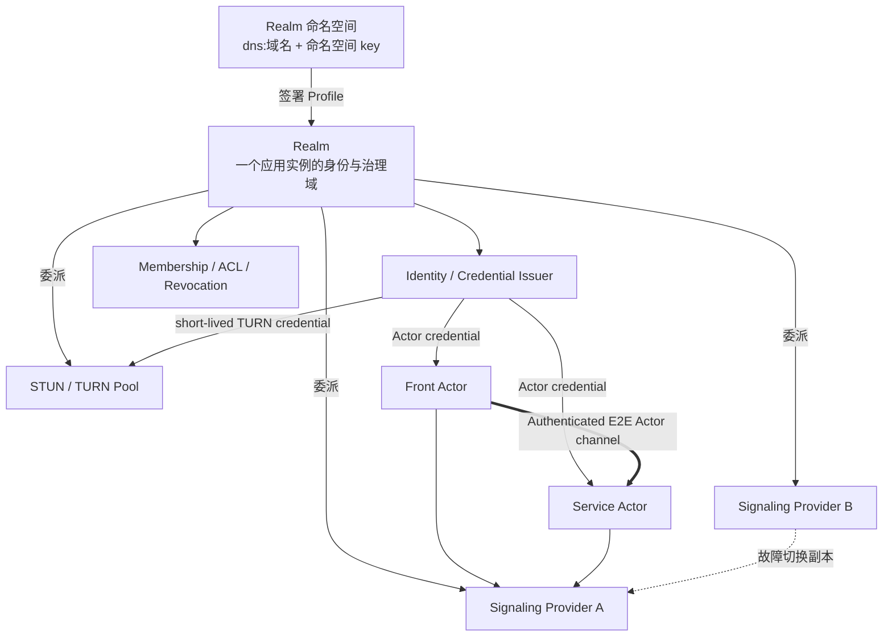

# 07. Realm、信令、TURN 与身份

## 1. 一张图看清关系



结论：

- Realm 对应一个应用实例：每创建一个应用实例，就创建一个 Realm；
- Realm 以「命名空间 + 本地名」命名，一个域名命名空间下可以有多个 Realm；
- Realm 与信令通常强绑定，但这种绑定是「信任和配置委派」，不是「一个 Realm 等于一台信令服务器」；
- 一个 Realm 可以委派多个信令集群；
- 一个 Provider（信令、STUN/TURN、issuer 等共享基础设施）承载大量 Realm；
- Realm 在创建时绑定一个 Provider，此后不可更换；同一 Provider 内部的机器与端点可以替换，Realm 身份和 ActorId 不变。

v1 中多个 signaling endpoint 必须属于同一个逻辑控制面，使用共享/复制的 presence，或按确定规则让所有 Actor 使用同一 active primary。它们是副本与故障切换入口，不是任意相互联邦的独立 Provider；跨 Provider federation 是后续协议。

## 2. Realm 的定义

### 2.1 Realm 是实例概念

Realm 是一个应用实例的逻辑信任和治理域。在 Actrium 中，Create Intent 创建 Primary Service 实例时，同时在所选命名空间下创建一个新 Realm；该实例的 Primary Service、它编排的 Auxiliary Actor，以及 Attach 到它的 Front，都属于这个 Realm。

Realm 不跟程序走：同一个 `notes.example/team-notes` 被 A 组织创建一次、被 B 组织创建一次，就是两个 Realm。Realm 也不是组织级成员域：一个组织运营多少个应用实例，就有多少个 Realm。

Realm 负责：

- 本实例的成员、设备和 Actor 准入；
- ActorId 命名空间；
- Actor credential 签发与续期；
- ACL、撤销与审计；
- 通过 Realm Profile 委派受信任的信令、STUN、TURN、issuer 端点；
- 为信令和 TURN 颁发短期、限 audience 的凭据。

v1 不做跨 Realm 规则与 federation；跨实例调用见 [06 §6.3](06-runtime-and-protocol.md)。

### 2.2 命名空间与本地名

Realm 借用命名空间命名。DNS 域名在现实中已经具备全局唯一性，且归属可验证；Realm 只使用这两点，不要求域名承载任何基础设施。

```text
Realm 命名空间 = dns:<domain> | local:<installation-id>
Realm          = 命名空间 + local_name
Realm 引用     = <local_name>~dns:<domain> | <local_name>~local:<installation-id>
例             = notes~dns:acme.com
```

- `domain` 为规范化 DNS 域名（小写 IDNA A-label，无 scheme、端口、userinfo 或 path），规则与 Publisher ID 相同；
- `local_name` 使用 DNS label 规则 `[a-z0-9-]`，1..63 字符，不以 `-` 开头或结尾；在命名空间内唯一，创建后不可修改；
- Actro 创建实例时默认生成完全随机的 `local_name`（如 `k7m2q9xh`，base32 小写，不含程序名），可读名称放在 Realm Profile 的 `display_name`；用户可在确认界面显式改用可读的 `local_name`（如 `notes`）。本文中的 `notes~dns:acme.com` 即显式选择可读名的例子；
- 已退役 Realm 的 `local_name` 永不复用：命名空间所有者不得复用，Provider 在本地以 tombstone 强制；
- DNS 命名空间的命名空间 key 是该命名空间下所有 Realm 的长期信任根；本机命名空间的 `installation-id` 由安装根 key 派生，本机 Realm 不使用 Profile（见 5.1）。

数值 `realm_id` 只是 Provider 内部的数据库句柄，不是 Realm 身份，不出现在 ActorId、Realm Profile、issuer 标识或跨 Provider 的比较中。

### 2.3 Realm、Publisher 与 Provider

| | Publisher | Realm | Provider |
|---|---|---|---|
| 是什么 | 程序的发布者 | 一个应用实例的信任域 | 共享基础设施 |
| 标识 | 规范化 DNS 域名 | 命名空间 + `local_name` | provider ID |
| 长期信任根 | Publisher key | 命名空间 key | 无（只持有被委派的 issuer key） |

每个 Realm 在创建时绑定一个 Provider，此后不可更换。需要换运营方时，在新 Provider 上新建实例并做应用层数据迁移，旧实例退役。

Publisher 域名命名程序（谁发布），Realm 命名空间命名部署（谁运营）。同一个包可以运行在 `notes~dns:acme.com`，也可以运行在 `notes~dns:foo.org`。一个 Provider（如 Actrix/Loran）承载来自多个命名空间的大量 Realm。

Realm 不是：

- Marketplace；
- Publisher；
- DNS 本身；
- 一个 WebSocket 进程或一台信令服务器；
- TURN RFC 中同名的认证字符串；
- Workspace；
- 组织或用户目录。

## 3. 命名空间描述与 Realm Profile

发现与信任分两级：每个域名在其 Actr authority descriptor 中发布一次命名空间描述，每个 Realm 一份由命名空间 key 签名的 Realm Profile。DNS Realm 命名空间就是不含端口的 Actr authority：`notes~dns:acme.com` 的命名空间即 `actr://acme.com`，与 [Actr URI](../../../actr/protocols/uri.zh.md) 中「同一 authority 可以运行多个 realm」一致。

### 3.1 命名空间描述

```text
GET https://<domain>/.well-known/actr
```

命名空间描述不是独立文件，而是 authority descriptor 中的两项内容，已在 [Actr Authority Discovery](../../../actr/protocols/authority-discovery.zh.md) §4.3–4.4 定义：

- 可选成员 `realm_namespace`：当前和历史命名空间 key 与 key id、轮换签名链、单调 `sequence`，以及整体 `signature`；
- core relation `realms`，protocol `actr-realm-profile/1`：`href` 指向 Realm Profile 服务。

`realm_namespace.signature` 由某个 `active` 命名空间 key 对去掉 `signature` 后的 `realm_namespace` 成员做 RFC 8785 JCS 规范化后签名，覆盖 `sequence`，在固定命名空间 key 之后提供回滚保护。authority descriptor 的其余部分仍是无签名的公开文档。

规则：

- 获取、HTTPS、authority 绑定校验、redirect 与大小上限均以 Authority Discovery 为准；不得使用 `/.well-known/actr` 下的任何子路径；
- 每个域名只发布一次，之后在该域名下创建 Realm 不需要再改动域名；
- 首次信任来自 Web PKI 或企业预置的命名空间 key pin；descriptor 内的签名不能自证首个 root；
- 命名空间 key 轮换时，旧 key 签名 `{from, to, public_key, sequence}` 形成轮换链；没有有效轮换链的 key 变化按身份变化处理，必须重新确认信任；
- 从 `keys` 中移除某个 key 即吊销它签过的一切：客户端与 Provider 以刷新 Profile 的节奏刷新 `realm_namespace`，已接受 Profile 的签名 key 被移除时，丢弃该 Profile 及其 `sequence` 基线，改用最后一份由仍列出的 key 签名的 Profile（没有则重新获取）；
- descriptor 中已有的 `signaling`、`identity`、`ice-config` 等是该 authority 的默认 Provider，只作为创建新 Realm 时的建议；某个 Realm 的实际委派只以其 Profile 为准。Realm Profile 取不到、验证失败或已退役时，客户端不得改用默认 Provider 与该 Realm 通信；
- descriptor 不列出 Realm 清单，避免实例被枚举。

### 3.2 Realm Profile

位置：

```text
GET <realms href>/<local_name>
```

`realms` 的 `href` 可以指向域名自己的静态托管（如 `https://acme.com/actr/realms`），也可以指向 Provider（如 `https://realms.provider.example/acme.com`，可带显式端口）；Realm Profile 也可以随邀请内嵌。Profile 的有效性只取决于命名空间 key 的签名，不取决于从哪里取到；因此 Provider 可以托管 Profile 而不成为信任根。

Profile 至少包含：

- schema（`actr.realm/v1`）；
- `namespace`、`local_name` 与显示名；
- `status`：`active` 或 `retired`；
- 单调 `sequence` 与签发时间 `issued_at`（Profile 不设过期时间）；
- issuer 标识 `actr:realm:<Realm 引用>:authority`、issuer URL、issuer keys/key ids；
- provider ID、signaling endpoints、STUN/TURN endpoints；
- credential audience；
- ACL/加入策略；
- 命名空间 key 签名。

Profile 使用 RFC 8785 JCS 规范化 payload 和 detached Ed25519 签名；签名 key 必须是 `active` 命名空间 key；由后来退役的 key 签发的既有 Profile 在被更高 `sequence` 取代前仍有效。Profile 不过期，回滚保护只依赖每个 Realm 的单调 `sequence`（相同 `sequence` 的内容必须完全一致）；客户端建立会话时或至少每 24 小时按 `realms` 位置刷新。`provider.id` 在 Realm 生命周期内不可变，客户端拒绝 `provider.id` 与已接受 Profile 不同的新 Profile。只包含非秘密信息。

生命周期：

- 创建与激活：管理请求以 `POST` 发往 Provider 自身 authority descriptor（`https://<provider_id>/.well-known/actr`）的 `realm-management` link。调用方以命名空间 key 签名的 `create_realm` 请求 Provider 创建 pending Realm，响应返回待签 Profile payload；调用方签名 Profile 后总是以 `activate_realm` 提交给 Provider，其响应即激活响应，一次性返回管理 token（Provider 自有命名空间由 Provider 自签，激活在内部完成）。幂等键为 `(namespace, local_name, 请求方)`：同一请求方对自己的 pending 或 active Realm 重试返回其状态（不返回管理 token）；不同请求方命中同名 Realm，或任何请求命中 tombstone，一律冲突；重复 `activate_realm` 返回冲突，丢失的管理 token 只能用 `reissue_admin_token` 取回（Provider 自有命名空间丢失 `create_realm` 响应时同样如此）；
- 更新：同一 Provider 下轮换 issuer key、变更端点、修改 `display_name` 或加入策略，均发布更高 `sequence` 的 Profile；
- 退役：退役只有一条路径，即命名空间所有者发布 `status = retired` 的新 Profile（保持相同 `provider.id`、`sequence` 更高），作为永久有效的 tombstone；Provider 通过周期刷新得知并写入本地 tombstone；若 Provider 已停服，命名空间所有者把 `realms` href 改指自控位置并在那里发布 retired Profile；Provider 自有命名空间随 Provider 一起消失，其中的 Realm 无法退役，只能在别处新建；
- 命名空间 key 全部丢失且没有可用轮换链时，该命名空间下的既有 Realm 都无法再签发后续 Profile。域名所有者只能发布新的命名空间 key（客户端按身份变化处理、重新确认信任），并在新 `local_name` 下重建实例。

创建授权（谁签 Profile）：创建 Realm 的请求与 Profile 都必须由命名空间 key 签名，因此能否创建取决于谁能使用这把 key。

- 本机命名空间：Actro 在本机直接创建，不涉及签名请求与 Profile；
- Provider 自有命名空间：由 Provider 运营方签名，个人用户在其中自助创建；用户以其在该 Provider 的账号认证（OAuth 2.0 授权码 + PKCE；descriptor 中 `identity` link 的 `href` 即 OAuth issuer，所有 Provider 接受固定公共 client ID `actr-host`），Provider 按账号计配额，Realm 管理权绑定该账号，换机或丢设备只需重新登录。Provider 能关联同一账号创建的实例（它本来就是签名方），实例成员看不到账号；
- 组织命名空间：由组织持有命名空间 key 的签名工具/服务按组织自己的策略认证成员后，代签创建请求与 Profile；组织自建 Provider 时，也可以让自己的 Provider 持有命名空间 key，这仍是组织自己的基础设施。

v1 中个人用户只能在本机命名空间或 Provider 自有命名空间自助创建 Realm。由命名空间 key 签发受限的「创建委派 key」（限定 `local_name` 前缀、配额、有效期）属于后续能力。

### 3.3 ActorId 如何携带 Realm

当前 Actr ActorId 中的 Realm 只有一个 `u32`：

```text
2af01@42/notes.example:team-notes:1.4.2
```

新设备仅凭 `42` 无法知道：

- 去哪个命名空间取 Realm Profile 和 issuer key；
- 连哪个信令集群；
- Realm 42 是否与另一个 Provider 上的 Realm 42 冲突。

Actro v1 因而要求 ActorId 自带 Realm 引用：

```text
<serial_hex>@<local_name>~dns:<domain>/<publisher>:<program>:<version>
2af01@notes~dns:acme.com/notes.example:team-notes:1.4.2
2af01@h3x8p2wq~local:<installation-id>/notes.example:team-notes:1.4.2
```

早期草案中的 `2af01@42~dns:team.example/...`（数值 realm_id 加 authority）作废，数值 realm_id 由 `local_name` 取代。`service` 参数本身即可定位 Realm；Attach URI 不再长期保留第二个 `realm` 参数。当前只含 `u32` 的 ActrId 视为 legacy，导入时必须显式补足 Realm 引用并重写成 v1 标准形式，不能猜测。

## 4. 信令服务器的权力边界

### 4.1 它不是「纯公益、没有实权」

信令即使不承载应用明文，仍可以：

- 观察 ActorId、IP、上线时间和连接关系；
- 决定谁能注册、发现和交换协商信息；
- 延迟、丢弃、分区、限流或封禁；
- 返回恶意/错误 ICE candidate；
- 强迫更多流量走 TURN；
- 进行流量关联；
- 造成拒绝服务。

因此信令是重要控制面和元数据处理者，必须进入威胁模型。

### 4.2 它不应拥有的权力

正确设计后，信令不应能够：

- 伪造任意 Actor 身份；
- 解密 Actor 应用消息；
- 修改已认证的 offer/answer 而不被发现；
- 颁发任意 Realm credential；
- 获得 Workspace capability；
- 用 ActorId 绕过 Service ACL。

这些边界依赖：

- Realm-signed Actor credential；
- Actor 长期 key；
- 双方 challenge；
- SDP/ICE 与会话 nonce 的签名绑定；
- DTLS/SRTP/DataChannel E2E 保护；
- Service 层再次授权。

### 4.3 Signaling 的职责

- 在线 presence；
- ActorId 到当前连接的临时映射；
- 类型发现与候选排序；
- WebRTC offer/answer/ICE 交换；
- ACL 初筛；
- Provider failover；
- 网络状态事件。

它不负责保存 Service 业务状态。

## 5. Actro 是否内置信令

Actro 内置：

- Actr signaling client；
- Realm 命名空间描述与 Realm Profile resolver；
- issuer/credential client；
- STUN/TURN 配置和故障切换；
- 本地 Realm 的 loopback/embedded signaling；
- 诊断和状态 UI。

Actro 不写死：

- 唯一全球信令服务器；
- 唯一公益组织；
- 唯一 TURN；
- Publisher 自己的信令地址；
- 静态 TURN 密码。

### 5.1 本地 Realm

本机实例使用 `local:<installation-id>` 命名空间（`installation-id` 由安装根 key 派生），每个本机实例一个本地 Realm。本地 Realm 没有 Provider，不使用 Realm Profile 与签名请求，Actro 只保存本地 record。本机 Front 与本机 Service：

- 优先使用 in-process/loopback transport；
- embedded signaling 只处理本地 Realm；
- 不需要公网 STUN/TURN；
- 离线可用；
- ActorId 仍是持久身份，并包含 `~local:<installation-id>` Realm 引用；
- 只有同一 installation 可以解析该 Realm；
- 「复制 portable link」必须禁用；迁移到 DNS 命名空间即创建新 Realm，并签发新 ActorId。

### 5.2 联网 Realm

联网实例的 Realm 位于某个 DNS 命名空间下：

- 用户或组织管理员先信任该命名空间（首次确认并固定命名空间 key）；
- 创建实例时，Actro 在该命名空间下创建新 Realm，Realm 所有者即实例创建者；
- 其他用户通过邀请加入这个实例的 Realm，取得该 Realm 的 membership；
- Actor 运行时使用 Profile 中的 Provider，该 Provider 在 Realm 生命周期内不变；
- Profile 与命名空间描述的更新都必须验证签名、轮换链和 `sequence`。

没有自己域名的用户可以使用 Provider 运营方的命名空间（如 `dns:realms.provider.example`）。此时命名空间 key 由 Provider 运营方托管，信任根即 Provider 运营方，Actro 必须如实显示。

## 6. Actor 身份

### 6.1 身份材料

Service Actor 身份至少由以下组成：

```text
ActorId
+ Actor long-term public key
+ Realm-signed Actor credential/certificate
+ private key proof
```

设备在每个 Realm 使用独立的设备 key（由设备根 key 按 Realm 引用派生，或独立生成），不跨 Realm 复用，不同实例无法据设备 key 关联同一设备。credential 中的 principal/device binding 绑定的是该 Realm 的设备 key。

Credential claims 应包含：

- ActorId；
- Realm；
- ActorType；
- actor public key；
- principal/device binding；
- issuer/key id；
- issued/expiry；
- audience；
- capability/role；
- revocation handle。

可选的受管客户端证明另行包含：

- platform app attestation；
- Actro 发行签名/版本；
- device management claim；
- attestation nonce 和有效期。

没有这类证明时，Realm credential 不证明设备正在运行官方 Front Host，Service 必须按不受信客户端处理。

### 6.2 持久 ActorId

Service Actor 的长期私钥和 ActorId 在创建事务中一次生成/签发并持久化。

以下操作必须保持 ActorId：

- Actro/Service 进程重启；
- credential 正常续期；
- renewal token 丢失后的重新认证，只要能证明同一长期 key；
- signaling reconnect；
- endpoint/IP 变化；
- P2P 与 TURN 切换；
- Realm 内主机迁移。

以下操作产生新 ActorId：

- 创建新 Service；
- Service 升级为新 Program Release（新 Service Actor 仍创建在同一 Realm，成员与 ACL 延续）；
- 迁移到另一个 Realm（包括从本地命名空间迁到 DNS 命名空间）；
- 长期 key 被撤销且不能恢复；
- 显式 clone/fork。

Actr 当前 hard rebind 可能返回新 ID。v1 前必须新增「凭长期 key reclaim 原 ActorId」的协议，并持久化 identity/renewal state。

### 6.3 ID 分配

Realm 必须保证 serial 在自身命名空间内永久不复用：

- 使用带唯一约束的 Realm allocator；
- 或使用足够强的 key-derived/随机 ID 并做碰撞检查；
- 不能依赖 hostname/PID 哈希的弱 worker id 就宣称无条件唯一；
- 撤销 Actor 后 serial 仍保留 tombstone；
- Realm 与 Provider 永久绑定，serial 始终由同一 Provider 分配。

### 6.4 Host 证据身份

Host 为 workload 出口闭包提供证据时，必须使用独立、可验证的 Host 证据键：

- Local Realm 由当前安装根绑定，只对本安装构成信任；
- 联网 Realm 可以把 Host key 绑定到 device credential；
- 受管场景可以进一步绑定 platform/runtime attestation；
- Host 证据键撤销必须使依赖该键的尚未过期结论立即失效；
- Host 不得自签自己的最终 `ActorAssurance`；
- Actor 自身的长期 key 不能冒充 Host 证据键；
- signaling 只能转发结论摘要，不能签发 workload kind、egress closure 或图完整性主张。

远端验证方根据自身策略决定是否信任该 Host 的证据。没有被接受的 `ActorAssurance` 时，身份仍可能 authentic，但节点结论不得为 `CONTROLLED`。

## 7. 身份验证流程

### 7.1 信任命名空间与加入实例 Realm

信任命名空间（每个命名空间一次）：

1. 按 Authority Discovery 获取 `https://<domain>/.well-known/actr`，读取 `realm_namespace`；
2. 用户/组织管理员确认命名空间；
3. Actro 固定命名空间 key，建立命名空间 record。

加入某个实例的 Realm（每个实例一次）：

1. 从邀请或 `service` ActorId 得到 Realm 引用；邀请可以内嵌 Realm Profile；
2. 获取 Realm Profile，验证命名空间 key 签名、`sequence` 与 `status`；
3. 设备为该 Realm 派生或生成独立的设备 key；principal/device 按该 Realm 的加入策略完成邀请或登录；
4. Realm 签发 membership credential；
5. 设备安全存储保存 key/refresh material；
6. Actro 建立 Realm record。

加入 Realm 只针对这一个实例；用户使用多个实例时，Actro 自动完成各 Realm 的设备注册，每个 Realm 使用不同的设备 key。命名空间级 SSO/目录属于后续能力，v1 不做。

membership 与实例授权是两层：Realm membership 只决定能否进入该实例的网络，即取得 Actor credential、连接 signaling、进行 Attach 握手的前提；实例内的角色与权限（读写、管理、分享）仍由 Service ACL 与会话授权决定。两者即使同属一个实例也不合并，取得 membership 不等于获得任何实例内权限。

### 7.2 Actor 注册

1. Host 生成或读取 Actor长期 key；
2. 请求新 ActorId 或 reclaim 已有 ActorId；
3. issuer 验证 membership、ActorType 和允许的 claim；需要受管 runtime 时另验 platform attestation；
4. issuer 签发短期 Actor credential；
5. Actor 使用短期 ticket 连接 signaling；
6. signaling 验证 issuer、audience、ActorId 和 proof。

### 7.3 Peer handshake

1. 信令交换已签名协商数据；
2. WebRTC/transport 建立；
3. 双方验证 Realm credential 与 Actor key；需要时再验证独立 runtime attestation；
4. challenge/nonce 防止重放；
5. Front–Service Attach 再验证 Program digest 与 session ACL；
6. 成功后 Guest capability 才可用。

## 8. 信令认证凭据

认证材料不得放在长期 URL query：

- query 会被代理、日志、浏览器历史和监控系统记录；
- 即使是签名，它在有效期内也可能具有可重放价值。

目标方案：

- WebSocket `Authorization` header；或
- issuer 签发的一次性、极短期 signaling ticket；
- ticket 绑定 ActorId、endpoint audience、nonce 和到期；
- 成功连接后立即作废；
- 日志只记录 ticket key id，不记录值。

`actr://` URI 中永远不携带 signaling ticket。

## 9. STUN/TURN

### 9.1 两个 Realm 不是一回事

- **Actr Realm**：产品身份和治理域。
- **TURN REALM**：TURN 长期凭据算法中的认证域字符串。

它们可以使用相同域名方便运维，但协议含义不同，不能在代码和文档中复用同一个类型。

建议命名：

```text
ActrRealmId
TurnAuthRealm
```

### 9.2 TURN 凭据

必须：

- 短期；
- 绑定 Actor/会话或 principal；
- 绑定 TURN pool audience；
- 有到期、带宽、并发 allocation 配额；
- 由 Realm issuer 或其授权 credential broker 签发；
- 支持 key id 和轮换；
- 不使用跨所有 Realm 的单一长期 shared secret；
- 不允许匿名开放中继。

### 9.3 TURN 的权力

TURN 通常看不到 DTLS/SRTP/DataChannel 明文，但可以看到：

- 两端 IP；
- 时间、流量大小和持续时间；
- allocation；
- 中继关系。

它也可以丢包、限速、拒绝或记录流量。因此 Realm 必须明确其 TURN Provider 和隐私政策。

## 10. Provider 委派与故障切换

Realm Profile 可以声明多个 endpoint：

```json
{
  "signaling": [
    {"url": "wss://signal-a.realm.example:443/ws", "priority": 10},
    {"url": "wss://signal-b.provider.example:8443/ws", "priority": 20}
  ],
  "ice": [
    {"urls": ["stun:stun.realm.example:3478"]},
    {"urls": ["turns:turn.provider.example:5349"], "credential_audience": "turn-pool-1"}
  ]
}
```

规则：

- endpoint 域名可以不同于 Realm 命名空间的域名；
- 由命名空间 key 签署的 Realm Profile 构成委派授权；
- Profile 的托管位置不影响其有效性；
- 非默认端口允许；
- endpoint 切换不改变 Realm 或 ActorId；
- failover 不能跳到未声明 Provider；
- Provider 证书和 ticket audience 必须匹配。

## 11. 端口政策

| 场景 | 端口政策 |
|---|---|
| `actr://` Publisher identity | 不允许端口 |
| Publisher Profile bootstrap | 固定 authority 域名的 HTTPS 443 |
| 默认 Release bootstrap | 固定 Publisher 域名的 HTTPS 443 |
| Profile 委派的 resolver/CDN/issuer | 可显式端口，必须 HTTPS |
| Realm 命名空间（authority descriptor `/.well-known/actr`） | 固定命名空间域名的 HTTPS 443 |
| Realm Profile | `realms` relation 声明的 HTTPS 位置，可显式端口 |
| Signaling WSS | 可显式端口 |
| STUN/TURN | 按协议显式端口 |
| `actr-dev://` | 可含端口 |
| localhost/private CA | 仅开发/企业显式策略 |

这样既保留部署自由，又不把网络端口变成产品命名空间。

## 12. 信任链

| 信任链 | 根 | 验证对象 | 失败后 |
|---|---|---|---|
| Publisher/Package | DNS/TLS + Publisher key | package bytes/digest | 不加载程序 |
| Realm/Actor | DNS/TLS + authority descriptor 中的命名空间 key → Realm Profile → issuer key；Actor key | 对端身份/准入 | 不连接 Actor |
| Front Session | Service policy + challenge | 当前 Front/用户/lease | 不开放业务 RPC |
| Signaling/TURN | 命名空间 key 签署的 Realm Profile 委派 | 控制面与中继资源 | 切换或离线 |
| Marketplace | 市场签名/策略 | 审核与撤销信息 | 降低信任/阻止安装 |

任何一条链都不能替代其他链。

## 13. Offline 与失联

### 13.1 本地 Realm

- 已安装固定 digest 可离线运行；
- 本机 Actor credential 可以由 local issuer 恢复；
- loopback 不需要 TURN；
- 撤销只影响本机管理。

### 13.2 联网 Realm

Realm Profile、credential 或撤销信息不可达时：

- 已建立短期 session 可持续到 credential 到期；
- 不无限延长过期身份；
- 只读离线模式是否允许由 Program/Realm policy 声明；
- 新 Attach 默认失败关闭；
- 不能因为 Realm 失联创建同类型本地替代 Service。

## 14. 隐私

Realm/Provider 可以观察的元数据必须在隐私页说明：

- ActorId；
- IP；
- online/offline；
- 连接目标；
- P2P/TURN；
- 时间与流量规模。

最小化措施：

- 不把 Program route、Workspace 名或业务 payload发给信令；
- 使用短期 ticket；
- offer/answer 绑定并加密可加密部分；
- Provider 日志最小化和短保留；
- 允许企业自托管；
- 支持多个 Provider 和透明状态显示；
- authority descriptor 不列出 Realm 清单。

Realm 引用出现在 ActorId 和 URL 中，会暴露命名空间与实例名；Actro 默认生成完全随机的 `local_name`，避免名字被猜测和枚举；显式选择可读名时，应知晓它会随分享暴露。
