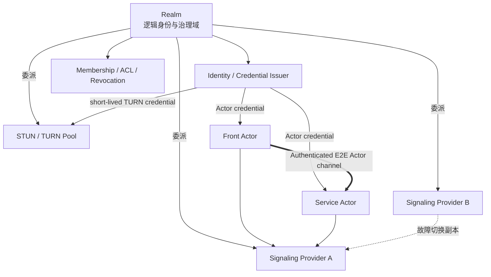

# 07. Realm、信令、TURN 与身份

## 1. 一张图看清关系



结论：

- Realm 与信令通常强绑定，但这种绑定是“信任和配置委派”，不是“一个 Realm 等于一台信令服务器”。
- 一个 Realm 可以委派多个信令集群；
- 一个信令集群可以为多个 Realm 服务；
- 物理 Provider 可以替换，Realm 身份和 ActorId 不应变化。

v1 中多个 signaling endpoint 必须属于同一个逻辑控制面，使用共享/复制的 presence，或按确定规则让所有 Actor 使用同一 active primary。它们是副本与故障切换入口，不是任意相互联邦的独立 Provider；跨 Provider federation 是后续协议。

## 2. Realm 的定义

Realm 是 Actr 的逻辑信任和治理域，负责：

- 成员、设备和 Actor 准入；
- ActorId 命名空间；
- Actor credential 签发与续期；
- ACL、撤销与审计；
- 发布受信任的信令、STUN、TURN、issuer 端点；
- 为信令和 TURN 颁发短期、限 audience 的凭据；
- 描述跨 Realm 规则。

Realm 不是：

- Marketplace；
- Publisher；
- DNS 本身；
- 一个 WebSocket 进程；
- TURN RFC 中同名的认证字符串；
- Workspace。

## 3. Realm Profile

### 3.1 域名入口

每个 Realm 使用可验证域名作为 Profile authority：

```text
GET https://<realm-domain>/.well-known/actrium-realm.json
```

该 bootstrap URL 必须使用 authority 域名和标准 HTTPS 443。只有 Profile 验证成功后，其中委派的 issuer、signaling、STUN/TURN endpoint 才可以使用其他域名和显式端口。

bootstrap 不跟随跨 Origin redirect；Realm 搬迁必须由旧 continuity key 签名轮换/迁移声明。

Profile 至少包含：

- schema version；
- Realm display name；
- 数值 `realm_id`；
- Realm authority domain；
- 当前和历史 Profile continuity keys；
- issuer URL；
- issuer keys/key ids；
- signaling endpoints；
- STUN/TURN endpoints；
- credential audience；
- ACL/加入策略；
- key rotation 与失效时间；
- Profile 签名。

首次信任来自 Web PKI 或企业预置 Realm root pin；Profile 内的签名不能自证首个 root。首次接受后，Profile 使用 RFC 8785 JCS 规范化 payload、detached Ed25519 签名、单调 `sequence`、有效期和旧 key 签名的轮换链提供连续性与回滚保护。

### 3.2 ActorId 如何携带 Realm

当前 Actr ActorId 中的 Realm 只有一个 `u32`：

```text
2af01@42/notes.example:team-notes:1.4.2
```

新设备仅凭 `42` 无法知道：

- 去哪个域名取 issuer key；
- 连哪个信令集群；
- Realm 42 是否与本机另一个 Realm 42 冲突。

Actrium v1 因而要求目标 ActorId 自带 authority；示意格式为：

```text
2af01@42~dns:team.example/notes.example:team-notes:1.4.2
```

联网 authority 为规范化 DNS 域名，本地 authority 为 `local:<installation-id>`。`service` 参数本身即可定位 Realm；Attach URI 不再长期保留第二个 `realm` 参数。当前只含 `u32` 的 ActrId 视为 legacy，导入时必须显式补足 authority 并重写成 v1 标准形式。

## 4. 信令服务器的权力边界

### 4.1 它不是“纯公益、没有实权”

信令即使不承载应用明文，仍可以：

- 观察 ActorId、IP、上线时间和连接关系；
- 决定谁能注册、发现和交换协商信息；
- 延迟、丢弃、分区、限流或封禁；
- 返回恶意/错误 ICE candidate；
- 强迫更多流量走 TURN；
- 进行流量关联；
- 造成拒绝服务。

因此信令是重要控制面和元数据处理者，必须进入威胁模型。

### 4.2 它不应拥有的权力

正确设计后，信令不应能够：

- 伪造任意 Actor 身份；
- 解密 Actor 应用消息；
- 修改已认证的 offer/answer 而不被发现；
- 颁发任意 Realm credential；
- 获得 Workspace capability；
- 用 ActorId 绕过 Service ACL。

这些边界依赖：

- Realm-signed Actor credential；
- Actor 长期 key；
- 双方 challenge；
- SDP/ICE 与会话 nonce 的签名绑定；
- DTLS/SRTP/DataChannel E2E 保护；
- Service 层再次授权。

### 4.3 Signaling 的职责

- 在线 presence；
- ActorId 到当前连接的临时映射；
- 类型发现与候选排序；
- WebRTC offer/answer/ICE 交换；
- ACL 初筛；
- Provider failover；
- 网络状态事件。

它不负责保存 Service 业务状态。

## 5. Actrium 是否内置信令

Actrium 内置：

- Actr signaling client；
- Realm Profile resolver；
- issuer/credential client；
- STUN/TURN 配置和故障切换；
- 本地 Realm 的 loopback/embedded signaling；
- 诊断和状态 UI。

Actrium 不写死：

- 唯一全球信令服务器；
- 唯一公益组织；
- 唯一 TURN；
- Publisher 自己的信令地址；
- 静态 TURN 密码。

### 5.1 本地 Realm

本机 Front 与本机 Service：

- 优先使用 in-process/loopback transport；
- embedded signaling 只处理本地 Realm；
- 不需要公网 STUN/TURN；
- 离线可用；
- ActorId 仍是持久身份，并包含 `local:<installation-id>` authority；
- 只有同一 installation 可以解析该 authority；
- “复制 portable link”必须禁用；迁移到 DNS Realm 会签发新 ActorId。

### 5.2 联网 Realm

加入组织或公共 Realm 时：

- 用户或管理员信任 Realm Profile；
- 获取 membership；
- Actor 运行时使用 Profile 中的 Provider；
- Provider 切换不改变 ActorId；
- Profile 更新必须验证签名和有效期。

## 6. Actor 身份

### 6.1 身份材料

Service Actor 身份至少由以下组成：

```text
ActorId
+ Actor long-term public key
+ Realm-signed Actor credential/certificate
+ private key proof
```

Credential claims 应包含：

- ActorId；
- Realm；
- ActorType；
- actor public key；
- principal/device binding；
- issuer/key id；
- issued/expiry；
- audience；
- capability/role；
- revocation handle。

可选的受管客户端证明另行包含：

- platform app attestation；
- Actrium 发行签名/版本；
- device management claim；
- attestation nonce 和有效期。

没有这类证明时，Realm credential 不证明设备正在运行官方 Front Host，Service 必须按不受信客户端处理。

### 6.2 持久 ActorId

Service Actor 的长期私钥和 ActorId 在创建事务中一次生成/签发并持久化。

以下操作必须保持 ActorId：

- Actrium/Service 进程重启；
- credential 正常续期；
- renewal token 丢失后的重新认证，只要能证明同一长期 key；
- signaling reconnect；
- endpoint/IP 变化；
- P2P 与 TURN 切换；
- Realm 内主机迁移；
- Realm Provider 替换。

以下操作产生新 ActorId：

- 创建新 Service；
- Service 升级为新 Program Release；
- 迁移到另一个 Realm；
- 长期 key 被撤销且不能恢复；
- 显式 clone/fork。

Actr 当前 hard rebind 可能返回新 ID。v1 前必须新增“凭长期 key reclaim 原 ActorId”的协议，并持久化 identity/renewal state。

### 6.3 ID 分配

Realm 必须保证 serial 在自身命名空间内永久不复用：

- 使用带唯一约束的 Realm allocator；
- 或使用足够强的 key-derived/随机 ID 并做碰撞检查；
- 不能依赖 hostname/PID 哈希的弱 worker id 就宣称无条件唯一；
- 撤销 Actor 后 serial 仍保留 tombstone。

### 6.4 Host 证据身份

Host 为 workload 出口闭包提供证据时，必须使用独立、可验证的 Host 证据键：

- Local Realm 由当前安装根绑定，只对本安装构成信任；
- 联网 Realm 可以把 Host key 绑定到 device credential；
- 受管场景可以进一步绑定 platform/runtime attestation；
- Host 证据键撤销必须使依赖该键的尚未过期结论立即失效；
- Host 不得自签自己的最终 `ActorAssurance`；
- Actor 自身的长期 key 不能冒充 Host 证据键；
- signaling 只能转发结论摘要，不能签发 workload kind、egress closure 或图完整性主张。

远端验证方根据自身策略决定是否信任该 Host 的证据。没有被接受的 `ActorAssurance` 时，身份仍可能 authentic，但节点结论不得为 `CONTROLLED`。

## 7. 身份验证流程

### 7.1 加入 Realm

1. HTTPS 获取 Realm Profile；
2. 用户/管理员确认 Realm；
3. principal/device 完成登录或邀请；
4. Realm 签发 membership credential；
5. 设备安全存储保存 key/refresh material；
6. Actrium 建立 Realm record。

### 7.2 Actor 注册

1. Host 生成或读取 Actor长期 key；
2. 请求新 ActorId 或 reclaim 已有 ActorId；
3. issuer 验证 membership、ActorType 和允许的 claim；需要受管 runtime 时另验 platform attestation；
4. issuer 签发短期 Actor credential；
5. Actor 使用短期 ticket 连接 signaling；
6. signaling 验证 issuer、audience、ActorId 和 proof。

### 7.3 Peer handshake

1. 信令交换已签名协商数据；
2. WebRTC/transport 建立；
3. 双方验证 Realm credential 与 Actor key；需要时再验证独立 runtime attestation；
4. challenge/nonce 防止重放；
5. Front–Service Attach 再验证 Program digest 与 session ACL；
6. 成功后 Guest capability 才可用。

## 8. 信令认证凭据

认证材料不得放在长期 URL query：

- query 会被代理、日志、浏览器历史和监控系统记录；
- 即使是签名，它在有效期内也可能具有可重放价值。

目标方案：

- WebSocket `Authorization` header；或
- issuer 签发的一次性、极短期 signaling ticket；
- ticket 绑定 ActorId、endpoint audience、nonce 和到期；
- 成功连接后立即作废；
- 日志只记录 ticket key id，不记录值。

`actr://` URI 中永远不携带 signaling ticket。

## 9. STUN/TURN

### 9.1 两个 Realm 不是一回事

- **Actr Realm**：产品身份和治理域。
- **TURN REALM**：TURN 长期凭据算法中的认证域字符串。

它们可以使用相同域名方便运维，但协议含义不同，不能在代码和文档中复用同一个类型。

建议命名：

```text
ActrRealmId
TurnAuthRealm
```

### 9.2 TURN 凭据

必须：

- 短期；
- 绑定 Actor/会话或 principal；
- 绑定 TURN pool audience；
- 有到期、带宽、并发 allocation 配额；
- 由 Realm issuer 或其授权 credential broker 签发；
- 支持 key id 和轮换；
- 不使用跨所有 Realm 的单一长期 shared secret；
- 不允许匿名开放中继。

### 9.3 TURN 的权力

TURN 通常看不到 DTLS/SRTP/DataChannel 明文，但可以看到：

- 两端 IP；
- 时间、流量大小和持续时间；
- allocation；
- 中继关系。

它也可以丢包、限速、拒绝或记录流量。因此 Realm 必须明确其 TURN Provider 和隐私政策。

## 10. Provider 委派与故障切换

Realm Profile 可以声明多个 endpoint：

```json
{
  "signaling": [
    {"url": "wss://signal-a.realm.example:443/ws", "priority": 10},
    {"url": "wss://signal-b.provider.example:8443/ws", "priority": 20}
  ],
  "ice": [
    {"urls": ["stun:stun.realm.example:3478"]},
    {"urls": ["turns:turn.provider.example:5349"], "credentialAudience": "turn-pool-1"}
  ]
}
```

规则：

- endpoint 域名可以不同于 Realm domain；
- Realm Profile 的签名构成委派授权；
- 非默认端口允许；
- endpoint 切换不改变 Realm 或 ActorId；
- failover 不能跳到未声明 Provider；
- Provider 证书和 ticket audience 必须匹配。

## 11. 端口政策

| 场景 | 端口政策 |
|---|---|
| `actr://` Publisher identity | 不允许端口 |
| Publisher Profile bootstrap | 固定 authority 域名的 HTTPS 443 |
| 默认 Release bootstrap | 固定 Publisher 域名的 HTTPS 443 |
| Profile 委派的 resolver/CDN/issuer | 可显式端口，必须 HTTPS |
| Realm Profile bootstrap | 固定 authority 域名的 HTTPS 443 |
| Signaling WSS | 可显式端口 |
| STUN/TURN | 按协议显式端口 |
| `actr-dev://` | 可含端口 |
| localhost/private CA | 仅开发/企业显式策略 |

这样既保留部署自由，又不把网络端口变成产品命名空间。

## 12. 信任链

| 信任链 | 根 | 验证对象 | 失败后 |
|---|---|---|---|
| Publisher/Package | DNS/TLS + Publisher key | package bytes/digest | 不加载程序 |
| Realm/Actor | Realm key + Actor key | 对端身份/准入 | 不连接 Actor |
| Front Session | Service policy + challenge | 当前 Front/用户/lease | 不开放业务 RPC |
| Signaling/TURN | Realm Profile 委派 | 控制面与中继资源 | 切换或离线 |
| Marketplace | 市场签名/策略 | 审核与撤销信息 | 降低信任/阻止安装 |

任何一条链都不能替代其他链。

## 13. Offline 与失联

### 13.1 本地 Realm

- 已安装固定 digest 可离线运行；
- 本机 Actor credential 可以由 local issuer 恢复；
- loopback 不需要 TURN；
- 撤销只影响本机管理。

### 13.2 联网 Realm

Realm Profile、credential 或撤销信息不可达时：

- 已建立短期 session 可持续到 credential 到期；
- 不无限延长过期身份；
- 只读离线模式是否允许由 Program/Realm policy 声明；
- 新 Attach 默认失败关闭；
- 不能因为 Realm 失联创建同类型本地替代 Service。

## 14. 隐私

Realm/Provider 可以观察的元数据必须在隐私页说明：

- ActorId；
- IP；
- online/offline；
- 连接目标；
- P2P/TURN；
- 时间与流量规模。

最小化措施：

- 不把 Program route、Workspace 名或业务 payload发给信令；
- 使用短期 ticket；
- offer/answer 绑定并加密可加密部分；
- Provider 日志最小化和短保留；
- 允许企业自托管；
- 支持多个 Provider 和透明状态显示。
