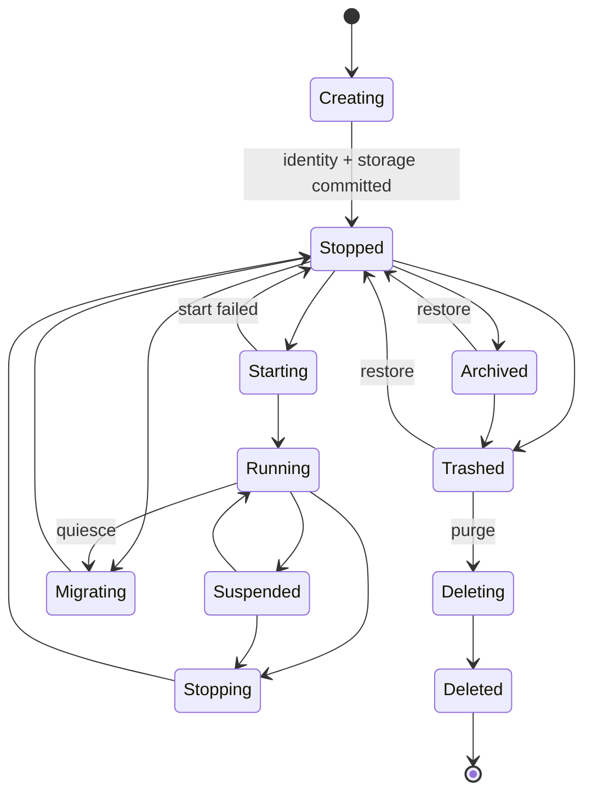

# 08. WorkspaceLife cycle and local storage

## 1. Workspace Return Service

Core rules:

> Service Actor Tie Workspace, Front Actor Only pass Service ActorId (a) Connection;Front I don't need to know. Workspace ♪ And the path,Workspace Provider credential Or lock.

This is not an addition to abstraction, but rather a consolidation of local files, cloud dishes, databases and remote warehouses. Service Available capability.

## 2. WorkspaceBinding

```json
{
  "workspaceId": "ws_...",
  "displayName": "Team Notes",
  "provider": "local-folder",
  "locator": "<host-owned opaque locator>",
  "accessMode": "read-write",
  "credentialRef": "keychain://...",
  "leasePolicy": "exclusive-writer",
  "createdAt": "2026-07-29T10:00:00Z"
}
```

Guest Visible launch context Only include:

```json
{
  "workspace": {
    "displayName": "Team Notes",
    "mode": "read-write"
  }
}
```

It shall not include:

- Original absolute path;
- bookmark/security-scoped token;
- cloud OAuth token;
- encryption key;
- Workspace Provider internal id(unless it is not per se sensitive and contractually required).

## 3. Workspace Statement

Workspace From the cross-sectioned field description:

| Dimensions | Value | Meaning |
|---|---|---|
| requirement | `none` / `optional` / `required` | Is there a user need WorkspaceAnd when must it be bound? |
| provisioning | `managed` / `user-selected` | By Actro Create, or choose by the user |
| access | `read-only` / `read-write` | Service Visiting capacity acquired |
| providers | Group Workspace Provider Type | Allow `managed-store`, `local-folder`, `cloud-drive` Waiting for it to happen |

`requirement=none` Time Service The example is still available for private use store, but not available for users Workspace.`requirement=required` with `provisioning=managed` It can come at once. It means creation. Service Time Actro Automatically create a requirement Workspace.

Writing parallel strategy:

- `exclusive-writer`: v1 Default;
- `shared-readers`: Multiple Service (a) Readable;
- `versioned-collaboration`: Future by Workspace Provider/Procedural agreement is achieved;
- Ban multiple writtens if not declared Service Tie Same Workspace.

## 4. Service Life cycle



This diagram only shows lifecycle.Service Inventory Separate records must also be kept of:

- desired state: `running`, `stopped` or `archived`;
- reachability: `online`, `offline`, `unreachable` or `unknown`;
- health: `healthy`, `degraded`, `failed` or `unknown`;
- attachment: `idle`, `leased` or `occupied`;
- placement: `local` or `remote`.

Launch failure as lifecycle Back `stopped` and health=`failed`Instead of creating a life cycle and a health level. `Error` Status.

### 4.1 Creating

Create is a Zen etc. for the user; internal must be used durable saga Submitted in turn:

- Program Release reference;
- Actor long-term key;
- persistent ActorId;
- Realm credential state;
- per-instance data directory;
- WorkspaceBinding;
- permission grant;
- Service Inventory record.

Any failure compensates for uncommitted resources; once an ActorId has been issued, it must not pretend to "fully roll back": it must keep a recovery record or a local instance tombstone, and the identity must never be reused.

### 4.2 Running

- Service Accept Attach;
- ActorId Online;
- Workspace lease (a) Effective;
- workload digest (b) Fixed;
- runtime health Observable.

### 4.3 Stopped

- ActorId It's still on. Service;
- identity/key, Workspace binding and store Reservations;
- signaling presence offline;
- Local Service Manager Knows it's stopped, so this is the machine. Attach You can return.“Stopped/Enabled”;
- Remotely only reports when host control provides signature status stopped; otherwise observers will only get offline/unreachable;
- Actor (a) cannot respond to a request after self-stopping, and the start-up operation is performed under host control;
- User has host management capability can be activated at the host device.

### 4.4 Suspended

Mobile platforms or energy-saving strategies are temporarily frozen:

- (a) The operational state can be restored;
- (b) Not undertake to receive requests in real time;
- lease Conduct by Platform and Service policy Decisions;
- Far Front Show suspendedInstead of creating another example.

### 4.5 Trashed

- Service Stops to hide from the default list;
- Actor credentialLong term keyExamples store, snapshot and WorkspaceBinding Reservations;
- Default saving period is 30 God, it's a man who can be run by him. policy Adjustments;
- Recovery must return to the same. ActorId;
- Unable to use normal during wastebin Attach, but owner It can be restored or fully removed before it is ready.

### 4.6 Deleted

- Undo Actor credential;
- Keep a local instance tombstone (including the ActorId) permanently;
- Remove instance store and key;
- Workspace Default not to delete;
- Workspace The deletion requires independent and explicit confirmation;
- Audit records may be exported.

Deleted Recover window only Trashed, cannot undo the private key and credential I'm still committed to it. ActorId Recoverable.

## 5. Tab with Service Life cycle separation

| Events | Front | Service | Workspace |
|---|---|---|---|
| New Tab | Create | Attach or Create | No change./Create binding |
| Refresh | Reconstruction | No change. | No change. |
| Tab Backstage. | pause/suspend | Continue or Platform suspend | No change. |
| Tab Close | destroy | No change. | No change. |
| Front crash | destroy/recreate | No change. | No change. |
| Actro Restart | Reconstruction | Restore Same ActorId | No change. |
| Service stop | detach | stopped | No change. |
| Service trash | detach | trashed, recoverable | No change. |
| Service purge | detach | deletedIt's not gonna come back. | Default Reservations |

## 6. Create Services

Local creation must be used durable intent:

```text
CreationIntent
├── idempotency_key
├── source_uri
├── program_release + digest
├── realm_name
├── workspace_selection
├── requested_permissions
├── stage
└── result_actor_id?
```

Phase:

```text
Prepared
→ PackageVerified
→ UserApproved
→ IdentityAllocated
→ StorageCommitted
→ ServiceStarted
→ URIRewritten
→ FrontAttached
→ Completed
```

Rule restored:

- (a) Each stage may be re-encumbered;
- `result_actor_id` Once written, you can't change it. ID;
- `StorageCommitted` And then even after that, UI Crashes. Examples of them. Inventory;
- URI The rewrite failed from result Rehabilitation;
- Failure does not leave a reusable semi-identity.

## 7. Service Storage

### 7.1 Directory isolation

Current Actr If you press only `ActrType` Build a directory of data that allows multiple entries of the same type Service Conflict. Target catalogue must be stable. ActorId Segregation:

```text
actro-data/
├── programs/
│   └── sha256/<package-digest>/
├── services/
│   └── <sha256(actor-id)>/
│       ├── instance.json
│       ├── actor-store/
│       ├── workload-state/
│       ├── snapshots/
│       └── logs/
├── workspaces/
│   └── <workspace-id>/...
└── db/
    └── actro.sqlite
```

Directory Name Use ActorId hashAvoid `/`, `:`(b) Length and case problems;`instance.json` Save Complete Standard ActorId.

### 7.2 Secure Storage

The following entry is the only entry. OS Keychain/Keystore/Credential Locker:

- device private key;
- Service Actor private key;
- Realm client keys;
- Workspace Provider credential;
- TURN/signaling ticket(Unusual memory only);
- encryption keys.

Normal SQLite Save Only opaque reference.

### 7.3 Database Table

Suggested minimum model:

```text
program_release
  publisher, program, version, digest, key_id, manifest, trust_state

service
  actor_id, actor_id_hash, publisher, program, version, digest,
  realm_name, workspace_id, runtime_location,
  lifecycle_state, desired_state, reachability, health,
  attachment_state, placement, created_at, last_opened_at

workspace
  workspace_id, display_name, provider, locator_ref,
  credential_ref, access_mode, lease_policy

permission_grant
  subject, capability, scope, decision, granted_at, expires_at

tab_session
  tab_id, uri, service_actor_id, front_actor_id, state,
  structure_digest, application_state_digest, application_color, ready

privacy_mark_cache
  mark_id, subject_ref, issuer_ref, workload_kind, egress_digest,
  issued_at, expires_at, revocation_state, encrypted_blob_ref

privacy_dependency_edge
  structure_digest, application_state_digest, edge_id, source_ref, target_ref,
  data_classes, target_mark_digest, decision, opened_at, closed_at

privacy_aggregate
  assurance_digest, tab_id, structure_digest, application_state_digest, policy_digest,
  mark, weakest_actor_ref, evidence_root, generated_at, expires_at

creation_intent
  intent_id, uri, stage, result_actor_id, timestamps

realm_domain
  domain, signing_keys, signing_keys_sequence, authority_descriptor_digest

realm
  realm_name, profile_digest, profile_sequence, provider_id,
  issuer_keys, membership_ref, client_key_ref
```

Service Table to Complete ActorId (a) Be the business key;`actor_id_hash` Only for indexing and directories.

`realm_domain` records each trusted Realm domain with its Realm signing keys (from the `realm_signing_keys` member in `https://<domain>/.well-known/actr`, defined in Actr Authority Discovery §4.4): the pinned keys (`signing_keys`, every key ever accepted) and the accepted `sequence` (`signing_keys_sequence`), which are refreshed with the Realm Profiles so that removed keys revoke the Realm Profiles they signed; `realm` records each instance Realm, where `profile_sequence` and `provider_id` are used to reject rolled-back Realm Profiles and Realm Profiles naming a different Realm Provider (both empty for a local Realm, which has no Realm Profile), and `client_key_ref` points to that Realm's own Realm client key (never reused across Realms). Neither uses the numeric realm_id, which is only an internal handle of the Realm Provider.

`ApplicationAssurance` It's a derivative of the current cut, no. Service . Cache expired,Tab Recalculation must be made after reconstruction, state or chart changes; presentation must also be made `Ready`Original attestation token Prefer to the long-term encryption cache or memory, and complete remote scaling, not for convenience UI The project is being implemented in the United States and is being implemented in the United States.

## 8. Program Catalog with Service Inventory Enduring

### Program Catalog Syncable

- coordinate;
- digest;
- Collections;
- Marketplace metadata;
- User installation preferences.

But other equipment still needs to be self-verified and downloaded. package.

### Service Inventory Carefully synchronized

Can sync:

- ActorId;
- Realm;
- Program Release;
- Display name;
- Remote host hint.

Can not blindly sync:

- Actor private key;
- Workspace credential;
- (a) Absolute local path;
- Unprotected Workspace Provider token.

If Service It only exists in one device, another. Inventory Record Display“Far/Host devices offline”, instead of trying to copy identity locally.

## 9. Workspace Lock and lease

### 9.1 Time-bound

Actro Workspace broker Inspection:

- Whether the same Workspace Provider locator already has a write lease;
- Workspace Provider Whether or not to support overwriting;
- Current Service (a) The availability of competence;
- Symbolic links, path crossing and security domain;
- Storage quotas;
- Workspace Provider Online status.

### 9.2 Run-time

- Service Just take it. brokered handle;
- All Paths Relative Workspace root;
- Atom Writing and fsync policy;
- symlink/hardlink (b) Escape protection;
- quota;
- write lease heartbeat;
- After the crash lease Restore/Expiry;
- Workspace Provider The conflict was clearly reported.

### 9.3 Retie

Workspace Do not change silently. Re-knit process:

1. (a) Stop new business writing;
2. (b) Generate consistent snapshots;
3. User Select New Workspace;
4. Verify New Workspace Provider;
5. Migration/Import;
6. Atomic Switch binding;
7. (a) Retain roll-back points;
8. Restore Service.

## 10. Snapshot, back-up and recovery

Snapshot Two floors:

- Service workload state;
- Workspace and Workspace Provider state.

Manifest To be declared snapshot schema version. The restoration must verify:

- Program coordinate/digest;
- snapshot schema;
- Workspace fingerprint;
- ActorId;
- Encryption key;
- Integrity hash.

Backup Actor Identity must be:

- Use Platform/(a) User-protected encryption;
- Prevention of the same ActorId (a) Started simultaneously by two host persons;
- From Recovery Realm Get Migration/Take over. lease;
- When completed, the old host is withdrawn from the operation.

## 11. Service Upgrade

v1 never modifies a Service's Program Release (its Actor type version) in place.

Upgrade is migration:

```text
Old Service ActorId + v1 Workspace
  → quiesce + snapshot
  → New Service ActorId + v2 workload (same Realm)
  → import/migrate
  → Workspace lease handoff
  → user verification
  → Old archived
```

Advantages:

- (b) The precise semantics of the version are not compromised;
- package digest (a) remain auditable;
- (a) Roll-back;
- New and old contract (a) Be able to coexist;
- URI I won't claim to be old. ActorId Has become a new type.

The new Service Actor is created in the same Realm as the original instance: the instance has not changed, Realm membership and application permissions carry over, and only the ActorId changes under the rules above.

The disadvantage is... ActorId Changes;Actro Update local collections and current Tab. Old links can be used to hint when local migration records are saved“Example moved”; other devices only see old examples offline/archivedUnless it's old Service Signing migration tips continue to be provided during rollback.Realm Level alias/redirect It's a follow-up capability, not here. v1 Quietly achieved.

## 12. Service Relocation of equipment

Machine migration within the same Realm and the same Program Release may keep the ActorId. A Realm is permanently bound to its Realm Provider; changing operators means creating a new instance on the new Realm Provider and migrating under the rules in this section. Migrating to another Realm (including from a local Realm to a Realm under a domain) must produce a new ActorId:

1. Access migration lease;
2. (b) Stop the new request from the old host;
3. Encryption Transfer Actor identity, store and Workspace capability;
4. New host certifying equipment and Actor key;
5. Realm Update presence;
6. New host start;
7. (a) A copy of the old host ' s key destruction;
8. Front Use original URI Reconnection.

Workspace If it was a local directory of used equipment, it would have to be moved alone or be accessible remotely.ActorId But moving doesn't mean Workspace Automatically.

## 13. Platform constraints

### macOS / Windows

- You can run local for long periods. Service manager;
- Available helper process;
- Available login entry/Backstage strategies;
- Users must be able to stop all backstages Service.

### iOS

- Local Service Key commitments Actro Available during the front desk;
- (a) Back-office tasks are subject to a system time frame;
- No commitment to continue signaling presence;
- Long-term online examples should host remote host(s) on desktop, server or supported;
- Workspace security-scoped access It must be correctly renewed and released.

### Android

- Front desk. Service/Notifications may extend the time available, subject to the Platform ' s policy;
- DozeThe Internet is not a good place to be used for this, but it is a good place to be used for this.
- User Select“Run on use only”;
- Not to limit failure to a system Actor Not there.

Products UI It has to be distinguished.“Stopped”“Suspended”“Actr Host offline”and“Actor not found”.

## 14. Delete and recoverability

Remove in two Service Phase and an independent data action:

1. **Move to Wastebin**: Stop and hide Service,Reserve Actor key, credentialExamples store/snapshot with WorkspaceBinding;defaults 30 Same as in days ActorId Restore.
2. **Cleared**: revoke the identity, delete keys and instance-private data, and record a permanent local instance tombstone; not recoverable.
3. **Delete Workspace**: Always a stand-alone high-risk action, not by default with the first two steps.

Before removal, list the private data of the example to be deleted, the external data to be retained Workspace And the consequences of recovery.Workspace If the document is explicitly deleted by the user, priority should be given to access Workspace Provider/OS Recycler; audit records do not contain business content.
