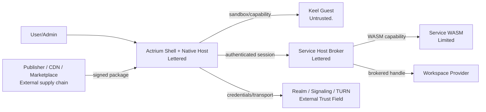

# 09. Security and privacy

> Privacy and security [docs/security](../../architecture/security/actrium/README.zh.md) is the applicable rule. Actrium Threats, privileges, sandboxes and secret management; colours and maps brought together [13](13-privacy-state-and-aggregation.md).

## 1. Security objectives

Actrium It is important to ensure that:

1. User knows which code runs from. Publisher; which unalterable version;
2. Publisher Guest Could not close temporary folder: %s Front Host;
3. Guest Only by declaration and authorization. capability;
4. Front Only business requests can be issued to the bounds. Primary Service;
5. ActorId It's coded. credential (a) Proof, not an oral statement by the messenger server;
6. Workspace secret, Actor key and session secret Do Not Enter URI;
7. Letter/TURN (a) Infrastructure considered to be equipped with metadata and usability rights;
8. One. Program/Tab/Service (b) Failure or excess of authority of the Party, if possible, does not affect other examples;
9. The security restrictions and true isolation intensity are expressed to the users in a true way.
10. Only the current pre-position is full `Ready` And all of them. `CONTROLLED` And then it's green. Green isn't the whole picture, and it doesn't deny the history leak.
11. Every network Actor edge It's... payload Yeah. signaling, TURN And normal relay Keep it secret and tie it to the real thing. Actor/runtime.
12. private/secret Expressly only for current policy The government has also been able to provide information on the situation in the country.

## 2. Trust borders



Lettered Actr Host There are still possible gaps;“Lettered”It is stated that it is within the platform ' s credible calculation base and does not imply that there is no need for an audit.

## 3. Assets

### High Value

- Workspace (a) Content;
- Actor Long-term private key;
- Realm membership/refresh material;
- Service Status and snapshot;
- Workspace Provider credential;
- user identity and application permissions;
- package signing key;
- Service session secret.

### Sensitive metadata

- ActorId;
- Program/Service Use of records;
- Realm membership;
- Realm names (which reveal the domain and instance name);
- IP, online time, connection;
- Workspace Display name and location;
- (a) The delegation of authority;
- crash/log.

## 4. Threat Subject

- It was malicious or broken. Publisher;
- It's been tampered with. package/CDN/Mirrors;
- Malicious. Keel Guest;
- Malicious. Service workload;
- It's bad or lost. Marketplace;
- Malicious. Realm, signaling or TURN Realm Provider;
- Other processes with equipment;
- The assailant with the right to do so;
- Stolen equipment;
- Malicious Link/Two-dimensional code./Web page call-up;
- Supply chain and dependence on attack;
- Domain name transfer,CA or DNS event.

## 5. Threats and primary control

| Threats | Control |
|---|---|
| Same version of the variant | coordinate→digest Fixed, bag-signed,equivocation hard fail |
| CDN/CacheView | HTTPS + package digest + Ed25519 |
| Zip slip/zip bomb | Path denied, number of files/Total/Compression ratio limit, atomic decompression |
| Guest require Any module | Build and install double white lists,runtime resolver fail-closed |
| Guest Direct networking | No Default fetch/socket;`host:net` capability + allowlist |
| Image Invisible networking/Bring your own header | ActriumSafeImage Only asset id Or controlled. URL |
| Guest Any Actor | Only exposure to fixed PrimaryService capability |
| Guest Counterfeiting Users/Permissions | Actr Host Attach Uncoverable session metadata |
| Guest Infinite Cycle | QuickJS interrupt timeout,Closable runtime |
| Guest Memory depletion | per-Guest heap cap, payload/render limits |
| Bridge/Component misuse | schemaComponent/props/event/RemoteRef White list |
| Service Run away. | WASM Component, import allowlist, fuel/memory/I/O quota |
| Workspace Path Passes | brokered root handle, path regularization,symlink policy |
| More Service Write simultaneously | exclusive writer lease |
| URL Batch creation | Confirm,creation intent Quotas, sources and flows |
| URL Discover Permissions | ActorId Not capability, URI None token |
| Actor Counterfeit | Realm credential, Actor key proof, challenge |
| Forged or rolled-back Realm Profile | Realm Profile must be signed by a pinned Realm signing key; first trust via Web PKI or enterprise pin; Realm signing key changes require a valid rotation chain; monotonic `sequence`, immutable `provider.id`, retired Realms rejected; Realm Profiles do not expire and clients refresh them periodically; a Realm Profile that cannot be fetched, fails verification or is retired must not lead to using any Realm Provider other than the Realm Profile's |
| Client disguised as official Actrium Front | Service Default not trusting client to achieve; controlled scenes are tested separately platform/runtime attestation |
| Malicious. Actor "Don't leak" self-report. | The person assessed cannot sign out for final `ActorAssurance`;a valid declaration by Actr Host Close |
| Service Concealing the support. Actor | No root map to find out; no green underage |
| WASM Declarations differ from actual exports | Comparison manifest, imports; valid declaration and actual side; confirmation of non-declaration of export `UNCONTROLLED` |
| Concurrent process Native Around broker | Third parties NativeCdylib Hold `UNKNOWN` or confirmed as `UNCONTROLLED`;no greening |
| signaling/TURN Observation or alteration payload | Actor Secure Envelope♪ Two-way identity and transcript (a) Tie;relay Not held payload key |
| Legal TLS Ended to Error workload | ActorId/runtime/credential/ephemeral key/attestation result channel binding |
| Cloud Administrator or Hypervisor Read Agent Express | secret policy Request TEE/CC;release data keys only after remote certification |
| Legal TEE Proof of being forwarded to malicious example | Evidence Tie nonce, Actor/runtime, workload digest, policy, audience and ephemeral key |
| Just... CPU TEE, GPU/NPU Still exposed. | CPU+Guest+driver+IOMMU/link+device firmware/memory composite attestation |
| Hardware vendor self-report ("supports confidential computing") | versioned Verifier adapter, vendor trust root, Reference Values, Endorsements, TCB Undo and Negative Test |
| CC Intra-negative. workload Active leak | CC No substitute WASM/Native confinement, egress closure with output control |
| Legal Actor Response to stolen tape secret | data-class schema, declassification capability, output size/Objective/Purpose gate |
| New Actor Data first and then verify | pending edge Sync gate;Mark Do not send business before passing payload |
| One down. AA Expired but green as a whole | `Ready` Require current pointer; no green display for expired |
| I'm not sure I'm gonna be able to do this. | The limit is not to cut and turn green. |
| Configure the old old rebirth Capability / Old conclusions | `ActorState.revision` Untouch incremental and enters the state root; roll back to get new `ActorStateDigest`Old bindings never match |
| Put the peer Actor It's a disguise. HTTPS ♪ Round and round ♪ Principal Rating | - I can show you. Actr Endpoint of identity must be pressed Actor Target rating; classification not determinable `UNKNOWN` |
| Call back local clocks to revive expired evidence, conclusions or documents | Time frame for the operator and the rating / No clocks can be called back for validity checks. |
| Letters are replayed. | One-time ticket, nonceShort period of validity |
| The candidate for the letter of the order. | Signing of data for consultation,peer identity handshake |
| TURN Open Agent | Short-term credential, audienceQuotas, non-hidden |
| Domain Name Synonym | IDNA Normative,A-label Display, Risk Tip |
| Domain Name Transfer | key history, digest pin, identity change UI |
| Local DB Leak | secret Just go in. Keychain/Keystore, DB Minimize |
| Log leak | redactionNone credential/payload/path, Retention policy |
| Front Concurrent process sandbox Run away. | Security code,fuzz, helper process Route, risk level |

## 6. Permission Model

### 6.1 Permission Subject

Permission to bind at least:

```text
publisher
+ program
+ major version
+ package digest or compatible release set
+ capability
+ scope
+ workspace/service
+ principal/client
```

Only name can be remembered by using program.

### 6.2 Decision-making on competence

Status:

- `allow-once`
- `allow-while-open`
- `allow-for-service`
- `allow-for-workspace`
- `deny`
- `admin-managed`

High-risk authority does not provide for permanent silence unless the organizational strategy is clearly managed.

### 6.3 Permission Upgrade

If the new version:

- Add capability;
- Expand domain allowlist;
- (a) From read-only to write-only;
- (b) Increase resource quotas;
- Allow Native Service;
- Change in the scope of data sharing;

It would have to be reconfirmed that the old version of the mandate could not be inherited.

### 6.4 Front with Service Separate authorization

For example:

```text
Front:
  clipboard.write
  notifications

Service:
  workspace.read-write
  net:https://api.example.com
  actor.call:example.com:indexer@1
```

Users can see which capacity is being implemented at the front desk, which is in the front desk. Service Host execution.

## 7. Keel Guest Clear.

### 7.1 Static Control

- package Allow only one declaration Guest entry;
- bundle parser Inspection import/require;
- Ban eval, Function constructor Non-physical dynamics import;
- capability manifest Consistent with the results of the source code analysis;
- bundle size, source map, character encoding limits;
- Ban External source URL;
- Customally modify the drop-off.

Static scans are the issuance of diagnostics, not the complete security boundary:`Function`Indirect `eval`, alias Call etc. must be made at the same time by runtime global policy, module loaders and capability (d) Quarantine restrictions.

### 7.2 Run-time Control

- Fixed QuickJS;
- No injection. fetch, WebSocket, filesystem, process, native module;
- Actr Host module dispatch Rejected without a declaration;
- input/output/event schema;
- deadline, rate limit, payload limit;
- timer/callback Cleaning;
- Guest console Structure and speed limit;
- destroy After All capability token Expiry.

### 7.3 Component control

Component props No, it's not.“Normal UI Data”It's automatic.Actrium Must check:

- URL and header;
- Documentation/asset reference;
- text and binary sizes;
- z-index/modal/focus (a) Conduct;
- accessibility;
- event Frequency;
- (a) Method calls;
- platform-specific escape hatch.

Default not provided WebViewAny HTML, any original component name or generic reflection.

## 8. Sandbox Security phase

The security centre shows the actual level:

| Level | Application | Segregation |
|---|---|---|
| S1 Same-process sandbox | v1 Keel JS Guest | Independence QuickJS runtime + capability + quota |
| S2 Worker/runtime isolation | Follow-up | Yeah. terminate worker + Independent memory movement |
| S3 OS process isolation | Desktop Long-Term Objectives | helper process/AppContainer/XPC |
| T1 Trusted Native | Actrium First party/Enterprise | Native workloadTrust. |

Don't put it in the car. S1 The case is written.“Process level segregation”.QuickJS Yes. C Engine,Actr Host/Bridge/The component layer leaks may still be crossing the language sandbox.

## 9. Service workload Clear.

Third parties WASM Service:

- Component Model Format validation;
- import allowlist;
- Ban ambient filesystem/network;
- Workspace Just give it to me. preopened capability;
- outbound domain, method, port policy;
- Actor dependency allowlist;
- fuel/epoch/wall timeout;
- memory/table/instance limit;
- mailbox/backpressure;
- snapshot schema;
- panic/trap (a) Only terminations;
- Call audit.

If procedural requirements native Service, the installation page must be displayed at a stand-alone high-risk level, and Marketplace Default rejection.

## 10. Networks and SSRF

All by package, Realm Profile or by user input URL It is necessary to:

- parse (a) Then verify;
- Only declaration allowed scheme;
- DNS Pre- and post-examining check loopback, private, link-local, multicast and metadata IP;
- Protection DNS rebinding;
- Control redirect Number and cross-domain;
- Not Forward Sensitive header To New origin;
- Limit ports;
- (a) Limit the response size and time;
- TLS hostname Validation;
- The exception to corporate private networking is authorized by a visible strategy.

Publisher package endpoint Available CDN, but CDN URL Not automatically Guest network allowlist.

## 11. Actor/Session Clear.

- ActorId I have to. public key and Realm credential (a) Tie;
- `ActorState` amend number one-to-one incremental; configuration rollback does not repeat old `ActorStateDigest`Old credential/Capability and will not be raised up.
- credential (b) Short-term, revocable;
- ServiceLong term key (b) Not being stored securely;
- signaling ticket One-time;
- Attach challenge (b) Two-way;
- session id Unpredictable;
- session metadata By Actr Host Add;
- lease The message is rejected after due date;
- replay/idempotency key (a) The window is clear;
- `service` URI mismatch Direct failure;
- Service offline No, no, no. fallback.

ActorType, Actr Host Version and package digest The client statement is not a valid one. runtime attestation;Service Data rights and operational mandates cannot be relied on in these self-reported fields.

## 12. Workspace Clear.

- Front/Guest No path;
- Service Use brokered handle;
- Workspace Provider credential (a) Independence;
- Path canonicalization;
- symlink/hardlink policy;
- Atom writing;
- quota;
- exclusive writer lease;
- (a) High-risk de-recognisations;
- snapshot Encryption;
- (b) Protection against double-hostages during migration;
- Delete Service Default not delete Workspace.

## 13. Secrets

Secret classification:

| Secret | Storage | Exposure range |
|---|---|---|
| Realm client key (generated separately per Realm; how Actrium generates it internally is not specified) | OS secure storage | Identity Manager |
| Service Actor key | OS secure storage | Service runtime bootstrap |
| Realm client key | OS secure storage | Realm Manager |
| signaling ticket | Memory | signaling clientOne time. |
| TURN credential | Memory | ICE stackShort term |
| Workspace credential | OS secure storage | Workspace broker |
| session secret | Front/Service Host Memory | Guest Not visible |

It is prohibited:

- URI;
- crash report;
- General logs;
- Guest config;
- Clipboard;
- (a) Unencrypted backup;
- query parameter.

## 14. Log, diagnosis and telemetry

### Local diagnosis

This could include:

- Standard error codes;
- ActorId;
- package digest;
- route (a) Name;
- timing/size;
- Realm endpoint;
- P2P/TURN Status.

Default does not contain:

- RPC payload;
- User text;
- Workspace Content or complete path;
- credential/ticket;
- authorization header;
- OAuth token;
- private key.

### Upload telemetry

- Default closes; uploads only when explicitly enabled by the user or organizer;
- ActorId Press installation to add salt hash;
- No, I'm not. publisher Private development URI;
- No, I'm not. Guest route/query (a) Content;
- No, I'm not. Workspace (a) Name;
- crash dump First redaction;
- (c) Clearly define the duration and use of the reservation.

## 15. Security update and undo

- Actrium Host Security update can require restart Front;
- package (a) Discontinuation of the hierarchy;
- Revoking a Realm issuer key or Realm signing key immediately affects new connections;
- Created session At the latest. credential/lease Term expires;
- compromised Publisher key (a) A historical and credible version of the text, judged by the time of signature and the scope of revocation;
- emergency blocklist (a) Signing, expiry and auditable;
- quarantine Reservations Workspace Export capability.

## 16. Privacy commitments

Actrium The user data flow depends on:

- Workspace Provider;
- Service host device;
- Realm;
- signaling/TURN;
- Publisher API;
- Marketplace.

Installation pages and security centres must be available“Where will the data go?”, instead of a general privacy switch.

A Realm name appears in shared URIs as part of the ActorId and reveals the Realm domain and the Realm label (`label`). By default Actrium generates a fully random `label` for each instance (containing no program name or user input); the human-readable name goes into `display_name` and never enters the ActorId. When the user explicitly chooses a readable `label`, the confirmation page and the pre-sharing UI should warn that it is exposed in links. Realm names and ActorIds look like email addresses (`k7m2q9xh@acme.com`); Actrium must never render them as `mailto:` links and should label them clearly as instance addresses. Each Realm uses a separate Realm client key, never reused across Realms, so different instances cannot correlate the same client by it. When the Realm signing key holder is a Realm Provider, the user signs in with a Realm Provider account to create; the Realm Provider can link the instances created by one account (it signs them anyway), but instance members never see the account.

## 17. Security development requirements

- URI/package/manifest/ActorId parser fuzz;
- Keel Bridge with Safe Components fuzz;
- WASM import validation;
- archive extraction property tests;
- session replay/lease tests;
- Realm signing key rotation chain, Realm Profile `sequence` rollback and Realm issuer key rotation tests;
- signaling/TURN credential leakage tests;
- capability policy differential tests;
- More Tab Resource segregation failure injection;
- Third-party penetration tests;
- Dependency SBOM and the scanning of loopholes;
- Signature key Operations Manual and incident runbook.

## 18. Application security

Applying privacy is not Publisher Self-reported a Boolean field.Actrium You have to press it. [13](13-privacy-state-and-aggregation.md) and [docs/security](../../architecture/security/actrium/README.zh.md) Processing:

- No root in the chart, by valid Actor `Transfer` (a) Formation;Front (a) Positioning only;
- WASM Adoption of the declaration + import / Effectiveness / (b) Export closed-convey measures;
- Third-party co-operation process Native No green; independence Native Capsule Only satisfaction. OS sandbox It's only possible to upgrade in a closed bag.
- If the channel is not valid, the channel is blocked and no rating is taken;
- Show green / Yellow / Red and shaving. `Ready`; hangs shall not be shown green;
- The new configuration will only be used for new data;
- (b) The same assessment of the weakest and prohibition of self-signature of final conclusions;
- Right Complete Actor The image is minimally disclosed, and no pounces are passed on to the top signaling Or default telemetry.

Green means only that the current level of readiness may be controlled, and does not mean that there are absolutely no loopholes in the code.
