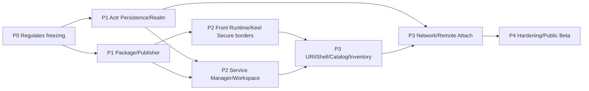

# 11. Delivery plan and feasibility

## 1. Feasibility conclusions

Overall **It's possible, but not just change. Actrium UI**.

The existing technology accumulation already covers most of the“Mechanisms”:

- Actr It's accurate. `ActorId` (a) Address;
- Actr Yes, it's pressed. `ActrType` (a) Discovery;
- Actr Yes. Realm, ACL, signaling, WebRTC, TURN;
- Actr Yes. Linked, NativeCdylib and WASM workload;
- Actr `.actr` Signed, signed,hash, resources and dependencies;
- Keel Existing Host/Guest, Bridge, contracts,JS sandbox and native component trees;
- Actrium Existing cross-platform Shell, Tab, share the running time and local sustainability base.

What is really missing is product-level invariacies and some key syntaxes:

1. Service ActorId (b) Permanent identity;
2. Publisher domain with package key (a) The formal chain of trust;
3. Realm Profile with Provider (a) Assignment;
4. Program/Service/Workspace Separation;
5. Fixed Front Native Host And controlled. Keel Guest;
6. `actr://` Create/Connectivity services;
7. Front–Service Attach/session Agreements;
8. Security component and capability broker;
9. per-instance storage;
10. Move the end honest life cycle.

## 2. Key Dependency Chart

Persistence ActorId It's the longest critical path. When it doesn't work,Attach URI, history, collection, re-launch and Service Inventory None of them can be delivered.

## 3. P0: Regulate freezing

### Objective

Turn the syntax of the product in this document into a cross-storey testable contract.

### Delivery

- `actr://` URI schema (a) with the test vector;
- Publisher Profile/Release schema;
- Actrium manifest extension schema;
- Realm Profile schema;
- persistent Actor identity lifecycle ADR;
- Front–Service session proto;
- ActorAssurance / ApplicationAssurance / EncGraph schema;
- privacy data-class, policy (a) The rules of convergence with the weakest;
- capability/permission taxonomy;
- Service/Workspace state machine;
- Steady error code registry;
- threat model.

### Exit Conditions

- Actrium, Actr, Keel Maintainer signatures for core nonvariable;
- schema (a) Version fields;
- create/attach/identity mismatch It's... golden tests Freezing;
- None“It's a decision. ActorId Stable”The problem of the suspense.

## 4. P1-A: Actr Durable identity and Realm

### Actr I'll change it.

1. ActorLong term key Models;
2. ActorId Text and wire model Include as Verifiable Realm authority;
3. New & & & & & & New reclaim ActorId Two paths to registration;
4. ActorId, renewal/identity state (a) Sustainability;
5. hard re-auth Keep Same ActorId;
6. Realm Internal serial Never again;
7. current endpoint/presence with logical ActorId Separation;
8. Realm Profile and issuer key discovery;
9. Actor credential Tie public keyand transcript/SDP challenge (a) Proof of private key holding;
10. signaling One-time ticket/header;
11. Provider Accreditation and failover;
12. per-Realm/TURN-pool key id (a) With rotation;
13. Publisher/manufacturer DNS Length and standardization;
14. Actor store namespace Accept instance identity;
15. Authenticator identification and signature `ActorAssurance`;
16. Actor spawn/call/stream/egress edge Observation;
17. `ActorStateId` / `ApplicationStateId` Subscriptions and withdrawals of dissemination system protocols.

### Must keep

- `Dest::Peer(ActrId)` (a) Accurate location;
- `ActrType + fingerprint` (a) Discovery;
- Realm default-deny ACL;
- workload lifecycle hooks;
- `.actr` verification;
- WebRTC state/fast path.

### Exit Conditions

- Same Service Re-starting,credential Extension,hard re-auth, signaling failover Back ID No change;
- Realm It's a replacement. signaling endpoint;
- ActorId reclaim Yes. key proof and conflict protection;
- legacy ephemeral identity The path will not be taken Actrium Service Use;
- Host It's practical. workload and Actor edge Generate Authenticable evidenceNo, no, no. Actor Can not hide the controlled side.

## 5. P1-B: Publisher with package

### Delivery

- Publisher Profile resolver;
- well-known release resolver;
- domain/IDNA normalizer;
- key history/rotation store;
- package digest pinning;
- Actrium manifest extension;
- Guest/contract/assets Inclusion `.actr` resource hash;
- content-addressed cache;
- zip safety policy;
- Marketplace metadata adapter;
- dev source adapter.

### Actr package Changes

- manufacturer Allow Normative Publisher domain;
- manifest Add Backwards Compatible `[actrium]` section;
- verifier Output typed Actrium metadata;
- binary Only support is allowed kind;
- resource hash, lock and proto Maintain;
- package signing key id Intercept Publisher Profile.

### Exit Conditions

- coordinate From Publisher Download a valid field name `.actr`;
- The same version of the variant is stabilized;
- Offline caches can be re-verifiable;
- package Can not replace folder: %s: No such folder Front Host.

## 6. P2-A: Front Runtime with Keel

### Actrium

- Every Tab Front Actor manager;
- fixed linked/native workload;
- verified Guest byte loader;
- Keel Engine Clear create/pause/resume/destroy;
- capability broker;
- session guard;
- resource accounting;
- Front Privacy Evaluator with aggregate subscription;
- crash page And diagnosis.

### Keel

- Support Host From Authenticated bytes Loading;
- fixed QuickJS provider config;
- Make it real and validate it. Native QuickJS `JS_SetInterruptHandler`/deadline;
- - Put it on. per-Guest heap limit Import runtimeand achieves credibility heap Diagnosis;
- strict bundle analysis;
- eval/dynamic import violation;
- capability manifest;
- callback/timer/destroy Testing;
- Safe Component schema Extension points;
- Disables default hidden network components.

### ActriumSafeComponents

- View/Text/Scroll/Input/Button/List/Image (a) The minimum set;
- props/event schema;
- asset-only Image Default;
- type-safe RemoteRef;
- render op quota;
- accessibility.

### Exit Conditions

- Malicious. Guest Cannot initialise Evolution's mail component. fetch/fs/arbitrary actor;
- Real Native QuickJS "Infinite cycle,heap Overstretch.render bomb List Tab(b) Segregation;
- Close/Reconstruction 10,000 None callback/capability Cross Tab Leakage;
- Security file is accurately marked as same-process sandbox;
- Front It is possible to position and draw conclusions in a strategic manner, and no nodes are shown green when they are unknown or cut in the ground.

## 7. P2-B: Service Manager with Workspace

### Delivery

- durable creation intent;
- Service Inventory store;
- stable identity bootstrap;
- per-instance directory;
- WASM Service runtime policy;
- Workspace broker;
- exclusive writer lease;
- stop/start/archive/trash/restore/purge;
- snapshot/restore;
- local Realm;
- platform runtime adapters;
- Service subtree privacy aggregate;
- Actor/terminal egress evidence.

### Exit Conditions

- Multiple in Same Type Service (a) Full isolation;
- Restart same ActorId;
- The same wastebin is available ActorId Recover it. Clear it completely. Workspace;
- Create Any Stage crash (a) Not repeat;
- Mobile Platform suspended (a) The state is extenuating;
- Required Auxiliary Actor Undo can spread to Front aggregate and stop the data path.

## 8. P3-A: Shell, URI and management

### Delivery

- address bar parser/formatter;
- Create/Attach confirmation;
- After Create replace URI;
- Program Catalog;
- Service Inventory;
- Template Collection/(a) Case collection;
- History and session restore;
- (a) Security information panels;
- Address Bar Green / Yellow / Red and weakest / Details of exports;
- (a) Competence centres;
- (a) The error page;
- External scheme handler;
- developer mode.

### Exit Conditions

- Create with Attach (a) There is no hidden branch of the act;
- All failures have stabilization errors and recovery actions;
- Repeat this machine. Service Focus;
- Refresh/Back/Crash (a) Do not duplicate creations;
- Address Bar Only `Ready` And the conclusion is green to show green and to position the weakest.

## 9. P3-B: Networking Realm With Far Attach

### Delivery

- Realm onboarding;
- membership;
- signaling Provider failover;
- P2P/TURN;
- From Description ActorId Parsing portable URI Realm;
- Actor/peer handshake;
- Attach challenge;
- exclusive lease/takeover;
- offline/suspended/denied (a) Status;
- Metadata privacy UI.

### Exit Conditions

- Open the same across devices URI Exactly the same. Service;
- No authority to know. ActorId (a) Connection;
- signaling We can't pretend to be Actor;
- TURN Use short-term credential;
- Provider failover No, I'm not. ActorId.

## 10. P4: Hardening with Public Beta

### Clear.

- parser/bridge/package fuzz;
- Third-party penetration tests;
- SBOM/provenance;
- emergency revoke;
- key compromise dkeel;
- Workspace deletion/recovery dkeel;
- signaling/TURN metadata review;
- security graph spoofingELECTRONIC, COMPLETE AND stale evidence review.

### Stability

- (a) Fault injection;
- Power outages./Disk fill;
- Network switching;
- Move Side suspend/kill;
- package cache corruption;
- Realm key rotation;
- Large Tab/Service;
- Long time. lease;
- Migration/Roll back;
- More Host Untransmitted, mixed snapshot rejections and optional dependency Segregation.

### Products

- (a) Accessibility;
- (a) Internationalization;
- Support/Diagnostic export;
- (a) Privacy policy;
- Marketplace (a) The audit process;
- Enterprise strategy.

## 11. The current relocation boundary of warehouses

Ben. PRD No requirement to retain existing Actr/AppSession/URL Behavior, but recommend re-use of mature mechanisms:

| Current Area | Objective |
|---|---|
| `packages/actrium` | Split Tab Runtime Manager, Front Host & With System UI |
| `packages/keel` | As upstream dependency/Synchronization package, fill strict Guest Security capabilities |
| `packages/browser-model` | Fall Program/Service/Tab/Realm Shared Model |
| `packages/runtime-host` | Fall Front Runtime with capability broker |
| `packages/app-sdk` | Just face it. Keel Guest Public API |
| `crates/actrium-core` | URIand the role of thepackage/realm modelThe rule of durability |
| `schemas/` | URI, manifest, session, service, workspace contract |
| platform apps | Shell, OS lifecycle, secure storage, helper process |

History `.actr` URLFar away. app API And many Tab legacy runtime:

- Provides one-time import/(b) Migration tools;
- (b) Not entering new public models;
- Do not continue to expand the two tracks API;
- Migration period UI Clear Tag legacy;
- And finally, Program Release + Service ActorReplace.

## 12. Risk list

| Risk | Severity | Response |
|---|---|---|
| ActrId It's not stable. | Block | P1 Change of identity; no publication Attach URI |
| iOS Local backstage is unsustainable | High | Clearing the front-office commitments; remote host;suspended Status |
| Keel same-process sandbox Run away. | High | fixed QuickJS,Minus TCB, fuzz;planning helper process |
| Publisher domain Transferred | High | key history, digest pin, a hint of change in identity |
| Service WASM Inadequate capacity | High | capability broker with ABIMake the smallest ring. |
| Workspace Overwrite damage | High | v1 exclusive writer |
| URI Create Abused | Medium | Confirm, tweak, etc., restricted flow, quota |
| Realm/Provider Overcentre | Medium | profile Delegation of authority, many ProviderSelf-custodial |
| Packing format extension fork | Medium | Direct Extension `.actr`No, no, no, no, no, no, no. |
| Multiplatform Host Behavioural drift | Medium |Share schema/golden tests, fixed sandbox |
| Version/ActorType Upgrade Complex | Medium | v1 Remarkable new Actor Migration |
| Marketplace Mistaked as trust. | Medium | UI And separate the identity from the agreement./Audit |
| Actor Self-reported, undiscovered or concealed downstream. | High | Host Closed valid declaration and discovery; self-reporting only declarations; prohibition of self-signature final conclusions |
| The change in privacy chart dynamics led to brief green misreporting | High | Change is hung up, not Ready No greens, no old data. |
| Large/Circulation caused DoS | Medium | No-go-connected weight, no-node limit, no-node limit, no-node minimum, no-node minimum, no-no-no-no-no-no-no-no-no-no-no-no-no-no-no-no-no-no-no-no-no-no-no-no-no-no-no-no-no-no-no-no-no-no-no-no-no-no-no-no-no-no-no-no-no-no-no-no-no-no-no-no-no-no-no-no-no-no-no-no-no-no-no-no-no-no-no-no-no-no-no-no-no-no-no-no-no-no-no-no-no-no-no-no-no-no-no-no-no-no-no-no-no-no. |
| Native Capsule Platform Semantic Float | High | Fixed conformance profile;absorption missing fail closed Or keep unknown |

## 13. Matters requiring continued decision-making without blocking product models

Here's what I can do. P0/P1 ADR , do not change the core semantic of this text:

- ActorId authority ♪ And in the end ♪ binary/text (a) Encoding;
- Publisher offline root It's... Marketplace/(b) Compulsory enterprise ranking;
- Service WASM Host API Use WIT Specific versions;
- Front–ServiceOperations contract From Proto How to generate Keel TS schema;
- helper process The order in which the platform is implemented;
- Local Realm ID (a) The distribution format;
- snapshot envelope The specific coding and the version are negotiated;
- Marketplace Transparent log providers;
- Private enterprise CA The strategy format for the project;
- `ActorAssurance` Remote certification format and platform attestation provider;
- privacy evidence root Specific coding and cache strategies;
- Native Capsule Yes. Windows/Linux/macOS/Android Minimum conformance profile.

The following is no longer an open question:

- Use ActorId (a) Accurate connection: Yes;
- Is it for you? stateful Service Do it. LB: No;
- Workspace Whether or not the Service Binding: Yes;
- Publisher Domain names: Yes;
- Front Publisher Can you write it? Host: No;
- None service Created or not: Yes;
- Yes. service Failure to create alternative: No;
- Marketplace Name authority: No;
- Is the letter...“Powerlessness”: No;
- Realm Whether to bind to a physical order: No.

## 14. Min. & Quantification

The first can show that the incision is only done:

1. macOS;
2. local Realm;
3. An autograph. `.actr` WASM Service;
4. One in the bag. Keel JS Guest;
5. managed Workspace;
6. None `service` (a) Create;
7. URI Rewriting;
8. Close/same after restart ActorIdRehabilitation;
9. fixed QuickJS;
10. Open only PrimaryService RPC.

Once this is established, the successor platform and network is expanded on the stabilization model rather than continuing to explore the relationship.
