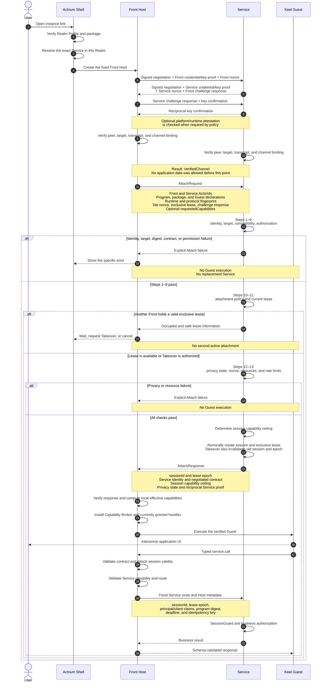
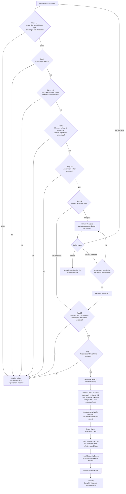
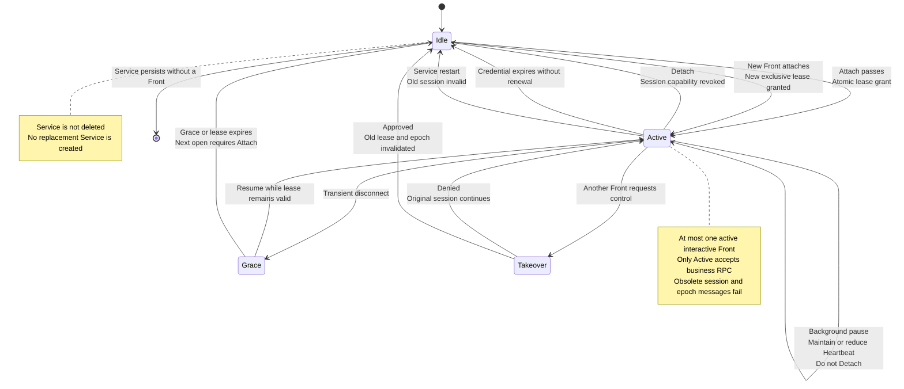

# Mutual Authentication and Front–Service Attach Flow

> Status: protocol proposal  
> Date: 2026-11-09  
> Basis: the three flow diagrams from the preceding design discussion  
> Scope: peer authentication, Attach authorization, exclusive leases, Guest gating, and session-protected RPC

## 1. Objective

Define how an Actrium Front establishes a controlled business session with one persistent Service.

The design separates two outcomes that are often incorrectly conflated:

- **Mutual authentication** proves which Actors participate in a channel and binds that channel to their credentials and keys.
- **Attach** decides whether the authenticated Front may operate a particular Service under a specific program, role, capability set, and lease.

A successful network connection is therefore neither an authenticated Actor channel nor an authorized application session.

```text
Open instance
  → resolve and verify target
  → authenticate both Actors
  → validate Attach
  → allocate exclusive lease
  → start Guest
  → authorize every business RPC
```

## 2. Participants and trusted artifacts

| Participant or artifact | Responsibility |
|---|---|
| Actrium Shell | Resolves the instance, verifies the Realm Profile and package, selects the exact Service, and creates the Front. |
| Front Host | Holds Front credentials, performs peer authentication and Attach, owns the session secret, and brokers Guest calls. |
| Service | Authenticates the peer, validates Attach, authorizes the member and role, owns the lease registry, and guards every business request. |
| Keel Guest | Provides the application UI and typed user intents. It is not trusted with Actor credentials, session secrets, or authoritative identity fields. |
| Signaling, TURN, and relays | Assist discovery, negotiation, and connectivity. They do not decide application authorization and must not possess payload keys. |
| `VerifiedChannel` | The authenticated result of peer handshake: peer Actor identity, local identity, channel binding, credential expiry, and replay state. |
| `FrontServiceSession` | The authorized result of Attach: Service binding, role, contract, capabilities, lease epoch, and expiry. |

The central trust rule is:

> Actor identity comes from the authenticated channel; application authority comes from the Service's current session record. Guest-authored fields are input, never proof.

## 3. End-to-end sequence



## 4. Phase A: resolve and fix the target

Before peer authentication, the Shell MUST:

1. Resolve the instance link to its Realm.
2. Verify the Realm Profile and package.
3. Obtain the required Realm membership and Front Actor credential.
4. Locate the Service whose Actor type matches the verified package in that same Realm.
5. Require an unambiguous target and fix its ActorId.
6. Create the platform-provided Front Host for the resident application Tab.

Once selected, the target is not silently changed. An Attach failure MUST NOT trigger:

- creation of a replacement Service;
- rediscovery by type alone;
- fallback to another Realm or Provider;
- package-version downgrade;
- load balancing to another logical instance.

A Service may exist without a Front. Opening or refreshing a Tab creates or rebuilds a Front session; it does not implicitly create a Service.

## 5. Phase B: mutual Actor authentication

### 5.1 Purpose

Mutual authentication establishes that:

- both peers possess the private keys corresponding to their Actor identities;
- both credentials are valid for the current Realm, Actor type, audience, and expiry;
- each peer is connected to the intended counterparty;
- the negotiated transport and resulting channel keys belong to this exchange;
- replayed negotiation or proof material cannot create a new valid channel.

The resulting channel is an authenticated transport context, not an application grant.

### 5.2 Handshake inputs

Each side supplies or references:

```text
ActorId and Realm
Actor credential and Actor public key
Actor type and member/client/role claims
expected target ActorId
fresh nonce and challenge response
runtime instance and current state binding
signed transport-negotiation digest
optional platform/runtime attestation
```

The channel transcript MUST bind both sides' identities, both challenges, the target Service, credential digests, ephemeral key material, and the negotiated transport context.

### 5.3 Verification rules

Each side MUST reject the handshake when:

- the credential signature, Realm, audience, or expiry is invalid;
- the private-key proof does not match the credentialed public key;
- the source ActorId differs from the credential claim;
- the local ActorId is not the peer's intended target;
- the negotiated transport digest or channel transcript differs;
- a challenge, nonce, or exchange identifier is replayed;
- required attestation is absent, expired, or bound to another channel.

Only after reciprocal verification and key confirmation does the channel become `Verified`.

The four steps in the sequence diagram are logical stages, not a limit on physical frame count. An implementation using Noise XX may carry the certificate, Actor proof, and each direction's key confirmation in separate frames. Every required proof and both confirmations MUST complete before application data is allowed.

### 5.4 VerifiedChannel contents

The Host retains at least:

```text
channelId and channel generation
transcript digest
local and peer ActorId
peer Actor type and Actor public key
member, client, and role claims from the credential
local and peer runtime instance
credential expiry
current policy and state bindings
replay and sequence state
```

A new connection or channel generation MUST NOT inherit verification from an old connection. Credential or state changes require the specified reauthentication path rather than mutation of an already published peer identity.

## 6. Phase C: Attach authorization

### 6.1 AttachRequest

The Front Host constructs the request. The Guest cannot override its authority-bearing fields.

```text
attachId
frontActorId and serviceActorId
channelId and channelTranscriptDigest
Program Release
packageDigest and guestDigest
runtime and Host API declarations
protocolFingerprint
tabSessionNonce
requestedLease = exclusive
requestedCapabilities (optional)
challengeResponse
```

Program and package declarations support compatibility checks. They do not, by themselves, prove which code the remote peer is executing.

### 6.2 Thirteen Service checks

The Service validates the request in the following order.

| Steps | Validation | Decision |
|---|---|---|
| 1–2 | Sender credential and caller ActorId | The authenticated peer must be the same Front named by the request. |
| 3 | Front Actor type and optional runtime attestation | Only an allowed Front type may request a Front session. |
| 4 | Attach signature, challenge, nonce, and replay state | The request must be fresh and bound to this exact channel. |
| 5 | Target Service ActorId | The request must target this Service, not merely a compatible type. |
| 6–8 | Program Release, package/Guest digest, and protocol fingerprint | Identity and digest mismatches are hard failures; contract negotiation must produce one fixed result. |
| 9 | Member, client, role, and requested Service capability scope | Realm admission is not sufficient; the Service applies application authorization and rejects requested capabilities beyond the member, role, or program policy. |
| 10 | Attachment policy | v1 requests an exclusive interactive session. |
| 11 | Current lease | An occupied lease returns `occupied` unless an authorized Takeover path applies. |
| 12 | Privacy policy, current state, assurance, and nonce | Protected capabilities require the current policy and state to be acceptable. |
| 13 | Resource and rate limits | Session, memory, request, and Attach quotas remain enforceable. |

The optional `requestedCapabilities` field is a least-privilege request, not proof of authorization. The Service checks it during steps 9 and 12 and determines `sessionCapabilityCeiling` before allocating the lease. This ceiling limits the session; it does not grant local Front Host permissions.

Host API and protocol versions may negotiate only within both parties' declared ranges. The selected values become immutable session properties.

### 6.3 Attach decision flow



The step-11 lease observation is only a preliminary check. Final allocation MUST be atomic with respect to Attach, Resume, Detach, expiry, and Takeover. Otherwise two concurrent requests could both observe an idle lease and become active.

### 6.4 AttachResponse and session record

The response contains:

```text
sessionId and leaseEpoch
lease mode, expiry, and heartbeat interval
Service ActorId and Program Release
package and protocol fingerprints
negotiated runtime and Host API
sessionCapabilityCeiling
current privacy state and hard expiry where applicable
reciprocal Service proof
```

`sessionCapabilityCeiling` is the Service-authorized upper bound for this session, not a grant of local Front Host permissions. The Front verifies that the response belongs to the same request and authenticated Service channel before accepting it.

The resulting session record binds:

```text
Front Actor + Service Actor
+ channel and runtime generation
+ member/client/role authorization snapshot
+ program/package/contract
+ session capability ceiling
+ sessionId and leaseEpoch
+ credential, lease, and policy expiry
```

The session secret remains inside the Front and Service Hosts. It is never exposed to Guest code, application JavaScript, URIs, logs, or crash reports.

## 7. Guest gating and business RPC

### 7.1 Guest start boundary

Package download and verification may happen before Attach. Guest execution may not.

The Front starts the Guest only after:

1. the target Service ActorId is fixed;
2. the Actor channel is verified;
3. Attach and contract negotiation succeed;
4. the exclusive lease is active;
5. the Capability Broker, session scope, and currently granted capability handles are installed.

Interactive Host capabilities that are not yet granted remain closed and MAY be requested on first use. Attach does not require the user to grant every declared interactive capability in advance.

Closing or crashing a Front revokes local session capabilities before its Guest engine is destroyed whenever local cleanup can run.

### 7.2 Effective capabilities

After verifying the AttachResponse, the local Front Host computes effective capabilities as the intersection of:

```text
Service session capability ceiling
∩ program declaration
∩ Host support
∩ user or organization grant
∩ platform policy
∩ authenticated member role
∩ current session scope
```

The Service can narrow the session ceiling, but only the local Actr Host can grant local Host capability handles. No handle is created for an undeclared or currently unauthorized capability.

A capability returned by Attach is still checked at the execution point. Session creation does not make later revocation irrelevant.

### 7.3 RPC route

Every business call follows the fixed route:

```text
Guest typed call
  → Keel contract validation
  → Attach session validity validation
  → Front Service capability and route validation
  → fixed Service ActorId route
  → Actor transport
  → Service SessionGuard
  → business handler
  → response schema validation
  → Guest
```

Session validity covers the `Active` state, channel generation, lease epoch, and credential and lease expiry. Capability checks use the resulting valid session scope rather than authorizing against a stale session.

The Front Host attaches metadata that the Guest cannot override:

```text
sessionId and leaseEpoch
channelId
minimal principal/client claims
programDigest
request id and route
trace id and deadline
idempotency key where applicable
request proof
```

The Service resolves the current session and re-evaluates authority. It does not trust user, role, or administrator fields supplied in the Guest payload.

## 8. Lease lifecycle



### 8.1 Heartbeat and credential renewal

Heartbeat renews the lease; it does not independently renew the Actor credential or refresh the member role.

If the Front obtains a new credential, it presents that credential during lease renewal. The Service verifies it and rereads the member role before extending authorization. Without a renewed credential, the session ends no later than the old credential expiry.

```text
session hard expiry = minimum of:
  lease expiry
  Front credential expiry
  required assurance expiry
  administrative revocation deadline
```

### 8.2 Resume

Resume applies after a transient interruption when the lease remains valid:

1. Establish and verify a new channel.
2. Prove possession of the previous session.
3. Revalidate the Service ActorId, member, role, policy, and expiry.
4. Advance the lease epoch.
5. Resume the Guest and refresh necessary application state.

If the lease or credential has expired, the Front performs a new Attach instead.

### 8.3 Detach and crash

A clean Tab close performs:

```text
revoke session capability
  → Detach
  → destroy Guest engine
  → destroy Front Actor
  → retain Service, ActorId, and instance record
```

After a crash, the remote side cannot rely on a clean Detach. The lease enters its grace path and expires. A crash never causes creation of another Service.

### 8.4 Takeover

Takeover is a new authorization decision, not an automatic result of a newer Attach request.

It requires:

- an authenticated requesting Front;
- sufficient member or administrator permission;
- approval under the Service conflict policy;
- atomic invalidation of the old session and lease epoch;
- rejection of old-channel and old-epoch messages;
- creation of a new session and lease for the approved Front.

At no point may both attachments be active.

### 8.5 Service restart

A Service restart preserves its ActorId and persistent business state but invalidates existing Front sessions by default. The Front must authenticate the new runtime instance and Attach again.

Releasing a Front attachment does not itself stop the Service.

## 9. SessionGuard requirements

The Service SessionGuard runs before deduplication and business dispatch. It checks:

1. exact target Service and allowed route;
2. current channel and channel generation;
3. session existence and `Active` state;
4. lease epoch and every hard expiry;
5. current member, client, role, and application permission;
6. Capability scope;
7. request proof, replay window, and idempotency rules;
8. current privacy and resource policy.

A durable queued request is checked again when dequeued. A request that was valid when queued MUST NOT execute after its session expires, its role is reduced, its lease is taken over, or its capability is revoked.

Equivalent checks apply to requests, responses, tells, and stream chunks. Old-session messages are always rejected.

## 10. Failure and recovery semantics

| Condition | Required result |
|---|---|
| Peer credential or key proof invalid | Fail peer authentication before application data. |
| Wrong source, target, Realm, or channel transcript | Close the handshake; never Attach. |
| Program, package, Guest, or contract mismatch | Hard fail before Guest execution. |
| Membership valid but application role insufficient | Return permission denied. |
| Lease occupied | Return occupied; allow wait, authorized Takeover, or cancel. |
| Required assurance missing or expired | Deny the affected protected capability or data path. |
| Credential or lease expired | Reject new business requests; renew, Resume, or Attach as applicable. |
| Old lease epoch or old channel generation | Reject before deduplication and dispatch. |
| Service offline or discovery ambiguous | Report the exact state; do not create or select another instance. |
| Realm or credential infrastructure unavailable | Fail new Attach closed and never extend expired identity indefinitely. |

Errors remain distinguishable in logs and user experience. A generic connection error MUST NOT hide identity, authorization, occupancy, or revocation failures.

## 11. Security invariants

1. No application data is accepted before mutual Actor authentication and key confirmation.
2. Guest executes only after successful Attach and installation of the Capability Broker, session scope, and currently granted handles.
3. A Front binds exactly one Service; the binding does not change during the session.
4. A Service has at most one active exclusive Front attachment.
5. Realm membership is not application authorization.
6. Actor and package declarations are not runtime-code attestation.
7. The Guest cannot supply authoritative identity, role, or session metadata.
8. The Service authorizes every business request using current session state.
9. Heartbeat does not extend an expired Actor identity.
10. Lease grant, renewal, release, and Takeover are linearized.
11. Old sessions, old channels, and old epochs cannot perform new effects.
12. Attach success alone does not prove the entire application graph trusted or ready.
13. Front session authority is not implicitly inherited by Service–Worker or other Actor edges.
14. Failure never silently changes the Realm, Provider, version, Service ActorId, or instance count.

## 12. Acceptance scenarios

### 12.1 Authentication

- Valid reciprocal credentials and key proofs produce a `VerifiedChannel`.
- A handshake missing either peer's challenge response or key confirmation cannot become `Verified`.
- A credential without its private key fails.
- A credential for Actor A cannot authenticate Actor B.
- Wrong target, Realm, audience, transcript, nonce, or transport digest fails before application data.
- Replayed handshake material cannot create a second verified channel.
- Required attestation bound to another channel is rejected.
- Signaling and relays cannot read protected application payloads.

### 12.2 Attach

- Wrong Service ActorId, Actor type, package, Guest digest, or protocol fingerprint fails before Guest execution.
- A Realm member without application permission is denied.
- Guest-authored identity and capability overrides have no effect.
- Identical Attach retries are idempotent; reuse of an Attach identifier with different content fails.
- Requested capabilities beyond the member, role, program, or privacy policy are rejected before lease allocation.
- Local effective capabilities never exceed the Service session ceiling or the local authorization intersection.
- Undeclared interactive capabilities remain unavailable, while declared but ungranted interactive capabilities can be requested on first use.
- No failure path creates a replacement Service or changes the target ActorId.

### 12.3 Lease and recovery

- Concurrent Attach attempts never produce two active exclusive attachments.
- A second device receives occupied while the first lease is valid.
- Unauthorized Takeover leaves the original session unchanged.
- Authorized Takeover immediately invalidates old-channel and old-epoch requests.
- Heartbeat with the same credential does not extend credential expiry or update a role.
- A renewed credential causes the Service to reread the role.
- Resume works only while the lease and required identity remain valid.
- Detach releases the attachment without deleting the Service.
- Front crash recovery waits for lease grace/expiry and never creates another Service.
- Service restart preserves ActorId but rejects every pre-restart session.

### 12.4 Request enforcement

- Expired, revoked, wrong-route, wrong-scope, and stale-epoch requests fail before business dispatch.
- An expired session is rejected before session-scoped capability evaluation.
- A request queued before revocation is rejected when dequeued.
- Request, response, tell, and stream paths enforce equivalent checks.
- Session secrets never appear in Guest APIs, logs, URIs, or crash reports.
- A successful direct Attach does not by itself release data that requires a broader application assurance decision.

## 13. Protocol artifacts to define

Implementation requires the following versioned artifacts:

- peer negotiation and channel-binding messages;
- credential and key-proof verification rules;
- canonical channel transcript and test vectors;
- `AttachRequest` and `AttachResponse`;
- idempotent Attach, Heartbeat, Resume, Detach, and Takeover messages;
- session metadata and request-proof encoding;
- lease epoch, grace, expiry, and replay-window rules;
- stable error codes and safe occupancy metadata;
- capability behavior when direct Attach succeeds but broader application assurance is unavailable.

Shared sessions, automatic cross-Actor authority inheritance, and treating Attach as runtime attestation are explicitly outside this proposal.
