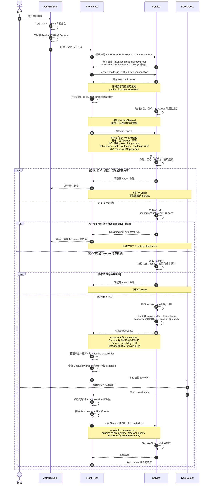
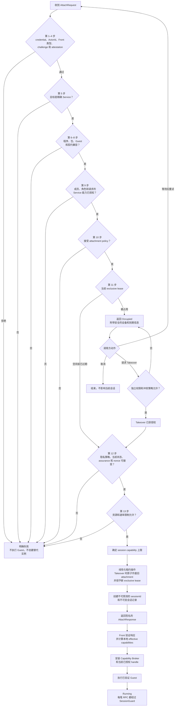
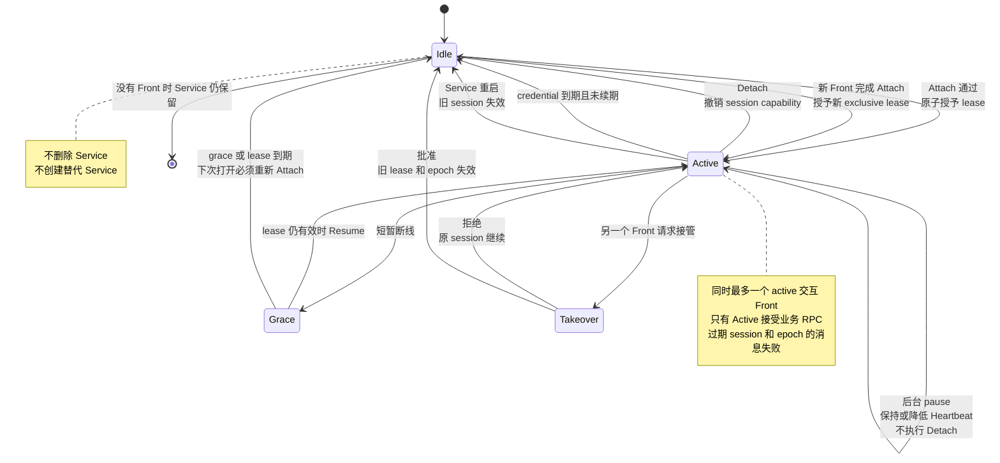

# 双向认证与 Front–Service Attach 流程方案

> 状态：协议提案  
> 日期：2026-11-09  
> 依据：前一轮设计讨论中的三张流程图  
> 范围：对端认证、Attach 授权、独占租约、Guest 启动门控，以及受会话保护的业务 RPC

## 1. 目标

定义 Actrium Front 如何与一个持久 Service 建立受控业务会话。

本设计明确区分两个容易混淆的结果：

- **双向认证**证明通道两端分别是哪个 Actor，并把通道绑定到双方凭据和密钥。
- **Attach**决定已认证 Front 能否在指定程序、角色、能力集合和租约下操作某个 Service。

因此，网络连接成功既不等于 Actor 通道已认证，也不等于应用会话已授权。

```text
打开实例
  → 解析并验证目标
  → 双向 Actor 认证
  → Attach 校验
  → 分配 exclusive lease
  → 启动 Guest
  → 对每笔业务 RPC 授权
```

## 2. 参与者与受信对象

| 参与者或对象 | 职责 |
|---|---|
| Actrium Shell | 解析实例、验证 Realm Profile 和程序包、选择精确 Service，并创建 Front。 |
| Front Host | 持有 Front 凭据，执行对端认证和 Attach，保管 session secret，并代理 Guest 调用。 |
| Service | 认证对端、校验 Attach、授权成员和角色、持有租约注册表，并保护每笔业务请求。 |
| Keel Guest | 提供应用界面和类型化用户意图。平台不信任它持有 Actor credential、session secret 或权威身份字段。 |
| 信令、TURN 与中继 | 协助发现、协商和连接，不决定应用授权，也不得持有业务载荷密钥。 |
| `VerifiedChannel` | 对端握手的认证结果：对端 Actor 身份、本端身份、通道绑定、凭据有效期和防重放状态。 |
| `FrontServiceSession` | Attach 的授权结果：Service 绑定、角色、契约、能力、租约代次和有效期。 |

核心信任规则是：

> Actor 身份来自已认证通道；应用权限来自 Service 当前的会话记录。Guest 自报字段只是输入，不是证明。

## 3. 端到端时序



## 4. 阶段 A：解析并固定目标

在对端认证开始前，Shell 必须：

1. 将实例链接解析到对应 Realm。
2. 验证 Realm Profile 和程序包。
3. 取得所需的 Realm membership 和 Front Actor credential。
4. 在该 Realm 内定位 Actor 类型与已验证包匹配的 Service。
5. 要求目标无歧义，并固定其 ActorId。
6. 为驻留应用 Tab 创建平台提供的 Front Host。

目标选定后不得静默更改。Attach 失败不得触发：

- 创建替代 Service；
- 仅按类型重新发现；
- 回退到其他 Realm 或 Provider；
- 程序版本降级；
- 负载均衡到另一个逻辑实例。

Service 可以暂时没有 Front。打开或刷新 Tab 会创建或重建 Front 会话，但不会隐式创建 Service。

## 5. 阶段 B：Actor 双向认证

### 5.1 目的

双向认证用于证明：

- 双方都持有各自 Actor 身份对应的私钥；
- 双方 credential 对当前 Realm、Actor 类型、audience 和有效期均有效；
- 每方连接的都是预期对端；
- 协商后的传输和通道密钥属于本次交换；
- 重放的协商或证明材料不能建立新的有效通道。

认证后的通道是已认证的传输上下文，不是应用授权。

### 5.2 握手输入

每方提供或引用：

```text
ActorId 和 Realm
Actor credential 和 Actor 公钥
Actor 类型以及 member/client/role claims
预期目标 ActorId
新鲜 nonce 和 challenge 响应
runtime instance 和当前状态绑定
签名的传输协商摘要
可选的 platform/runtime attestation
```

通道 transcript 必须绑定双方身份、双方 challenge、目标 Service、credential 摘要、临时密钥材料和协商后的传输上下文。

### 5.3 验证规则

出现以下任一情况时，双方都必须拒绝握手：

- credential 签名、Realm、audience 或有效期无效；
- 持钥证明与 credential 中的公钥不匹配；
- 来源 ActorId 与 credential claim 不一致；
- 本端 ActorId 不是对端的预期目标；
- 协商后的传输摘要或通道 transcript 不一致；
- challenge、nonce 或 exchange id 被重放；
- 必需的 attestation 缺失、过期或绑定到其他通道。

只有完成双向验证和 key confirmation，通道才进入 `Verified`。

时序图中的四步是逻辑阶段，不限制实际帧数。使用 Noise XX 的实现可以把证书、Actor proof 和两个方向的 key confirmation 分成独立帧传输。所有必需证明和双向 confirmation 完成前，都不得传输应用数据。

### 5.4 VerifiedChannel 内容

Host 至少保存：

```text
channelId 和 channel generation
transcript digest
本端和对端 ActorId
对端 Actor 类型和 Actor 公钥
credential 中的 member、client 和 role claims
本端和对端 runtime instance
credential 有效期
当前 policy 和状态绑定
防重放和序列状态
```

新连接或新 channel generation 不得继承旧连接的认证状态。credential 或状态变化必须走规定的重新认证路径，不能直接修改已经发布的对端身份。

## 6. 阶段 C：Attach 授权

### 6.1 AttachRequest

请求由 Front Host 构造，Guest 不能覆盖其中的权限字段。

```text
attachId
frontActorId 和 serviceActorId
channelId 和 channelTranscriptDigest
Program Release
packageDigest 和 guestDigest
runtime 和 Host API 声明
protocolFingerprint
tabSessionNonce
requestedLease = exclusive
requestedCapabilities（可选）
challengeResponse
```

程序和包声明用于兼容性检查，但它们本身不能证明对端实际执行的是哪段代码。

### 6.2 Service 的十三项检查

Service 按以下顺序校验请求。

| 步骤 | 校验 | 判定 |
|---|---|---|
| 1–2 | 发送方 credential 和 caller ActorId | 已认证对端必须与请求中的 Front 相同。 |
| 3 | Front Actor 类型和可选 runtime attestation | 只有允许的 Front 类型才能申请 Front 会话。 |
| 4 | Attach 签名、challenge、nonce 和防重放状态 | 请求必须新鲜，并绑定到当前精确通道。 |
| 5 | 目标 Service ActorId | 请求必须指向当前 Service，而不只是指向兼容类型。 |
| 6–8 | Program Release、package/Guest digest 和 protocol fingerprint | 身份或摘要不匹配必须硬失败；契约协商必须产生唯一固定结果。 |
| 9 | 成员、客户端、角色和请求的 Service 能力范围 | Realm 准入不够，Service 还要执行应用授权，并拒绝超出成员、角色或程序策略的 requestedCapabilities。 |
| 10 | Attachment policy | v1 请求独占交互会话。 |
| 11 | 当前 lease | 租约被占用时返回 `occupied`，除非进入已授权 Takeover 路径。 |
| 12 | 隐私策略、当前状态、assurance 和 nonce | 受保护能力要求当前策略和状态可接受。 |
| 13 | 资源和速率限制 | session、内存、请求和 Attach 配额始终可执行。 |

可选的 `requestedCapabilities` 是最小权限请求，不是授权证明。Service 在第 9 步和第 12 步检查它，并在分配 lease 前确定 `sessionCapabilityCeiling`。该上限约束会话，但不授予本地 Front Host 权限。

Host API 和协议版本只能在双方声明的范围内协商，选定值成为不可变的会话属性。

### 6.3 Attach 决策流程



第 11 步对租约的观察只是预检查。最终分配必须与 Attach、Resume、Detach、到期和 Takeover 原子化，否则两个并发请求可能都看到空闲租约并同时进入 active。

### 6.4 AttachResponse 和会话记录

响应包含：

```text
sessionId 和 leaseEpoch
lease 模式、有效期和 heartbeat 间隔
Service ActorId 和 Program Release
package 和 protocol fingerprints
协商后的 runtime 和 Host API
sessionCapabilityCeiling
当前隐私状态以及适用时的硬期限
对向 Service 证明
```

`sessionCapabilityCeiling` 是 Service 授权的本会话能力上限，不是对本地 Front Host 权限的授予。Front 接受会话前，必须验证响应对应于同一请求和同一已认证 Service 通道。

最终会话记录绑定：

```text
Front Actor + Service Actor
+ channel 和 runtime generation
+ member/client/role 授权快照
+ program/package/contract
+ session capability 上限
+ sessionId 和 leaseEpoch
+ credential、lease 和 policy 有效期
```

session secret 只保存在 Front 和 Service Host 内，不暴露给 Guest 代码、应用 JavaScript、URI、日志或崩溃报告。

## 7. Guest 门控与业务 RPC

### 7.1 Guest 启动边界

程序包可以在 Attach 前下载和验证，Guest 执行不行。

Front 只有在以下条件全部满足后才能启动 Guest：

1. 目标 Service ActorId 已固定；
2. Actor 通道已验证；
3. Attach 和契约协商成功；
4. exclusive lease 处于 active；
5. Capability Broker、session scope 和当前已授权的能力 handle 已安装。

尚未授权的交互 Host 能力保持关闭，可以在首次使用时请求授权。Attach 不要求用户预先授予所有已声明的交互能力。

只要本地清理仍能执行，关闭或崩溃 Front 时都应先撤销本地 session capability，再销毁 Guest Engine。

### 7.2 Effective capabilities

验证 AttachResponse 后，本地 Front Host 计算有效能力，取以下集合的交集：

```text
Service 会话能力上限
∩ 程序声明
∩ Host 支持
∩ 用户或组织授权
∩ 平台策略
∩ 已认证成员角色
∩ 当前 session 范围
```

Service 可以缩小会话能力上限，但只有本地 Actr Host 能授予本地 Host capability handle。未声明或当前未授权的能力不得创建 handle。

Attach 返回的 capability 在执行点仍要检查，建立会话不意味着之后的撤销可以忽略。

### 7.3 RPC 路由

每笔业务调用走固定路径：

```text
Guest 类型化调用
  → Keel 契约校验
  → Attach session 有效性校验
  → Front Service capability 和 route 校验
  → 固定 Service ActorId 路由
  → Actor transport
  → Service SessionGuard
  → 业务处理器
  → 响应 schema 校验
  → Guest
```

session 有效性包括 `Active` 状态、channel generation、lease epoch，以及 credential 和 lease 有效期。capability 检查使用通过校验后的当前 session 范围，不针对过期 session 授权。

Front Host 附加 Guest 无法覆盖的 metadata：

```text
sessionId 和 leaseEpoch
channelId
最小化 principal/client claims
programDigest
request id 和 route
trace id 和 deadline
适用时的 idempotency key
request proof
```

Service 解析当前会话并重新评估权限，不信任 Guest payload 中的用户、角色或管理员字段。

## 8. 租约生命周期



### 8.1 Heartbeat 和 credential 续期

Heartbeat 只续租，不独立续期 Actor credential，也不刷新成员角色。

如果 Front 取得新 credential，它在租约续约时出示新 credential。Service 验证并重新读取成员角色后才延长授权。如果没有续期 credential，会话最迟在旧 credential 到期时结束。

```text
session 硬期限取以下最小值：
  lease 有效期
  Front credential 有效期
  必需 assurance 的有效期
  管理撤销期限
```

### 8.2 Resume

短暂中断后，如果租约仍有效，可以 Resume：

1. 建立并验证新通道。
2. 证明持有旧 session。
3. 重新验证 Service ActorId、成员、角色、策略和有效期。
4. 增加 lease epoch。
5. 恢复 Guest，并重新拉取必要的应用状态。

如果租约或 credential 已过期，Front 必须重新 Attach。

### 8.3 Detach 和崩溃

正常关闭 Tab 的顺序是：

```text
撤销 session capability
  → Detach
  → 销毁 Guest Engine
  → 销毁 Front Actor
  → 保留 Service、ActorId 和实例记录
```

崩溃后，远端不能依赖正常 Detach。租约进入 grace 路径并最终到期，崩溃绝不会导致创建另一个 Service。

### 8.4 Takeover

Takeover 是一次独立授权决定，不是新 Attach 请求自动产生的结果。

它要求：

- 请求方 Front 已认证；
- 具备足够的成员或管理员权限；
- 通过 Service 冲突策略审批；
- 原子作废旧 session 和 lease epoch；
- 拒绝旧通道和旧 epoch 的消息；
- 为获批 Front 创建新 session 和 lease。

任何时刻都不得让两个 attachment 同时 active。

### 8.5 Service 重启

Service 重启保留 ActorId 和持久业务状态，但默认使现有 Front session 全部失效。Front 必须认证新的 runtime instance 并重新 Attach。

释放 Front attachment 本身不会停止 Service。

## 9. SessionGuard 要求

Service SessionGuard 在去重和业务分发之前运行，检查：

1. 精确目标 Service 和允许的 route；
2. 当前 channel 和 channel generation；
3. session 是否存在并处于 `Active`；
4. lease epoch 和所有硬期限；
5. 当前成员、客户端、角色和应用权限；
6. Capability 范围；
7. request proof、防重放窗口和幂等规则；
8. 当前隐私和资源策略。

持久化队列中的请求在出队时还要再次检查。已入队时有效的请求，在 session 到期、角色降权、租约被接管或 capability 被撤销后，不得继续执行。

请求、响应、tell 和流式 chunk 都执行等价检查，旧 session 的消息一律拒绝。

## 10. 失败与恢复语义

| 条件 | 必须结果 |
|---|---|
| 对端 credential 或持钥证明无效 | 在应用数据之前使对端认证失败。 |
| 来源、目标、Realm 或 channel transcript 错误 | 关闭握手，绝不进入 Attach。 |
| 程序、包、Guest 或契约不匹配 | 在 Guest 执行前硬失败。 |
| membership 有效但应用角色权限不足 | 返回 permission denied。 |
| lease 被占用 | 返回 occupied；允许等待、授权 Takeover 或取消。 |
| 必需 assurance 缺失或过期 | 拒绝受影响的受保护能力或数据路径。 |
| credential 或 lease 过期 | 拒绝新业务请求；按情况续期、Resume 或重新 Attach。 |
| 旧 lease epoch 或旧 channel generation | 在去重和分发前拒绝。 |
| Service 离线或发现有歧义 | 报告精确状态，不创建或选择其他实例。 |
| Realm 或 credential 基础设施不可达 | 新 Attach 默认失败关闭，不无限延长过期身份。 |

日志和用户体验中的错误必须保持可区分，不能用通用连接错误掩盖身份、授权、占用或撤销失败。

## 11. 安全不变量

1. 双向 Actor 认证和 key confirmation 完成前，不接受应用数据。
2. 只有 Attach 成功并安装 Capability Broker、session scope 和当前已授权 handle 后，才执行 Guest。
3. 一个 Front 只绑定一个 Service，会话期间不改变绑定。
4. 一个 Service 同时最多有一个 active exclusive Front attachment。
5. Realm membership 不等于应用授权。
6. Actor 和包声明不等于运行时代码 attestation。
7. Guest 不能提供权威身份、角色或 session metadata。
8. Service 使用当前会话状态对每笔业务请求授权。
9. Heartbeat 不延长已过期的 Actor 身份。
10. 租约授予、续约、释放和 Takeover 必须线性化。
11. 旧 session、旧通道和旧 epoch 不能产生新效果。
12. Attach 成功本身不证明整个应用图可信或 Ready。
13. Front 会话权限不被 Service–Worker 或其他 Actor 边隐式继承。
14. 失败时绝不静默改变 Realm、Provider、版本、Service ActorId 或实例数量。

## 12. 验收场景

### 12.1 认证

- 有效双向 credential 和持钥证明产生 `VerifiedChannel`。
- 缺少任一方的 challenge 响应或 key confirmation 时，握手不得进入 `Verified`。
- 只有 credential、没有对应私钥时失败。
- Actor A 的 credential 不能认证 Actor B。
- 错误目标、Realm、audience、transcript、nonce 或传输摘要都在应用数据之前失败。
- 重放的握手材料不能创建第二条已验证通道。
- 绑定到其他通道的必需 attestation 被拒绝。
- 信令和中继不能读取受保护的应用载荷。

### 12.2 Attach

- 错误 Service ActorId、Actor 类型、包、Guest digest 或 protocol fingerprint 都在 Guest 执行前失败。
- 没有应用权限的 Realm 成员被拒绝。
- Guest 伪造身份和 capability 覆盖字段不产生效果。
- 相同 Attach 重试保持幂等；使用相同 Attach id 但内容不同时失败。
- 超出成员、角色、程序或隐私策略的 requestedCapabilities 在分配 lease 前被拒绝。
- 本地 effective capabilities 不得超出 Service 会话能力上限和本地授权交集。
- 未声明的交互能力始终不可用；已声明但未授权的交互能力可以在首次使用时请求授权。
- 所有失败路径都不创建替代 Service，也不改变目标 ActorId。

### 12.3 租约与恢复

- 并发 Attach 永远不会产生两个 active exclusive attachment。
- 第一个 lease 有效时，第二台设备收到 occupied。
- 未授权 Takeover 不改变原 session。
- 已授权 Takeover 立即拒绝旧通道和旧 epoch 请求。
- 使用同一 credential 的 Heartbeat 不延长 credential 有效期，也不更新角色。
- 续期 credential 后，Service 重新读取角色。
- Resume 只在 lease 和所需身份仍有效时可用。
- Detach 释放 attachment，但不删除 Service。
- Front 崩溃恢复等待 lease grace/到期，不创建另一个 Service。
- Service 重启保留 ActorId，但拒绝重启前的所有 session。

### 12.4 请求执行

- 过期、撤销、错误 route、错误 scope 和旧 epoch 请求都在业务分发前失败。
- 过期 session 在 session 范围内的 capability 校验之前即被拒绝。
- 撤销前入队的请求在出队时被拒绝。
- request、response、tell 和 stream 路径执行等价检查。
- session secret 不出现在 Guest API、日志、URI 或崩溃报告中。
- 直连 Attach 成功本身不释放需要更广泛 Application Assurance 决策的数据。

## 13. 需要定义的协议产物

实现前需要定义以下带版本的协议产物：

- 对端协商和通道绑定消息；
- credential 与持钥证明验证规则；
- 规范化 channel transcript 和测试向量；
- `AttachRequest` 和 `AttachResponse`；
- 幂等 Attach、Heartbeat、Resume、Detach 和 Takeover 消息；
- session metadata 和 request-proof 编码；
- lease epoch、grace、有效期和防重放窗口规则；
- 稳定错误码和安全的 occupancy 元数据；
- 直连 Attach 成功但更广泛 Application Assurance 不可用时的 capability 行为。

共享会话、自动跨 Actor 权限继承，以及把 Attach 当作 runtime attestation，均不在本提案范围内。
