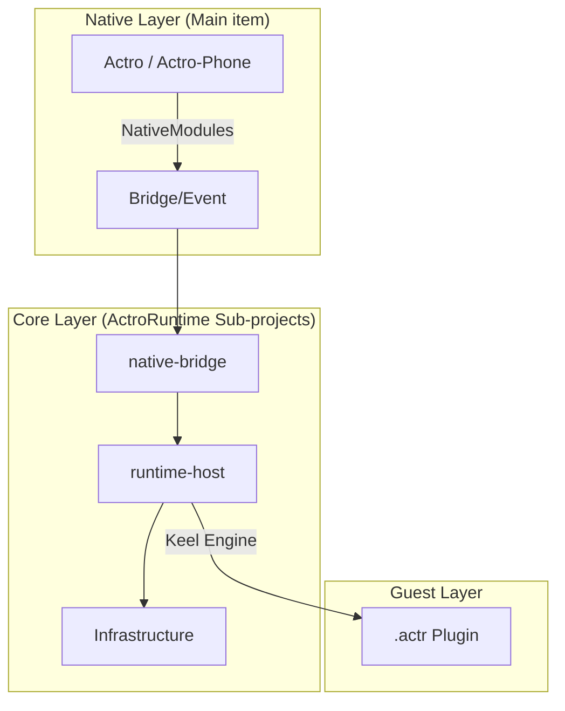

# Actro-Pad/Phone System Architecture Overview

This project is a cross-platform mobile end AI Interactive system, adopted **Native iOS Shell + React Native Run-time** ♪ The mix of structures. `ActroRuntime` Operating nuclear simultaneously iPad(Actroand iPhone Both ends.

---

## 1. Overall layer structure

### Layer Overview

| Level | Statement of duties |
|---|---|
| **Native Layer** | Responsible for life cycle, multi-label container management, system level API (Actr SDK, Speech, Camera, Safe Area). |
| **JS Native-Bridge** | Achieved JS with Native Two-way communication, yes. Actr WebRTC The signal is sealed, routed and quoted as count management. |
| **JS Actr-Host (kernel host)** | Business logic core. Responsible for route control, plugin life cycle management, two-end response mode UI Component. |
| **Infrastructure (Infrastructure)** | Initialisation process,SQLite Stepover Sustainability, Global Status Management (Zustand). |

---

## 2. Module responsibilities and collaborative relationships

### Key component collaboration
- **TabRouter** (RN Entry): Receiving Native Enter configuration, by type to `RuntimeApp` (Plugin) or application in the system (Login/History).
- **RuntimeApp / RuntimeTabView**: Management Keel Engine Example pool. Downloads, validates plugin packages, initials the rendering of sandboxes and sends a surveillance snapshot to the natives.
- **native-bridge**: as: JS With birth SDK The only way between them, dealing with complex things. WebRTC Connects to logic, and you achieve the end-to-end route of the stream.
- **Infrastructure (api/repo/services)**: `AppSessionService` Responsible for the full initialization of sessions (access to information) -> Verify Package -> Parsing scripts.

### Design normative principles
- **Scattered**: `native-bridge` Separating from the original complexity, and not taking care of the top business WebRTC Details.
- **Segregation of duties**: Memory Store Control UI The blogger says:Repository Responsible SQLite Read and write.
- **Response UI**: based on the same set of logical kernels, automatically fit Pad (Three columns./Sidebar) with Phone (Columns/Overwrite) Layout.

---

## 3. Project collaboration and warehouse description

- **Main repository (Current)**:
    - `Actro/` & `Actro-iPhone/`: Native Shell source code and build environment.
    - Duties: Multi-window management, enhanced primary capacity, and rendering layer stability.
- **Sub-warehouse (Actro Runtime - Submodule)**:
    - `ActroRuntime/`: Pure JS/TS Operational nuclear.
    - Responsibilities: Business logic, data durability, two-end logical alignment.
    - **Detailed Logic Documents:[ActroRuntime/AGENTS.md](./ActroRuntime/AGENTS.md)**

---

## 4. Core data stream

### A. Apply Load Stream
Native Start -> `TabRouter` Distribution -> `AppSessionService` Initialization Plugin -> `RuntimeTabView` Activate plugin run.

### B. Message Interact Closed Ring
1.  **Send**: User Input -> `AppInput` -> `native-bridge` -> `Native Actr SDK` -> `Server`.
2.  **Receive**: `Native Event` -> `native-bridge` (Fluent distribution) -> `useMessageStore` (Add) -> `UI` Present.

---

## 5. Development norms
- The business logic of cross-cutting is not directly related to Native The layer is complete. It's going down. `ActroRuntime`.
- Original module references to be in `native-bridge` - Get down.
