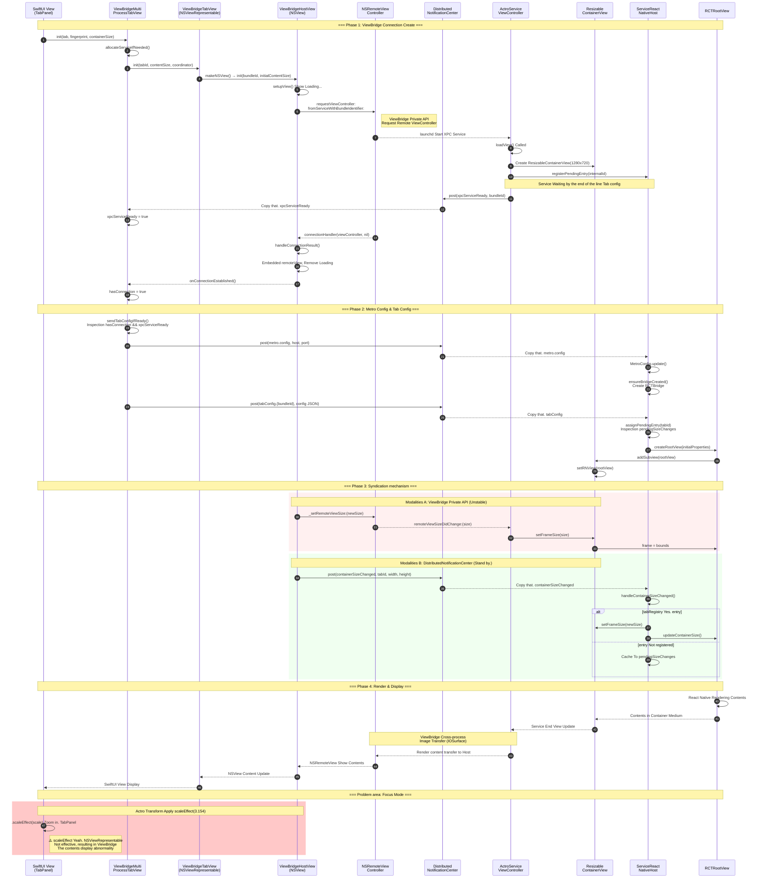

# ViewBridge XPC Structure Document

> History document. See current path [Renderer-Process-Pool.md](Renderer-Process-Pool.md).

## 1. Summary of structure

Actro Use ViewBridge (macOS Private framework) Enter the view of the process, which will React Native Content runs independently XPC Service Process.

```
┌─────────────────────────────────────────────────────────────────┐
│                        Actro Host App                          │
│  ┌─────────────────┐  ┌─────────────────┐  ┌─────────────────┐ │
│  │   SwiftUI View  │  │  MetroManager   │  │ XPCServicePool  │ │
│  │   (TabPanel)    │  │  (Port: Dynamic)   │  │  (4 slots)      │ │
│  └────────┬────────┘  └────────┬────────┘  └────────┬────────┘ │
│           │                    │                    │           │
│  ┌────────▼────────┐           │                    │           │
│  │ ViewBridgeHost  │           │                    │           │
│  │     View        │◄──────────┼────────────────────┘           │
│  │ (NSRemoteView)  │           │                                │
│  └────────┬────────┘           │                                │
└───────────┼────────────────────┼────────────────────────────────┘
            │                    │
            │ ViewBridge         │ DistributedNotificationCenter
            │ (macOS Private)    │
            │                    │
┌───────────▼────────────────────▼────────────────────────────────┐
│                    XPC Service Process                          │
│              (RCTViewService0/1/2/3.xpc)                        │
│  ┌─────────────────┐  ┌─────────────────┐  ┌─────────────────┐ │
│  │ ActroService   │  │ ServiceReact    │  │   RCTBridge     │ │
│  │ ViewController  │  │ NativeHost      │  │  (Share Examples)      │ │
│  └────────┬────────┘  └────────┬────────┘  └────────┬────────┘ │
│           │                    │                    │           │
│  ┌────────▼────────────────────▼────────────────────▼────────┐ │
│  │              RCTRootView (per Tab)                        │ │
│  │         Render size by containerSize Decision                       │ │
│  └───────────────────────────────────────────────────────────┘ │
└─────────────────────────────────────────────────────────────────┘
            │
            │ WebSocket (Metro Protocol)
            │
┌───────────▼─────────────────────────────────────────────────────┐
│                     Metro Bundler                               │
│              (Dynamic Port, Like 50319, 58242, 65045)                  │
│  - Pack up. JS Bundle                                               │
│  - Hot Reload Support                                              │
│  - SourceMap                                                      │
└─────────────────────────────────────────────────────────────────┘
```

## 2. Key components

### 2.1 Host End (Actro App)

| Component | Documentation | Duties |
|------|------|------|
| `ViewBridgeHostView` | ViewBridgeHostView.swift | NSRemoteViewController Packaging, managing cross-process views |
| `ViewBridgeCoordinator` | ViewBridgeHostView.swift | Manage Single Tab It's... XPC Connect life cycle |
| `ViewBridgeMultiProcessTabView` | ViewBridgeHostView.swift | SwiftUI View, Integration ViewBridge |
| `XPCServicePool` | XPCServicePool.swift | Management 4 individual XPC Service slot Allocation |
| `MetroManager` | MetroManager.swift | Metro bundler Life cycle management |
| `TabPanel` | WorkspaceMainView.swift | Tab Card view, manage rendering dimensions |

### 2.2 XPC Service End

| Component | Documentation | Duties |
|------|------|------|
| `ActroServiceViewController` | ActroServiceViewController.swift | Dynamic Registered NSServiceViewController |
| `ServiceReactNativeHost` | ActroServiceViewController.swift | Manage shared RCTBridge and per-Tab RCTRootView |
| `TabViewControllerEntry` | ActroServiceViewController.swift | Single Tab It's... ViewController and RCTRootView |
| `ResizableContainerView` | ActroServiceViewController.swift | Resizeable packagings, responding ViewBridge Zoom Sync |
| `MetroConfig` | ActroServiceViewController.swift | Storage from Host Received Metro Configure |

## 3. Size Count (Key data)

### 3.1 Coordinate System

Actual values based on log analysis:

| Parameters | Typical value | Annotations |
|------|--------|------|
| `viewportSize` | 589 x 398 | Actual visual dimensions (window content area) |
| `cardWidth` | 186.7 | Overview Card width in Mode |
| `cardHeight` | 126.2 | Overview The height of the card in mode |
| `scale` | 3.154 | Focus Scale of Zooming Mode (viewportSize / cardSize) |

### 3.2 Size Relationship

```
viewportSize.width / cardWidth = scale
589 / 186.7 ≈ 3.154

viewportSize.height / cardHeight = scale
398 / 126.2 ≈ 3.154
```

### 3.3 Render Mode

| Mode | ViewBridge Render Size | Actro Transform | Final display of dimensions |
|------|---------------------|------------------|--------------|
| Overview | cardSize (187x126) | scale=1 | 187x126 |
| Focus | viewportSize (589x398) | scale=3.154 | 589x398 |

**Key findings**: ViewBridge XPC I'm not gonna be able to make a difference in the process of independence. Host End Actro Transform Impact.Focus Patterns must make XPC Service Use viewportSize Render, otherwise the content will be blurred.

## 4. Communications mechanisms

### 4.1 DistributedNotificationCenter Announcements

| Name of notice | Orientation | Purpose |
|----------|------|------|
| `com.actro.xpcServiceReady` | XPC → Host | XPC Service Ready, acceptable configuration |
| `com.actro.tabConfig.<bundleId>` | Host → XPC | Send Tab ConfiguretabId, systemAppType Wait |
| `com.actro.metro.config` | Host → XPC | Radio Metro Configurehost, port) |
| `com.actro.containerSizeChanged` | Host → XPC | Notification of changes in packaging size |
| `com.actro.openBookmark` | XPC → Host | User Click Bookmarks |
| `com.actro.openHistoryItem` | XPC → Host | User Click History |

### 4.2 Tab Config Structure

```json
{
  "tabId": "90009605-812D-4507-BDFA-126296F9B672",
  "title": "Start Page",
  "systemAppType": "startPage",
  "backgroundColor": "#260f43",
  "containerWidth": 186.74,
  "containerHeight": 126.19
}
```

### 4.3 Metro Config Structure

```json
{
  "host": "127.0.0.1",
  "port": 65045
}
```

## 5. ViewBridge Connection Scheduling



## 6. Start Sequence (Chile)

```
┌─────────────────────────────────────────────────────────────────┐
│ 1. Actro App Start                                              │
│    - CrashHandler.setup()                                       │
│    - TabProcessManager Initialize                                    │
│    - XPCNotificationBridge Initialize                                │
│    - [DEBUG] MetroManager.start() Autostart                       │
└─────────────────────────────────────────────────────────────────┘
                              ↓
┌─────────────────────────────────────────────────────────────────┐
│ 2. Metro Bundler Start (Step)                                     │
│    - Dynamic Distribution Port (findAvailablePort)                            │
│    - Wait "Dev server ready" Output                                │
│    - broadcastMetroConfig() Broadcast Configuration                             │
└─────────────────────────────────────────────────────────────────┘
                              ↓
┌─────────────────────────────────────────────────────────────────┐
│ 3. Tab Create & XPC Allocation                                          │
│    - XPCServicePool.allocate() Allocation service slot                │
│    - ViewBridgeHostView Create, Request NSRemoteViewController        │
│    - setupXPCReadyListener() Listening xpcServiceReady               │
└─────────────────────────────────────────────────────────────────┘
                              ↓
┌─────────────────────────────────────────────────────────────────┐
│ 4. XPC Service Start                                             │
│    - registerActroServiceViewController() Dynamic Registration Category            │
│    - ServiceReactNativeHost.shared Initialize                        │
│    - setupTabConfigListener() Set Notification Listen                       │
│    - postXPCServiceReady() Announcements Host                            │
│    ⚠️ Not created yet RCTBridge (Wait Metro config)                 │
└─────────────────────────────────────────────────────────────────┘
                              ↓
┌─────────────────────────────────────────────────────────────────┐
│ 5. Host Copy that. xpcServiceReady                                    │
│    - Radio Metro config Present. XPC Service                           │
│    - Inspection hasConnection && xpcServiceReady                      │
│    - sendTabConfigToService() Send Tab Configure                     │
└─────────────────────────────────────────────────────────────────┘
                              ↓
┌─────────────────────────────────────────────────────────────────┐
│ 6. XPC Service Copy that. Metro config                                │
│    - MetroConfig.update() Update Configuration                              │
│    - ensureBridgeCreated() Create RCTBridge                       │
│    ✅ RCTBridge Use correct Metro Port                            │
└─────────────────────────────────────────────────────────────────┘
                              ↓
┌─────────────────────────────────────────────────────────────────┐
│ 7. XPC Service Copy that. Tab config                                  │
│    - handleTabConfigNotification()                              │
│    - createRootViewWithConfig() Create RCTRootView                │
│    - RN Start Rendering                                             │
└─────────────────────────────────────────────────────────────────┘
```

**Key findings**: RCTBridge We have to get it. Metro config Create it later, otherwise it will be by default. 8081 Port leads to a connection failure.

## 6. XPC Service Pool

### 6.1 Configure

- **Pool Size**: 4 individual slot (RCTViewService0 - RCTViewService3)
- **Bundle ID Format**: `io.actrium.actro.rctviewservice{N}`

### 6.2 Distribution Policy

```swift
// Same fingerprint It's... Tab Share the same XPC Service
// Different. fingerprint Different distributions XPC Service
// System applications are harmonized slot 0
```

| Application Type | Fingerprint | Distribution Service |
|----------|-------------|----------------|
| Start Page | system.startPage | RCTViewService0 |
| Bookmarks | system.bookmarks | RCTViewService0 |
| History | system.history | RCTViewService0 |
| User Application A | {appFingerprint} | RCTViewService1 |
| User Application B | {appFingerprint} | RCTViewService2 |

## 7. Problems solved

### 7.1 Metro Port mismatch

**Problem**: RCTBridge Use default for creation 8081 Port, but Metro Run in Dynamic Port

**Resolve**: Delay creation RCTBridgeWait till you get it. Metro config Create after notification

### 7.2 Sizing Scheduling Problem

**Problem**: `containerSizeChanged` Notification in `tabRegistry` entry We arrived before the distribution, so we couldn't update the size.

**Resolve**:
- Yes. Service Add End `pendingSizeChanges` Change in size of early arrival in cache storage
- When? entry Auto-apply cache sizes when assigned
- Add `hasPendingSizeApplied` Mark to distinguish cache sizes and config Dimensions

### 7.3 The synchronous size is unreliable.

**Problem**: ViewBridge Private API Zero-syncs unstable.

**Resolve**: Add DistributedNotificationCenter Alternative mechanisms (`com.actro.containerSizeChanged`)

## 8. Outstanding issues:Focus Mode Rendering

### 8.1 Problem description

React Native The content is in Focus Could not close temporary folder: %s
- Overview Mode: Can see cardSize The content of the card ✓
- Focus Mode: No content or only occasionally flash when dragging the window

### 8.2 Objective

| Mode | The desired retrofit size | Expected dimensions | Expected effects |
|------|---------------|---------------|---------|
| Overview | cardSize (187x126) | cardSize (187x126) | The card, it's clear. |
| Focus | viewportSize (589x398) | viewportSize (589x398) | Full size, clear. |

### 8.3 It's hard to get to the core.

```
┌─────────────────────────────────────────────────────────────────┐
│                        Actro Transform                          │
│   - Overview Mode: scale = 1.0                                   │
│   - Focus Mode: scale = viewportSize / cardSize ≈ 3.154         │
│                                                                  │
│   Question:Actro Transform It'll zoom in. TabPanel, but NSViewRepresentable │
│         (ViewBridge) I won't be. scaleEffect Correct Scale                 │
└─────────────────────────────────────────────────────────────────┘
```

**Key findings**: `scaleEffect` Yeah. `NSViewRepresentable` Not Effective (macOS The number of people who have been killed is not yet equal to the number of people who have been killed.
It's not like that. SwiftUI The original view is passed like that. scaleEffect We'll offset it by a pre-diggling. Actro Transform Zoom in.

### 8.4 Attempted scheme

#### Programme A: viewportSize Render + scaleEffect Zoom Out ❌

```swift
// Ideas:Focus Mode viewportSize Rendering,scaleEffect Zoom in to cardSize,
//       Actro Transform Zoom back in. viewportSize
ViewBridgeMultiProcessTabView(containerSize: viewportSize)
    .scaleEffect(cardWidth / viewportSize.width)  // ≈ 0.317
```

**Reason for failure**: `scaleEffect` Yeah. `NSViewRepresentable` Not effective,ViewBridge The content will not be narrowed down.

#### Programme B: Always cardSize Render ❌

```swift
// Ideas:ViewBridge Always cardSize Rendering, by Actro Transform Zoom in.
ViewBridgeMultiProcessTabView(containerSize: cardSize)
// Do Not Use scaleEffect
```

**Result**:
- Overview Mode: The content is correctly displayed ✓
- Focus Mode:Actro Transform Fuzzy after magnifying/Do Not Show ❌

**Observation**: You can see flashing images while you drag the window, which means that the content is actually being rendered.

#### Programme C: Dynamic Switch containerSize ❌

```swift
// Thinking: Based on isFocused Dynamic Update containerSize
let renderSize = isFocused ? viewportSize : cardSize
ViewBridgeMultiProcessTabView(containerSize: renderSize)
```

**Reason for failure**:
1. `containerSizeChanged` (As adopted) pendingSizeChanges Cache repair)
2. Even if the size is right,Focus There's still a problem with displays in the mode.

### 8.5 Current status

```
┌─────────────────────────────────────────────────────────────────┐
│ Service End state (recognised from log)                                      │
│ - RCTRootView Created successfully ✓                                        │
│ - Size Correct Settings (187x126 or 589x398) ✓                           │
│ - React Native Rendering content ✓                                    │
└─────────────────────────────────────────────────────────────────┘
                              ↓
┌─────────────────────────────────────────────────────────────────┐
│ ViewBridge Transfer (presumed problem area)                                   │
│ - NSRemoteView Connect to NSServiceViewController ✓                 │
│ - Cross-process image transfer ?                                               │
│ - Zoom Sync ?                                                     │
└─────────────────────────────────────────────────────────────────┘
                              ↓
┌─────────────────────────────────────────────────────────────────┐
│ Host Port Display                                                      │
│ - Overview Mode: See content ✓                                    │
│ - Focus Mode: Not visible/♪ And sometimes flash ♪ ❌                                  │
│ - Drag window: Sometimes you see the image flash                                  │
└─────────────────────────────────────────────────────────────────┘
```

### 8.6 Comparative:Web Content Solutions

Web Content (Input)WKWebViewThe solution is to: **FocusedWebOverlay**:

```swift
// Focus The blogger says:Web The content is in Actro Transform Independent rendering outside
if case .focus(let tabId) = mode, case .web(let url) = tab.contentType {
    FocusedWebOverlay(
        tab: tab,
        url: url,
        viewportSize: viewportSize  // Directly by viewportSize Render
    )
    .frame(maxWidth: .infinity, maxHeight: .infinity)
}
```

Key points:
1. Focus Under Mode Web Contents**No, I'm not. Actro Transform Internal**
2. Use `WebViewHolderManager` Management sustainability WKWebView Examples
3. Overview and Focus Share the same WKWebViewIt's just different.

### 8.7 Possible directions for solutions

#### Orientation 1: FocusedReactNativeOverlay

Similar Web Content, create independent overlay Yes. Actro Transform Outside rendering:

```swift
if case .focus(let tabId) = mode, case .reactNative = tab.contentType {
    FocusedReactNativeOverlay(
        tab: tab,
        viewportSize: viewportSize,
        coordinator: coordinator
    )
}
```

**Challenges**:
- ViewBridge Connections are one-on-one, not two at once. ViewBridgeHostView
- Yes, I do. Focus/Overview Rebuild when Switches ViewBridge Connect?

#### Orientation 2: Investigations Actro Transform Yeah. NSRemoteView Impact

Maybe. Actro Transform(Adopted CALayer transform) ... ..and it's affecting. NSRemoteView the display.

**Debug Direction**:

- Inspection NSRemoteView It's... layer Properties
- Try Disable Actro Transform See if it's normal.
- Research ViewBridge Private API & & & & & & & & & & & & & & & & & & & & & & & & & & & & & & & & & & & & & & & & & & & & & & & & & & & & & & & & & & & & & & & & & & & & & & & & & & & & & & & & & & & & & & & & & & & & & & & & & & & & & & & & & & & & & & & & & & & & & & & & & & & & & & and & and

### 8.8 Key Log

```
# Service End Log - Confirm. RCTRootView Create correctly
[F2C28491] Using container size from config: (186.74, 126.19)
[F2C28491] Creating RCTRootView, size: (186.74, 126.19)
[F2C28491] RCTRootView frame set to: (0.0, 0.0, 186.74, 126.19)
[F2C28491] RCTRootView created and added to container

# Host End Log - Confirm. ViewBridge Connection Create
ViewBridgeHostView: Remote view embedded, size=(186.74, 126.19)
📤 XPC connection established for tab: F2C28491

# Size Update Log - Confirm that the notification was sent correctly
📐 Posted containerSizeChanged: tabId=88C5221A, size=(589.0, 398.0)
```

## 9. List of documents

```
Actro/
├── Actro/
│   ├── App/
│   │   └── ActroApp.swift               # Application entrance,Metro Autostart
│   ├── MultiProcess/
│   │   ├── ViewBridgeHostView.swift     # ViewBridge Host End Achieved
│   │   ├── XPCServicePool.swift         # XPC Service Pool management
│   │   └── TabProcessManager.swift      # Tab Process management
│   ├── DevTools/
│   │   ├── MetroManager.swift           # Metro bundler Management
│   │   └── MetroAddressResolver.swift   # Metro Address Parsing
│   └── Views/
│       └── WorkspaceMainView.swift      # TabPanel, Rendering dimension calculation
├── ActroViewService/
│   └── ActroServiceViewController.swift # XPC Service Achieved
├── scripts/
│   └── generate_xpc_pool.sh             # XPC Service Pool Generate Script
└── packages/actrium/
    └── src/
        ├── TabRouter.tsx                # RN Tab Route
        └── system-apps/
            ├── StartPageApp.tsx
            ├── BookmarksApp.tsx
            └── HistoryApp.tsx
```

## 10. Debugging technique

### 10.1 Log Filter

```bash
# Host End Log
log show --predicate 'process == "Actro"' --last 1m

# XPC Service Log
log show --predicate 'process contains "ActroViewService"' --last 1m

# Metro Relevant
log show --predicate 'eventMessage contains "Metro"' --last 1m
```

### 10.2 Key Log Tags

| Tags | Meaning |
|------|------|
| `📐` | Size-related |
| `📤` | Organisation/Configure |
| `📡` | Receiving notification/Create Connection |
| `🔵` | ViewBridge Relevant |
| `📦` | XPC Service Pool |
| `🆕` | Create New Instance |

---

*Document Update Time: 2026-01-09*
*Based on Actro Project ' s actual running log analysis*
*I'm not sure. 8 Section"Outstanding issues"It's on the record. Focus Debugging of mode rendering problems*

## 11. Emerging issues:Remote / Local View Error

### 11.1 Symptoms (corresponding screenshot)

- The toolbar title and sidebar highlight `History / Bookmarks`, but right ViewBridge The picture is still there. Start Page The card grid.
- Switch to Bookmarks It's almost blank on the right. “0 bookmarks” bottom bar;toggle to History Sometimes it's just like that. Start Page The empty status card.
- Annotations Host Side thinks current Tab A, but Service The side of the picture is... Tab B(or old connection).

### 11.2 Ghen analysis

1) **Tab Configure path missing“Connect dimensions”**
   - Host → Service ..and only for the broadcast. `com.actro.tabConfig.<bundleId>`No one with whom. NSRemoteViewController/Connect to request this configuration.
   - Service Side `assignPendingEntry(tabId:)` It's... FIFO The strategy will be received. `tabId` ♪ Tie it to the“The oldest one. pending entry”——The earliest. `loadView` - The connection.
   - When Same Process Slot (inslot0It's in there. StartPage/Bookmarks/History When three connections are made, just“Connection creation order”and“Configure Send Order”Not in line, it'll be TabA It's... config ♪ Tie it to the TabB , there is a misdirection of content.

2) **Service End uncleaned old entry, easily reuses the wrong connection**
   - `registerActroServiceViewController` It's defined. dealloc blockBut no. `class_addMethod` Registered,`unregisterEntry` Never called.
   - SwiftUI If it's rebuilt Host Side ViewBridge(e.g., changing pattern or size leading to replacement of view), old entry Still `tabRegistry`New pending entry I can't get it. `tabId` Tie, resulting in new connections not being rendered or old.

3) **xpcServiceReady Only for the first one. tabConfig Re-issuance**(minor but aggravating chaos)
   - Service First received tabConfig Stop re-issuing after ready. New coordinator If I miss it, ready, `xpcServiceReady=false` I'll never trigger it again. sendTabConfigThe old picture is still in the picture.

### 11.3 Recommended direction for rehabilitation

- **Introduction connectionId(or direct use) tabId♪ Make a pair and a tie**
  - Host Requesting NSRemoteViewController Time Generate `connectionId` Saved to coordinator;Service It's... `loadView` Internal `internalId` Relay or expose setter(e.g. new) `setHostTabId:` ♪ How ♪ ♪ Host Call with the "Connect-Exclusive" notification name or method `tabId` Tie it right. entry, not FIFO.
- **Rehabilitation Service Clean Logic**
  - Official registration dealloc / disconnect Hook Call `unregisterEntry(internalId:)`, make sure it's closed./Do not leave behind when reconnecting entry.
  - Yes. `remoteViewSizeDidChange:` The connection may also be detected and cleaned in the back.
- **Ready Radio Quilling**
  - Or in. Host Side: If `hasConnection && !xpcServiceReady` Timeout is still out. trueSend it on your own. config;or in Service Side: Always re-dispatch the new connection when it is created `xpcServiceReady`(Lands) bundleId and connectionId).
  - It's so new. coordinator It won't get stuck in the old picture.
- **Interim mitigation options**
  - If you don't do it in the short term, connectionIdavoid at least multiple Tab Share the same service: System pages can be split to stand alone temporarily slot, decrease FIFO Probability of mis-absorption (cost: more process).

> Debug proposal: Service `assignPendingEntry`, `handleTabConfigNotification` Inline printing `connection(internalId) -> tabId -> title` The binding relationship, see if it's there. “tabId Bind to non-current NSRemoteViewController” conditions; printing at the same time `pendingEntries.count / tabRegistry.keys`, confirm whether the clean-up is effective.
