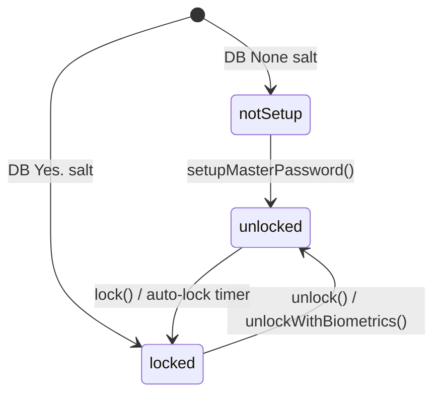
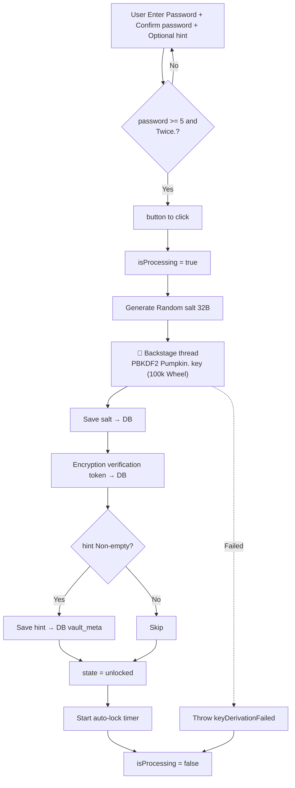
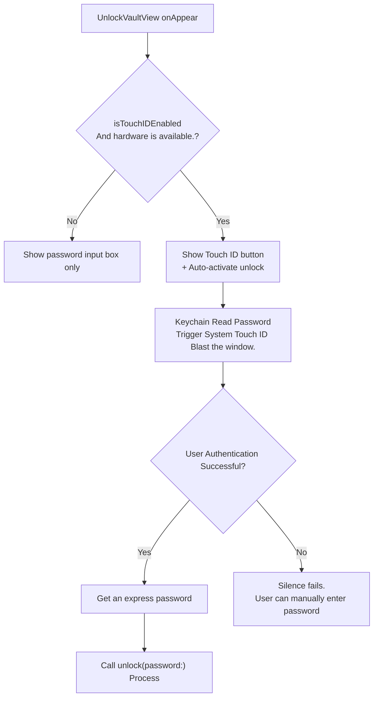
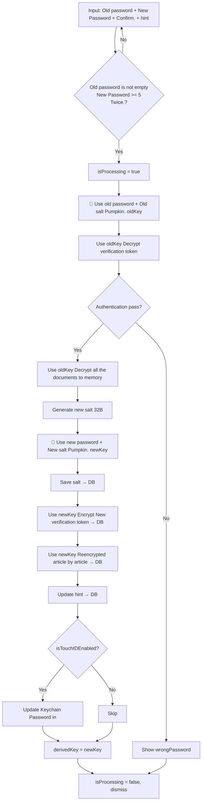
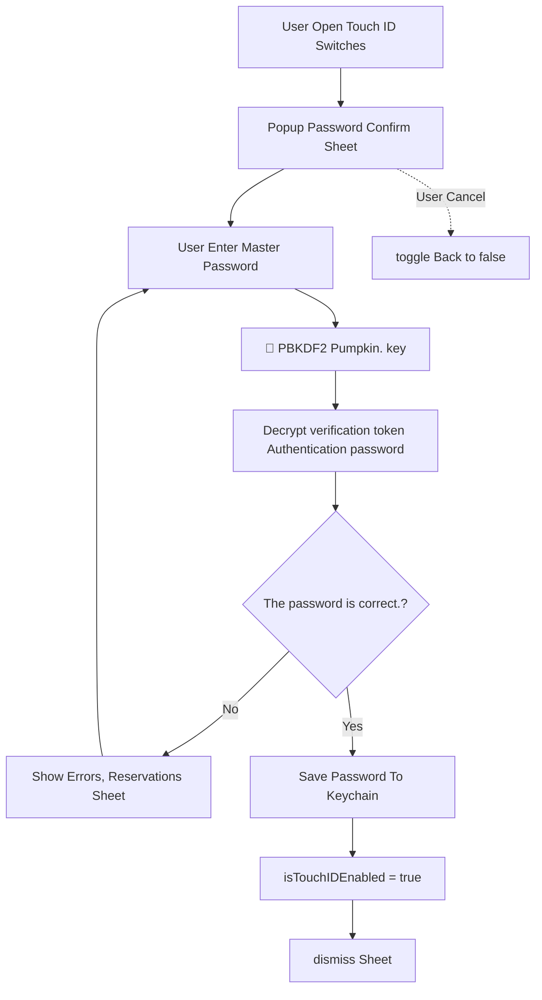
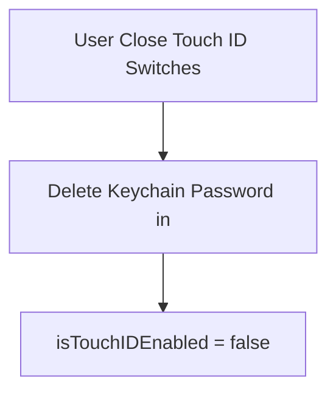
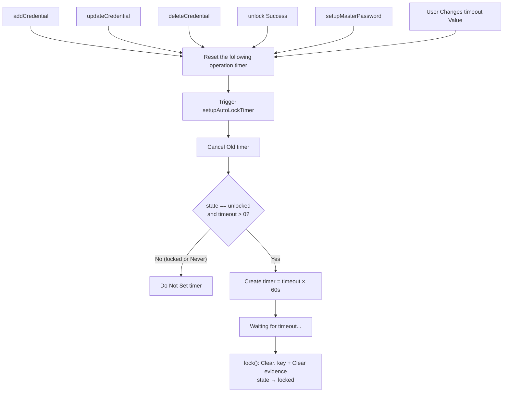
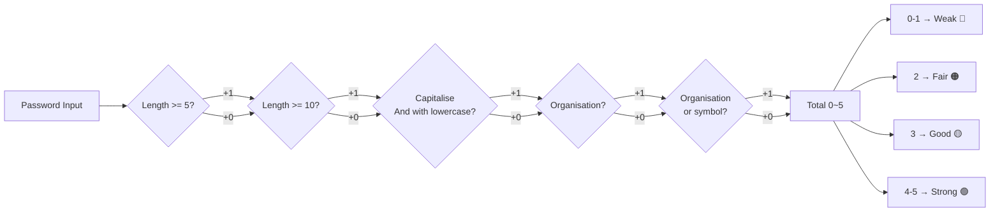

# Password Vault Flow Diagrams

Password Vault module.

Documents:
- `Actrium/Settings/Security/VaultManager.swift` — Core status machine, encryption,Keychain, auto-lock, hint Storage
- `Actrium/Settings/Security/SetupMasterPasswordView.swift` — First setting password UI
- `Actrium/Settings/Security/UnlockVaultView.swift` — Unlock UI(Show) hint)
- `Actrium/Settings/Security/PasswordField.swift` — Reversible password input component + PasswordStrength enum
- `Actrium/Settings/PasswordSettingsView.swift` — Unlocked management page (substance list,Security section(Class change)

---

## 1. Vault State Machine

Tri-state limited-state machine, durable. DB Existence in `salt` Record.



| State | Meaning | UI |
|-------|------|-----|
| `notSetup` | Never set master password | SetupMasterPasswordView |
| `locked` | Set up, password required | UnlockVaultView |
| `unlocked` | Unlocked, operational evidence | UnlockedVaultView |

---

## 2. Setup Master Password

Sets the main password for the first time. Creates salt- It's a birth-coded code. key, store the authentication badge, and enter an optional password hint.

**Note:** Bio-identification (BIO)Touch IDI'm not here. Setup Phase setup to unlock and be in Security section Independent management.



**Key design decisions:**
- PBKDF2 Pass. `Task.detached` Run backstage lines to avoid jamming. UI
- Touch ID Not anymore. setup Phase Settings, after Unlock Security section Independent administration
- Password Hint (Phone)hint) Optionally to fill in DB `vault_meta` Table

---

## 3. Unlock with Password

Password unlocking process. DB Read salt- What? key, verify if the decryption is correct verification token.

If it's set up, password hint, unlocking the page will show a hint to help the user remember the password.

```mermaid
flowchart TD
    A[User Enter Password] --> B{Password is not empty?}
    B -- No --> A
    B -- Yes --> C[isProcessing = true]
    C --> D[From DB Read salt]
    D --> E{salt Existence?}
    E -- No --> F[Throw notSetup]
    E -- Yes --> G["🔄 Backstage. PBKDF2 Pumpkin. key"]
    G --> H[From DB Read verification_hash]
    H --> I[- With a birth. key Decrypt token]
    I --> J{Decrypt Results ==<br/>vault-verification-token?}
    J -- No --> K[derivedKey = nil]
    K --> L[Show Incorrect password]
    J -- Yes --> M[state = unlocked]
    M --> N[Load and decrypt all the documents]
    N --> O[Start auto-lock timer]
    O --> P[isProcessing = false]
    L --> P

    style A fill:#e8f4fd
    note right of A: Page Display hint Tips (if any)
```

---

## 4. Unlock with Biometrics (Touch ID)

Touch ID Unlock is the shortcut to unlock from the password: Keychain Checkout Password → Take the normal password to unlock.



**Design decision-making:** Automatically unlocks without a bug hint to avoid interfering with the user's manual input.

---

## 5. Change Master Password

Modifying the master password requires: Verifying the old password → Decrypt all the evidence. → Generate new salt/key → Reencrypt all the documents. You can also change the password hint.



**Note:** The change of the password involves two times. PBKDF2 Derivative (old) key + New keyIt's a long time,loading The state of affairs is particularly important.

---

## 6. Security Section (Unlocked View)

After unlocking footer Area to structured Security section:

```
┌─ Security ────────────────────────────┐
│  Auto-lock:      [Never ▾]            │
│  Touch ID:       [Toggle] (Hardware required)  │
│  Password hint:  xxxxxxx  [Edit]      │
│  [Change Password...]                 │
└───────────────────────────────────────┘
```

- **Auto-lock**: Select auto-lock time (%1)Never / 1 / 5 / 10 / 15 min)
- **Touch ID**: Open with password confirmation (%1)TouchIDPasswordSheet) Closes and deletes directly Keychain
- **Password hint**: Unlocked to directly edit (inline) TextField) , no password to confirm
- **Change Password**: Open Change Password Sheet, and can be modified at the same time hint

---

## 7. Enable Touch ID (Post-Setup)

Unlocked to open Touch ID, the master password must be verified before the password can be stored Keychain.



**Security considerations:** Not a direct binding. toggle Present. `vault.isTouchIDEnabled`I'm using it. `@State` Intermediate variable + `onChange` + Sheet Confirm process.

---

## 8. Disable Touch ID

Close Touch ID No password authentication required, just delete Keychain entry.



---

## 9. Auto-Lock Timer

Automatic lock timer, reset after multiple operations.`timeout = 0` Organisation Never.



**Timeout Options:** `Never (0)` / `1 min` / `5 min` / `10 min` / `15 min`Default 5 min.

---

## 10. Password Strength Evaluation

Validity of passwords, in real time, for use Setup and Change Password page.



| Score | Level | Colours | Shows the number of bright start points |
|------|------|------|--------------|
| 0-1 | Weak | Red | 1/4 |
| 2 | Fair | Orange | 2/4 |
| 3 | Good | Yellow | 3/4 |
| 4-5 | Strong | Green | 4/4 |

---

## 11. Reusable PasswordField Component

`PasswordField.swift` Provide reusable password input areas, using each scene:

| scene | showStrength | showConfirm | placeholder |
|------|-------------|-------------|-------------|
| Setup | true | true | "Master password" |
| Unlock | false | false | "Master password" |
| Change (current) | false | false | "Current password" |
| Change (new) | true | true | "New password" |
| Touch ID confirm | false | false | "Master password" |

---

## Crypto Summary

| Component | Algorithm/Parameters |
|------|----------|
| Key Derivation | PBKDF2-HMAC-SHA256, 100,000 iterations, 32B salt |
| Encryption | AES-256-GCM (CryptoKit) |
| Key Storage | macOS Keychain (Touch ID protected) |
| Verification | Encrypt Fixed String `"vault-verification-token"` Validate as password |
