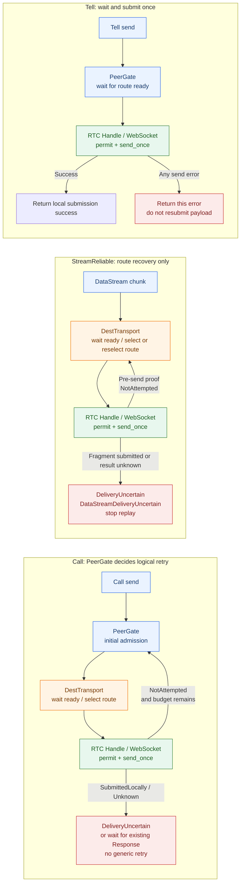

# RFC-0507: Framework-Owned Outbound Readiness Waiting and Safe Retry

- Status: Proposed
- Date: 2026-08-31
- Baseline: `Actrium/actrium/main@e2ec26d7de6042fa432fef27b5cf2f460a2200c0`
- RFC PR: [Actrium/actrium#241](https://github.com/Actrium/actrium/pull/241) (historical [Actrium/actr#509](https://github.com/Actrium/actr/pull/509))
- Tracking issue: [Actrium/actrium#32](https://github.com/Actrium/actrium/issues/32) (historical [Actrium/actr#507](https://github.com/Actrium/actr/issues/507))
- Related: [RFC-0504 / #505](https://github.com/Actrium/actr/pull/505),
  [#492](https://github.com/Actrium/actr/issues/492),
  [#498](https://github.com/Actrium/actr/issues/498),
  [#503](https://github.com/Actrium/actr/issues/503),
  [#582](https://github.com/Actrium/actr/pull/582),
  RFC-0323, RFC-0419.
- Monorepo migration: [#187](https://github.com/Actrium/actrium/pull/187),
  [#189](https://github.com/Actrium/actrium/pull/189),
  [#190](https://github.com/Actrium/actrium/pull/190),
  [#191](https://github.com/Actrium/actrium/pull/191),
  [#192](https://github.com/Actrium/actrium/pull/192),
  [umbrella issue #32](https://github.com/Actrium/actrium/issues/32), and
  [migration record #185](https://github.com/Actrium/actrium/issues/185)

## Summary

When a send encounters `ConnectionNotReady`, application code currently has to
save the message, subscribe to a WebRTC Hook, wait for the connection to
recover, and create another send operation. This flow is vulnerable to missed
or delayed Hook notifications and can also stack with retry in the SDK or
transport layer.

This RFC solves one problem: move **pre-send readiness waiting and safe retry**
into the Actr framework. The scope covers:

- `Dest::Peer`;
- `RpcReliable` Call/Tell;
- `StreamReliable` DataStream chunks.

At API entry, the framework creates one absolute deadline and waits for an
actually usable WebRTC or WebSocket route. It rechecks the route and generation
before sending. Call may logically retry a failure proven to have happened
before submission; `StreamReliable` retains its existing transport-level route
waiting/reselection capability but does not add another payload retry layer;
Tell waits for readiness and performs one payload submission by default.

This RFC does not provide exactly-once delivery and does not transparently
replay a DataStream that may already have entered the transport. A mid-stream
DataStream disconnect continues to be reported through the existing
`DataStreamDeliveryUncertain` observation path.

## Problem definition

### Current behavior

The current usage guide requires application code to implement this flow:

```text
call / sendDataStream
  -> ConnectionNotReady
  -> save pendingRetry
  -> wait for on_webrtc_connected or a fallback timer
  -> create another send operation
```

This flow has several problems:

1. A Hook is an edge notification, not a linearizable send permit;
2. the connection can enter recovery again between `Connected` and the actual
   send;
3. WebSocket may already be usable while WebRTC is not ready;
4. `PeerGate`, `DestTransport`, the SDK, and application code may retry the same
   operation;
5. application code cannot tell whether a failure happened before or during
   submission.

### Current implementation gaps

- `PeerGate::preflight_send` directly returns `ConnectionNotReady` during
  recovery;
- `PeerGate` still retries according to `NetworkError::is_retryable()`;
- `DestTransport` may resend the same payload after a closed-like lane error;
- the RTC layer already distinguishes `ConnectionNotReady`, buffer full, and
  `DataChunkDeliveryUncertain`, but the transport adapter may collapse them
  back into a generic error;
- the mapping from `Unknown` to an upper-layer error has no unified contract;
  if it is mapped to retryable `Unavailable` or `ConnectionNotReady`, the upper
  layer may resend incorrectly;
- a timeout may not cover all of preflight, lane creation, and Response wait.

These gaps concern waiting ownership, retry safety, and the deadline contract;
they do not require a second RTC state machine.

### Existing `StreamReliable` retry layers

The phrase "retry existed previously" refers to two different behaviors:

- In the payload-level `PayloadTypeExt::retry_policy`, `StreamReliable` was
  originally configured with `max_attempts = 1`, meaning it had no independent
  business payload retry;
- `DestTransport::send_with_identity` would select a route/lane again when no
  ready route existed, a lane became invalid, or the ready set changed, and
  would wait for the next send opportunity. This is route-level recovery, and
  DataStream relies on it to recover across WebRTC/WebSocket changes.

RFC-0507 retains the second capability but requires it to use
`DeliveryProgress`: route/lane reselection is allowed only when no fragment or
byte has been submitted. Once progress is `Unknown`, recovery must stop and
return an uncertain-delivery result. RFC-0507 does not add another
`StreamReliable` payload retry loop.

## Goals

### Goals of this RFC

1. Ordinary `RpcReliable` Call/Tell no longer requires application code to
   catch `ConnectionNotReady`, subscribe to a Hook, or save `pendingRetry`.
2. `StreamReliable` DataStream chunks likewise wait for an actually usable
   route before sending.
3. Each operation uses one absolute deadline from API entry.
4. Waiting considers WebRTC, WebSocket, secure state, and lane capability.
5. Call may logically retry a pre-send stale failure; `StreamReliable` retains
   only its existing route-level recovery and must prove `NotAttempted`; Tell
   performs one payload submission; no failure after sending starts is
   transparently replayed.
6. An operation that may have been submitted is converted to an explicit
   `DeliveryUncertain` result and is never downgraded to a retryable generic
   error.
7. Hooks are used only for UI, logging, and metrics, not for send correctness.
8. Internal waiting has small global, per-peer, and per-class hard limits and
   has cancellation and reclamation paths.
9. Existing Call, Tell, and DataStream public method signatures and wire format
   remain unchanged.

### Extensions outside this RFC

The following capabilities may be designed and implemented independently, but
are not completion conditions for this RFC:

- independent strategies for `RpcSignal`, `StreamLatencyFirst`, and Media;
- a unified delivery-progress API for Host/Workload;
- a revisioned `ReadinessRegistry`;
- weighted scheduling, retry tokens, and gradual draining;
- public structured `Backpressure` and stage-specific deadline errors;
- explicit deduplicated replay.

## Non-goals

- General exactly-once delivery;
- automatically determining whether database, payment, or device-control
  operations are idempotent;
- adding remote ACKs, checkpoints, resume, or a new sequence protocol to
  DataStream;
- an unlimited or persistent offline queue;
- placing business payloads in the RTC Controller mailbox;
- changing the ICE, DTLS, SCTP, or WebSocket wire protocol;
- changing handler dispatch-slot semantics through implicit spawn, reentrancy,
  or readiness waiting;
- migrating every language binding's public error model in one change.

## Terminology

### Logical operation

A single Call, Tell, or DataStream chunk. It is held by the caller's future
and contains:

- operation ID;
- target peer;
- payload type;
- absolute deadline;
- cancellation state;
- current delivery progress.

### Delivery progress

```rust
enum DeliveryProgress {
    /// The underlying send was not called, or zero accepted bytes/fragments
    /// were proven.
    NotAttempted,
    /// The complete message was accepted by the local transport.
    SubmittedLocally,
    /// The message may have been submitted, but the local result is unknown.
    Unknown,
}
```

`SubmittedLocally` and `Unknown` are not generic safe-retry conditions.

`Unknown` is an internal delivery-progress state, not an error name that can
be exposed directly to callers. At the operation boundary it must become an
explicit uncertain-delivery result:

- synchronous Call/Tell send paths return
  `ActrError::DeliveryUncertain { operation_id, cause }`;
- the synchronous `StreamReliable` path returns the same error; if the
  disconnect is discovered only after the send future has completed, the
  existing `DataStreamDeliveryUncertain` Hook is also emitted;
- `DeliveryUncertain.is_retryable` must be `false`;
- `Unknown` must not be mapped to `ConnectionNotReady`, `TimedOut`, or ordinary
  `Unavailable`, because those errors may be misinterpreted as retryable.

### Readiness state

```rust
enum ReadinessDecision {
    Ready,
    Waitable,
    Terminal,
}
```

- `Ready`: at least one candidate route can proceed to lane/permit validation;
- `Waitable`: a connection is being established or recovered, secure state is
  changing, or a lane is being provisioned;
- `Terminal`: the target is closing, no candidate route can recover, or the
  payload is unsupported.

Application code does not determine "still recovering" from a Hook. Before
each send, the framework reads the latest authoritative state and recalculates
this three-way result:

| Authoritative fact | Meaning | Send decision |
| --- | --- | --- |
| `RtcPeerSnapshot.status=Recovering` and `sendable=false` | RTC is recovering | `Waitable` |
| `status=Connecting` with an allowed connection flight | Initial/replacement connection is being established | `Waitable` |
| RTC `sendable=true` and the specific lane is usable | RTC route can be attempted | `Ready` |
| RTC is unavailable but a payload-capable WebSocket is ready | Fallback route is usable | `Ready`; do not wait for RTC |
| Secure state is `Handshaking`/`Rekeying` while the wire remains alive | Security layer is temporarily not sendable | `Waitable` |
| `Idle` and not closing | No current session, but lazy dialing is allowed | Allow a new flight; not a terminal failure |
| Closing, secure `Closed`/`Failed`, no live candidate, or unsupported payload | This operation cannot recover | `Terminal` |

`SendProjection` is a global gate: `Blocked` means new sends are currently
forbidden, and whether it is waitable depends on the reason (temporary offline
may recover, while teardown/closing is terminal). `ExistingOnly` permits only
an existing route; `Normal` permits creating a new route.

`on_webrtc_disconnected(status=Recovering)` is an observation notification,
not a send permit. Hooks may be missed, delayed, or reordered. The actual
wait/send decision comes from the snapshot, route-ready state, and the final
permit check immediately before sending.

### Safe retry

For an operation that enables safe retry, all of the following must hold:

```text
progress == NotAttempted
AND the error is recoverable before submission
AND the deadline has not expired
AND the operation is not cancelled
AND the current retry budget permits it
```

`Transient` or `is_retryable()` describes only a failure domain; neither alone
proves that retry is safe. Tell does not enable this safe-retry policy: its
payload retry budget is zero, although it still uses an independent send
deadline to wait for the first submission. `StreamReliable` route-level
recovery may reselect a route/lane only while progress is `NotAttempted`; that
does not permit replaying an uncertain chunk.

## Design constraints

### Reuse authoritative state

This RFC directly reuses the following existing components:

| Component | Use |
| --- | --- |
| `RtcPeerSnapshot` | RTC peer sendability, status, and generation facts |
| `RtcPeerControllerHandle` | RTC lanes, `SendPermit`, and the final pre-send check |
| `WirePool::watch_ready()` | WebRTC/WebSocket ready-set wakeup hint |
| `SendProjection` | Global recovery/teardown policy wakeup hint |
| `RpcDeadline` | Monotonic clock and absolute deadline |
| `DataStreamDeliveryUncertain` | Existing application observation path after a DataStream disconnect |

These watches/broadcasts only wake an operation. After every wake, the
operation must reread the latest authoritative state; absence of an event is
not evidence that state is unchanged.

This RFC does not add a second RTC phase, a `recovering_peers` mirror, or a
global readiness registry.

### Readiness waiting

Add a crate-private helper conceptually equivalent to:

```rust
async fn wait_until_route_ready(
    target: &ActrId,
    payload_type: PayloadType,
    deadline: &RpcDeadline,
) -> ActorResult<()>;
```

Execution rules:

1. Read the latest `SendProjection`;
2. determine whether the target is closing or terminal;
3. determine whether WebSocket can carry the payload;
4. determine whether the RTC snapshot is sendable;
5. if the lane is lazy-created, charge lane provisioning to the same deadline;
6. if the state is `Waitable`, wait for a snapshot, ready-set, or projection
   change;
7. after each wake, return to step 1;
8. immediately before `DataLane::send`, run the final check in the concrete
   route implementation.

Waiting must support cancellation and the operation deadline. It must not use
a second fixed full timeout.

### Call/Tell operation boundaries

#### Call

Call follows this sequence:

```text
API entry
  -> create RpcDeadline
  -> wait_until_route_ready
  -> register pending Response
  -> send_once
  -> safe retry only for NotAttempted
  -> wait for the existing RPC Response
```

The pending entry must retain the operation/request ID and minimal delivery
progress. A missing Response or an expired deadline alone does not prove that
the transport is unhealthy and must not close a healthy route.

If the route generation is invalidated after the Call has been marked
`SubmittedLocally`, the pending Call is completed with
`ActrError::DeliveryUncertain`. The response may still arrive at the remote
peer, so the framework does not replay the Call or convert this result into a
retryable timeout. A caller that has an idempotency policy may start a new
logical Call with a new operation ID.

#### Tell

Tell uses the existing send budget, which covers readiness waiting and one
submission, and does not wait for a Response:

```text
API entry
  -> create Tell send deadline
  -> wait_until_route_ready
  -> send_once
  -> return the local submission result
```

Tell does not automatically retry its payload. `RpcReliable` describes the
underlying lane capability; it does not mean that a Tell has remote idempotency
or a safe replay contract. If a Tell operation needs reliable processing, use a
Call/ACK flow or an application idempotency protocol. The final route/permit
check is still required before sending; a failed check returns this operation's
result and does not submit the same payload again.

Here, framework ownership means that the framework waits for readiness during
normal recovery; an actual error from the one submission may still be returned
to the caller.

### DataStream operation boundaries

This RFC includes `StreamReliable` DataStream but not `StreamLatencyFirst`.

#### StreamReliable

Each DataStream chunk is an independent logical operation:

- wait for a WebRTC/WebSocket route before sending;
- use the existing DataChunk send budget;
- retain the existing `stream_id` and `sequence`;
- preserve existing chunk ordering semantics; this RFC does not add an ordering
  scheduler for concurrent chunks, so callers must continue to control
  concurrency according to existing conventions;
- retain existing route-level recovery: before any fragment is submitted, the
  route/lane may be selected again; this does not add an independent payload
  retry policy;
- do not create a new stream ID or change the sequence;
- do not keep an unlimited payload queue in the framework.

DataStream success means only that the local transport accepted the chunk; it
does not mean that the receiver's business handler processed it.

#### Mid-stream disconnect

If one or more fragments may have entered the DataChannel, or a WebSocket write
cannot prove that zero bytes were submitted, progress must be `Unknown`. At
that point, existing route-level recovery must also stop:

- do not enter generic automatic retry;
- do not resend the same chunk automatically;
- continue to use the existing `DataStreamDeliveryUncertain` event/Hook; its
  error payload should be `DeliveryUncertain` while the event category remains
  compatible;
- let the application decide based on ACK, checksum, an idempotency key, or
  user interaction.

The active DataStream tracker stores only bounded metadata such as `stream_id`,
sequence, session identity, and timestamps. It does not store business
payloads, and it must have TTL, success cleanup, cancellation cleanup, and
session-replacement cleanup.

#### StreamLatencyFirst

`StreamLatencyFirst` remains FailFast/drop. It does not start queueing or
retrying because of the `StreamReliable` Wait rule in this RFC.

### Retry responsibility and route recovery

This RFC assigns the logical retry decision for Call to `PeerGate`.
`StreamReliable` continues to use existing route-level recovery for route/lane
reselection, without adding a separate payload-retry decision layer. Tell is
handled by `PeerGate` for readiness waiting and one submission, but it has no
payload retry.

"Retry responsibility boundary" is not a new public component or a Rust
ownership concept. It answers only which layer may decide whether to try again
after a failure. The logical-operation layer decides whether the same operation
may retry; the route layer finds or invalidates physical connections; the RTC
Handle validates whether the send permit is still valid. None of the layers may
make the other layer's business-payload replay decision.

- `PeerGate` decides whether Call is re-admitted, waits, and consumes retry
  budget; `StreamReliable` may reselect a route/lane only when the concrete
  route implementation proves `NotAttempted`; Tell only decides whether to wait
  for the first route to become ready;
- `DestTransport` owns route-level waiting/reselection, lane acquisition,
  invalidation, and wakeups, but does not decide whether a logical payload is
  replayable;
- `DestTransport` must not unconditionally resend the same payload after one
  lane send returns a failure;
- RTC `SendPermit` remains private to `RtcPeerControllerHandle`;
- the SDK and official examples must not add another default retry layer for
  the same Call, and Tell must not add a default payload retry.

The responsibility boundaries are shown below. "Enter route recovery again"
means only waiting for or selecting a physical route/lane again; whether the
same business payload may be handed to the send path again is decided by the
operation-specific rule.



In short: `PeerGate` decides whether Call tries again; the route layer decides
whether `StreamReliable` can switch routes for the current chunk based on
delivery progress; Tell has no payload retry and only waits for the first
sendable route.

During compatibility migration, the old `DataLane::send` wrapper may remain,
but the new logical-operation path must use an internal adapter that returns
`DeliveryProgress`.

### Send attempt

The concrete route implementation provides a crate-private seam conceptually
equivalent to:

```rust
struct AttemptResult {
    progress: DeliveryProgress,
    route_identity: Option<RouteIdentity>,
}

async fn send_once(
    route: &RouteSelection,
    payload: Bytes,
) -> Result<AttemptResult, AttemptFailure>;
```

The required order is:

1. Select the current WebRTC or WebSocket route;
2. validate the logical transport identity;
3. acquire a lane through the secure gate;
4. acquire and validate `SendPermit` inside the RTC Handle;
5. record the route identity before the first possible submission;
6. immediately before the underlying send, recheck generation, sendability,
   and cancellation;
7. return `NotAttempted`, `SubmittedLocally`, or `Unknown`.

If a ticket, permit, or generation becomes stale before the underlying send,
return `NotAttempted`; do not count it as a sent attempt.

### Route identity

This RFC does not expose the complete physical identity through an
`AdmissionTicket`, nor does it require creating an `AdmissionTicket` immediately.
Pending cleanup and stale-route invalidation must nevertheless be able to
compare the route currently in use with the route used by the operation:

```rust
enum RouteIdentity {
    WebRtc { peer: ActrId, session_id: u64, generation: u64 },
    WebSocket { session_id: u64 },
}
```

RTC `SendPermit`, the WebSocket session, and the secure epoch are still checked
by their respective concrete route implementations. A close event from an old
route must not affect its replacement.

### Simple bounded waiting

Internal waiting must not be an unlimited queue, but this RFC does not implement
a full fair scheduler. The minimum requirements are:

- a global waiter limit;
- a per-peer waiter limit;
- global and per-peer payload-byte limits;
- at least a small independent capacity for `RpcReliable` and
  `StreamReliable`;
- cancellation and reclamation for waiters, pending Calls, active DataStream
  metadata, and timers;
- reuse existing resource-exhausted/unavailable errors when limits are
  exceeded; this RFC does not require adding a public `Backpressure` variant.

Recovery draining must not be implemented by waking every waiter and letting
all of them retry freely. This RFC uses hard limits, a per-operation retry cap,
and the existing ready watch; fair scheduling is a separate RFC.

### Handler dispatch boundary

Readiness waiting decides only whether an outbound operation waits or fails; it
does not change handler dispatch-slot semantics. A direct `await` inside a
handler may still hold the serial dispatch slot. Use RFC-0323 Explicit Reply,
an explicit `spawn`, or an independent concurrency design when the slot must be
released.

#### Conclusion

Any long-running operation directly awaited inside a handler occupies the
current actor's serial dispatch slot, including:

- `call`;
- `tell`;
- HTTP/RPC requests;
- database, file, and other external I/O.

This is actor-scheduler blocking, not blocking a Tokio worker thread: the async
future yields the thread, but subsequent messages for the same actor cannot
obtain the serial dispatch slot until the future completes, times out, is
cancelled, or is explicitly transferred. Outbound readiness waiting does not
release that slot and is not a handler concurrency mechanism.

To let subsequent messages continue dispatching, the implementation must use
RFC-0323 Explicit Reply, `spawn`, or an independent concurrency executor.
RFC-0507 does not change this conclusion through implicit spawn, reentrancy, or
a policy guessed from `caller_id`.

#### Default wait policy

The framework-owned Wait behavior is intentionally bounded, but it is not a
new dispatch scheduler:

- for ordinary `RpcReliable` and `StreamReliable` calls, readiness waiting is
  enabled by default and is charged to the caller's one absolute deadline;
- the waiter and payload-byte caps are admission limits, not an offline queue;
- a direct `await` from a serial handler keeps the existing serial dispatch slot
  until the operation succeeds, fails, times out, or is cancelled;
- callers that must keep the slot free must use RFC-0323 Explicit Reply,
  explicit `spawn`, or another declared concurrent dispatch mode;
- legacy FailFast entry points may still return `ConnectionNotReady` and are
  not silently converted to Wait.

This is a deliberate compatibility rule: RFC-0507 owns outbound readiness and
safe retry, while handler lifetime and actor scheduling remain unchanged. A
separate deferred-operation RFC is required for an operation that outlives its
handler without occupying that handler's dispatch slot.

## External semantics

This RFC adds no readiness parameter and does not change the public signatures
of Call, Tell, or `send_data_chunk`.

### Result mapping

| Situation | Result under this RFC |
| --- | --- |
| Route recovers while waiting and send succeeds | Existing success result |
| No submission before the deadline | Existing `TimedOut` or terminal `ConnectionNotReady` |
| A pre-send stale state is re-admitted successfully | Existing success result; the application sees one operation |
| Tell/DataStream is accepted by the local transport | Existing success result; local submission only |
| Tell fails before sending (`NotAttempted`) | Return this send error; do not submit again; see [PR-0507-4](#pr-0507-4-rpcreliable-and-streamreliable-readiness-waiting) |
| Call/Tell send progress is `Unknown` | `ActrError::DeliveryUncertain`; no generic retry |
| DataStream send progress is `Unknown` | `ActrError::DeliveryUncertain` plus the existing `DataStreamDeliveryUncertain` observation path |
| Call was sent but no Response arrived | `ActrError::DeliveryUncertain`; no generic replay |
| Explicit FailFast or a legacy API | May continue to return `ConnectionNotReady` |

The framework-owned path provides no recovery countdown to application code and
does not require an application fallback timer. `ConnectionNotReady` means only
that this operation did not enter the send flow; whether to keep waiting is
decided by the framework from current route state and the operation deadline.

### Hook semantics

- `on_webrtc_connecting/connected/disconnected`: observe connection state;
- `on_error(DataStreamDeliveryUncertain)`: observe uncertain DataStream
  delivery;
- missed, duplicated, reordered, or delayed Hooks must not change send
  correctness;
- ordinary Call/Tell/StreamReliable does not require application Hook
  subscription to recover.

## PR breakdown

The following PRs can be reviewed and reverted independently. A later PR must
not include extensions that are undefined by the earlier PR.

```text
PR-0507-1  deadline baseline
      └── PR-0507-2  delivery progress and route send seam
      └── PR-0507-3  route recovery / retry boundary / stale lane
PR-0507-1 + PR-0507-3
      └── PR-0507-4  RpcReliable + StreamReliable readiness wait
                              └── PR-0507-5  simple bounded waiting and cancellation
PR-0507-4/5
      └── PR-0507-6  documentation, examples, and SDK retry cleanup
```

### PR-0507-1: Deadline baseline

**Goal**: fix the core contract tracked by #492.

**Do**:

- create one `RpcDeadline` at API entry;
- make the Peer Call, Tell, and DataStream send budgets cover preflight and
  lane acquisition; Call also covers Response wait, while Tell performs one
  submission;
- remove lower-layer paths that reacquire a full timeout;
- add stage timing and timeout tests.

**Do not**: enable Wait, change default retry, or add a public error.

**Acceptance**: preflight or lane provisioning consumes the user budget;
existing success and error classification is unchanged when there is no
recovery.

### PR-0507-2: Delivery progress and route send seam

**Goal**: allow the framework to determine whether a failure happened before
submission.

**Do**:

- add crate-private `DeliveryProgress` and an internal attempt result;
- preserve the distinction among `ConnectionNotReady`, buffer full, closed,
  and `DataChunkDeliveryUncertain` in the RTC adapter;
- pass progress through `V020DataLane`, the secure wrapper, and the WebSocket
  adapter;
- add an internal send seam to the RTC Handle while keeping `SendPermit`
  private;
- make the DataStream tracker store only bounded activity metadata;
- add the additive, non-exhaustive
  `ActrError::DeliveryUncertain { operation_id, cause }` in crates/actr-protocol and
  guarantee `is_retryable == false`.

**Do not**: change readiness defaults, add `ReplayMode`, `Backpressure`, or
stage-specific deadline errors, or map `Unknown` to an existing retryable
error.

**Acceptance**: partial fragments and ambiguous WebSocket writes produce
`Unknown`; pre-send stale state produces `NotAttempted`; `Unknown` becomes the
non-retryable `DeliveryUncertain`; the wire format is unchanged. The acceptance
tests must include:

- `lane_tests::websocket_interrupted_write_is_unknown_and_not_retryable`, which
  models a sink error after a WebSocket write has started and asserts
  `DeliveryProgress::Unknown`;
- the PeerGate/transport mapping assertion that the same outcome becomes
  `ActrError::DeliveryUncertain` with `is_retryable == false` and exactly one
  physical submission.

### PR-0507-3: Route recovery, retry boundaries, and stale lanes

**Goal**: retain existing `StreamReliable` route recovery, remove
progress-unproven duplicate sends and retry stacking, and make Tell a single
submission.

**Do**:

- centralize Call's logical retry in `PeerGate`; Tell retains only one
  submission;
- retain route-level wait/reselection in `DestTransport`, but remove
  unconditional payload replay after closed-like errors;
- allow `StreamReliable` to reselect a route/lane only when the concrete route
  implementation proves `NotAttempted`; Tell does not retry;
- keep minimal route identity and progress for pending Calls;
- let close events from an old generation/session affect only the same route
  identity.

**Do not**: enable readiness waiting, add deduplicated replay, or change
`StreamLatencyFirst`/Media semantics.

**Acceptance**: `Unknown` is never retried; `StreamReliable` keeps pre-send
route recovery but does not replay a chunk after uncertain delivery; Tell makes
at most one payload submission per logical operation; a missing Response alone
does not close a healthy route; the same logical operation is not retried by
PeerGate, DestTransport, and the SDK at the same time.

### PR-0507-4: RpcReliable and StreamReliable readiness waiting

**Goal**: remove the application-side `ConnectionNotReady` + Hook + timer flow.

**Do**:

- let `RpcReliable` Call/Tell wait for an actual route while state is waitable;
- let Tell wait for a route and call `send_once` only once, even after a
  `NotAttempted` result;
- use the same wait helper for `StreamReliable` DataStream chunks;
- reread the latest snapshot/ready state after every wake;
- run the final route/permit recheck before sending;
- allow an already-ready WebSocket fallback while WebRTC recovers;
- retain the existing strategies for `StreamLatencyFirst`, `RpcSignal`, and
  Media.

**Do not**: create a Registry or Ticket, infer readiness from handler context,
or automatically resume a DataStream.

**Acceptance**: Call, `StreamReliable` DataStream, and Tell recover without an
application Hook; Tell waits during peer recovery and submits once; if the
deadline expires before submission, an explicit existing error is returned;
the application starts one logical operation. The serial-handler regression
case must also pin that a handler awaiting a recovering peer retains its
dispatch slot; no implicit spawn or reentrancy is introduced.

### PR-0507-5: Simple bounded waiting and cancellation

**Goal**: prevent waiting from becoming unbounded memory use or leaking
waiters.

**Do**:

- add global/per-peer waiter and byte limits;
- keep a minimum capacity separation between RPC and `StreamReliable`;
- add RAII cleanup for cancellation, future drop, peer removal, and shutdown;
- add TTL and upper bounds for active DataStream metadata.

**Do not**: implement a weighted scheduler, retry tokens, a Response reserve,
or gradual draining.

**Acceptance**: a failed peer cannot consume another peer's basic waiting
capacity; all waiters, timers, pending Calls, and active DataStream metadata can
be released.

### PR-0507-6: Documentation, examples, and SDK retry cleanup

**Goal**: align user-visible behavior with this RFC.

**Do**:

- remove `pendingRetry`, connected-Hook replay, and fallback-timer examples for
  ordinary Call/Tell/StreamReliable;
- retain the DataStream mid-disconnect `DataStreamDeliveryUncertain`
  explanation;
- state clearly that Hooks are observational only;
- expose `DeliveryUncertain { operationId, cause }` through the UniFFI error
  surface without renumbering existing error discriminants;
- make the Kotlin SDK's default `withRetry` exclude all `ActrException`
  values, including `DeliveryUncertain`, and document that an explicit custom
  predicate is required for an idempotent operation outside the framework;
- add Kotlin and Swift mapping/classification tests that preserve the operation
  ID and cause and prove `DeliveryUncertain` is not retryable;
- update DataStream examples with cancellation, timeout, and uncertain-delivery
  handling.

**Do not**: change the wire protocol or add a readiness parameter.

## Independent RFCs

The following are outside RFC-0507 and are maintained as independent topics:

### Independent RFC-A: Other payload strategies

- short Wait/FailFast for `RpcSignal`;
- drop/backpressure for `StreamLatencyFirst`;
- recovery-period dropping for Media;
- unified operation semantics for Host/Workload.

### Independent RFC-B: Large-scale admission scheduling

- `ReadinessRegistry` and revisions;
- `AdmissionTicket`;
- per-class weighted scheduling;
- retry tokens, Response/Control reserve, and gradual draining;
- systematic handling of wake-all storms and cross-peer/class HOL.

### Independent RFC-C: Explicit replay and extended errors

- `Backpressure` and stage-specific deadline errors;
- additive mappings for WIT/FFI/Swift/Kotlin/Python/TypeScript/C#;
- explicit deduplicated replay;
- durable idempotency keys, inbox/outbox, and cross-restart semantics.

## Correctness invariants

RFC-0507 must satisfy:

1. Every logical operation has one absolute deadline.
2. The deadline starts at API entry and covers waiting, lane provisioning,
   send/retry, and Call's Response wait; Tell's deadline covers waiting and its
   one submission.
3. If a route or permit is stale before the underlying send, progress remains
   `NotAttempted`.
4. A failure that may have entered the transport must never be downgraded to
   `NotAttempted`.
5. Generic automatic retry never retries `SubmittedLocally` or `Unknown`;
   Tell has no default payload retry.
6. Missed, duplicated, or reordered Hooks and ready-watch notifications do not
   affect send correctness.
7. An unavailable WebRTC route must not block a usable WebSocket fallback.
8. A close or generation event from an old route must not clean up its
   replacement route.
9. A missing Response or ordinary operation deadline expiry alone does not
   prove that the route is unhealthy.
10. Every waiter, pending Call, timer, and DataStream metadata entry has a
    cancellation, deadline, or TTL release path.
11. Existing `StreamReliable` route-level recovery can occur only while
    `NotAttempted`, does not change `stream_id`/`sequence`, and does not add a
    remote ACK or resume protocol.
12. Readiness waiting does not change handler dispatch-slot semantics.

## Testing and acceptance

### Unit tests

- `RpcDeadline` decreases from API entry;
- waitable/terminal/readiness decisions;
- RTC snapshot, WebSocket ready-set, and fallback selection;
- final `SendPermit` generation/cancellation validation;
- `NotAttempted`, `SubmittedLocally`, and `Unknown` mappings;
- `Unknown -> DeliveryUncertain` mapping and `is_retryable == false`;
- a WebSocket sink write error after the write starts produces `Unknown`, then
  `DeliveryUncertain`, without a second physical submission;
- stale lanes never unconditionally resend a payload;
- `StreamReliable` recovers when a route/lane fails before sending, but a
  fragment already submitted does not cause the route loop to replay the chunk;
- a partial DataStream fragment produces `Unknown`;
- active DataStream metadata cleanup on success, cancellation, TTL, and
  replacement;
- waiter/byte limits and RAII release.

### Integration tests

- a `RpcReliable` Call waits in Recovering and completes;
- a `RpcReliable` Tell waits within the same send budget and submits once;
- a Tell with a pre-send `NotAttempted` failure is not submitted again;
- a `StreamReliable` DataStream chunk succeeds after recovery;
- sequential DataStream chunks preserve existing `sequence` order;
- a mid-send DataStream disconnect does not replay the same chunk;
- a submitted Call whose Response is suppressed and whose WebRTC generation is
  replaced completes with `DeliveryUncertain`, preserves its operation ID,
  leaves no pending entry, and is not retried;
- WebRTC Recovering plus WebSocket Ready uses WebSocket;
- readiness waiting expires with an existing timeout/not-ready error;
- missed, duplicated, and reordered Hooks do not change these results;
- an old generation close does not affect the replacement route;
- one failed peer cannot exhaust another peer's capacity;
- caller future drop, shutdown, and peer removal do not leak.

The test names used for these two safety-critical cases are
`websocket_interrupted_write_is_unknown_and_not_retryable` and
`submitted_call_without_response_is_delivery_uncertain`. They are merge-gate
tests, not optional diagnostics. The serial-handler acceptance also includes
an `M1 -> recovering peer B` / `M2 -> healthy peer C` case proving that M1's
readiness wait retains the existing serial dispatch-slot behavior; it must not
be implemented by implicit spawn or reentrancy.

### Load tests

RFC-0507 requires only:

- finite single-peer waiter and byte limits;
- minimum capacity separation between RPC and StreamReliable;
- interruption of a large multi-fragment DataStream;
- one-second, six-second, and over-deadline recovery windows;
- no default unlimited payload queue.

1000-waiter gradual draining, global fair scheduling, cross-class HOL, and
adaptive retry rate are not RFC-0507 merge gates.

#### CI gate and timing policy

The merge gate is the Rust `test` job in
`.github/workflows/ci-gate.yml`. Its `realtime` `REALTIME_BINARIES` filter
must continue to include `webrtc_large_mobile_recovery`,
`mobile_network_event_scenarios`, and `mobile_rtc_pair_contract`; the
`retry_core_mechanics` and WebRTC v0.20 unit targets run on the same job's
retry-free `rest` shard. The realtime command is:

```text
cargo nextest run --workspace --all-features --no-fail-fast -E "$REALTIME_BINARIES"
```

The gate policy is:

- every RFC-0507 acceptance test has an explicit operation deadline and must
  resolve before the nextest 60-second slow-test period;
- the one-second and six-second interruption cases assert their operation
  deadline independently of scheduler load; real-time scheduling jitter may
  be at most one second beyond the asserted deadline;
- an over-deadline case must return the existing timeout/not-ready result and
  must not leave a pending Call, waiter, timer, or DataStream metadata entry;
- a test that passes only after a bounded nextest retry is reported as flaky;
  retries cannot turn a persistent RFC-0507 failure into a merge pass;
- a hang, duplicate physical submission, unexpected retryable mapping, or
  payload/resource leak fails the gate even if a later business retry succeeds.

The existing `#[ignore]` stale-transport diagnosis is informative only; the
two safety-critical mapping tests above are active merge gates.

## Observability

RFC-0507 records only the necessary fields:

- operation ID, Call request ID, peer, payload type, and stream ID/sequence;
- readiness-wait duration and remaining deadline;
- attempt count and `DeliveryProgress`;
- route type and a route-identity summary;
- timeout, terminal-not-ready, safe-retry, unknown, and uncertain counts;
- current waiter/byte occupancy and rejection counts.

Logs must not contain business payloads, credentials, tokens, cookies, or
credential-bearing URLs.

Observability acceptance checks are part of the gate:

- every uncertain/safe-retry record carries the exact operation ID (or Call
  request ID), peer, payload type, progress, and route-identity summary;
- the peer value uses the stable `ActrId::to_string_repr()` representation and
  no raw payload is used as a label or message field;
- the static `.github/workflows/scripts/check-payload-logging.sh` guard runs in
  CI and rejects payload-bearing formatting in `crates/actr-hyper` tracing macros;
- redaction fixtures containing marker payloads, credentials, tokens, cookies,
  and credential-bearing URLs assert that none of those markers appear in the
  captured log output.

RFC-0507 does not require a complete readiness revision, feedback ACK, or
high-cardinality peer metric implementation.

## Compatibility and migration

- Do not change the public signatures of Call, Tell, or `send_data_chunk`;
- do not change the wire format;
- keep `ReadinessMode` and the progress adapter crate-private;
- add the additive, non-exhaustive `DeliveryUncertain` error; it does not
  change method signatures or wire format, and no boundary may map it to a
  retryable `Unavailable` or `TimedOut`;
- `ConnectionNotReady` may continue to serve FailFast, terminal, stale Context,
  and legacy APIs;
- `StreamReliable` success still means only local submission, not remote
  business completion;
- retain the existing low-latency semantics of `StreamLatencyFirst`;
- PR-0507-6 completes the UniFFI Kotlin/Swift mapping and its classification
  tests; the mapping preserves the operation ID and cause and keeps
  `DeliveryUncertain` non-retryable;
- WIT, Python, TypeScript, C#, and other binding-specific mappings remain under
  Independent RFC-C, but an interim fallback must be terminal and must never
  map `DeliveryUncertain` to `Unavailable` or `TimedOut`;
- SDKs may retain retry helpers only for explicit idempotency or operations
  outside the framework's ownership, and their default predicates must not
  retry framework `ActrError` results;
- documentation migration belongs in PR-0507-6 so that old and new official
  examples do not coexist.

## Risks and trade-offs

### Waiting extends future lifetime

This is intentional, but it is bounded by the absolute deadline, cancellation,
and waiter limits. It does not solve handler dispatch-slot occupancy.

### DataStream delivery may remain uncertain

This fact cannot be removed by local transport alone. RFC-0507 does not
transparently replay uncertain delivery, avoiding duplicate chunks, side
effects, and an incorrect exactly-once implication.

### Simple capacity limits may be conservative

RFC-0507 prioritizes finite resources and basic RPC/Stream isolation. If
production metrics prove that more complex fair scheduling is needed,
Independent RFC-B can address it.

### Fallback selection depends on route capability

The wait helper must determine whether the specific payload can use WebSocket;
it must not rely only on the WebRTC Hook state.

## Alternatives

### Keep application Hook + retry

This retains edge races, cross-language differences, and stacked retry layers,
so it is not the default.

### Provide only an SDK retry helper

A helper cannot observe whether the underlying send has started and cannot stop
transport-level duplicate sends. It is only a supplement for explicitly
idempotent business operations.

### Unlimited offline queue

This introduces unbounded memory, stale payloads, cross-peer HOL, and shutdown
complexity, and is rejected.

### Implement the complete Registry/scheduler/replay system at once

That would cover more cases, but would turn a pre-send readiness issue into a
full cross-payload, cross-language, and cross-route rewrite. RFC-0507 does not
take this approach.

## Open questions

These questions do not block RFC-0507, but must be resolved before the related
PRs merge:

1. Initial global and per-peer waiter/byte hard limits;
2. whether `StreamReliable` keeps the existing send-budget constant;
3. TTL and maximum entry count for active DataStream metadata;
4. whether `RpcSignal` is always FailFast;
5. the scope and sequencing of Independent RFC-C mappings for WIT, Python,
   TypeScript, C#, and any remaining binding-specific error surfaces.

## Definition of done

RFC-0507 is complete when:

1. Users calling ordinary `RpcReliable` Call/Tell or `StreamReliable` DataStream
   do not need to catch `ConnectionNotReady`, subscribe to a WebRTC Hook, or
   save `pendingRetry`;
2. connection-recovery waiting and timeout are handled by the framework within
   one operation deadline; Call uses logical pre-send safe retry,
   `StreamReliable` retains pre-send route-level recovery, and Tell submits only
   once;
3. uncertain DataStream delivery is not transparently replayed and remains
   available through the existing observation path;
4. every `Unknown` result becomes a non-retryable `DeliveryUncertain` rather
   than `ConnectionNotReady`, `TimedOut`, or `Unavailable`;
5. failed peers, cancellation, shutdown, and Hook failures do not leak waiters,
   pending requests, or active DataStream metadata;
6. official documentation and examples no longer require Hook-driven retry for
   ordinary sends;
7. WebSocket partial-write and submitted-Call/no-Response acceptance tests are
   active in the Rust CI Gate (the realtime shard for integration tests and the
   retry-free rest shard for unit tests);
8. UniFFI SDK mappings preserve `DeliveryUncertain` fields and no default SDK
   retry helper replays it.
